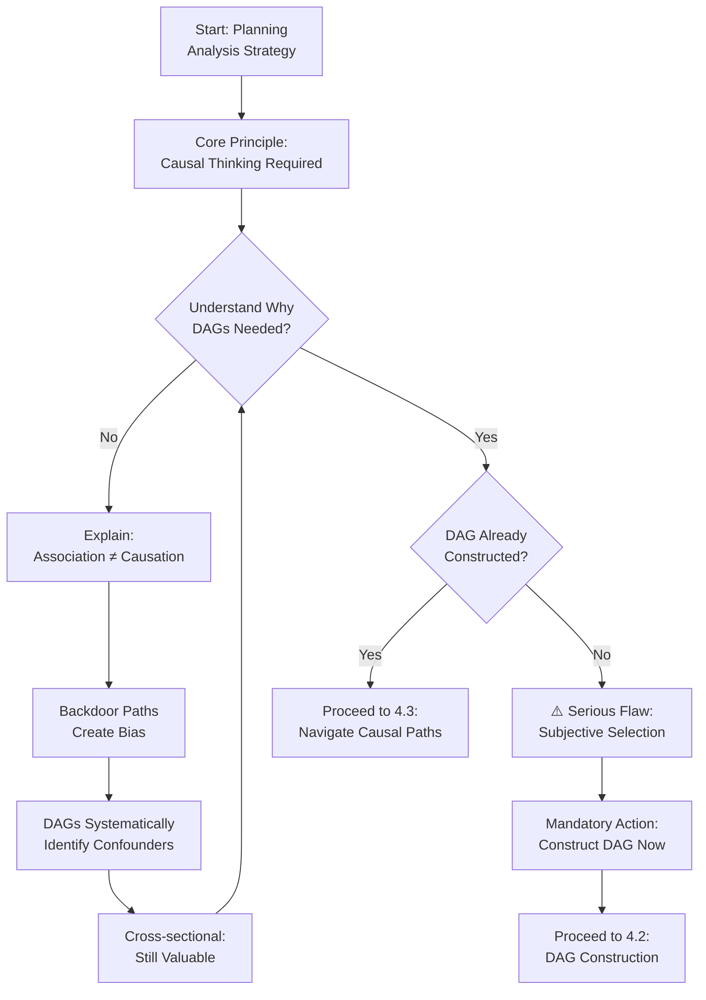
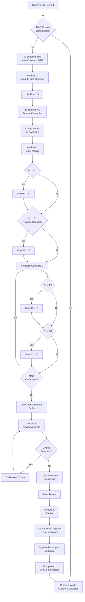
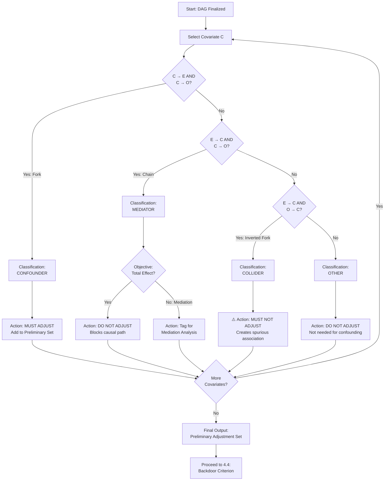
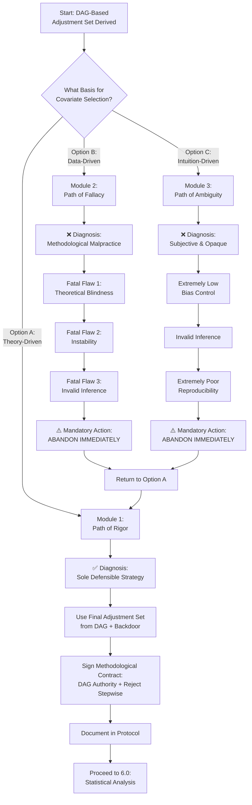

# Cross-sectional study decision tree

> This file is the core design reference. Search the numbered heading that matches the current decision, then teach the user the problem, options, trade-offs, and downstream consequences before recording a public rationale.


---

## 1_question_formulation/1.1_framework_choice.md

# 1.1 Objective-Level Framework Routing | 目标级框架路由

**STROBE Items**: 2, 3
**Decision Tree Level**: Phase 1, Module 1


## Core decision

Do not ask the entire study to select one framework. First split the narrative into candidate objectives, assign a family to each objective, and then route every objective independently.

**Question**: What inferential task does each candidate objective perform?

## Objective routes

### Prevalence or distribution

Use **CoCoPop** when an objective estimates burden, prevalence, distribution, a mean, or a percentile in a defined population.

Route to `1.3_cocopop_specification.md`.

This route locks:

- the target parameter and denominator
- population and context definitions
- representativeness and probability-sampling requirements
- precision-oriented sample-size logic when this is primary
- a descriptive, non-causal claim boundary

### Association

Use **PECO** when an objective estimates an exposure-outcome association or a between-group contrast.

Route to `1.2_peco_specification.md`.

This route locks:

- objective-specific population, exposure, comparison, and outcome
- effect measure and analysis family
- variable-role adjudication and DAG-informed adjustment
- prohibition of significance-driven covariate selection
- a cross-sectional association, non-temporal claim boundary

### Prediction

Use the intake and release checks in [protocol_standard.md](protocol_standard.md)
when the objective concerns classification, screening, discrimination, or prediction.

Keep prediction separate from etiologic association. Predictors do not automatically become causal factors.

### Mechanism-exploratory

Retain only as hypothesis-generating. Do not allow a mechanism-exploratory objective to determine the primary confounder adjustment set.

### Policy relevance only

Use as motivation or discussion context unless the design supports an explicit policy estimand.

## Multi-objective studies

A cross-sectional protocol may contain multiple routes at once. For example:

```text
OBJ1: prevalence/distribution -> CoCoPop
OBJ2: cognition-BMD association -> PECO
OBJ3: lifestyle-BMD association -> PECO
```

Each route must have its own `objective_id`, estimand, sample-size role, analysis commitments, output shells, and interpretation boundary. Shared population or measurement definitions may be reused only when they are genuinely identical.

## Public decision trace

Show only:

```text
Recognized objectives: <short list>
Proposed routes: <objective_id -> framework>
Why these routes apply: <concise methodological basis>
Decision required: <primary/secondary priority and any unresolved family>
Downstream impact: <estimands, sample size, DAG, sampling, reporting>
```

Do not output hidden reasoning or private reasoning.

## Completion criteria

Before leaving this node:

- every candidate objective has a unique `objective_id`
- every retained objective has one objective family and framework
- prevalence and association objectives are not collapsed together
- one primary objective or a justified co-primary structure is confirmed
- every objective has a claim boundary
- policy-only ideas are deferred unless supported by the design

Then continue to the applicable CoCoPop, PECO, prediction, or exploratory nodes and to population-trinity specification.

---

## 1_question_formulation/1.2_peco_specification.md

# 1.2 PECO Framework Specification
# 1.2 PECO框架规范化

**STROBE Items**: 2, 3, 6a, 7
**Decision Tree Level**: Phase 1, Subtree 1.1.A
**Prerequisites**: PECO framework selected in 1.1

---

## Overview | 概述

**Purpose**: Systematically deconstruct a vague research idea through the four pillars of PECO (Population, Exposure, Comparison, Outcome), ultimately forming a clear, specific, and scientifically testable research question.

**目的**: 通过PECO四大支柱(人群、暴露、对照、结局)系统性地解构模糊的研究想法,最终形成清晰、具体、科学可检验的研究问题。

**Core Principle**: Each component must be **operationally defined** (measurable, reproducible) and **validated** (reliable measurement).

**核心原则**: 每个组成部分必须**操作性定义**(可测量、可重复)并**验证**(可靠测量)。

---

## Starting Point | 起始点

**Context**: You have selected the PECO framework in Phase 1.1 because your core objective is **association analysis** or **between-group comparison**.

**当前状态**: 你在第1.1阶段选择了PECO框架,因为你的核心目标是**关联分析**或**组间比较**。

**Example of Preliminary Idea**:
- "I want to examine whether, among older adults, drinking sugar-sweetened beverages is related to diabetes."
- "我想研究老年人中,饮用含糖饮料是否与糖尿病相关。"

**Goal**: Transform this vague idea into a structured PECO question with operational definitions.

---

## Public Decision Trace | 公开决策轨迹

Read the public decision-trace rules in [protocol_standard.md](protocol_standard.md).
Do not output hidden reasoning. For the current PECO component, show only:

```text
Recognized information: what the user already stated about P, E, C, or O
Current node: the one PECO component requiring confirmation
Why it matters: the bias, estimand, or interpretation consequence
Options: two or three defensible operational definitions when alternatives exist
Recommendation: a concise recommendation or "insufficient information"
Downstream impact: measurement, DAG, sample size, model, or reporting fields affected
User confirmation: confirmed, revised, deferred, or blocked
```

Ask one material question per turn and write the confirmed answer to the guided decision trace.

---

## Module 1: Specification of P (Population) | 人群规范化

### **Starting Point**:
User has provided a preliminary population description (e.g., "older adults").

### **Diagnosis**:
A broad population definition is fertile ground for **selection bias** and will severely limit the **interpretability** and **generalizability** (external validity) of study conclusions.

**诊断**: 宽泛的人群定义容易产生**选择偏倚**,严重限制研究结论的**可解释性**和**推广性**(外部效度)。

---

### **1.1.A.1 Initial Question**

**Question**: Who is the core population you intend to study?

**问题**: 你打算研究的核心人群是谁?

**Example User Answer**: "Older adults"

---

---

### **1.1.A.2 Distinguishing Target vs Source Population**

**Question (a)**: Who is the **broadest population** to whom you wish to generalize your findings (**target population**)?

**问题(a)**: 你希望将研究结果推广到的**最广泛人群**(目标人群)是谁?

**Example Decision**: "All adults aged 65 years or older in China"

---

**Question (b)**: Who is the **specific population** you can access operationally, from which a sample will be drawn (**source population**)?

**问题(b)**: 你实际可以接触到的、将从中抽样的**具体人群**(源人群)是谁?

**Example Decision**: "All residents aged 65 years or older recorded in the electronic health records of a community health service center in Beijing"

---

**Rationale Check** | 理由检查:

Clarifying this distinction is a **key early diagnostic step for "external validity"**. Any systematic differences between the source and target populations (e.g., urban-rural differences, socioeconomic differences) will directly determine the generalizability of study conclusions.

阐明这一区别是**"外部效度"的关键早期诊断步骤**。源人群与目标人群之间的任何系统性差异(如城乡差异、社会经济差异)将直接决定研究结论的推广性。

---

### **1.1.A.3 Setting Precise Inclusion/Exclusion Criteria**

**Question (a)**: **Demographic criteria** - Is there a clearly defined age range? Is sex restricted, or is residency in a specific geographic area required?

**问题(a)**: **人口学标准** - 是否有明确的年龄范围?是否限制性别或特定地理区域居住?

**Example Decision**: "Aged 65 to 80 years"

---

**Question (b)**: **Clinical criteria** - Are there key comorbidities that must be excluded to ensure population homogeneity or to avoid contraindications?

**问题(b)**: **临床标准** - 是否有关键合并症需要排除以确保人群同质性或避免禁忌症?

**Example Decision**: "Exclude patients with a physician diagnosis of type 1 diabetes or gestational diabetes"

**Rationale**: Different diabetes types have different etiologies; mixing them would obscure associations.

---

**Question (c)**: **Time criteria** - Are there requirements for the study starting point (time zero)?

**问题(c)**: **时间标准** - 对研究起始点(时间零点)是否有要求?

**Example Decision**: "At least one visit record at the community health service center between 1 January and 31 December 2023"

---

### **1.1.A.4 Module 1 Output (Population P)**

**Action**: Integrate all decisions above to produce a clear, unambiguous written definition of the population.

**Example Final Output**:
```
"The study population (P) is defined as residents who, during 2023, lived in a community in Beijing, were aged 65 to 80 years, and had no prior diagnosis history of type 1 diabetes or gestational diabetes."
```

**Public output**:
```
✅ POPULATION (P) DEFINED:
   - Target: All adults 65+ in China
   - Source: Beijing community residents 65-80y
   - Exclusions: Type 1 DM, gestational DM

⚠️ EXTERNAL VALIDITY NOTE:
   - Findings may not generalize to: Rural areas, ages >80y, institutionalized elderly
   - Reason: Source population is urban, younger-old, community-dwelling

🔒 LOCKED FOR PHASE 2:
   - Sampling frame must cover: Beijing community residents 65-80y
   - External validity limitations must be stated in protocol
```

**Action**: Proceed to Module 2.

---

## Module 2: Specification of E (Exposure) | 暴露规范化

### **Diagnosis**:
An exposure variable that has not been carefully operationalized is a primary source of **information bias** and can render the most sophisticated analysis plan meaningless—consistent with the **"garbage in, garbage out"** principle.

**诊断**: 未经仔细操作化的暴露变量是**信息偏倚**的主要来源,会使最复杂的分析计划变得毫无意义——符合**"垃圾进,垃圾出"**原则。

---

### **1.1.A.5 Initial Question**

**Question**: What is the core exposure you wish to evaluate?

**问题**: 你希望评估的核心暴露是什么?

**Example User Answer**: "Drinking sugar-sweetened beverages"

---

---

### **1.1.A.6 Operational Definition and Measurement Instrument**

**Question (a)**: How will you operationally define and measure it—via questionnaire, biochemical marker, or electronic records?

**问题(a)**: 你将如何操作性定义和测量它——通过问卷、生化标志物还是电子记录?

**Example Decision**: "Grams of sugar-sweetened beverages consumed per day on average over the past month, assessed using a food frequency questionnaire (FFQ)"

---

**Question (b) -- ⭐ Mandatory Checkpoint**: Has the measurement instrument you selected been **validated** for reliability and validity?

**问题(b) -- ⭐ 强制检查点**: 你选择的测量工具是否已经过**信度和效度验证**?

**Decision Pathway**:

#### **If YES** → ✅ Proceed

**Example Decision**: "The FFQ has been widely validated in Chinese older adults (cite: Zhang et al. 2020), with Cronbach's alpha > 0.8 and test-retest reliability > 0.7."

**Action**: Document the validation evidence. The measurement instrument is qualified.

---

#### **If NO** → ⚠️ **Mandatory Action**

---

### **1.1.A.7 Determining the Analytical Form**

**Question**: How will the exposure variable be used in the analysis model?

**问题**: 暴露变量将如何在分析模型中使用?

**Options**:
1. **Continuous variable** (e.g., "daily intake in grams")
2. **Binary variable** (e.g., "consumers" vs "non-consumers")
3. **Categorical variable** (e.g., "never", "occasionally", "frequently")

**⭐ Mandatory Action**: The analytical form to be used in the **primary analysis** must be **pre-specified** during the study design phase.

**强制行动**: 用于**主要分析**的分析形式必须在研究设计阶段**预先指定**。

---

**If Categorization is Planned**:

**Mandatory**: The cut-off points and their **rationale** must be explicitly defined.

**Rationale Options**:
- **Clinical guidelines** (e.g., "WHO recommends <25g/day added sugar")
- **Existing literature** (e.g., "Previous studies used tertiles")
- **Data distribution** (e.g., "Quartiles to ensure adequate sample size per group")

**Example Decision**:
```
"The exposure will be modeled as:
  - Primary analysis: Categorical (quartiles based on sample distribution)
    - Q1: 0 g/day (reference)
    - Q2: >0 to 50 g/day
    - Q3: >50 to 150 g/day
    - Q4: >150 g/day
  - Sensitivity analysis: Continuous with restricted cubic splines (to assess non-linearity)"
```

---

---

### **1.1.A.8 Module 2 Output (Exposure E)**

**Example Final Output**:
```
"The exposure (E) is defined as mean daily sugar-sweetened beverage intake (g/day) over the past month, assessed by a validated food frequency questionnaire (FFQ; Zhang et al. 2020, Cronbach's α=0.82). For the primary analysis, intake will be categorized into quartiles based on the sample distribution. A sensitivity analysis will model intake as a continuous variable using restricted cubic splines with 4 knots to evaluate potential non-linear associations."
```

**Public decision summary**:
```
✅ EXPOSURE (E) DEFINED:
   - Variable: Sugar-sweetened beverage intake
   - Measurement: Validated FFQ (Zhang et al. 2020)
   - Quantification: Grams/day, past month average
   - Analytical form: Quartiles (primary), Splines (sensitivity)

🔒 LOCKED FOR LATER PHASES:
   - Phase 3: FFQ validation evidence documented ✅
   - Phase 6: Model will include 3 dummy variables (Q2, Q3, Q4)
   - Phase 7: Sensitivity analysis with splines pre-specified ✅
```

**Action**: Proceed to Module 3.

---

## Module 3: Specification of C (Comparison) | 对照规范化

### **Diagnosis**:
An ill-defined or inappropriate comparison group is one of the most insidious sources of **confounding bias**.

**诊断**: 定义不清或不适当的对照组是**混杂偏倚**最隐蔽的来源之一。

---

### **1.1.A.9 Initial Question**

**Question**: What is the comparator group?

**问题**: 对照组是什么?

**Example User Answer**: "People who do not drink sugar-sweetened beverages"

---

---

### **1.1.A.10 Ensuring Exchangeability: Internal Comparison Principle**

**⭐ Mandatory Requirement**: The comparison group must be selected from the **same source population** defined in Module 1.

**强制要求**: 对照组必须从模块1中定义的**同一源人群**中选择。

**❌ Strict Prohibition**: Absolutely avoid comparing exposed individuals in your study sample with external general population data from a different source (e.g., average levels from a national health survey).

**严格禁止**: 绝对避免将研究样本中的暴露个体与来自不同来源的外部一般人群数据(如全国健康调查平均水平)进行比较。

**Why This Matters**: Such comparisons seriously violate the fundamental assumptions of epidemiological research and will almost certainly lead to fallacious conclusions.

---

**Rationale Check** | 理由检查:

Reflect on this: "How do people who drink sugar-sweetened beverages differ from those who do not in terms of socioeconomic status, dietary habits, physical activity levels, etc.?"

This reflective process serves as an **intuitive foundation** for the subsequent construction of DAGs to systematically identify confounding factors.

这个反思过程为后续构建DAG系统性识别混杂因素提供了**直觉基础**。

---

### **1.1.A.11 Module 3 Output (Comparison C)**

**Example Final Output**:
```
"The comparison group (C) in this study is defined as: individuals from the same source population (Beijing community residents aged 65-80 years) who had an average daily sugar-sweetened beverage intake of 0 grams over the past month."
```

**Public decision summary**:
```
✅ COMPARISON (C) DEFINED:
   - Reference group: 0 g/day SSB intake
   - Source: Same Beijing community sample
   - Exchangeability: ✅ Internal comparison ensured

 CONFOUNDING PREVIEW (for Phase 4):
   Potential confounders to consider in DAG:
   - SES: Education, income (affect both SSB consumption and diabetes risk)
   - Lifestyle: Physical activity, smoking, overall diet quality
   - Clinical: BMI, family history

🔒 LOCKED FOR PHASE 4:
   - Must build DAG to identify confounders
   - Cannot use external comparison data
```

**Action**: Proceed to Module 4.

---

## Module 4: Specification of O (Outcome) | 结局规范化

### **Diagnosis**:
The outcome definition must be **objective**, **operational**, and **reproducible**. Vague outcomes (e.g., "poor health") undermine validity and invite selective reporting.

**诊断**: 结局定义必须**客观**、**可操作**、**可重复**。模糊的结局(如"健康不佳")会损害效度并导致选择性报告。

---

### **1.1.A.12 Initial Question**

**Question**: What is the outcome of interest?

**问题**: 感兴趣的结局是什么?

**Example User Answer**: "Diabetes"

---

---

### **1.1.A.13 Operational Definition and Measurement**

**Question (a)**: Please define a **specific, measurable clinical event** as your primary outcome.

**问题(a)**: 请将主要结局定义为**具体、可测量的临床事件**。

**Example Decision**: "Prevalence of Type 2 Diabetes"

---

**Question (b)**: How will you **operationalize** this clinical concept so that it can be identified in the data?

**问题(b)**: 你将如何**操作化**这个临床概念以便在数据中识别?

**Example Decision**:
```
"At the survey time point, meeting ANY of the following criteria:
  (1) Self-reported history of physician-diagnosed type 2 diabetes
  (2) Fasting plasma glucose ≥7.0 mmol/L (WHO 2019 criteria)
  (3) HbA1c ≥6.5% (ADA 2023 criteria)
  (4) Current use of glucose-lowering medication"
```

**Rationale**: Using multiple criteria increases sensitivity (captures more true cases).

---

### **1.1.A.14 ⭐ CRITICAL: Prevalence Estimation and Effect Measure Selection**

**Question**: Based on existing literature or preliminary data, what is the **approximate prevalence** of this outcome in your study population?

**问题**: 基于现有文献或初步数据,你的研究人群中此结局的**大致患病率**是多少?

---

---

### **Decision Pathway (Mandatory)**:

#### **If Prevalence > 10%** → ⭐ **Mandatory Action**

**Effect Measure**: The primary effect measure **must be** established as the **Prevalence Ratio (PR)**.

**Statistical Model** (locked for Phase 6): Modified Poisson Regression or Log-binomial Regression must be utilized.

**Rationale**: When the outcome is common, the Odds Ratio (OR) from Logistic Regression **systematically and significantly exaggerates** the true strength of association.

---

#### **If Prevalence ≤ 10%** → **Recommended Action**

**Effect Measure**: You may use the OR from logistic regression as an **acceptable approximation** of the PR. Nonetheless, direct estimation of PR remains a clearer and preferable choice.

**Statistical Model** (flexible for Phase 6): Logistic Regression (OR) or Modified Poisson (PR).

---

### **1.1.A.15 Module 4 Output (Outcome O)**

**Example Final Output**:
```
"The outcome (O) is the prevalence of type 2 diabetes, operationally defined as meeting ANY of the following criteria at the survey time point: (1) self-reported physician diagnosis, (2) fasting plasma glucose ≥7.0 mmol/L, (3) HbA1c ≥6.5%, or (4) current use of glucose-lowering medication. Given prior knowledge indicating that the prevalence in this population (Chinese adults aged 65-80 years) is approximately 15-20%, which exceeds the 10% threshold, the pre-specified primary effect measure will be the Prevalence Ratio (PR)."
```

**Public decision summary**:
```
✅ OUTCOME (O) DEFINED:
   - Variable: Type 2 diabetes prevalence
   - Operational criteria: Self-report OR FPG≥7.0 OR HbA1c≥6.5% OR medication
   - Expected prevalence: 15-20% (>10% threshold)
   - Effect measure: PR (LOCKED) ✅

🔒 LOCKED FOR LATER PHASES:
   - Phase 1.5: Objective states "estimate the PR and 95% CI"
   - Phase 2: Sample size uses PR formula
   - Phase 6: Modified Poisson Regression (NOT Logistic)
   - Phase 8: Results table reports PR (NOT OR)

⚠️ PROHIBITION ENFORCED:
   - Logistic Regression is PROHIBITED for primary analysis
   - OR cannot be reported as primary effect measure
```

**Action**: Proceed to Module 5.

---

## Module 5: PECO Synthesis and Methodological Contract | PECO综合与方法学契约

### **Diagnosis**:
Without the final step of synthesis and commitment, all prior specification work can be undermined in the analysis stage by arbitrary methodological choices.

**诊断**: 没有综合和承诺的最后步骤,所有先前的规范工作都可能在分析阶段被任意的方法学选择破坏。

---

### **1.1.A.16 Combine PECO to Form Final Research Question**

**Action**: Combine the outputs of Modules 1-4 into a complete, unambiguous research question statement.

**Example Final Output**:
```
"In community-dwelling residents aged 65-80 years in Beijing (P), comparing higher sugar-sweetened beverage intake (E) with non-consumption (C), is it associated with the prevalence of type 2 diabetes (O)?"
```

---

### **1.1.A.17 From Question to Objectives and Hypotheses**

**This step is detailed in** → [1.5_objectives_hypotheses.md](1.5_objectives_hypotheses.md)

**Brief Preview**:
- Primary objective with pre-specified PR
- Null hypothesis: H₀: PR = 1 after adjustment
- Alternative hypothesis: H₁: PR ≠ 1

---

### **1.1.A.18 ⭐ Final Checkpoint: Methodological Contract Confirmation (MANDATORY)**

**Action**: The study protocol must include the following commitment statement to confirm understanding and acceptance of the **non-negotiable methodological consequences** entailed by the adoption of the PECO framework.

---

---

### **1.1.A.18 Module 5 Output**

**Final Deliverables**:

1. ✅ **Complete PECO Specification**:
   - P: [Defined]
   - E: [Defined with measurement]
   - C: [Defined with exchangeability]
   - O: [Defined with operational criteria]

2. ✅ **Effect Measure Locked**: PR or OR (based on prevalence)

3. ✅ **Methodological Contract Signed**: User confirms understanding of locked pathways

4. ✅ **Forward Linkages Established**:
   - To Phase 2: Population definition, effect measure
   - To Phase 3: Measurement validation requirements
   - To Phase 4: DAG construction mandate
   - To Phase 6: Model selection locked

---

## Completion | 完成

**✅ PECO Framework Specification Complete**

A vague idea has been successfully transformed into a **solid, rigorous research question** with a **clear methodological pathway**.

**模糊的想法已成功转化为具有明确方法学路径的坚实、严格的研究问题。**

---

## Next Steps | 下一步

**Proceed to**: [1.5_objectives_hypotheses.md](1.5_objectives_hypotheses.md) to formulate formal objectives and hypotheses.

**Then**: Phase 2 - [2.1_population_trinity.md](../2_sampling_design/2.1_population_trinity.md)

---

## 📊 Decision Log Entry | 决策日志条目

**Record in `decision_log.json`**:
```json
{
  "phase_1_peco_specification": {
    "population": "Beijing community residents, 65-80y, no T1DM/GDM",
    "target_population": "All Chinese adults 65+",
    "source_population": "Beijing community health center registrants",
    "exposure": "SSB intake (g/day, past month, validated FFQ)",
    "exposure_analytical_form": "Quartiles (primary), Splines (sensitivity)",
    "comparison": "Non-consumers (0 g/day) from same population",
    "outcome": "Type 2 diabetes (self-report OR FPG≥7.0 OR HbA1c≥6.5% OR medication)",
    "outcome_prevalence_estimate": 0.175,
    "effect_measure_locked": "PR",
    "model_locked": "Modified_Poisson",
    "methodological_contract_signed": true,
    "locked_pathways": {
      "phase_4_dag_mandatory": true,
      "phase_6_model": "Modified_Poisson",
      "stepwise_regression_prohibited": true
    }
```

---

## Common Mistakes Prevented | 防止的常见错误

### ❌ **Mistake 1**: Vague Population
- **Before**: "Older adults"
- **After**: "Beijing community residents, 65-80y, no T1DM/GDM"
- **Prevented**: Selection bias, unclear generalizability

### ❌ **Mistake 2**: Unvalidated Measurement
- **Before**: "Self-designed questionnaire"
- **After**: "Validated FFQ (Zhang 2020, α=0.82)" OR triggers validation protocol
- **Prevented**: Information bias, measurement error

### ❌ **Mistake 3**: External Comparison
- **Before**: "Compare to national average"
- **After**: "Non-consumers from SAME Beijing sample"
- **Prevented**: Severe confounding, invalid inference

### ❌ **Mistake 4**: Vague Outcome
- **Before**: "Diabetes"
- **After**: "Type 2 diabetes (FPG≥7.0 OR HbA1c≥6.5% OR...)"
- **Prevented**: Misclassification bias, selective reporting

### ❌ **Mistake 5**: Post-hoc Effect Measure Choice
- **Before**: "I'll decide PR vs OR after seeing the data"
- **After**: "PR locked NOW (prevalence 15% >10%)"
- **Prevented**: Data-driven decision bias, p-hacking

---

## References | 参考文献

- STROBE Statement, Items 2, 3, 6a, 7
- Barros AJ, Hirakata VN. (2003). Alternatives for logistic regression in cross-sectional studies: an empirical comparison of models that directly estimate the prevalence ratio. *BMC Med Res Methodol*, 3, 21.
- Zou G. (2004). A modified poisson regression approach to prospective studies with binary data. *Am J Epidemiol*, 159(7), 702-706.

---

## 1_question_formulation/1.3_cocopop_specification.md

# 1.3 CoCoPop Framework Specification
# 1.3 CoCoPop框架规范化

**STROBE Items**: 2, 3, 6a, 7
**Decision Tree Level**: Phase 1, Subtree 1.1.B
**Prerequisites**: CoCoPop framework selected in 1.1

---

## Overview | 概述

**Purpose**: Systematically deconstruct a vague prevalence-estimation idea through the three pillars of CoCoPop (Condition, Context, Population), ultimately forming a clear, specific, and scientifically estimable research question.

**目的**: 通过CoCoPop三大支柱(状况、背景、人群)系统性地解构模糊的患病率估计想法,最终形成清晰、具体、科学可估计的研究问题。

**Core Principle**: Each component must be **operationally defined** (measurable, reproducible) and **validated** (reliable measurement). The focus shifts from confounding control to ensuring **sample representativeness**.

**核心原则**: 每个组成部分必须**操作性定义**(可测量、可重复)并**验证**(可靠测量)。重点从混杂控制转向确保**样本代表性**。

---

## Starting Point | 起始点

**Context**: You have selected the CoCoPop framework in Phase 1.1 because your core objective is **prevalence estimation** or **descriptive epidemiology**.

**当前状态**: 你在第1.1阶段选择了CoCoPop框架,因为你的核心目标是**患病率估计**或**描述性流行病学**。

**Example of Preliminary Idea**:
- "I want to understand the prevalence of hypertension among older adults."
- "我想了解老年人中高血压的患病率。"

**Goal**: Transform this vague idea into a structured CoCoPop question with operational definitions.

---

## Public Decision Trace | 公开决策轨迹

Read the public decision-trace rules in [protocol_standard.md](protocol_standard.md).
Do not output hidden reasoning. For the current CoCoPop component, show only:

```text
Recognized information: what the user already stated about condition, context, and population
Current node: the one CoCoPop component requiring confirmation
Why it matters: the denominator, representativeness, measurement, or precision consequence
Options: two or three defensible definitions when genuine alternatives exist
Recommendation: a concise recommendation or "insufficient information"
Downstream impact: sampling, weighting, sample size, estimation, or reporting fields affected
User confirmation: confirmed, revised, deferred, or blocked
```

Ask one material question per turn and write the confirmed answer to the guided decision trace.

---

## ⭐ Methodological Implications | 方法学含义

**Diagnosis**: The core objective of the study is descriptive rather than comparative. Consequently, the methodological focus shifts from confounding control to ensuring the representativeness of the sample with respect to the target population.

**诊断**: 研究的核心目标是描述性而非比较性。因此,方法学重点从混杂控制转向确保样本相对于目标人群的代表性。

**Methodological Commitment**: Selecting the CoCoPop framework constitutes a fundamental design commitment. It dictates that the methodological core must be the attainment of an unbiased estimate of the overall prevalence. Therefore, this protocol **mandates the adoption of probability sampling methods** in the subsequent sampling design stage (Phase 2.2). Only probability sampling guarantees sample representativeness and permits the scientific inference of results from the sample to the target population.

**方法学承诺**: 选择CoCoPop框架构成了基本的设计承诺。它规定方法学核心必须是获得总体患病率的无偏估计。因此,本协议**强制要求在后续抽样设计阶段(第2.2阶段)采用概率抽样方法**。只有概率抽样才能保证样本代表性,并允许将结果从样本科学推断到目标人群。

---

## Module 1: Specification of Co (Condition/Status) | 状况规范化

### **Starting Point**:
User has an interest in the burden of a disease or health condition.

**Example of preliminary idea**: "I want to understand the prevalence of hypertension among older adults."

### **Diagnosis**:
If the condition is not clearly and operationally defined, prevalence estimation is **meaningless**. Different diagnostic criteria will yield entirely different prevalence estimates; comparison across studies becomes invalid.

**诊断**: 如果状况没有清晰和操作性地定义,患病率估计就是**无意义的**。不同的诊断标准会产生完全不同的患病率估计;跨研究比较变得无效。

---

### **1.1.B.1 Initial Question**

**Question**: What disease/health condition/status do you intend to estimate prevalence for?

**问题**: 你打算估计哪种疾病/健康状况/状态的患病率?

**Example User Answer**: "Hypertension"

---

---

### **1.1.B.2 Refining the Clinical Concept: From a Vague Label to an Operational Definition**

**Action**: Transform the broad clinical label into a precise, measurable definition.

---

#### **Question (a) - Clinical Definition**

**Question**: Which recognized clinical guideline will be adopted to define the condition?

**问题**: 将采用哪个公认的临床指南来定义该状况?

**Example Decision**: "According to the 2017 ACC/AHA High Blood Pressure Guideline."

**Rationale Check**: This locks in the specific diagnostic threshold (e.g., ≥130/80 mmHg vs. ≥140/90 mmHg), which directly determines the prevalence estimate.

---

#### **Question (b) - Operational Definition** ⭐ **Mandatory Checkpoint**

**Question**: How will this clinical concept be operationalized to enable accurate measurement and classification within the study?

**问题**: 如何将这个临床概念操作化,以便在研究中进行准确测量和分类?

**Example Decision**:
"At the survey time point, meeting either of the following criteria:
1. The average of two readings measured using a calibrated electronic blood pressure monitor after 5 minutes of seated rest indicates systolic BP ≥130 mmHg or diastolic BP ≥80 mmHg;
2. Self-reported current use of physician-prescribed antihypertensive medication during the interview."

**Rationale Check**: This operational definition must be sufficiently detailed to ensure **standardization** and **reproducibility** of the data collection process. It directly determines the quality of data input and embodies the core principle of "garbage in, garbage out".

---

---

### **1.1.B.3 Module 1 Output (Condition Co)**

**Action**: Integrate all decisions above to produce a clear, unambiguous written definition of the condition.

**Final Output Example**:
"The condition (Condition) in this study is hypertension, operationally defined as: based on the 2017 ACC/AHA guideline, at the survey time point, mean systolic BP ≥130 mmHg or mean diastolic BP ≥80 mmHg (average of two readings using a calibrated electronic monitor after 5 minutes of seated rest), or self-reported current use of antihypertensive medication."

✅ **Checkpoint**: Condition is now precisely defined and measurable.

**Action**: Proceed to Module 2.

---

## Module 2: Specification of Co (Context) | 背景规范化

### **Starting Point**:
Condition has been operationally defined in Module 1.

### **Diagnosis**:
A vague context definition (e.g., "our city") makes the scope of applicability of study results uncertain; other investigators cannot replicate or compare the findings.

**诊断**: 模糊的背景定义(如"我们的城市")使研究结果的适用范围不确定;其他研究者无法复制或比较研究结果。

---

### **1.1.B.4 Initial Question**

**Question**: In what context does this condition occur?

**问题**: 这种状况发生在什么背景下?

**Example User Answer**: "In older adults in our city."

**Diagnosis**: Too vague. The context must be specified along **geographic** and **temporal** dimensions (and, where relevant, the **institutional setting**).

---

---

### **1.1.B.5 Refining the Context: Defining Time and Setting**

**Action**: Systematically define the three dimensions of context.

---

#### **Question (a) - Geographic Boundary**

**Question**: What is the specific geographic scope?

**问题**: 具体的地理范围是什么?

**Example Decision**: "Within the administrative boundaries of Beijing, China."

---

#### **Question (b) - Setting Boundary**

**Question**: In what setting is the study conducted? Is it a community, hospital, or specific institution?

**问题**: 研究在什么环境中进行?是社区、医院还是特定机构?

**Example Decision**: "Community-dwelling population, excluding individuals residing in institutions such as hospitals or nursing homes."

**Rationale Check**: This exclusion is critical because institutionalized populations may have systematically different health profiles.

---

#### **Question (c) - Temporal Boundary** ⭐ **Mandatory Checkpoint**

**Question**: As this is a cross-sectional study, a precise "cross-sectional" time point or period must be defined.

**问题**: 由于这是横断面研究,必须定义精确的"横断面"时间点或时期。

**Example Decision**: "Data collection will be conducted between January 1, 2024, and December 31, 2024."

**Rationale Check**: The temporal boundary determines whether the prevalence reflects current conditions or historical patterns. It also affects comparability with other studies.

---

---

### **1.1.B.6 Module 2 Output (Context Co)**

**Action**: Synthesize the three dimensions into a complete context statement.

**Final Output Example**:
"The context (Context) of this study is defined as: the community-dwelling setting within the administrative boundaries of Beijing, China, during the year 2024."

✅ **Checkpoint**: Context is now precisely bounded in space, setting, and time.

**Action**: Proceed to Module 3.

---

## Module 3: Specification of Pop (Population) | 人群规范化

### **Starting Point**:
Condition and Context have been operationally defined.

### **Diagnosis**:
Prevalence estimation requires a precisely defined population, because **the population is the denominator**. A vague population definition makes the prevalence estimate uninterpretable.

**诊断**: 患病率估计需要精确定义的人群,因为**人群是分母**。模糊的人群定义使患病率估计无法解释。

---

### **1.1.B.7 Initial Question**

**Question**: What is your target population?

**问题**: 你的目标人群是什么?

**Example User Answer**: "Older adults."

**Diagnosis**: Too broad. You must define the population in terms of clear **inclusion and exclusion criteria**.

---

---

### **1.1.B.8 Refining the Population: Inclusion and Exclusion Criteria**

**Action**: Systematically define the population through explicit criteria.

---

#### **Question (a) - Demographic Criteria**

**Question**: What is the specific age range defining the target population?

**问题**: 定义目标人群的具体年龄范围是什么?

**Example Decision**: "Individuals aged 18 years or older."

**Rationale Check**: This threshold should align with the research question and clinical relevance.

---

#### **Question (b) - Residency Status Criteria**

**Question**: How is the status of "resident" defined?

**问题**: 如何定义"居民"的身份?

**Example Decision**: "Individuals who have resided at the current community address for at least 6 consecutive months at the time of sampling."

**Rationale Check**: This criterion prevents inclusion of transient populations whose health profiles may differ systematically.

---

#### **Question (c) - Other Key Exclusion Criteria** ⭐ **Mandatory Checkpoint**

**Question**: Are there other conditions that must be excluded to ensure the clarity of the population definition?

**问题**: 是否有其他必须排除的条件以确保人群定义的清晰性?

**Example Decision**:
"Exclusion of:
1. Pregnant women (due to the distinct pathology of gestational hypertension)
2. Individuals unable to complete blood pressure measurement or the questionnaire (due to severe cognitive impairment or communication barriers)"

**Rationale Check**: Each exclusion must have a clear scientific justification. Avoid arbitrary exclusions that reduce generalizability.

---

---

### **1.1.B.9 Module 3 Output (Population Pop)**

**Action**: Synthesize all criteria into a complete population statement.

**Final Output Example**:
"The target population (Population) of this study is defined as: non-pregnant residents aged ≥18 years who have resided in a community in Beijing for at least 6 consecutive months, excluding individuals unable to complete blood pressure measurement or the questionnaire."

✅ **Checkpoint**: Population is now precisely defined with clear inclusion/exclusion criteria.

**Action**: Proceed to Module 4.

---

## Module 4: CoCoPop Synthesis and Signing the Methodological Contract | CoCoPop综合与签署方法学合同

### **Starting Point**:
All three CoCoPop components (Condition, Context, Population) have been operationally defined.

### **Diagnosis**:
Without the final step of synthesis and commitment, all prior specification work can be undermined in subsequent stages by arbitrary methodological changes.

**诊断**: 如果没有综合和承诺的最后步骤,所有先前的规范工作都可能在后续阶段被任意的方法学变更破坏。

---

### **1.1.B.10 Combine CoCoPop to Form the Final Research Question**

**Action**: Combine the outputs of Modules 1-3 into a complete, unambiguous research-question statement.

**Template**: "In [Population Pop] in [Context Co], what is the prevalence of [Condition Co]?"

**Example Final Output**:
"In non-pregnant community-dwelling residents aged ≥18 years in Beijing during 2024, what is the prevalence of hypertension (defined by 2017 ACC/AHA criteria)?"

---

---

### **1.1.B.11 From Question to Objectives**

**Action**: Transform the research question into a formal primary objective containing the planned statistical endpoint.

**Template**: "The primary objective of this study is to estimate the prevalence (with 95% confidence interval) of [Condition Co], defined according to [specific criteria], among [Population Pop] in [Context Co]."

**Example Primary Objective**:
"The primary objective of this study is to estimate the prevalence (with 95% confidence interval) of hypertension, defined according to the 2017 ACC/AHA criteria, among non-pregnant community-dwelling residents aged 18 years or older in Beijing during 2024."

✅ **Checkpoint**: Primary objective now includes:
- Clear outcome (prevalence)
- Uncertainty quantification (95% CI)
- Operational definition (2017 ACC/AHA)
- Defined population and context

---

### **1.1.B.12 Final Checkpoint: The Methodological Commitment Statement** ⭐ **Mandatory**

**Diagnosis**: Choosing the CoCoPop framework represents a formal design commitment. It locks the study into the sampling-design and analysis pathway for prevalence estimation. Any later attempt to shift towards association/causal questions (e.g., introducing exposure comparisons) would violate the original methodological contract and will cause fundamental mismatch between design and analysis.

**诊断**: 选择CoCoPop框架代表正式的设计承诺。它将研究锁定在患病率估计的抽样设计和分析路径上。任何后续试图转向关联/因果问题(如引入暴露比较)的尝试都将违反原始方法学合同,并导致设计与分析之间的根本性不匹配。

---

**Action**: Write the following commitment statement **verbatim** in the protocol.

**行动**: 在方案中**逐字**写下以下承诺声明。

---

### **📋 Commitment Statement | 承诺声明**

> **Methodological Contract for CoCoPop Framework**
>
> 1. **Framework Adoption**: "This study adopts the CoCoPop framework. The research question is clearly formulated as: In [Population], in [Context], what is the prevalence of [Condition]?"
>
> 2. **Study Nature**: "This is a prevalence-estimation study. It does **not** aim to examine exposure-outcome associations or causal effects."
>
> 3. **Core Methodological Pathway**: "This study will use **probability sampling** to ensure representativeness and will report point prevalence with 95% confidence intervals. It will **not** interpret effect estimates from regression models causally."

---

---

### **✅ Module 4 Output**

**Completion Status**:
- ✅ Research question formulated (CoCoPop structure)
- ✅ Primary objective stated (with 95% CI)
- ✅ Methodological contract signed
- ✅ Pathway locked: Probability sampling required in Phase 2.2

---

## ❌ Prohibited Actions | 禁止行为

**After adopting the CoCoPop framework, the following are STRICTLY PROHIBITED**:

1. ❌ **No Causal Language**: Do NOT use terms like "effect", "impact", "influence", "cause" in reporting.

2. ❌ **No Exposure Comparisons**: Do NOT introduce exposure-outcome associations (that would require PECO framework).

3. ❌ **No Non-Probability Sampling**: Do NOT use convenience sampling, quota sampling, or other non-probability methods (unless explicitly justified as a major limitation).

4. ❌ **No Causal Regression Models**: Do NOT interpret regression coefficients as causal effects (regression may be used for standardization or subgroup description only).

---

## ✅ Mandatory Actions | 强制行为

**After adopting the CoCoPop framework, the following are MANDATORY**:

1. ✅ **Probability Sampling**: MUST use probability sampling in Phase 2.2 (simple random, stratified, cluster, or multi-stage).

2. ✅ **Representativeness Focus**: MUST prioritize sample representativeness over causal inference.

3. ✅ **Prevalence Reporting**: MUST report point prevalence with 95% CI as primary outcome.

4. ✅ **Descriptive Analysis**: MUST use descriptive statistics and stratified prevalence (not causal models).

---

## Summary | 总结

**What You Have Accomplished**:
- ✅ Transformed vague idea into precise CoCoPop question
- ✅ Operationally defined Condition, Context, Population
- ✅ Formulated primary objective with statistical endpoint
- ✅ Signed methodological contract locking subsequent pathways

**What Happens Next**:
- → **Phase 2.0**: Population and Sampling Design
- → **Phase 2.2**: MUST select probability sampling method
- → **Phase 3.0**: Measurement protocol aligned with operational definitions
- → **Phase 6.0**: Descriptive analysis (NOT causal inference)

---

## Cross-References | 交叉引用

**Related Decision Trees**:
- [1.1 Framework Selection](./1.1_framework_choice.md) - How CoCoPop was selected
- [1.2 PECO Specification](./1.2_peco_specification.md) - Alternative framework for associations
- [1.5 Objectives and Hypotheses](./1.5_objectives_hypotheses.md) - Detailed objective formulation
- [Phase 2.2 Probability Sampling](../2_sampling_design/) - Next mandatory phase

---

## Examples | 示例

### **Example 1: Hypertension Prevalence Study**

**Initial Idea**: "I want to study hypertension in Beijing."

**After CoCoPop Specification**:
- **Condition**: Hypertension (2017 ACC/AHA: ≥130/80 mmHg or medication)
- **Context**: Beijing community-dwelling, 2024
- **Population**: Non-pregnant residents ≥18 years, ≥6 months residency

**Research Question**: "In non-pregnant community-dwelling residents aged ≥18 years in Beijing during 2024, what is the prevalence of hypertension (2017 ACC/AHA criteria)?"

**Primary Objective**: "To estimate the prevalence (95% CI) of hypertension among non-pregnant community-dwelling residents aged ≥18 years in Beijing during 2024."

---

### **Example 2: Diabetes Prevalence Study**

**Initial Idea**: "I want to know how common diabetes is in rural China."

**After CoCoPop Specification**:
- **Condition**: Type 2 diabetes (ADA 2023: FPG ≥7.0 mmol/L or HbA1c ≥6.5% or self-reported diagnosis)
- **Context**: Rural villages in Anhui Province, 2025
- **Population**: Adults ≥40 years, permanent residents (≥12 months)

**Research Question**: "In adults aged ≥40 years who are permanent residents of rural villages in Anhui Province during 2025, what is the prevalence of type 2 diabetes (ADA 2023 criteria)?"

**Primary Objective**: "To estimate the prevalence (95% CI) of type 2 diabetes among adults aged ≥40 years who are permanent residents of rural villages in Anhui Province during 2025."

---

**Completion**: A vague exploratory idea has been successfully transformed into a rigorous, focused prevalence-estimation protocol with a clear methodological pathway.

**完成**: 模糊的探索性想法已成功转化为严格、聚焦的患病率估计方案,具有清晰的方法学路径。

**Action**: Proceed to Phase 2.0 (Sampling Design).

**行动**: 进入第2.0阶段(抽样设计)。

---

## 1_question_formulation/1.5_objectives_hypotheses.md

# 1.5 From Framework to Objectives and Hypotheses
# 1.5 从框架到目标和假设

**STROBE Items**: 3
**Decision Tree Level**: Phase 1, Final Module
**Prerequisites**: Framework specification completed (1.2 PECO or 1.3 CoCoPop or 1.4 SPIDER)

---

## Overview | 概述

**Purpose**: Transform the populated framework (PECO/CoCoPop/SPIDER) into formal research objectives containing **pre-specified statistical endpoints** and testable hypotheses.

**目的**: 将已填充的框架转化为包含**预先指定统计终点**的正式研究目标和可检验假设。

**Why This Matters**: Pre-specifying the effect measure (PR vs OR) at this stage is **critical** because it:
1. Directly determines sample size calculation methods (Phase 2)
2. Locks the choice of statistical models (Phase 6)
3. Prevents data-driven decision bias

**为何重要**: 在此阶段预先指定效应量(PR vs OR)**至关重要**,因为它:
1. 直接决定样本量计算方法(第2阶段)
2. 锁定统计模型选择(第6阶段)
3. 防止数据驱动的决策偏倚

---

## Starting Point | 起始点

**Question**: Has the populated framework (PECO or CoCoPop) been translated into formal research objectives and testable hypotheses?

**问题**: 已填充的框架(PECO或CoCoPop)是否已转化为正式研究目标和可检验假设?

- **No** → **Action**: Complete the following modules to ensure clarity and operability.
- **Yes** → Question formulation phase complete. Proceed to Phase 2.0.

---

## Module 1: Statement of Primary Objective | 主要目标陈述

**Diagnosis**: An objective without a prespecified effect measure is ambiguous, leading to confusion in subsequent sample size calculations and statistical model selection. This is a **core embodiment of the "Front-shifted STROBE" principle**.

**诊断**: 没有预先指定效应量的目标是模糊的,会导致后续样本量计算和统计模型选择的混乱。这是**"前置STROBE"原则的核心体现**。

### **1.5.1 Initial Question: Which research framework is being employed?**

**Decision Pathway**:

- **Branch A**: PECO (Association Inquiry) → Proceed to 1.5.2
- **Branch B**: CoCoPop (Prevalence Estimation) → Proceed to 1.5.3
- **Branch C**: SPIDER (Qualitative) → Proceed to 1.5.4

---

### **1.5.2 Decision Point (PECO): Selection and Pre-specification of Effect Measure**

**Question (a) -- Mandatory Checkpoint**: Based on existing literature or preliminary data, what is the approximate estimated **prevalence of the outcome** in the study population?

**问题(a) -- 强制检查点**: 基于现有文献或初步数据,研究人群中结局的大致**患病率**是多少?

**Decision Pathway**:

#### **If Prevalence > 10%** → **Mandatory Action**

- **Effect Measure**: The primary effect measure **must be** the **Prevalence Ratio (PR)**.

- **Rationale**: When the outcome is common, the Odds Ratio (OR) from logistic regression **systematically and substantially exaggerates** the true strength of association. The PR offers a more intuitive interpretation: "The prevalence in the exposed group is X times that in the unexposed group."

- **Locked Consequence**: In Phase 6, you **must use** Modified Poisson Regression (or Log-binomial Regression) to estimate PR. Standard logistic regression is **prohibited** for the primary analysis.

**如果患病率 > 10%** → **强制行动**
- **效应量**: 主要效应量**必须是** **患病率比(PR)**
- **理由**: 当结局常见时,逻辑回归的比值比(OR)**系统性地严重夸大**真实关联强度
- **锁定后果**: 在第6阶段,你**必须使用**修正泊松回归来估计PR

#### **If Prevalence ≤ 10%** → **Recommended Action**

- **Effect Measure**: The OR is acceptable as an approximation of the PR. However, direct estimation of PR remains a clearer and preferable choice.

- **Flexibility**: You may use logistic regression (OR) or Modified Poisson (PR).

**如果患病率 ≤ 10%** → **推荐行动**
- **效应量**: OR可作为PR的可接受近似值,但直接估计PR仍是更清晰的选择

---

### **Question (b) -- Formulation of the Objective Statement**

**Mandatory Template**: Use the following structure to combine all PECO elements with the selected effect measure into a precise primary objective.

**强制模板**: 使用以下结构将所有PECO元素与选定的效应量结合成精确的主要目标。

**Template**:
```
"The primary objective of this study is to estimate, within [insert precise Population P definition], the [insert selected effect measure: prevalence ratio / odds ratio] associated with [insert precise Outcome O definition] when comparing [insert precise Exposure E definition] to [insert precise Comparison C definition], after adjustment for potential confounders."
```

**Example Output**:
```
"The primary objective of this study is to estimate, among community-dwelling residents aged 65-80 years in Beijing (P), the prevalence ratio (PR) and its 95% confidence interval for the association between higher sugar-sweetened beverage intake (E), compared with non-consumption (C), and the prevalence of type 2 diabetes (O), after adjustment for potential confounders identified via a directed acyclic graph."
```

**中文示例**:
```
"本研究的主要目标是,在北京社区居住的65-80岁居民中(P),估计较高含糖饮料摄入量(E)与不摄入(C)相比,与2型糖尿病患病率(O)的关联的患病率比(PR)及其95%置信区间,并调整通过有向无环图识别的潜在混杂因素。"
```

**Action**: Upon completion of the objective statement, proceed to Module 2.

---

### **1.5.3 Decision Point (CoCoPop): Definition of the Estimation Objective**

**Question (a) -- Mandatory Checkpoint**: Is the aim to provide a point estimate only, or to also assess its uncertainty?

**问题(a) -- 强制检查点**: 目标是仅提供点估计,还是也评估其不确定性?

**Decision Pathway**:
- Scientific estimation **must include** quantification of uncertainty (i.e., precision).
- **Mandatory Action**: The primary objective statement must include estimation of the **95% Confidence Interval (95% CI)**.

**科学估计**必须包括**不确定性量化(即精确度)。
**强制行动**: 主要目标陈述必须包括**95%置信区间(95% CI)**的估计。

---

### **Question (b) -- Formulation of the Objective Statement**

**Mandatory Template**: Use the following structure to combine all CoCoPop elements into a precise primary objective.

**Template**:
```
"The primary objective of this study is to estimate the prevalence (and 95% confidence interval) of [insert precise Condition Co definition] among [insert precise Population Pop definition] in [insert precise Context Co definition]."
```

**Example Output**:
```
"The primary objective of this study is to estimate the prevalence (and 95% confidence interval) of hypertension, defined according to the 2017 ACC/AHA criteria (systolic BP ≥130 mmHg or diastolic BP ≥80 mmHg or current antihypertensive medication use), among non-pregnant community-dwelling residents aged ≥18 years in Beijing during 2024."
```

**Action**: Upon completion of the objective statement, proceed to Module 2.

---

### **1.5.4 Decision Point (SPIDER): Qualitative Objective Statement**

**For SPIDER framework**, the objective focuses on **exploration and understanding** rather than statistical estimation.

**Template**:
```
"This [Research type R] study aims to explore and evaluate [Evaluation E], via [Design D], the [Phenomenon of Interest PI] among [Sample S]."
```

**Example Output**:
```
"This qualitative study aims to explore and evaluate, via semi-structured interviews, the experiences, perspectives, and beliefs regarding barriers and facilitators influencing insulin therapy initiation among patients with type 2 diabetes selected via maximum variation sampling."
```

**Action**: Proceed to Module 2 (Secondary Objectives).

---

## Module 2: Statement of Secondary Objectives | 次要目标陈述

**Diagnosis**: Aggregating all research interests into the primary objective results in a lack of focus. Clearly distinguishing between primary and secondary objectives is a hallmark of rigorous research planning.

**诊断**: 将所有研究兴趣聚合到主要目标中会导致缺乏焦点。明确区分主要和次要目标是严格研究规划的标志。

### **1.5.5 Question: Beyond the primary objective, do additional associations or descriptive metrics require exploration?**

**问题**: 除主要目标外,是否需要探索其他关联或描述性指标?

**Decision Pathway**:

#### **Yes** → **Action**:

- List all secondary objectives clearly in bullet point format.
- 以要点格式清晰列出所有次要目标。

**Secondary Objective Examples (PECO)**:
- "To explore the association between the exposure and secondary outcomes (e.g., quality of life scores, cardiovascular events)."
- "To evaluate the association between the exposure and the primary outcome within specific subgroups (e.g., age groups: <75 vs ≥75 years; sex: male vs female)."
- "To assess whether the association is modified by [moderator variable]."

**次要目标示例(PECO)**:
- "探索暴露与次要结局(如生活质量评分、心血管事件)的关联"
- "评估暴露与主要结局在特定亚组(如年龄组:<75 vs ≥75岁;性别:男vs女)中的关联"
- "评估关联是否被[调节变量]修饰"

**Secondary Objective Examples (CoCoPop)**:
- "To describe the prevalence of the condition stratified by sex and age group."
- "To describe the proportion of individuals receiving treatment among those with the condition."
- "To examine temporal trends in prevalence over the study period."

**次要目标示例(CoCoPop)**:
- "描述按性别和年龄组分层的疾病患病率"
- "描述患病者中接受治疗的比例"
- "检查研究期间患病率的时间趋势"

#### **No** → **Action**:

- Explicitly document: "This study has no prespecified secondary objectives."
- 明确记录:"本研究没有预先指定的次要目标"

### **1.5.6 Module 2 Output**:

- A definitive list of secondary objectives or confirmation of their absence.
- 次要目标的明确列表或确认其不存在。

**Action**: Proceed to Module 3.

---

## Module 3: Formulation of Research Hypotheses | 研究假设制定

**Diagnosis**: An analytical study (e.g., PECO-driven) lacking testable hypotheses lacks clear direction and criteria for statistical inference.

**诊断**: 缺乏可检验假设的分析性研究(如PECO驱动)缺乏明确方向和统计推断标准。

### **1.5.7 Initial Question: Which research framework is being employed?**

**Decision Pathway**:

#### **Branch A: PECO (Association Inquiry)**

- **Diagnosis**: The study aims to conduct statistical inference; therefore, testable hypotheses **must be** established.
- **诊断**: 研究旨在进行统计推断;因此**必须**建立可检验假设。
- **Action**: Proceed to 1.5.8.

#### **Branch B: CoCoPop (Prevalence Estimation)**

- **Diagnosis**: The core of the study is **estimation** rather than **hypothesis testing**. Therefore, formal null and alternative hypotheses are generally **not established**. The "scientific question" is fully articulated by the estimation objective in Module 1.
- **诊断**: 研究核心是**估计**而非**假设检验**。因此通常**不建立**正式的零假设和备择假设。"科学问题"已由模块1中的估计目标完全阐明。
- **Action**: Complete this module and proceed to Module 4.

#### **Branch C: SPIDER (Qualitative)**

- **Diagnosis**: Qualitative research does not use statistical hypothesis testing.
- **Action**: Complete this module and proceed to Module 4.

---

### **1.5.8 Decision Point (PECO): Construction of Null and Alternative Hypotheses**

**Question (a) -- Constructing the Null Hypothesis (H₀)**:

The null hypothesis invariably states **"no difference"** or **"no association"**. Based on the primary objective, state a null hypothesis capable of being "rejected" by statistical data.

零假设总是陈述**"无差异"**或**"无关联"**。基于主要目标,陈述一个能被统计数据"拒绝"的零假设。

**Template**:
```
"H₀: After adjustment for potential confounders, there is no difference in the prevalence of [Outcome O] between [Exposure E] and [Comparison C] groups (i.e., [Effect Measure] = 1)."
```

**Examples**:

**For PR (Prevalence Ratio)**:
```
"H₀: After adjustment for potential confounders identified via the DAG, there is no difference in the prevalence of type 2 diabetes between individuals with higher sugar-sweetened beverage intake and non-consumers (i.e., PR = 1)."
```

**For OR (Odds Ratio)**:
```
"H₀: After adjustment for potential confounders, the odds of the outcome are equal between the exposed and unexposed groups (i.e., OR = 1)."
```

**中文示例(PR)**:
```
"H₀: 在调整通过DAG识别的潜在混杂因素后,较高含糖饮料摄入者与不摄入者之间的2型糖尿病患病率无差异(即 PR = 1)。"
```

---

**Question (b) -- Constructing the Alternative Hypothesis (H₁)**:

The alternative hypothesis represents the conclusion accepted if the null hypothesis is rejected.

备择假设代表如果零假设被拒绝时接受的结论。

**Template (Two-sided test, standard)**:
```
"H₁: After adjustment for potential confounders, there is a difference in the prevalence of [Outcome O] between [Exposure E] and [Comparison C] groups (i.e., [Effect Measure] ≠ 1)."
```

**Template (One-sided test, if directional hypothesis exists)**:
```
"H₁: After adjustment for potential confounders, the prevalence of [Outcome O] is higher in [Exposure E] compared to [Comparison C] (i.e., [Effect Measure] > 1)."
```

**Example (Two-sided)**:
```
"H₁: After adjustment for potential confounders, there is a difference in the prevalence of type 2 diabetes between individuals with higher sugar-sweetened beverage intake and non-consumers (i.e., PR ≠ 1)."
```

**Example (One-sided)**:
```
"H₁: After adjustment for potential confounders, the prevalence of type 2 diabetes is higher among individuals with higher sugar-sweetened beverage intake compared to non-consumers (i.e., PR > 1)."
```

---

### **1.5.9 Module 1 Output**:

**For PECO**:
- ✅ A clear, specific, measurable primary research objective containing a **pre-specified statistical endpoint** (PR or OR)
- ✅ A set of statistically testable null and alternative hypotheses

**For CoCoPop**:
- ✅ A clear estimation objective with 95% CI specification
- ⚠️ No formal hypotheses (estimation, not testing)

**For SPIDER**:
- ✅ A clear qualitative exploration objective
- ✅ Linkage plan to quantitative phase (if applicable)

**Action**: Proceed to Module 2.

---

## Module 2: Statement of Secondary Objectives | 次要目标陈述

### **1.5.10 Question: Beyond the primary objective, do additional associations or descriptive metrics require exploration?**

**Decision Pathway**:

#### **Yes** → **Action**:

List all secondary objectives clearly. Ensure they are **distinct from** and **subordinate to** the primary objective.

**Secondary Objective Categories**:

1. **Secondary Outcomes** (PECO)
   - Example: "To explore the association between [Exposure E] and secondary outcomes including quality of life (SF-36 score), depressive symptoms (PHQ-9 score), and self-rated health status."

2. **Subgroup Analyses** (PECO or CoCoPop)
   - Example: "To evaluate the association between [Exposure E] and [Outcome O] stratified by:
     - Age groups (<65 vs ≥65 years)
     - Sex (male vs female)
     - Race/ethnicity (Non-Hispanic White, Non-Hispanic Black, Hispanic, Other)"
   - ⚠️ **Critical**: These must be **pre-specified** here to avoid data mining (Phase 7.3 requirement)

3. **Effect Modification / Interaction** (PECO)
   - Example: "To assess whether the association between [Exposure E] and [Outcome O] is modified by:
     - Obesity status (BMI <30 vs ≥30 kg/m²)
     - Physical activity level (active vs inactive)"
   - ⚠️ **Critical**: Pre-specification required; will be tested via interaction terms in Phase 6

4. **Descriptive Stratification** (CoCoPop)
   - Example: "To describe the prevalence of [Condition Co] stratified by sociodemographic characteristics (age, sex, education, income)."

5. **Temporal Trends** (CoCoPop)
   - Example: "To examine temporal trends in the prevalence of [Condition Co] across survey cycles (2015-2016, 2017-2018, 2019-2020)."

---

#### **No** → **Action**:

- Explicitly document: "This study has **no prespecified secondary objectives**. All analyses will focus on the primary objective."
- 明确记录:"本研究**没有预先指定的次要目标**。所有分析将聚焦于主要目标。"

---

### **1.5.11 Module 2 Output**:

- A definitive, numbered list of secondary objectives
- OR confirmation of their absence

**Action**: Proceed to Module 3.

---

## Module 3: Formulation of Research Hypotheses | 研究假设制定

### **1.5.12 Question: Which research framework is being employed?**

**Decision Pathway**:

#### **Branch A: PECO (Association Inquiry)**

**Diagnosis**: The study aims to conduct statistical inference; therefore, testable hypotheses **must be** established.

**Action**: Hypotheses have already been constructed in 1.5.8. Proceed to Module 4.

#### **Branch B: CoCoPop (Prevalence Estimation)**

**Diagnosis**: The core of the study is **estimation** rather than **hypothesis testing**. The "scientific question" is fully articulated by the estimation objective in Module 1.

**Action**: No formal H₀/H₁ required. Proceed to Module 4.

#### **Branch C: SPIDER (Qualitative)**

**Diagnosis**: Qualitative research does not use statistical hypothesis testing.

**Action**: Proceed to Module 4.

---

## Module 4: Final Confirmation of the Methodological Linkage Contract | 方法论联系契约的最终确认

**Diagnosis**: This embodies the **"methodological cascade"**. This step compels the investigator to acknowledge that choices made during the question formulation phase have **locked in** critical subsequent methodological pathways, thereby preventing disjointedness between design and analysis.

**诊断**: 这体现了**"方法论级联"**。此步骤迫使研究者承认,在问题制定阶段做出的选择已经**锁定**了关键的后续方法学路径,从而防止设计与分析之间的脱节。

---

### **1.5.13 Final Checkpoint: Confirmation of the Locked Methodological Pathways**

**Question**: Based on the selected research framework, read and confirm the following methodological commitments.

**问题**: 基于选定的研究框架,阅读并确认以下方法学承诺。

---

#### **If PECO Framework Was Selected** → **Confirmation Statement**:

**English**:
```
"By constructing the research question based on the PECO framework, I understand and commit to the following non-negotiable methodological consequences:

1. Theory-Driven Confounding Control:
   - I will NOT use p-values or any data-driven methods (e.g., stepwise regression, univariate screening) to select variables for adjustment.
   - Such practices are methodologically fatally flawed and prone to introducing bias.

2. Mandatory Use of DAGs:
   - I will construct a Directed Acyclic Graph (DAG) in Phase 4 to encode a priori domain knowledge regarding causal relationships among exposure, outcome, and all potential confounders.
   - This DAG will be the SOLE basis for confounder identification.

3. Adherence to the Minimal Sufficient Adjustment Set:
   - I will use the backdoor criterion to systematically derive the 'Minimal Sufficient Adjustment Set' from the DAG.
   - I will include ONLY this theory-based set of variables in the final multivariable model for adjustment—no more, no less.

4. Effect Measure Commitment:
   - The pre-specified effect measure is: [PR / OR]
   - This locks the statistical model selection in Phase 6.

5. Prohibition Acknowledgment:
   - I acknowledge that the following practices are STRICTLY PROHIBITED:
     ✗ Stepwise regression for variable selection
     ✗ P-value-based screening (e.g., 'include if p<0.1 in bivariate')
     ✗ Adjusting for mediators when estimating total effects
     ✗ Adjusting for colliders
     ✗ Changing the adjustment set based on data analysis results

I confirm that I have read, understood, and agree to adhere to these methodological commitments."
```

**中文**:
```
"通过基于PECO框架构建研究问题,我理解并承诺以下不可协商的方法学后果:

1. 理论驱动的混杂控制:
   - 我不会使用p值或任何数据驱动方法(如逐步回归、单变量筛选)来选择调整变量
   - 此类做法在方法学上存在致命缺陷,容易引入偏倚

2. 强制使用DAG:
   - 我将在第4阶段构建有向无环图(DAG),编码关于暴露、结局和所有潜在混杂因素之间因果关系的先验领域知识
   - 此DAG将是混杂因素识别的唯一基础

3. 遵守最小充分调整集:
   - 我将使用后门准则从DAG系统性地推导"最小充分调整集"
   - 我将在最终多变量模型中仅包含这个基于理论的变量集进行调整——不多不少

4. 效应量承诺:
   - 预先指定的效应量是:[PR / OR]
   - 这锁定了第6阶段的统计模型选择

5. 禁止事项确认:
   - 我承认以下做法严格禁止:
     ✗ 用逐步回归选择变量
     ✗ 基于p值筛选(如"双变量p<0.1则纳入")
     ✗ 估计总效应时调整中介变量
     ✗ 调整对撞因子
     ✗ 基于数据分析结果更改调整集

我确认已阅读、理解并同意遵守这些方法学承诺。"
```

---

#### **If CoCoPop Framework Was Selected** → **Confirmation Statement**:

**English**:
```
"By constructing the research question based on the CoCoPop framework, I understand and commit to the following non-negotiable methodological consequences:

1. Study Nature:
   - This is a prevalence-estimation study.
   - It does NOT aim to examine exposure-outcome associations or causal effects.

2. Core Methodological Pathway:
   - I will use PROBABILITY SAMPLING (Phase 2.2) to ensure sample representativeness.
   - I will report point prevalence with 95% confidence intervals.
   - I will NOT interpret effect estimates from regression models causally.

3. Sampling Focus:
   - The methodological core is ensuring the sample represents the target population.
   - Sampling design and weighting (if applicable) are critical.

4. Analysis Approach:
   - If complex sampling is used, I will apply survey analysis procedures (Phase 2.7).
   - Descriptive statistics will be weighted to reflect the population.

I confirm that I have read, understood, and agree to adhere to these methodological commitments."
```

**中文**:
```
"通过基于CoCoPop框架构建研究问题,我理解并承诺以下不可协商的方法学后果:

1. 研究性质:
   - 这是一项患病率估计研究
   - 它不旨在检查暴露-结局关联或因果效应

2. 核心方法学路径:
   - 我将使用概率抽样(第2.2阶段)以确保样本代表性
   - 我将报告点患病率及其95%置信区间
   - 我不会对回归模型的效应估计进行因果解释

3. 抽样焦点:
   - 方法学核心是确保样本代表目标人群
   - 抽样设计和加权(如适用)至关重要

4. 分析方法:
   - 如果使用复杂抽样,我将应用调查分析程序(第2.7阶段)
   - 描述性统计将加权以反映人群

我确认已阅读、理解并同意遵守这些方法学承诺。"
```

---

#### **If SPIDER Framework Was Selected** → **Linkage Plan**:

**English**:
```
"The findings of this qualitative study will serve as the foundation for subsequent quantitative research (based on PECO/CoCoPop framework) in the following ways:

1. Hypothesis Generation:
   - Core themes regarding [key barriers/facilitators/experiences] distilled from interviews will be used to construct primary and secondary hypotheses for the subsequent PECO study.

2. Questionnaire Development:
   - The unique language, terminology, and concepts used by participants will be directly utilized to develop items for a new quantitative questionnaire.
   - This questionnaire will undergo validation according to Phase 3 (Measurement Integrity) protocols.

3. Variable Definition:
   - In-depth understanding of complex concepts (e.g., 'treatment burden', 'perceived stigma') will assist in creating more valid operational definitions for these variables in the quantitative study.

After completing this qualitative work, I will return to Phase 1.1 and formulate a new quantitative research question based on PECO or CoCoPop framework."
```

---

### **1.5.14 Module 4 Output**:

**Final Deliverables**:

1. ✅ **Primary Objective** (with pre-specified effect measure for PECO)
2. ✅ **Secondary Objectives** (if any, pre-specified)
3. ✅ **Research Hypotheses** (H₀ and H₁ for PECO)
4. ✅ **Signed Methodological Contract** (framework-specific commitments)

**These outputs will be carried forward to**:
- Phase 2: Sample size calculation (uses effect measure)
- Phase 4: DAG construction (uses PECO commitments)
- Phase 6: Model selection (uses effect measure)
- Phase 8: Protocol writing (uses all objectives and hypotheses)

---

## Critical Success Criteria | 关键成功标准

Before proceeding to Phase 2, verify:

- [ ] Primary objective is **specific** (not vague like "explore diabetes")
- [ ] Primary objective is **measurable** (contains quantifiable endpoint)
- [ ] Effect measure is **pre-specified** (PR or OR, with rationale based on prevalence)
- [ ] Hypotheses are **testable** (can be rejected by statistical data)
- [ ] Methodological contract is **signed** (commitments understood and accepted)
- [ ] Secondary objectives are **pre-specified** (to avoid data mining)

**If all checkboxes are checked** ✅ → **Phase 1 Complete**. Proceed to **Phase 2: Sampling Strategy**.

---

## Common Mistakes to Avoid | 常见错误

❌ **Mistake 1**: "My objective is to explore factors associated with diabetes."
- **Problem**: Too vague. Which factors? What effect measure?
- **Fix**: "To estimate the PR for the association between sleep duration (E) and diabetes (O), adjusting for age, sex, BMI..."

❌ **Mistake 2**: "I'll decide whether to use PR or OR after seeing the data."
- **Problem**: Data-driven decision bias. Effect measure must be pre-specified.
- **Fix**: Check prevalence NOW (from literature), decide NOW.

❌ **Mistake 3**: "My hypothesis is: Sleep affects diabetes."
- **Problem**: Not statistically testable. No null value specified.
- **Fix**: "H₀: PR = 1 after adjustment for confounders."

❌ **Mistake 4**: Listing 20 secondary objectives.
- **Problem**: Lack of focus, multiple comparison issues.
- **Fix**: Limit to 3-5 most important secondary objectives.

---

## Next Steps | 下一步

**Phase 1 Complete** ✅

You now have:
- ✅ Structured research question (PECO/CoCoPop/SPIDER)
- ✅ Primary objective with pre-specified effect measure
- ✅ Testable hypotheses (if PECO)
- ✅ Signed methodological contract

**Proceed to Phase 2**: [2.1_population_trinity.md](../2_sampling_design/2.1_population_trinity.md)

In Phase 2, you will:
- Define target population, source population, and sampling frame
- Select probability vs non-probability sampling
- Choose specific sampling design
- Obtain the **Analysis Constraint Flag** that locks all downstream analysis methods

---

## References | 参考文献

- STROBE Statement, Item 3: "State specific objectives, including any prespecified hypotheses"
- Moher D, et al. (2010). CONSORT 2010 explanation and elaboration: updated guidelines for reporting parallel group randomised trials. *BMJ*, 340, c869.
- Schulz KF, Altman DG, Moher D. (2010). CONSORT 2010 statement: updated guidelines for reporting parallel group randomised trials. *BMJ*, 340, c332.

---

## 2_sampling_design/2.1_population_trinity.md

# 2.1 Population Trinity: Target, Source, and Sampling Frame
# 2.1 人群三位一体:目标人群、源人群与抽样框架

**STROBE Items**: 5, 6a
**Decision Tree Level**: Phase 2, Subtree 2.1
**Prerequisites**: Research question formulated via PECO/CoCoPop/SPIDER (Phase 1)

---

## Overview | 概述

**Purpose**: Systematically distinguish and operationally define three closely related yet fundamentally distinct population concepts. This module transforms the abstract "population" in your research question into concrete, measurable entities, thereby establishing the foundation for valid sampling and inference.

**目的**: 系统性地区分并操作性定义三个密切相关但本质不同的人群概念。本模块将研究问题中抽象的"人群"转化为具体、可测量的实体,从而为有效抽样和推断奠定基础。

**Core Principle**: The **discrepancy** between Target Population and Source Population determines **external validity**; the **quality** of the Sampling Frame determines the **feasibility** of probability sampling.

**核心原则**: 目标人群与源人群之间的**差异**决定**外部效度**;抽样框架的**质量**决定概率抽样的**可行性**。

---

## Starting Point | 起始点

**Context**:
- ✅ Research question formulated in Phase 1
- ✅ Framework selected (PECO/CoCoPop/SPIDER)
- ❓ Population broadly defined (e.g., "adults with diabetes")

**Goal**: Transform the broad population concept into three operationally distinct entities with explicit quality assessments.

---

---

## Module 1: Defining the Target Population | 定义目标人群

### **2.1.1 Initial Question: To which population do you intend to generalize your study conclusions?**

**问题**: 你打算将研究结论推广到哪个人群?

**Example User Answer**: "All adults with type 2 diabetes."

---

---

### **2.1.2 Action: Refine the Target Population with Explicit Boundaries**

**Mandatory Checkpoints**:

#### **Checkpoint (a) — Geographic Scope**

**Question**: What is the geographic boundary of your target population?

**问题**: 目标人群的地理边界是什么?

**Options**:
- Global (all countries)
- National (specific country)
- Regional (specific province/state)
- Local (specific city/district)

**Example Refinement**: "All adults with type 2 diabetes **in China**."

---

#### **Checkpoint (b) — Age Boundaries**

**Question**: What are the precise age inclusion criteria?

**问题**: 精确的年龄纳入标准是什么?

**Example Refinement**: "All adults **aged ≥18 years** with type 2 diabetes in China."

---

#### **Checkpoint (c) — Diagnostic/Eligibility Criteria**

**Question**: What specific criteria define "type 2 diabetes" in your study?

**问题**: 在你的研究中,"2型糖尿病"的具体定义标准是什么?

**Example Refinement**: "All adults aged ≥18 years with type 2 diabetes **diagnosed according to ADA 2023 criteria** in China."

---

#### **Checkpoint (d) — Exclusions**

**Question**: Are there any subgroups within this population that should be explicitly excluded?

**问题**: 在这个人群中是否有应明确排除的亚组?

**Example Refinement**: "All adults aged ≥18 years with type 2 diabetes diagnosed according to ADA 2023 criteria in China, **excluding pregnant women and those with type 1 diabetes**."

---

### **2.1.3 Module 1 Output (Target Population Definition)**

**Final Output Example**:

> **Target Population**: All adults aged ≥18 years with type 2 diabetes diagnosed according to ADA 2023 criteria in China, excluding pregnant women and those with type 1 diabetes.

**Action**: Record this definition in the study protocol. Proceed to Module 2.

---

## Module 2: Defining the Source Population | 定义源人群

### **2.1.4 Core Question: From which concrete, accessible population will you actually draw your sample?**

**问题**: 你实际上将从哪个具体、可及的人群中抽取样本?

---

---

### **2.1.5 Action: Define the Source Population with Explicit Access Criteria**

**Mandatory Checkpoints**:

#### **Checkpoint (a) — Setting Type**

**Question**: What is the primary setting from which you will recruit participants?

**问题**: 你将从哪种主要场所招募参与者?

**Options**:
- Hospital/clinic-based
- Community-based
- Population registry-based
- Workplace-based
- School-based
- Other (specify)

**Example**: "Hospital-based"

---

#### **Checkpoint (b) — Specific Institutions/Locations**

**Question**: Which specific institutions or geographic locations will serve as your source?

**问题**: 哪些具体机构或地理位置将作为你的源人群?

**Example**: "All adult patients with type 2 diabetes visiting the endocrinology departments of three tertiary hospitals in Beijing."

---

#### **Checkpoint (c) — Temporal Boundaries**

**Question**: What is the time frame for identifying eligible individuals?

**问题**: 识别合格个体的时间范围是什么?

**Example**: "All adult patients with type 2 diabetes visiting the endocrinology departments of three tertiary hospitals in Beijing **between January 1, 2024 and December 31, 2024**."

---

### **2.1.6 Module 2 Output (Source Population Definition)**

**Final Output Example**:

> **Source Population**: All adult patients aged ≥18 years with type 2 diabetes (ADA 2023 criteria) visiting the endocrinology departments of three tertiary hospitals in Beijing between January 1, 2024 and December 31, 2024, excluding pregnant women and those with type 1 diabetes.

**Action**: Record this definition in the study protocol. Proceed to Module 3.

---

## Module 3: External Validity Assessment | 外部效度评估

### **2.1.7 ⭐ CRITICAL Checkpoint: How representative is your Source Population of your Target Population?**

**问题**: 你的源人群对目标人群的代表性如何?

---

---

### **2.1.8 Action: Systematic Assessment of Representativeness**

**Question (a)**: In what key characteristics might your Source Population differ systematically from your Target Population?

**问题(a)**: 源人群可能在哪些关键特征上系统性地不同于目标人群?

**Common Differences to Consider**:
- Disease severity (hospital patients may be more severe)
- Socioeconomic status (tertiary care patients may be wealthier)
- Geographic distribution (urban vs. rural)
- Age distribution (certain settings attract certain age groups)
- Comorbidity burden

**Example Assessment**:

> "The source population (tertiary hospital patients in Beijing) likely differs from the target population (all adults with T2DM in China) in the following ways:
> 1. **Disease severity**: Tertiary hospital patients may have more severe or complicated diabetes.
> 2. **Socioeconomic status**: Patients seeking tertiary care in Beijing are likely of higher SES.
> 3. **Geographic distribution**: Beijing residents may differ from rural populations in lifestyle and healthcare access.
> 4. **Age**: Tertiary hospitals may attract older patients with longer disease duration."

---

### **2.1.9 Question (b): Can the Source Population be expanded to improve representativeness?**

**问题(b)**: 能否扩大源人群以提高代表性?

**Options**:
- **Yes** → Action: Consider expanding to more diverse settings (e.g., include community health centers, rural hospitals, multiple cities)
- **No** → Action: Acknowledge this as a major limitation; results will have limited generalizability

---

### **2.1.10 Module 3 Output (External Validity Assessment)**

**Final Output Example**:

> **External Validity Assessment**: The source population is a convenience subset of the target population, limited to tertiary hospital patients in Beijing. This introduces potential selection bias, as these patients may be more severe, of higher SES, and more urban than the general population of adults with T2DM in China. **Limitation**: Study findings may not generalize to rural populations, primary care settings, or patients with milder disease. This limitation will be explicitly stated in the Discussion section (STROBE 21).

**Action**: Record this assessment in the study protocol. Proceed to Module 4.

---

## Module 4: Defining and Auditing the Sampling Frame | 定义并审核抽样框架

### **2.1.11 Core Question: What is the specific, exhaustive list of individuals from which the sample will be drawn?**

**问题**: 将从哪个具体、详尽的个体列表中抽取样本?

---

---

### **2.1.12 Action: Define the Sampling Frame**

**Question**: What specific list or database will serve as your sampling frame?

**问题**: 哪个具体的列表或数据库将作为你的抽样框架?

**Example User Answer**: "Patient list from the hospital EMR system."

**Diagnosis**: Insufficiently specific. The quality of the list directly determines sample representativeness.

**Action**: Proceed to 2.1.13 for quality audit.

---

### **2.1.13 ⭐ CRITICAL: Sampling Frame Quality Audit Checklist**

#### **Checkpoint (a) — Completeness**

**Question**: Does the list contain **all** individuals within the source population defined in Module 2? Are there systematic omissions?

**问题**: 列表是否包含模块2中定义的源人群中的**所有**个体?是否存在系统性遗漏?

**Examples of Systematic Omissions**:
- EMR includes only patients with electronic records, excluding those with paper records
- Registry includes only diagnosed cases, missing undiagnosed individuals
- Community list includes only registered residents, missing migrants

**Decision Example**:

> "The list is based on the hospital's electronic medical record (EMR) system and is estimated to cover >98% of individuals in the source population. However, approximately 2% of older patients with paper-only records are excluded."

**Action**: If completeness <95%, this is a **major threat** to representativeness.

---

#### **Checkpoint (b) — Accuracy**

**Question**: Is the key information within the list (e.g., diagnosis, contact details) accurate?

**问题**: 列表中的关键信息(如诊断、联系方式)是否准确?

**Decision Example**:

> "The accuracy of diagnostic information is high (validated against lab results). However, contact details for approximately 15% of patients may be outdated."

**Action**: If accuracy <90%, plan for verification procedures.

---

#### **Checkpoint (c) — Timeliness**

**Question**: Is the list the most current version? Have deceased or transferred individuals been removed?

**问题**: 列表是否为最新版本?已故或转院的个体是否已移除?

**Decision Example**:

> "The list is updated daily. However, there is approximately a 3-month lag in updating mortality status."

**Action**: If lag >6 months, this may introduce significant coverage bias.

---

#### **Checkpoint (d) — Duplication**

**Question**: Could the same individual appear multiple times in the list?

**问题**: 同一个体是否可能在列表中出现多次?

**Decision Example**:

> "Patients with multiple visits may appear multiple times. Deduplication by unique patient ID is required."

**Action**: Plan deduplication procedure before sampling.

---

### **2.1.14 Module 4 Output (Sampling Frame Quality Assessment)**

**Final Output Example**:

> **Sampling Frame**: The sampling frame for this study is the patient list exported from the hospital's electronic medical record (EMR) system on December 31, 2024.
>
> **Quality Assessment**:
> - **Completeness**: Estimated 98% coverage; ~2% of older patients with paper-only records are excluded.
> - **Accuracy**: Diagnostic information is highly accurate (validated against lab results); contact details for ~15% may be outdated.
> - **Timeliness**: List is updated daily; ~3-month lag in mortality status updates.
> - **Duplication**: Deduplication by unique patient ID will be performed before sampling.
>
> **Overall Assessment**: The sampling frame is of **acceptable quality** for probability sampling, with minor limitations that will be addressed through deduplication and acknowledged as potential sources of non-response bias.

**Action**: Record this assessment in the study protocol. Proceed to Module 5.

---

## Module 5: Final Synthesis and Methodological Commitment | 最终综合与方法学承诺

### **2.1.15 ⭐ CRITICAL Final Check: Based on the sampling frame quality assessment, is a high-quality sampling frame suitable for probability sampling available?**

**问题**: 基于抽样框架质量评估,是否存在适合概率抽样的高质量抽样框架?

---

### **Decision Pathway**:

#### **If YES** → **Methodological Commitment**

**Commitment**:

> "A high-quality sampling frame has been confirmed as available. Therefore, this study commits that **probability sampling methods must be adopted** in the subsequent sampling design stage (Phase 2.2) to ensure sample representativeness and enable valid statistical inference."

**Action**: Complete this sub-process. Proceed to **Phase 2.2: Probability vs. Non-probability Decision**.

---

#### **If NO** → **Warning and Corrective Action**

**Warning**:

> "The existing sampling frame possesses severe quality issues (e.g., completeness <90%, accuracy <80%, or no frame available). This renders true probability sampling difficult or impossible to achieve. This constitutes a **major threat** to study validity."

**Mandatory Actions**:

1. **Option A**: Allocate resources to **improve the sampling frame** (e.g., manual verification, data cleaning, expanding data sources).

2. **Option B**: **Redefine the source population** to match a higher-quality sampling frame (e.g., switch from hospital-based to registry-based if registry has better coverage).

3. **Option C**: If neither is feasible, **acknowledge this as a major limitation** in the study protocol and consider:
   - Using **cluster/multi-stage sampling** (which requires a frame of clusters, not individuals)
   - Using **non-probability sampling** (with severe limitations on generalizability)

**Mandatory Documentation**:

> "This must be listed as a **major limitation** in the study protocol. The Methods section (STROBE 6a) and Limitations section (STROBE 21) must explicitly state: 'Due to sampling frame quality issues [specify: incompleteness/inaccuracy/unavailability], the representativeness of the sample may be compromised, potentially limiting the generalizability of findings.'"

**Action**: Complete this sub-process. Proceed to **Phase 2.2** with explicit awareness of sampling frame limitations.

---

## Summary Output | 总结输出

**Upon completion of Module 5, the study protocol must contain**:

1. ✅ **Target Population**: Explicitly defined with geographic, age, diagnostic, and exclusion criteria
2. ✅ **Source Population**: Explicitly defined with setting, institutions, and temporal boundaries
3. ✅ **External Validity Assessment**: Systematic evaluation of Target-Source gap and representativeness threats
4. ✅ **Sampling Frame**: Explicitly defined with quality audit results (completeness, accuracy, timeliness, duplication)
5. ✅ **Methodological Commitment**: Explicit statement on probability sampling feasibility

---

## Cross-References | 交叉引用

**Feeds into**:
- **2.2**: Probability vs. non-probability sampling decision (depends on frame quality)
- **2.3-2.6**: Specific probability sampling designs (require high-quality frame)
- **6.0**: Statistical analysis (external validity affects interpretation)
- **8.0**: STROBE reporting (Items 5, 6a require population trinity documentation)

**Depends on**:
- **1.0**: Research question framework (defines preliminary population)

---

## Common Errors Prevented | 预防的常见错误

❌ **Error 1**: Conflating target and source populations → **Prevented by**: Mandatory separate definitions in Modules 1-2

❌ **Error 2**: Ignoring sampling frame quality → **Prevented by**: Mandatory quality audit in Module 4

❌ **Error 3**: Overgeneralizing from convenience samples → **Prevented by**: External validity assessment in Module 3

❌ **Error 4**: Attempting probability sampling without adequate frame → **Prevented by**: Final check in Module 5

---

## Completion Criteria | 完成标准

✅ All three population concepts explicitly defined
✅ External validity gap assessed and documented
✅ Sampling frame quality audited with specific metrics
✅ Methodological commitment to probability/non-probability sampling made
✅ All outputs recorded in study protocol

**Next Phase**: Proceed to **2.2 Probability vs. Non-probability Sampling Decision**

---

## 2_sampling_design/2.2_probability_decision.md

# 2.2 Probability vs. Non-probability Sampling Decision
# 2.2 概率抽样与非概率抽样决策

**STROBE Items**: 6a, 12a
**Decision Tree Level**: Phase 2, Subtree 2.2
**Prerequisites**:
- Research question formulated (Phase 1)
- Population trinity defined (2.1)
- Sampling frame quality assessed (2.1)

---

## Overview | 概述

**Purpose**: Make a fundamental, **irrevocable** choice between probability sampling and non-probability sampling. This decision constitutes an explicit "methodological contract" that determines the scientific legitimacy and generalizability of study conclusions.

**目的**: 做出基本的、**不可撤销的**概率抽样与非概率抽样选择。此决策构成明确的"方法学契约",决定研究结论的科学合法性和可推广性。

**Core Principle**: Only **probability sampling** (random selection with known selection probabilities) enables valid statistical inference from sample to population. Non-probability sampling **abandons** this capacity.

**核心原则**: 只有**概率抽样**(具有已知选择概率的随机选择)才能实现从样本到总体的有效统计推断。非概率抽样**放弃**了这种能力。

---

## Starting Point | 起始点

**Context**:
- ✅ Research objective clarified via PECO/CoCoPop/SPIDER framework
- ✅ Source population precisely defined
- ✅ Sampling frame quality assessed
- ❓ Sampling philosophy not yet determined

**Goal**: Sign an explicit methodological contract that locks the study's inferential capacity.

---

---

## Core Decision Point | 核心决策点

### **2.2.0 ⭐ CRITICAL Question: Does your research objective require statistical inference from the sample to a broader source population and quantification of sampling error?**

**问题**: 你的研究目标是否需要从样本到更广泛源人群的统计推断,并量化抽样误差?

---

---

### **Decision Pathway**:

- **YES** (Inference required) → **Proceed to Module 1: Probability Sampling**
- **NO** (Exploratory/hypothesis-generating) → **Proceed to Module 2: Non-probability Sampling**

---

## Module 1: Selection of Probability Sampling (The Path of Inference) | 概率抽样选择(推断之路)

### **2.2.1 Diagnosis and Rationale Check**

**Diagnosis**: The study objective necessitates an **unbiased estimate** of the population and **valid statistical inference**.

**诊断**: 研究目标需要对总体进行**无偏估计**和**有效统计推断**。

---

---

### **2.2.2 Rationale Check: Why is Probability Sampling Mandatory?**

**Core Principle**: Only when every individual in the source population possesses a **known, non-zero probability of selection** (i.e., random selection) can the sample scientifically represent the population, allowing sampling error to be quantified mathematically.

**核心原理**: 只有当源人群中的每个个体都具有**已知的、非零的选择概率**(即随机选择)时,样本才能科学地代表总体,允许数学量化抽样误差。

**This serves as the cornerstone of statistical inference**:
- Confidence intervals depend on known sampling distributions
- P-values depend on known null distributions
- Standard errors depend on quantifiable sampling variability
- All require probability sampling

---

### **2.2.3 Methodological Commitment and Action**

**Mandatory Action**: Probability Sampling methods **must** be adopted.

**强制行动**: **必须**采用概率抽样方法。

---

### **Methodological Contract Signing**:

The study protocol must explicitly record:

> **"This study aims to generalize results to the source population; therefore, to ensure sample representativeness and the validity of statistical inference, a probability sampling design will be employed. All individuals in the source population will have a known, non-zero probability of selection."**

**方法学契约签署**:

研究方案必须明确记录:

> **"本研究旨在将结果推广到源人群;因此,为确保样本代表性和统计推断的有效性,将采用概率抽样设计。源人群中的所有个体都将具有已知的、非零的选择概率。"**

---

### **2.2.4 Next Step**

**Action**: Proceed to **Subtree 2.3** to select the specific probability sampling design (SRS, Stratified, Cluster, or Unequal Probability).

**行动**: 进入**子树2.3**,选择具体的概率抽样设计(简单随机、分层、整群或不等概率)。

---

### **2.2.5 Module 1 Output**

**Final Output**:

✅ **Confirmation**: "Probability Sampling" as the sampling philosophy of the research.

✅ **Locked Consequence**: This decision locks in the subsequent necessity of using statistical analysis methods capable of handling the corresponding sampling design (e.g., stratification, clustering).

✅ **Methodological Contract**: Explicit commitment to random selection with known probabilities.

**Next Module**: **2.3 Probability Sampling Design Selection**

---

## Module 2: Selection of Non-probability Sampling (The Path of Exploration) | 非概率抽样选择(探索之路)

### **2.2.6 Diagnosis and Rationale Check**

**Diagnosis**: The study objective is **exploratory**, **hypothesis-generating**, or targets a specific **hard-to-reach group**, rather than conducting statistical inference.

**诊断**: 研究目标是**探索性的**、**假设生成性的**,或针对特定的**难以接触的群体**,而非进行统计推断。

---

---

### **2.2.7 Rationale Check: When is Non-probability Sampling Acceptable?**

**Acceptable Scenarios**:

1. **Exploratory Research**: Generating hypotheses for future confirmatory studies
2. **Qualitative Studies**: In-depth understanding of experiences/perceptions
3. **Hard-to-Reach Populations**: Homeless individuals, undocumented migrants, rare disease patients
4. **Pilot Studies**: Testing feasibility of instruments/procedures
5. **Resource Constraints**: When probability sampling is financially/logistically impossible

**NOT Acceptable**:
- ❌ Estimating prevalence
- ❌ Testing associations for generalization
- ❌ Any research requiring statistical inference

---

### **2.2.8 Action: Selection of Specific Non-probability Sampling Method**

**Question**: Based on the exploratory objective, which non-probability sampling method is most appropriate?

**问题**: 基于探索性目标,哪种非概率抽样方法最合适?

---

#### **Option 1: Convenience Sampling | 便利抽样**

**Definition**: Selecting individuals who are easily accessible to the researcher.

**定义**: 选择研究者容易接触到的个体。

**Applicability**:
- Rapid, low-cost collection of preliminary data
- Course projects or pilot trials
- Testing survey instruments

**Example**: "Recruiting patients from the outpatient clinic on days when the researcher is present."

**Severe Limitations**:
- Highest risk of selection bias
- No control over sample composition
- Completely non-representative

---

#### **Option 2: Quota Sampling | 配额抽样**

**Definition**: Ensuring the sample mirrors the population in key characteristics (e.g., age, sex), but individual selection within quotas remains based on convenience.

**定义**: 确保样本在关键特征(如年龄、性别)上反映总体,但配额内的个体选择仍基于便利性。

**Applicability**:
- When some demographic representativeness is desired
- Market research
- Opinion polls (non-scientific)

**Example**: "Recruiting 50 males and 50 females, but selecting whoever is available within each quota."

**Limitations**:
- Non-random selection within quotas
- Selection bias within strata
- Cannot calculate sampling error

---

#### **Option 3: Purposive/Judgmental Sampling | 目的性/判断性抽样**

**Definition**: Researchers use their expertise to purposefully select individuals deemed most representative or knowledgeable regarding the research topic.

**定义**: 研究者利用其专业知识有目的地选择被认为最具代表性或最了解研究主题的个体。

**Applicability**:
- Expert interviews
- Key informant studies
- Selecting "typical" or "extreme" cases

**Example**: "Selecting 10 senior clinicians with >20 years of experience in diabetes care."

**Limitations**:
- Subjective selection
- Researcher bias
- Not representative of broader population

---

#### **Option 4: Snowball Sampling | 滚雪球抽样**

**Definition**: Using referrals from existing participants to identify new participants.

**定义**: 利用现有参与者的推荐来识别新参与者。

**Applicability**:
- Hard-to-identify or hard-to-access populations
- Homeless individuals
- Patients with rare diseases
- Stigmatized groups

**Example**: "Recruiting initial participants with rare disease X, then asking them to refer other patients they know with the same condition."

**Limitations**:
- Network-dependent selection
- Excludes isolated individuals
- Severe selection bias

---

### **2.2.9 ⭐ CRITICAL: Methodological Warning and Mandatory Statement**

**Severe Warning**: The selected path **abandons** the capacity for statistical inference. The sample **cannot** represent the source population and is **highly susceptible** to severe selection bias.

**严重警告**: 所选路径**放弃**了统计推断能力。样本**不能**代表源人群,并且**极易**受到严重选择偏倚的影响。

---

### **Mandatory Action**:

The study protocol **AND** the Methods and Limitations sections of the final report **MUST** include the following (or similar) statement:

**强制行动**:

研究方案**以及**最终报告的方法和局限性部分**必须**包含以下(或类似)声明:

---

### **Mandatory Statement Template**:

> **"This study adopted a non-probability sampling strategy using [insert specific method, e.g., convenience sampling]. We acknowledge that, as sample selection was based on non-random criteria, it cannot guarantee representativeness of the target population and may harbor severe selection bias. Consequently, the findings of this study should NOT be used for statistical inference, and its external validity is extremely low. Results should be regarded as exploratory, intended to inform future research rather than to establish generalizable conclusions."**

**强制声明模板**:

> **"本研究采用非概率抽样策略,使用[插入具体方法,如便利抽样]。我们承认,由于样本选择基于非随机标准,无法保证对目标人群的代表性,可能存在严重的选择偏倚。因此,本研究的发现不应用于统计推断,其外部效度极低。结果应被视为探索性的,旨在为未来研究提供信息,而非建立可推广的结论。"**

---

### **2.2.10 Module 2 Output**

**Final Output**:

✅ **Confirmation**: "Non-probability Sampling" as the sampling philosophy of the research.

✅ **Locked Consequence**: Study conclusions **cannot** be statistically generalized.

✅ **Mandatory Documentation**: Limitations must be explicitly and prominently declared in:
- Study protocol (Methods section)
- Final report (Methods section, STROBE 6a)
- Final report (Discussion/Limitations section, STROBE 21)

✅ **Analysis Implications**:
- Descriptive statistics only
- No confidence intervals for population parameters
- No p-values for population-level hypotheses
- No claims of generalizability

**Next Steps**:
- Sampling design phase **COMPLETE** (no further sampling design modules needed)
- Proceed to **Phase 3: Measurement Integrity**
- Prepare explicit limitation statements for protocol and manuscript

---

## Summary Decision Table | 决策总结表

| **Research Objective** | **Framework** | **Inference Required?** | **Sampling Method** | **Generalizability** | **Next Phase** |
|------------------------|---------------|-------------------------|---------------------|----------------------|----------------|
| Estimate prevalence | CoCoPop | ✅ YES | Probability (MANDATORY) | High (if representative) | 2.3 Design selection |
| Test association | PECO | ✅ YES | Probability (MANDATORY) | High (if representative) | 2.3 Design selection |
| Explore phenomenon | SPIDER | ❌ NO | Non-probability (Acceptable) | Extremely low | 3.0 Measurement |
| Generate hypotheses | SPIDER | ❌ NO | Non-probability (Acceptable) | Extremely low | 3.0 Measurement |
| Hard-to-reach population | Any | ❌ NO | Non-probability (Necessary) | Extremely low | 3.0 Measurement |

---

## Cross-References | 交叉引用

**Feeds into**:
- **2.3-2.6**: Specific probability sampling designs (if Module 1 selected)
- **3.0**: Measurement integrity (all studies proceed here)
- **6.0**: Statistical analysis (probability vs. non-probability determines analysis methods)
- **8.0**: STROBE reporting (Items 6a, 12a, 21 require sampling method documentation)

**Depends on**:
- **1.0**: Research question framework (determines inferential requirement)
- **2.1**: Population trinity and sampling frame quality (determines feasibility)

---

## Common Errors Prevented | 预防的常见错误

❌ **Error 1**: Using convenience sampling for prevalence estimation → **Prevented by**: Mandatory probability sampling for CoCoPop

❌ **Error 2**: Claiming generalizability from non-probability samples → **Prevented by**: Mandatory limitation statements in Module 2

❌ **Error 3**: Calculating confidence intervals from non-probability samples → **Prevented by**: Explicit analysis constraints in Module 2 output

❌ **Error 4**: Ignoring selection bias in convenience samples → **Prevented by**: Mandatory acknowledgment in Module 2.2.9

---

## Completion Criteria | 完成标准

✅ Probability vs. non-probability decision made explicitly
✅ Methodological contract signed and documented
✅ If probability: Commitment to random selection recorded
✅ If non-probability: Limitation statements prepared
✅ Analysis implications understood and documented
✅ Next phase determined (2.3 for probability, 3.0 for non-probability)

**Next Phase**:
- **If Probability Sampling** → Proceed to **2.3 Probability Sampling Design Selection**
- **If Non-probability Sampling** → Proceed to **3.0 Measurement Integrity** (sampling design complete)

---

## 2_sampling_design/2.3_srs_systematic.md

# 2.3 Simple Random Sampling (SRS) and Systematic Sampling
# 2.3 简单随机抽样与系统抽样

**STROBE Items**: 6a, 12a
**Decision Tree Level**: Phase 2, Subtree 2.3.A & 2.5.B
**Prerequisites**:
- Probability sampling selected (2.2)
- Complete individual sampling frame available (2.1)
- Population relatively homogeneous

---

## Overview | 概述

**Purpose**: Select and correctly execute Simple Random Sampling (SRS) or Systematic Sampling when a complete individual sampling frame is available and the population exhibits high homogeneity. Assign the definitive "Analysis Constraint Tag" that locks downstream statistical methods.

**目的**: 当存在完整的个体抽样框架且人群表现出高度同质性时,选择并正确执行简单随机抽样(SRS)或系统抽样。分配确定性的"分析约束标签",锁定下游统计方法。

**Core Principle**: SRS and Systematic Sampling (without periodicity) satisfy the **independence assumption** of standard statistical tests, enabling the use of standard analysis procedures without complex survey adjustments.

**核心原则**: SRS和系统抽样(无周期性)满足标准统计检验的**独立性假设**,允许使用标准分析程序而无需复杂调查调整。

---

## Starting Point | 起始点

**Context**:
- ✅ Probability sampling decision made (2.2)
- ✅ Source population and sampling frame defined (2.1)
- ❓ Specific probability sampling design not yet selected

**Goal**: Confirm applicability conditions, select between SRS and Systematic, execute correctly, and assign "Standard Analysis Applicable" tag.

---

---

## Module 1: Prerequisite Review | 前提条件审查

### **2.3.A.1 ⭐ CRITICAL Initial Question: Is a complete, up-to-date sampling frame available, wherein each sampling unit represents an independent individual?**

**问题**: 是否存在完整、最新的抽样框架,其中每个抽样单位代表一个独立的个体?

---

---

### **Decision Pathway**:

- **YES** (Complete individual frame) → **Proceed to 2.3.A.2**
- **NO** (Incomplete or clustered) → **Action Required**

---

### **If NO** → **Diagnosis and Action**:

**Diagnosis**: The fundamental prerequisites for Simple Random Sampling or Systematic Sampling are **not met**.

**诊断**: 简单随机抽样或系统抽样的基本前提条件**未满足**。

**Mandatory Action**: Terminate this process. Choose one of the following:

1. **Option A**: Return to **Subtree 2.1** to re-evaluate and improve the sampling frame
2. **Option B**: Return to **Subtree 2.3** and select **2.3.C: Cluster Sampling** (if only cluster-level frame available)
3. **Option C**: Return to **Subtree 2.2** and reconsider non-probability sampling (if frame cannot be improved)

---

## Module 2: Population Homogeneity Assessment | 人群同质性评估

### **2.3.A.2 Question: Is the source population relatively homogeneous regarding key characteristics?**

**问题**: 源人群在关键特征方面是否相对同质?

---

---

### **Decision Pathway**:

- **YES** (Homogeneous) → **Proceed to Module 3**
- **NO** (Heterogeneous with important subgroups) → **Recommendation**

---

### **If NO** → **Diagnosis and Recommendation**:

**Diagnosis**: Significant heterogeneity exists within the population, characterized by key subgroups whose representation must be ensured (e.g., patients with varying disease severity or from different geographic regions).

**诊断**: 人群内存在显著异质性,具有必须确保代表性的关键亚组(如不同疾病严重程度或不同地理区域的患者)。

**Strong Recommendation**: Terminate this process. Return to **Subtree 2.3** and select **Subtree 2.3.B: Stratified Sampling** to:
- Improve sample representativeness
- Enhance estimation precision
- Ensure adequate subgroup representation

**User Override Option**: If the user prioritizes operational simplicity over precision gains, they may proceed with SRS/Systematic, but this should be documented as a limitation.

---

## Module 3: Selection Between SRS and Systematic Sampling | SRS与系统抽样选择

### **2.3.A.3 Core Decision Point: Trade-off between operational convenience and potential risk of bias**

**核心决策点**: 操作便利性与潜在偏倚风险之间的权衡

---

### **Question**: Is priority given to operational simplicity or the guarantee of absolute randomness?

**问题**: 优先考虑操作简便性还是绝对随机性的保证?

---

---

### **Decision Pathway**:

#### **Option 1: Priority on Theoretically Pure Randomness**

**Action**: Select **Simple Random Sampling (SRS)**. Proceed to **Module 4: SRS Implementation**.

---

#### **Option 2: Priority on Operational Simplicity**

**Condition**: The sampling frame possesses **no known inherent ordering or periodicity**.

**Action**: Select **Systematic Sampling**. Proceed to **Module 5: Systematic Sampling Implementation**.

---

## Module 4: Implementation Process of Simple Random Sampling (SRS) | 简单随机抽样实施流程

### **2.3.A.4 Action: The following steps must be followed to execute SRS**

**行动**: 必须遵循以下步骤执行SRS

---

### **Step 1: Enumeration | 编号**

**Action**: Assign a unique serial number to every individual in the sampling frame (from 1 to N, where N is the population size).

**行动**: 为抽样框架中的每个个体分配唯一的序列号(从1到N,其中N是总体大小)。

**Example**:
- If N = 5,000 patients in EMR system
- Assign IDs: Patient_0001, Patient_0002, ..., Patient_5000

---

### **Step 2: Determination of Sample Size | 确定样本量**

**Action**: The required number of samples, **n**, is determined based on the sample size calculation results (STROBE 10, Phase 5).

**行动**: 根据样本量计算结果确定所需样本数**n**(STROBE 10,第5阶段)。

**Example**:
- Sample size calculation (from Phase 5) → n = 385

---

### **Step 3: Generation of Random Numbers | 生成随机数**

**Action**: Using statistical software (e.g., R, Python, Stata) or an online random number generator, generate **n unique random integers** within the range of 1 to N.

**行动**: 使用统计软件(如R、Python、Stata)或在线随机数生成器,在1到N的范围内生成**n个唯一随机整数**。

**Example Code (R)**:
```r
# Set seed for reproducibility
set.seed(12345)

# Generate n=385 unique random integers from 1 to N=5000
selected_ids <- sample(1:5000, size = 385, replace = FALSE)

# Sort for easier lookup (optional)
selected_ids <- sort(selected_ids)
```

**Example Code (Python)**:
```python
import random
random.seed(12345)
selected_ids = random.sample(range(1, 5001), 385)
selected_ids.sort()
```

---

### **Step 4: Sample Extraction | 样本提取**

**Action**: Select the **n individuals** corresponding to the generated random numbers to constitute the final sample.

**行动**: 选择与生成的随机数对应的**n个个体**构成最终样本。

**Example**:
- If random numbers are [3, 17, 42, 89, ...]
- Select Patient_0003, Patient_0017, Patient_0042, Patient_0089, ...

---

### **Action**: Upon completion of sampling, proceed to **Module 6: Final Output**.

---

## Module 5: Implementation Process of Systematic Sampling | 系统抽样实施流程

### **2.3.A.5 Action: The following steps must be followed to execute systematic sampling**

**行动**: 必须遵循以下步骤执行系统抽样

---

### **Step 1: Determination of Sample Size | 确定样本量**

**Action**: The required number of samples, **n**, is determined based on the sample size calculation results (STROBE 10, Phase 5).

**Example**: n = 385

---

### **Step 2: Calculation of Sampling Interval (k) | 计算抽样间隔(k)**

**Action**: Calculate the interval **k = N / n** (where N is the population size) and round **down** to the nearest integer.

**行动**: 计算间隔**k = N / n**(其中N是总体大小)并**向下**舍入到最接近的整数。

**Example**:
- N = 5,000, n = 385
- k = 5,000 / 385 = 12.987 → **k = 12**

**Note**: Rounding down ensures you get at least n samples.

---

### **Step 3: Selection of Random Start Point | 选择随机起点**

**Action**: Randomly select an integer between **1 and k** to serve as the starting point.

**行动**: 随机选择**1到k**之间的整数作为起点。

**Example Code (R)**:
```r
set.seed(12345)
start <- sample(1:12, size = 1)  # e.g., start = 7
```

---

### **Step 4: Sample Extraction | 样本提取**

**Action**: Starting from the random start point, select one individual every **k** units until **n** samples are collected.

**行动**: 从随机起点开始,每隔**k**个单位选择一个个体,直到收集到**n**个样本。

**Example**:
- If start = 7, k = 12
- Select individuals: 7, 19, 31, 43, 55, 67, ...
- Continue until 385 individuals selected

**Formula**: Selected IDs = start, start+k, start+2k, start+3k, ..., start+(n-1)k

---

### **Step 5 — ⭐ CRITICAL: Mandatory Checkpoint for Periodicity Bias | 周期性偏倚强制检查点**

**Action**: Proceed to **Module 5A: Periodicity Risk Assessment** (MANDATORY).

---

## Module 5A: Mandatory Risk Assessment of Periodicity Bias | 周期性偏倚强制风险评估

### **2.3.A.6 ⭐ CRITICAL Mandatory Checkpoint: Does the sampling frame exhibit any inherent ordering or periodic patterns that might coincide with the sampling interval k?**

**问题**: 抽样框架是否表现出任何可能与抽样间隔k重合的固有排序或周期性模式?

---

---

### **Action: Scrutinize the Sorting Method of the Sampling Frame**

**Review Examples of Periodic Patterns**:

1. **Patient List Sorted by Ward and Bed Number**
   - Example: Every 10th bed represents a specific ward type (e.g., single rooms)
   - If k = 10 → Sample consists entirely of single-room patients
   - **SEVERE BIAS**

2. **Household List Sorted by Street and House Number**
   - Example: Corner houses appear at regular intervals (every 20th house)
   - If k = 20 → Sample consists entirely of corner houses
   - **SEVERE BIAS**

3. **Staff List Sorted by Hire Date**
   - Example: Company recruits in batches at the start of each quarter
   - If k matches quarterly cycle → Sample from specific cohorts only
   - **MODERATE BIAS**

4. **School Roster Sorted by Class**
   - Example: Each class has exactly 30 students
   - If k = 30 → Sample from same position in each class
   - **SEVERE BIAS**

---

### **Question: Is it possible that the sampling interval k matches or is a multiple of any periodic patterns in your frame?**

**问题**: 抽样间隔k是否可能匹配或是抽样框架中任何周期性模式的倍数?

---

### **Decision Pathway**:

- **YES** (Periodicity risk detected) → **Proceed to 2.3.A.7 (Corrective Action)**
- **NO** (No periodicity detected) → **Proceed to Module 6 (Final Output)**

---

### **2.3.A.7 If YES → Diagnosis and Mandatory Corrective Action**

**Diagnosis**: A significant risk of **periodicity bias** has been detected. Direct sampling will result in **severe sample distortion**, rendering conclusions invalid.

**诊断**: 检测到显著的**周期性偏倚**风险。直接抽样将导致**严重的样本扭曲**,使结论无效。

---

### **Mandatory Action: Select ONE of the following corrective options**

**强制行动**: 选择以下纠正选项之一

---

#### **Option 1: Eliminate Periodicity | 消除周期性**

**Action**: Prior to executing systematic sampling, the entire sampling frame must undergo a **thorough random shuffling**.

**行动**: 在执行系统抽样之前,整个抽样框架必须进行**彻底的随机打乱**。

**Rationale**: Random shuffling disrupts the original periodicity, rendering systematic sampling effectively equivalent to simple random sampling.

**理由**: 随机打乱破坏了原始周期性,使系统抽样实际上等同于简单随机抽样。

**Implementation Example (R)**:
```r
# Shuffle the sampling frame
set.seed(12345)
frame_shuffled <- frame[sample(nrow(frame)), ]

# Then apply systematic sampling to shuffled frame
```

**Action**: After shuffling, proceed to **Module 6**.

---

#### **Option 2: Abandon Systematic Sampling | 放弃系统抽样**

**Action**: Systematic sampling must be abandoned. Return to **Module 3** and select **Simple Random Sampling (SRS)** instead.

**行动**: 必须放弃系统抽样。返回**模块3**并选择**简单随机抽样(SRS)**。

**Rationale**: SRS eliminates periodicity risk entirely through independent random selection.

**Action**: Return to **Module 4** to implement SRS.

---

### **2.3.A.8 If NO → Diagnosis**

**Diagnosis**: No obvious risk of periodicity bias is detected. Systematic sampling may be regarded as a valid approximation of simple random sampling.

**诊断**: 未检测到明显的周期性偏倚风险。系统抽样可被视为简单随机抽样的有效近似。

**Action**: Proceed to **Module 6**.

---

## Module 6: Final Output and Methodological Commitment | 最终输出与方法学承诺

### **2.3.A.9 ⭐ CRITICAL Action: Assign the final "Analysis Constraint Tag" to the study protocol**

**行动**: 为研究方案分配最终的"分析约束标签"

---

### **Final Output**:

✅ **Analysis Constraint Tag**: **"Standard Analysis Applicable"**

✅ **Tag Meaning**:
- This study employs Simple Random Sampling or Systematic Sampling (without periodicity)
- The sampling design satisfies the **independence assumption** inherent in standard statistical tests
- **NO** complex survey adjustments required in Phase 6 analysis

---

### **Methodological Contract Signing**:

The study protocol must explicitly record:

> **"This study employs [Simple Random Sampling / Systematic Sampling]. The sampling design satisfies the independence assumption inherent in standard statistical tests. Consequently, standard statistical analysis procedures (e.g., the `glm()` function in R, `regress` in Stata) will be utilized in the subsequent analysis, requiring no special corrections for the sampling design."**

**方法学契约签署**:

研究方案必须明确记录:

> **"本研究采用[简单随机抽样/系统抽样]。抽样设计满足标准统计检验固有的独立性假设。因此,后续分析将使用标准统计分析程序(如R中的`glm()`函数、Stata中的`regress`),无需对抽样设计进行特殊校正。"**

---

### **Additional Documentation (if Systematic Sampling with Shuffling)**:

> **"Following a review for periodicity within the sampling frame, a potential risk of bias was identified. To eliminate this risk, the sampling frame was randomly shuffled prior to systematic sampling. This procedure renders the systematic sample equivalent to a simple random sample."**

> **"在对抽样框架进行周期性审查后,发现了潜在的偏倚风险。为消除此风险,在系统抽样之前对抽样框架进行了随机打乱。此程序使系统样本等同于简单随机样本。"**

---

### **Locked Consequences for Phase 6 Analysis**:

This tag **locks** the following analysis methods:

✅ **Permitted**:
- Standard descriptive statistics: `mean()`, `sd()`, `median()`
- Standard regression models: `lm()`, `glm()`, `coxph()`
- Standard hypothesis tests: `t.test()`, `chisq.test()`, `wilcox.test()`
- Standard confidence intervals: `confint()`

❌ **NOT Required** (but not prohibited):
- Complex survey design specification: `svydesign()`
- Survey-weighted functions: `svymean()`, `svyglm()`
- Cluster-robust standard errors
- Sampling weights

---

## Summary Output | 总结输出

**Upon completion of Module 6, the study protocol must contain**:

1. ✅ **Sampling Method**: Simple Random Sampling OR Systematic Sampling
2. ✅ **Implementation Details**:
   - SRS: Random number generation method, seed value
   - Systematic: Sampling interval k, random start point, periodicity check results
3. ✅ **Periodicity Assessment**: (For Systematic only) Results of periodicity review and corrective actions if needed
4. ✅ **Analysis Constraint Tag**: "Standard Analysis Applicable"
5. ✅ **Methodological Commitment**: Explicit statement on analysis methods

---

## Cross-References | 交叉引用

**Feeds into**:
- **2.7**: Analysis constraints (this tag determines analysis methods)
- **5.0**: Sample size calculation (n value used in Steps 2)
- **6.0**: Statistical analysis (standard methods permitted)
- **8.0**: STROBE reporting (Items 6a, 12a require sampling method documentation)

**Depends on**:
- **2.1**: Sampling frame quality (must be complete and individual-level)
- **2.2**: Probability sampling decision (must be probability)

---

## Common Errors Prevented | 预防的常见错误

❌ **Error 1**: Using SRS with incomplete sampling frame → **Prevented by**: Mandatory prerequisite check in Module 1

❌ **Error 2**: Ignoring periodicity in systematic sampling → **Prevented by**: Mandatory periodicity check in Module 5A

❌ **Error 3**: Using stratified sampling when SRS is sufficient → **Prevented by**: Homogeneity assessment in Module 2

❌ **Error 4**: Applying complex survey methods to SRS data → **Prevented by**: Clear "Standard Analysis Applicable" tag

---

## Completion Criteria | 完成标准

✅ Prerequisite checks passed (complete individual frame, homogeneous population)
✅ SRS or Systematic sampling selected with clear rationale
✅ Implementation steps documented with specific parameters
✅ Periodicity risk assessed and mitigated (for Systematic)
✅ "Standard Analysis Applicable" tag assigned
✅ Methodological commitment recorded in protocol

**Next Phase**: Proceed to **2.7 Analysis Constraints** to confirm tag propagation, then to **Phase 3: Measurement Integrity**

---

## 2_sampling_design/2.4_stratified_sampling.md

# 2.4 Stratified Sampling
# 2.4 分层抽样

**STROBE Items**: 6a, 12a
**Decision Tree Level**: Phase 2, Subtree 2.3.B & 2.5.C
**Prerequisites**:
- Probability sampling selected (2.2)
- Sampling frame contains stratification variable information (2.1)
- Population contains distinct heterogeneous subgroups

---

## Overview | 概述

**Purpose**: Correctly design and execute a stratified sampling strategy when the population contains distinct subgroups (strata) exhibiting significant heterogeneity. This ensures adequate representation of key subgroups or enhances estimation precision, while locking in mandatory complex survey analysis requirements.

**目的**: 当人群包含表现出显著异质性的不同亚组(层)时,正确设计并执行分层抽样策略。这确保关键亚组的充分代表性或提高估计精度,同时锁定强制性的复杂调查分析要求。

**Core Principle**: Stratified sampling **violates** the simple random sampling assumption. Analysis **MUST** incorporate strata information via specialized complex survey procedures. Ignoring stratification leads to **incorrect standard errors**.

**核心原则**: 分层抽样**违反**简单随机抽样假设。分析**必须**通过专门的复杂调查程序纳入层信息。忽略分层会导致**错误的标准误**。

---

## Starting Point | 起始点

**Context**:
- ✅ Probability sampling decision made (2.2)
- ✅ Source population diagnosed as containing key heterogeneous subgroups
- ✅ Sampling frame contains stratification variable information
- ❓ Specific stratified sampling protocol not yet designed

**Goal**: Design stratified sampling protocol, determine allocation strategy, and assign "Complex Survey Data Analysis Required" tag.

---

---

## Module 1: Prerequisite Review and Stratification Variable Selection | 前提条件审查与分层变量选择

### **2.4.1 ⭐ CRITICAL Initial Question: Does the sampling frame contain the specific variable information planned for stratification corresponding to every individual?**

**问题**: 抽样框架是否包含对应每个个体的计划用于分层的特定变量信息?

---

---

### **Decision Pathway**:

- **YES** (Variable available in frame) → **Proceed to 2.4.2**
- **NO** (Variable unavailable) → **Action Required**

---

### **If NO** → **Diagnosis and Action**:

**Diagnosis**: The population cannot be stratified **prior to sampling**.

**诊断**: 无法在抽样**之前**对人群进行分层。

**Mandatory Action**: Terminate this process. Choose one of the following:

1. **Option A**: Return to **Subtree 2.3** and select alternative sampling designs:
   - **2.3.A**: Simple Random Sampling (if heterogeneity acceptable)
   - **2.3.C**: Cluster Sampling (if geographic dispersion is issue)

2. **Option B**: Consider using **"post-stratification weighting"** as an alternative during the analysis phase (Phase 6):
   - Collect stratification variable during data collection
   - Apply post-stratification weights in analysis
   - Less efficient than pre-stratification but feasible

3. **Option C**: Allocate resources to **enrich the sampling frame** with stratification variable information before sampling

---

## Module 2: Stratification Purpose and Variable Selection | 分层目的与变量选择

### **2.4.2 Question: What is the primary purpose of the stratification?**

**问题**: 分层的主要目的是什么?

---

---

### **Decision Pathway**:

#### **Option 1: Subgroup Analysis**

**Goal**: To ensure sufficient numbers within key (especially smaller) subgroups to facilitate reliable independent analysis of these subgroups.

**目标**: 确保关键(尤其是较小)亚组内有足够数量,以便对这些亚组进行可靠的独立分析。

**Example**: "We need at least 100 patients with severe disease to analyze this subgroup separately, but severe cases are only 5% of the population."

**Action**: The objective is **Subgroup Analysis**. Proceed to **2.4.3**.

---

#### **Option 2: Precision Enhancement**

**Goal**: To increase the precision of estimates (e.g., population means or proportions) for the entire sample (i.e., to reduce the standard error).

**目标**: 提高整个样本估计值(如总体均值或比例)的精度(即减少标准误)。

**Mechanism**: When between-stratum variance is high and within-stratum variance is low, stratification reduces overall variance.

**Example**: "Disease prevalence varies greatly by region (10% in urban, 30% in rural). Stratifying by region will improve precision of overall prevalence estimate."

**Action**: The objective is **Precision Enhancement**. Proceed to **2.4.3**.

---

### **2.4.3 Question: Which variable(s) will be used to define the "Strata"?**

**问题**: 将使用哪些变量来定义"层"?

---

### **Action**: List candidate stratification variables.

**Examples**:
- Age group (e.g., 18-39, 40-59, ≥60)
- Sex (male, female)
- Disease severity classification (mild, moderate, severe)
- Geographic region (urban, rural)
- Socioeconomic status (low, medium, high)

---

### **Mandatory Checkpoints**:

#### **Checkpoint (a) — ⭐ CRITICAL: Correlation with Outcome**

**Question**: Is the selected stratification variable **highly correlated** with the primary study outcome?

**问题**: 所选分层变量是否与主要研究结局**高度相关**?

**Rationale**: Stratification improves precision **only if** the stratification variable is correlated with the outcome. If uncorrelated, stratification provides no benefit and adds complexity.

**理由**: 分层仅在分层变量与结局相关时才能提高精度。如果不相关,分层不提供益处且增加复杂性。

**Decision Pathway**:

- **YES** (Highly correlated) → ✅ **This is critical for improving estimation precision.**
- **NO** (Weakly or not correlated) → ⚠️ **Warning**: The precision gain derived from stratification will be negligible. The stratification variables should be reconsidered.

**Example**:
- Good: Stratifying by disease severity when outcome is mortality (severity predicts mortality)
- Poor: Stratifying by eye color when outcome is diabetes prevalence (no correlation)

---

#### **Checkpoint (b) — Mutually Exclusive and Exhaustive**

**Question**: Do the defined "strata" **not overlap** and do they **completely cover** the entire source population?

**问题**: 定义的"层"是否**不重叠**且**完全覆盖**整个源人群?

**Rationale**: This is a fundamental requirement for stratum definition. Every individual must belong to exactly one stratum.

**理由**: 这是层定义的基本要求。每个个体必须恰好属于一个层。

**Decision Pathway**:

- **YES** (Mutually exclusive & exhaustive) → ✅ **This is a fundamental requirement for stratum definition.**
- **NO** (Overlap or gaps exist) → ❌ **Error**: Stratification must be redefined to ensure that every individual is assigned to exactly one stratum and no individuals are omitted.

**Example**:
- ✅ Good: Age strata (18-39, 40-59, ≥60) — no overlap, covers all adults
- ❌ Bad: Age strata (18-40, 35-60, ≥55) — overlaps exist
- ❌ Bad: Age strata (18-39, 40-59) — gap for ≥60

---

### **2.4.4 Decision Example**:

> **"This study will utilize 'disease severity' (categorized into three strata: mild, moderate, severe) as the stratification variable. Disease severity is highly correlated with the primary outcome (hospitalization rate). The three strata are mutually exclusive and exhaustive, covering all patients in the source population."**

**Action**: Upon completion of stratification variable definition, proceed to **Module 3**.

---

## Module 3: Sample Allocation Strategy | 样本分配策略

### **2.4.5 ⭐ CRITICAL Core Decision Point: Determination of the allocation of the total sample size (n) among the various "strata"**

**核心决策点**: 确定总样本量(n)在各"层"之间的分配

---

---

### **Decision Pathway**:

- **If primary purpose is Precision Enhancement** → **Select Proportional Allocation**. Proceed to **2.4.6**.
- **If primary purpose is Subgroup Analysis** → **Select Disproportional Allocation**. Proceed to **2.4.7**.

---

## Module 3A: Proportional Allocation | 比例分配

### **2.4.6 Implementation Process of Proportional Allocation**

**实施比例分配流程**

---

### **Action**: Calculate the sample size $n_h$ to be allocated to each stratum ($h$).

**行动**: 计算分配给每个层($h$)的样本量$n_h$。

---

### **Formula**:

$$n_h = n \times \left(\frac{N_h}{N}\right)$$

**Where**:
- $n$ = Total sample size (from Phase 5 sample size calculation)
- $N_h$ = Size of stratum $h$ in the population
- $N$ = Total population size
- $n_h$ = Sample size allocated to stratum $h$

---

### **Example Calculation**:

**Scenario**:
- Total sample size: $n = 400$
- Population size: $N = 10,000$
- Strata by disease severity:
  - Mild: $N_1 = 5,000$ (50%)
  - Moderate: $N_2 = 3,000$ (30%)
  - Severe: $N_3 = 2,000$ (20%)

**Calculations**:
- $n_1 = 400 \times (5,000 / 10,000) = 400 \times 0.5 = 200$ (Mild)
- $n_2 = 400 \times (3,000 / 10,000) = 400 \times 0.3 = 120$ (Moderate)
- $n_3 = 400 \times (2,000 / 10,000) = 400 \times 0.2 = 80$ (Severe)

**Verification**: $200 + 120 + 80 = 400$ ✅

---

### **Diagnosis**: This method yields a **"self-weighting" sample**, wherein every individual possesses an **equal probability of selection**.

**诊断**: 此方法产生**"自加权"样本**,其中每个个体具有**相等的选择概率**。

**Selection Probability**:
- For all strata: $P = n/N = 400/10,000 = 0.04$ (4%)
- Mild: $P_1 = n_1/N_1 = 200/5,000 = 0.04$ ✅
- Moderate: $P_2 = n_2/N_2 = 120/3,000 = 0.04$ ✅
- Severe: $P_3 = n_3/N_3 = 80/2,000 = 0.04$ ✅

**Implication**: Because selection probabilities are equal, **sampling weights are optional** (though can still be used for consistency).

---

### **Action**: Upon completion of calculations, proceed to **Module 4**.

---

## Module 3B: Disproportional Allocation | 不成比例分配

### **2.4.7 Implementation Process of Disproportional Allocation**

**实施不成比例分配流程**

---

### **Action**: A fixed sample size sufficient for analysis must be prespecified for the critical, smaller subgroups (strata) of interest.

**行动**: 必须为关键的、较小的感兴趣亚组(层)预先指定足够用于分析的固定样本量。

---

### **Example Scenario**:

**Problem**:
- Severe disease patients are only 5% of population ($N_3 = 500$ out of $N = 10,000$)
- With proportional allocation and $n = 400$: $n_3 = 400 \times 0.05 = 20$ patients
- **20 patients are insufficient** for reliable subgroup analysis (need ≥100 for adequate power)

**Solution**: Oversample the severe stratum

---

### **Step 1: Allocate Fixed Sample Size to Target Subgroup**

**Action**: Prespecify $n_3 = 100$ for severe disease stratum (even though it's only 5% of population).

---

### **Step 2: Allocate Remaining Sample Size**

**Action**: The remaining total sample size is allocated proportionally or equally among the remaining strata.

**Calculation**:
- Total sample size: $n = 400$
- Allocated to severe: $n_3 = 100$
- Remaining: $n - n_3 = 400 - 100 = 300$

**Proportional allocation of remaining 300**:
- Mild (50% of remaining population): $n_1 = 300 \times (5,000 / 9,500) = 158$
- Moderate (30% of remaining): $n_2 = 300 \times (3,000 / 9,500) = 95$
- Severe (fixed): $n_3 = 100$

**Alternative (Equal allocation of remaining)**:
- $n_1 = n_2 = 150$, $n_3 = 100$

---

### **⚠️ Warning**: A **non-self-weighting sample** has been created. The probability of selection for individuals in different strata is **no longer equal**. This imposes a **non-negotiable requirement** on subsequent analysis.

**警告**: 已创建**非自加权样本**。不同层中个体的选择概率**不再相等**。这对后续分析施加了**不可协商的要求**。

---

### **Selection Probability Calculation**:

- Mild: $P_1 = n_1/N_1 = 158/5,000 = 0.0316$ (3.16%)
- Moderate: $P_2 = n_2/N_2 = 95/3,000 = 0.0317$ (3.17%)
- Severe: $P_3 = n_3/N_3 = 100/500 = 0.20$ (20%)

**Diagnosis**: Severe patients are **6.3 times more likely** to be selected than mild patients. This creates **structural bias** if not corrected with weights.

---

### **Sampling Weight Calculation** (MANDATORY):

**Formula**: $w_h = \frac{1}{P_h} = \frac{N_h}{n_h}$

**Calculations**:
- Mild: $w_1 = 5,000/158 = 31.65$
- Moderate: $w_2 = 3,000/95 = 31.58$
- Severe: $w_3 = 500/100 = 5.00$

**Interpretation**: Each severe patient in the sample represents 5 individuals in the population, while each mild patient represents ~32 individuals.

---

### **Action**: Upon completion of calculations, proceed to **Module 4**.

---

## Module 4: Sampling Implementation | 抽样实施

### **2.4.8 Action: The following steps must be followed to execute stratified sampling**

**行动**: 必须遵循以下步骤执行分层抽样

---

### **Step 1: Partitioning the Sampling Frame | 分割抽样框架**

**Action**: Based on the variables and categories defined in 2.4.3, the entire sampling frame is physically or logically partitioned into mutually exclusive sub-lists (i.e., individual strata).

**行动**: 基于2.4.3中定义的变量和类别,将整个抽样框架物理或逻辑地分割为互斥的子列表(即各个层)。

**Example (R code)**:
```r
# Partition sampling frame by disease severity
frame_mild <- frame[frame$severity == "mild", ]
frame_moderate <- frame[frame$severity == "moderate", ]
frame_severe <- frame[frame$severity == "severe", ]
```

---

### **Step 2: Intra-stratum Sampling | 层内抽样**

**Action**: Within each stratum, **Simple Random Sampling (SRS)** or **Systematic Sampling** is conducted independently to extract the sample quantity $n_h$ calculated for that stratum in Module 3.

**行动**: 在每个层内,独立进行**简单随机抽样(SRS)**或**系统抽样**,提取模块3中为该层计算的样本量$n_h$。

**Example (R code)**:
```r
# SRS within each stratum
set.seed(12345)
sample_mild <- frame_mild[sample(nrow(frame_mild), size = 200), ]
sample_moderate <- frame_moderate[sample(nrow(frame_moderate), size = 120), ]
sample_severe <- frame_severe[sample(nrow(frame_severe), size = 80), ]
```

---

### **Step 3: Sample Merging | 样本合并**

**Action**: Samples extracted from all strata are merged to constitute the final study sample.

**行动**: 从所有层提取的样本合并以构成最终研究样本。

**Example (R code)**:
```r
# Merge samples from all strata
final_sample <- rbind(sample_mild, sample_moderate, sample_severe)

# Add stratum identifier (CRITICAL for analysis)
final_sample$stratum <- c(rep("mild", 200),
                          rep("moderate", 120),
                          rep("severe", 80))
```

**⚠️ CRITICAL**: The stratum identifier variable **MUST** be retained in the dataset for Phase 6 analysis.

---

### **Action**: Upon completion of sampling, proceed to **Module 5**.

---

## Module 5: Final Output and Methodological Commitment | 最终输出与方法学承诺

### **2.4.9 ⭐ CRITICAL Action: Assign the final "Analysis Constraint Tag" to the study protocol**

**行动**: 为研究方案分配最终的"分析约束标签"

---

### **Final Output**:

✅ **Analysis Constraint Tag**: **"Complex Survey Data Analysis Procedures Required"**

✅ **Tag Note**: **"Stratification variables must be specified in the analysis model."**

---

### **Methodological Contract Signing**:

The study protocol must explicitly record:

> **"This study employs a stratified sampling design. To obtain correct standard errors and confidence interval estimates, all statistical analyses (including descriptive statistics and regression models) must utilize specialized procedures capable of handling complex survey data (e.g., the `survey` package in R), and stratification variables must be explicitly specified in the model configuration."**

**方法学契约签署**:

研究方案必须明确记录:

> **"本研究采用分层抽样设计。为获得正确的标准误和置信区间估计,所有统计分析(包括描述性统计和回归模型)必须使用能够处理复杂调查数据的专门程序(如R中的`survey`包),并且必须在模型配置中明确指定分层变量。"**

---

### **Additional Commitment (if Disproportional Allocation was used)**:

> **"Due to the adoption of a disproportional allocation strategy, sampling weights must be calculated and applied in all analyses to obtain unbiased estimates of population parameters. Each individual's weight equals the inverse of their selection probability (w_h = N_h / n_h)."**

> **"由于采用了不成比例分配策略,必须计算并在所有分析中应用抽样权重,以获得总体参数的无偏估计。每个个体的权重等于其选择概率的倒数(w_h = N_h / n_h)。"**

---

### **Locked Consequences for Phase 6 Analysis**:

This tag **locks** the following analysis requirements:

✅ **MANDATORY**:
- Define survey design using `svydesign()` in R (or equivalent)
- Specify strata via `strata=` argument
- If disproportional: Specify weights via `weights=` argument
- Use survey-specific functions: `svymean()`, `svyglm()`, `svytable()`

❌ **PROHIBITED**:
- Standard functions on raw data: `mean()`, `glm()`, `lm()`
- Ignoring stratification in analysis
- If disproportional: Analyzing unweighted data

---

### **Example R Code for Phase 6 Analysis**:

```r
library(survey)

# Step 1: Define survey design (MANDATORY)
design <- svydesign(
  ids = ~1,                    # No clustering (use ~PSU if clustered)
  strata = ~stratum,           # MUST specify strata
  weights = ~weight,           # If disproportional allocation
  data = final_sample
)

# Step 2: Use survey-specific functions (MANDATORY)
# Descriptive statistics
svymean(~outcome, design)      # NOT mean(final_sample$outcome)

# Regression analysis
svyglm(outcome ~ exposure + age + sex,
       design = design,
       family = binomial())    # NOT glm()
```

---

## Summary Output | 总结输出

**Upon completion of Module 5, the study protocol must contain**:

1. ✅ **Stratification Variable**: Explicitly defined with categories
2. ✅ **Stratification Purpose**: Precision enhancement OR subgroup analysis
3. ✅ **Allocation Strategy**: Proportional OR disproportional
4. ✅ **Stratum-Specific Sample Sizes**: $n_h$ for each stratum
5. ✅ **Sampling Weights**: (If disproportional) $w_h$ for each stratum
6. ✅ **Analysis Constraint Tag**: "Complex Survey Data Analysis Required"
7. ✅ **Methodological Commitment**: Explicit statement on mandatory analysis procedures

---

## Cross-References | 交叉引用

**Feeds into**:
- **2.7**: Analysis constraints (this tag determines analysis methods)
- **5.0**: Sample size calculation (total n, stratum-specific n_h)
- **6.0**: Statistical analysis (complex survey methods MANDATORY)
- **8.0**: STROBE reporting (Items 6a, 12a require stratification documentation)

**Depends on**:
- **2.1**: Sampling frame quality (must contain stratification variable)
- **2.2**: Probability sampling decision (must be probability)

---

## Common Errors Prevented | 预防的常见错误

❌ **Error 1**: Stratifying without variable in frame → **Prevented by**: Mandatory prerequisite check in Module 1

❌ **Error 2**: Using uncorrelated stratification variable → **Prevented by**: Correlation checkpoint in Module 2

❌ **Error 3**: Analyzing stratified data with standard glm() → **Prevented by**: "Complex Survey Required" tag

❌ **Error 4**: Ignoring weights in disproportional allocation → **Prevented by**: Mandatory weight calculation and commitment

❌ **Error 5**: Incorrect standard errors → **Prevented by**: Mandatory svydesign() specification

---

## Completion Criteria | 完成标准

✅ Prerequisite checks passed (stratification variable in frame)
✅ Stratification purpose clarified (precision vs. subgroup)
✅ Stratification variable selected with correlation check
✅ Allocation strategy determined (proportional vs. disproportional)
✅ Stratum-specific sample sizes calculated
✅ Sampling weights calculated (if disproportional)
✅ "Complex Survey Data Analysis Required" tag assigned
✅ Methodological commitment recorded in protocol

**Next Phase**: Proceed to **2.7 Analysis Constraints** to confirm tag propagation, then to **Phase 3: Measurement Integrity**

---

## 2_sampling_design/2.5_cluster_multistage.md

# 2.5 Cluster Sampling and Multi-stage Sampling
# 2.5 整群抽样与多阶段抽样

**STROBE Items**: 6a, 12a
**Decision Tree Level**: Phase 2, Subtree 2.3.C & 2.5.D
**Prerequisites**:
- Probability sampling selected (2.2)
- Complete individual sampling frame unavailable OR cost-prohibitive (2.1)
- Complete list of clusters (groups) available

---

## Overview | 概述

**Purpose**: Correctly design and execute cluster or multi-stage sampling when the target population is geographically dispersed and acquiring a complete list of individuals is unfeasible. This addresses the absence of a complete individual sampling frame while locking in mandatory complex survey analysis requirements.

**目的**: 当目标人群地理分散且获取完整个体列表不可行时,正确设计并执行整群或多阶段抽样。这解决了缺乏完整个体抽样框架的问题,同时锁定强制性的复杂调查分析要求。

**Core Principle**: Cluster sampling introduces **"clustering effect"** (intra-cluster correlation, ICC). Individuals within the same cluster are more similar than those in different clusters. This **violates independence assumption**. Ignoring clustering in analysis causes **severely underestimated standard errors** and **inflated Type I error rates**.

**核心原则**: 整群抽样引入**"聚集效应"**(组内相关,ICC)。同一群内的个体比不同群间的个体更相似。这**违反独立性假设**。在分析中忽略聚集会导致**严重低估的标准误**和**膨胀的I类错误率**。

---

## Starting Point | 起始点

**Context**:
- ✅ Probability sampling decision made (2.2)
- ❌ Complete individual sampling frame unavailable or cost-prohibitive
- ✅ Complete list of clusters (groups) available
- ❓ Cluster/multi-stage sampling protocol not yet designed

**Goal**: Design cluster/multi-stage sampling protocol, calculate design effect, and assign "Complex Survey Data Analysis Required" tag with PSU specification.

---

---

## Module 1: Prerequisite Review and Design Selection | 前提条件审查与设计选择

### **2.5.1 ⭐ CRITICAL Initial Question: Is a complete list of groups (or "Clusters") available for sampling?**

**问题**: 是否存在可用于抽样的完整群组(或"整群")列表?

**Examples of Cluster Lists**:
- List of all communities in a city
- List of all schools in a district
- List of all hospitals in a region
- List of all primary care clinics in a province

---

---

### **Decision Pathway**:

- **YES** (Complete cluster list available) → **Proceed to 2.5.2**
- **NO** (No cluster list or incomplete) → **Action Required**

---

### **If NO** → **Diagnosis and Action**:

**Diagnosis**: Standard cluster/multi-stage sampling **cannot** be implemented.

**诊断**: 标准整群/多阶段抽样**无法**实施。

**Mandatory Action**: Terminate this process. Choose one of the following:

1. **Option A**: **Allocate resources** to create a cluster list:
   - Conduct census of clusters in the region
   - Obtain cluster list from government/administrative sources
   - Build cluster database from existing records

2. **Option B**: **Adopt alternative sampling methods**:
   - Geospatial sampling (if GPS coordinates available)
   - Adaptive sampling (for rare populations)
   - Return to 2.2 and reconsider non-probability sampling

3. **Option C**: **Redefine source population** to match available cluster frame:
   - Example: If only urban community list available, limit study to urban areas

---

## Module 2: Design Selection (One-Stage vs. Multi-Stage) | 设计选择(单阶段vs多阶段)

### **2.5.2 Core Decision Point: Following the random selection of these "clusters," how will individuals within the clusters be handled?**

**核心决策点**: 在随机选择这些"整群"之后,如何处理群内的个体?

---

---

### **Decision Pathway**:

#### **Option 1: All Individuals in Selected Clusters**

**Action**: **One-Stage Cluster Sampling** has been selected. Proceed to **Module 3: One-Stage Implementation**.

**When to Choose**:
- Clusters are small (e.g., <50 individuals per cluster)
- Complete enumeration within clusters is feasible
- Operational simplicity is priority

---

#### **Option 2: Subsequent Sampling Within Selected Clusters**

**Action**: **Multi-stage Sampling** has been selected. Proceed to **Module 4: Multi-Stage Implementation**.

**When to Choose**:
- Clusters are large (e.g., >100 individuals per cluster)
- Individual lists within clusters can be obtained
- Cost efficiency is priority
- Multiple levels of clustering exist (e.g., cities → communities → households)

---

## Module 3: Implementation Process of One-Stage Cluster Sampling | 单阶段整群抽样实施流程

### **2.5.3 Action: The following steps must be followed to execute one-stage cluster sampling**

**行动**: 必须遵循以下步骤执行单阶段整群抽样

---

### **Step 1: Definition and Enumeration of Clusters | 定义并编号整群**

**Action**: Clusters (i.e., **Primary Sampling Units, PSUs**) must be clearly defined, and a unique serial number assigned to each group within the cluster list.

**行动**: 必须清晰定义整群(即**初级抽样单位,PSUs**),并为群列表中的每个群分配唯一的序列号。

**Example**:
- PSU definition: "Community" (defined as administrative neighborhood unit)
- Cluster list: 500 communities in the city
- Enumeration: Community_001, Community_002, ..., Community_500

**⚠️ CRITICAL**: PSU definition must be **unambiguous** and **mutually exclusive**. Each individual must belong to exactly one PSU.

---

### **Step 2: Determination of the Number of Clusters to be Sampled | 确定抽取的整群数量**

**Action**: The quantity of clusters, $n_{cluster}$, to be extracted is determined based on sample size calculations that account for the **"Design Effect"**.

**行动**: 基于考虑**"设计效应"**的样本量计算,确定要提取的整群数量$n_{cluster}$。

---

### **Design Effect (Deff) Calculation**:

**Formula**:
$$\text{Deff} = 1 + (m - 1) \times \text{ICC}$$

**Where**:
- $m$ = Average cluster size (number of individuals per cluster)
- ICC = Intra-cluster Correlation Coefficient (typically 0.01-0.05 for health outcomes)

**Example**:
- Average cluster size: $m = 100$ individuals per community
- Estimated ICC: 0.02 (based on literature or pilot data)
- Deff = 1 + (100 - 1) × 0.02 = 1 + 1.98 = **2.98**

**Interpretation**: Due to clustering, the **effective sample size** is reduced by a factor of 2.98. To achieve the same statistical power as SRS with n=400, you need:

$$n_{cluster\_total} = n_{SRS} \times \text{Deff} = 400 \times 2.98 = 1,192 \text{ individuals}$$

**Number of clusters**:
$$n_{cluster} = \frac{n_{cluster\_total}}{m} = \frac{1,192}{100} = 12 \text{ communities}$$

---

### **Step 3: Random Selection of Clusters | 随机选择整群**

**Action**: **Simple Random Sampling (SRS)** is utilized to randomly select $n_{cluster}$ groups from the cluster list.

**行动**: 使用**简单随机抽样(SRS)**从群列表中随机选择$n_{cluster}$个群。

**Example (R code)**:
```r
set.seed(12345)
selected_clusters <- sample(1:500, size = 12, replace = FALSE)
# Result: Communities 23, 47, 89, 134, 201, 267, 312, 378, 421, 456, 489, 500
```

---

### **Step 4: Inclusion of All Individuals | 纳入所有个体**

**Action**: **All eligible individuals** within the selected $n_{cluster}$ groups are included in the final study sample.

**行动**: 将选定的$n_{cluster}$个群内的**所有合格个体**纳入最终研究样本。

**Example**:
- 12 communities selected
- Average 100 individuals per community
- Total sample: ~1,200 individuals (all included, no further sampling)

**⚠️ CRITICAL**: Each individual's **PSU identifier** (cluster ID) must be recorded in the dataset for Phase 6 analysis.

---

### **Action**: Upon completion of sampling, proceed to **Module 5: Methodological Diagnosis**.

---

## Module 4: Implementation Process of Multi-stage Sampling | 多阶段抽样实施流程

### **2.5.4 Action: The following steps must be followed to execute multi-stage sampling**

**行动**: 必须遵循以下步骤执行多阶段抽样

---

### **Step 1: Definition and Sampling of First-Stage Units (PSU) | 定义并抽取第一阶段单位(PSU)**

**Action**: **Primary Sampling Units (PSUs)** (e.g., cities, districts) are defined, and a specific quantity of PSUs is randomly selected.

**行动**: 定义**初级抽样单位(PSUs)**(如城市、区),并随机选择特定数量的PSUs。

**Example**:
- PSU definition: "District" (30 districts in the province)
- Sample 10 districts using SRS

**R code**:
```r
set.seed(12345)
selected_PSUs <- sample(1:30, size = 10, replace = FALSE)
```

---

### **Step 2: Definition and Sampling of Second-Stage Units (SSU) | 定义并抽取第二阶段单位(SSU)**

**Action**: Within each selected PSU, a list of next-level units (**Secondary Sampling Units, SSUs**, e.g., communities) is obtained, and a specific quantity of SSUs is randomly selected.

**行动**: 在每个选定的PSU内,获取下一级单位(**次级抽样单位,SSUs**,如社区)的列表,并随机选择特定数量的SSUs。

**Example**:
- Within each of 10 selected districts
- Obtain list of all communities (e.g., 50 communities per district)
- Sample 5 communities per district using SRS

**R code**:
```r
# For each selected PSU
for (psu in selected_PSUs) {
  communities_in_psu <- get_community_list(psu)  # e.g., 50 communities
  selected_SSUs <- sample(communities_in_psu, size = 5, replace = FALSE)
  # Total: 10 PSUs × 5 SSUs = 50 communities
}
```

---

### **Step 3 (If applicable): Repetition of the Sampling Process | 重复抽样过程**

**Action**: This process is repeated as necessary (e.g., sampling buildings within communities, households within buildings).

**行动**: 根据需要重复此过程(如在社区内抽取建筑物,在建筑物内抽取家庭)。

**Example (3-stage)**:
- Stage 1: 10 districts (PSUs)
- Stage 2: 5 communities per district (SSUs) = 50 communities
- Stage 3: 10 households per community = 500 households

---

### **Step 4: Sampling of Final Units (Individuals) | 抽取最终单位(个体)**

**Action**: Within the units selected in the final stage (e.g., communities or households), a list of all eligible individuals is obtained, and **Simple Random Sampling** is performed to select the final study participants.

**行动**: 在最终阶段选定的单位(如社区或家庭)内,获取所有合格个体的列表,并进行**简单随机抽样**以选择最终研究参与者。

**Example**:
- Within each of 50 selected communities
- Obtain list of all eligible individuals (e.g., 200 per community)
- Sample 20 individuals per community using SRS
- Total sample: 50 communities × 20 individuals = **1,000 individuals**

**R code**:
```r
# For each selected community
for (community in selected_communities) {
  individuals_in_community <- get_individual_list(community)
  selected_individuals <- sample(individuals_in_community, size = 20, replace = FALSE)
}
```

**⚠️ CRITICAL**: Each individual's **PSU identifier** (first-stage cluster ID) must be recorded in the dataset for Phase 6 analysis.

---

### **Action**: Upon completion of sampling, proceed to **Module 5: Methodological Diagnosis**.

---

## Module 5: Methodological Diagnosis and Consequences | 方法学诊断与后果

### **2.5.5 ⭐ CRITICAL Mandatory Diagnosis: Clustering Effect**

**强制诊断**: 聚集效应

---

### **Diagnosis**:

The sampling design introduces a **"Clustering Effect"**. Individuals within the same cluster may exhibit **greater similarity** than individuals across different clusters. This **Intra-cluster Correlation (ICC)** violates the assumption of **observation independence** inherent in standard statistical models.

**诊断**:

抽样设计引入了**"聚集效应"**。同一群内的个体可能表现出比不同群间个体**更大的相似性**。这种**组内相关(ICC)**违反了标准统计模型固有的**观测独立性**假设。

---

---

### **2.5.6 ⚠️ SEVERE WARNING: Consequences of Ignoring Clustering**

**严重警告**: 忽略聚集的后果

---

**Consequences**: If this clustering effect is **ignored** during analysis and standard statistical procedures (e.g., `glm()`) are directly utilized, the following **severe errors** will occur:

**后果**: 如果在分析中**忽略**此聚集效应并直接使用标准统计程序(如`glm()`),将发生以下**严重错误**:

1. **Standard errors will be severely underestimated** (often by 30-50%)
2. **Confidence intervals will be overly narrow** (false precision)
3. **P-values will be artificially deflated** (appear more significant than reality)
4. **Type I error rate will be drastically inflated** (false-positive conclusions)
5. **Replication will fail** (findings not reproducible)

---

### **Numerical Example**:

**Scenario**: Testing association between exposure and outcome

**Correct Analysis** (accounting for clustering):
- Cluster-robust SE = 0.15
- 95% CI: [0.20, 0.80]
- P-value = 0.08 (not significant)

**Incorrect Analysis** (ignoring clustering):
- Naive SE = 0.08 (underestimated by 47%)
- 95% CI: [0.34, 0.66] (too narrow)
- P-value = 0.001 (falsely significant)

**Conclusion**: Ignoring clustering leads to **false-positive conclusion**.

---

## Module 6: Final Output and Methodological Commitment | 最终输出与方法学承诺

### **2.5.7 ⭐ CRITICAL Action: Assign the final "Analysis Constraint Tag" to the study protocol**

**行动**: 为研究方案分配最终的"分析约束标签"

---

### **Final Output**:

✅ **Analysis Constraint Tag**: **"Complex Survey Data Analysis Procedures Required"**

✅ **Tag Note**: **"Cluster/Primary Sampling Unit (PSU) must be specified in the analysis model."**

---

### **Methodological Contract Signing**:

The study protocol must explicitly record:

> **"This study employs a Cluster/Multi-stage Sampling design, which introduces non-independence among data. To obtain correct standard errors and confidence interval estimates, all statistical analyses (including descriptive statistics and regression models) must utilize specialized procedures capable of handling complex survey data (e.g., the `survey` package in R), and variables identifying clusters (i.e., Primary Sampling Units, PSUs) must be explicitly specified in the model configuration."**

**方法学契约签署**:

研究方案必须明确记录:

> **"本研究采用整群/多阶段抽样设计,这引入了数据间的非独立性。为获得正确的标准误和置信区间估计,所有统计分析(包括描述性统计和回归模型)必须使用能够处理复杂调查数据的专门程序(如R中的`survey`包),并且必须在模型配置中明确指定识别整群(即初级抽样单位,PSUs)的变量。"**

---

### **Locked Consequences for Phase 6 Analysis**:

This tag **locks** the following analysis requirements:

✅ **MANDATORY**:
- Define survey design using `svydesign()` in R (or equivalent)
- Specify PSU via `ids=` argument (e.g., `ids = ~cluster_id`)
- Use cluster-robust standard errors
- Use survey-specific functions: `svymean()`, `svyglm()`, `svytable()`

❌ **PROHIBITED**:
- Standard functions on raw data: `mean()`, `glm()`, `lm()`
- Ignoring clustering in analysis
- Treating clustered data as independent

---

### **Example R Code for Phase 6 Analysis**:

```r
library(survey)

# Step 1: Define survey design (MANDATORY)
design <- svydesign(
  ids = ~cluster_id,           # MUST specify PSU (cluster identifier)
  strata = ~stratum,            # If also stratified
  weights = ~weight,            # If unequal probabilities
  data = final_sample
)

# Step 2: Use survey-specific functions (MANDATORY)
# Descriptive statistics
svymean(~outcome, design)      # NOT mean(final_sample$outcome)

# Regression analysis with cluster-robust SE
svyglm(outcome ~ exposure + age + sex,
       design = design,
       family = binomial())    # NOT glm()

# The survey package automatically:
# - Adjusts standard errors for clustering
# - Calculates correct confidence intervals
# - Provides valid p-values
```

---

## Summary Output | 总结输出

**Upon completion of Module 6, the study protocol must contain**:

1. ✅ **Sampling Design**: One-stage cluster OR Multi-stage
2. ✅ **PSU Definition**: Explicit definition of Primary Sampling Units
3. ✅ **Cluster List**: Source and completeness of cluster frame
4. ✅ **Number of Clusters**: $n_{cluster}$ sampled
5. ✅ **Design Effect**: Deff calculation with ICC estimate
6. ✅ **Effective Sample Size**: Adjusted for clustering
7. ✅ **PSU Identifier**: Variable name in dataset
8. ✅ **Analysis Constraint Tag**: "Complex Survey Data Analysis Required"
9. ✅ **Methodological Commitment**: Explicit statement on mandatory PSU specification

---

## Cross-References | 交叉引用

**Feeds into**:
- **2.7**: Analysis constraints (this tag determines analysis methods)
- **5.0**: Sample size calculation (must account for design effect)
- **6.0**: Statistical analysis (complex survey methods with PSU MANDATORY)
- **8.0**: STROBE reporting (Items 6a, 12a require clustering documentation)

**Depends on**:
- **2.1**: Sampling frame quality (cluster frame must be complete)
- **2.2**: Probability sampling decision (must be probability)

---

## Common Errors Prevented | 预防的常见错误

❌ **Error 1**: Using cluster sampling without cluster frame → **Prevented by**: Mandatory prerequisite check in Module 1

❌ **Error 2**: Ignoring clustering in analysis → **Prevented by**: "Complex Survey Required" tag with PSU specification

❌ **Error 3**: Underestimating sample size (not accounting for Deff) → **Prevented by**: Mandatory design effect calculation

❌ **Error 4**: Using standard glm() on clustered data → **Prevented by**: Mandatory svydesign() specification

❌ **Error 5**: False-positive conclusions from deflated p-values → **Prevented by**: Cluster-robust standard errors

---

## Completion Criteria | 完成标准

✅ Prerequisite checks passed (cluster frame available)
✅ Design selected (one-stage vs. multi-stage)
✅ PSU clearly defined and enumerated
✅ Number of clusters calculated (accounting for Deff)
✅ Sampling implementation steps documented
✅ PSU identifier variable specified
✅ "Complex Survey Data Analysis Required" tag assigned
✅ Methodological commitment recorded in protocol

**Next Phase**: Proceed to **2.7 Analysis Constraints** to confirm tag propagation, then to **Phase 3: Measurement Integrity**

---

## 2_sampling_design/2.6_unequal_probability.md

# 2.6 Unequal Probability Sampling (Oversampling)
# 2.6 不等概率抽样(过度抽样)

**STROBE Items**: 6a, 12a
**Decision Tree Level**: Phase 2, Subtree 2.3.D & 2.5.E
**Prerequisites**:
- Probability sampling selected (2.2)
- Sampling frame contains subgroup identifier variable (2.1)
- Need for in-depth analysis of small subgroups established

---

## Overview | 概述

**Purpose**: Correctly design and execute an unequal probability sampling (oversampling) strategy when in-depth analysis of specific small subgroups is required, where proportional sampling cannot guarantee sufficient sample size. This ensures analytical power for key subgroups while locking in mandatory weighting requirements for analysis.

**目的**: 当需要对特定小亚组进行深入分析,而比例抽样无法保证足够样本量时,正确设计并执行不等概率抽样(过度抽样)策略。这确保关键亚组的分析效能,同时锁定分析的强制加权要求。

**Core Principle**: Unequal probability sampling creates **non-self-weighting samples** with **unequal selection probabilities** across strata. Analysis on **unweighted data** produces **severely biased estimates**. **Sampling weights MUST be calculated and applied** in all analyses.

**核心原则**: 不等概率抽样创建**非自加权样本**,各层间具有**不等选择概率**。对**未加权数据**的分析产生**严重偏倚的估计**。**必须计算并应用抽样权重**于所有分析。

---

## Starting Point | 起始点

**Context**:
- ✅ Probability sampling decision made (2.2)
- ✅ Need for subgroup analysis of small populations established
- ✅ Sampling frame contains subgroup identifier variable
- ❓ Oversampling protocol not yet designed

**Goal**: Design oversampling protocol, calculate sampling weights, and assign "Complex Survey Data Analysis Required" tag with mandatory weighting.

---

---

## Module 1: Prerequisite Review and Target Subgroup Definition | 前提条件审查与目标亚组定义

### **2.6.1 ⭐ CRITICAL Initial Question: Does the sampling frame contain variable information capable of explicitly identifying the target subgroups intended for oversampling?**

**问题**: 抽样框架是否包含能够明确识别拟过度抽样的目标亚组的变量信息?

---

---

### **Decision Pathway**:

- **YES** (Variable available in frame) → **Proceed to 2.6.2**
- **NO** (Variable unavailable) → **Action Required**

---

### **If NO** → **Diagnosis and Action**:

**Diagnosis**: Target subgroups **cannot be identified and isolated** prior to sampling.

**诊断**: 无法在抽样之前**识别并隔离**目标亚组。

**Mandatory Action**: Terminate this process. Choose one of the following:

1. **Option A**: Return to **Subtree 2.3** and select alternative sampling designs:
   - **2.3.A**: Simple Random Sampling (accept insufficient subgroup size)
   - **2.3.B**: Stratified Sampling with proportional allocation

2. **Option B**: **Allocate resources** to enrich the sampling frame:
   - Add subgroup identifier variable to frame
   - Link frame to external databases with subgroup information
   - Conduct preliminary screening to identify subgroups

3. **Option C**: Use **two-phase sampling**:
   - Phase 1: Screen large sample to identify subgroup members
   - Phase 2: Oversample identified subgroup members

---

## Module 2: Target Subgroup Definition and Rationale Check | 目标亚组定义与理由检查

### **2.6.2 Question: Explicitly define the one or more specific subgroups for which Oversampling is planned**

**问题**: 明确定义计划过度抽样的一个或多个特定亚组

---

### **Action**: List the target subgroups and their approximate proportions within the population.

**行动**: 列出目标亚组及其在总体中的大致比例。

---

### **Example Scenarios**:

**Scenario 1: Rare Disease Subtype**
- Target subgroup: "Patients with specific rare complication X"
- Population proportion: ~2% (200 out of 10,000)
- Rationale: Need 100 cases for adequate statistical power in subgroup analysis

**Scenario 2: Minority Ethnic Group**
- Target subgroup: "Ethnic minority Y"
- Population proportion: ~5% (500 out of 10,000)
- Rationale: Need 150 cases to examine ethnic disparities

**Scenario 3: Severe Disease Cases**
- Target subgroup: "Severe disease (Stage IV)"
- Population proportion: ~3% (300 out of 10,000)
- Rationale: Need 120 cases for survival analysis

---

### **2.6.3 ⭐ CRITICAL Rationale Check: Is oversampling justified?**

**理由检查**: 过度抽样是否合理?

---

### **Question (a)**: Is this subgroup a **critical comparison group** requiring independent statistical analysis?

**问题(a)**: 此亚组是否为需要独立统计分析的**关键比较组**?

**Decision Pathway**:
- **YES** → Proceed to Question (b)
- **NO** → ⚠️ **Warning**: Oversampling may not be necessary. Reconsider.

---

### **Question (b)**: Would **proportional sampling** result in a sample size **too small** for meaningful analysis?

**问题(b)**: **比例抽样**是否会导致样本量**太小**而无法进行有意义的分析?

**Calculation Example**:
- Total sample size (from Phase 5): n = 500
- Subgroup proportion: 2%
- Proportional allocation: 500 × 0.02 = **10 cases**
- Required for adequate power: ≥100 cases
- **Conclusion**: Proportional sampling insufficient → Oversampling justified

**Decision Pathway**:
- **YES** (Proportional sampling insufficient) → ✅ **The decision is rational. Proceed to Module 3.**
- **NO** (Proportional sampling sufficient) → ⚠️ **Warning**: The necessity of unequal probability sampling must be re-evaluated. Consider proportional allocation instead.

---

### **2.6.4 Decision Example**:

> **"This study will oversample 'patients with rare complication X' (accounting for approximately 2% of the population, N=200 out of 10,000). This subgroup is a critical comparison group for examining risk factors specific to this complication. Proportional sampling would yield only 10 cases (insufficient for multivariate analysis requiring ≥100 cases). Therefore, oversampling is justified to ensure adequate statistical power."**

**Action**: Upon completion of rationale check, proceed to **Module 3**.

---

## Module 3: Sample Allocation and Implementation Process | 样本分配与实施流程

### **2.6.5 Action: The sampling frame must be partitioned into distinct "strata" based on the target subgroups**

**行动**: 必须基于目标亚组将抽样框架分割为不同的"层"

---

### **Step 1: Creation of Strata | 创建层**

**Action**: Create at least two strata:
- **Stratum 1**: Contains **all individuals belonging to the target subgroup**
- **Stratum 2** (or additional strata): Contains **all remaining individuals** not belonging to the target subgroup

**行动**: 创建至少两个层:
- **层1**: 包含**属于目标亚组的所有个体**
- **层2**(或其他层): 包含**不属于目标亚组的所有剩余个体**

**Example**:
- Stratum 1 (Rare complication): N₁ = 200 individuals
- Stratum 2 (No rare complication): N₂ = 9,800 individuals
- Total population: N = 10,000

---

### **2.6.6 ⭐ CRITICAL Core Decision Point: Adoption of a Disproportional Allocation strategy to distribute the total sample size (n)**

**核心决策点**: 采用不成比例分配策略来分配总样本量(n)

---

### **Step 2: Allocation of Sample Size to the Target Subgroup | 分配样本量给目标亚组**

**Action**: A fixed sample size, $n_1$, sufficient for analysis, is prespecified for the target subgroup (Stratum 1).

**行动**: 为目标亚组(层1)预先指定足够用于分析的固定样本量$n_1$。

**Example**:
- Required for adequate power: $n_1 = 100$ cases
- Even though subgroup is only 2% of population
- This is **disproportional** (not 2% of total sample)

---

### **Step 3: Allocation of Sample Size to the Remaining Population | 分配样本量给剩余人群**

**Action**: The remaining total sample size, $n_2 = n - n_1$, is allocated to the remaining stratum (Stratum 2).

**行动**: 剩余总样本量$n_2 = n - n_1$分配给剩余层(层2)。

**Example**:
- Total sample size: n = 500
- Allocated to target subgroup: $n_1 = 100$
- Remaining: $n_2 = 500 - 100 = 400$

---

### **2.6.7 Action: Independent sampling is conducted within each stratum**

**行动**: 在每个层内进行独立抽样

---

### **Step 4: Intra-stratum Sampling | 层内抽样**

**Action**: Within each stratum, **Simple Random Sampling (SRS)** is performed.

**行动**: 在每个层内进行**简单随机抽样(SRS)**。

**Example (R code)**:
```r
# Partition frame by subgroup
frame_target <- frame[frame$rare_complication == "Yes", ]  # N₁ = 200
frame_other <- frame[frame$rare_complication == "No", ]    # N₂ = 9,800

# SRS within each stratum
set.seed(12345)
sample_target <- frame_target[sample(nrow(frame_target), size = 100), ]
sample_other <- frame_other[sample(nrow(frame_other), size = 400), ]
```

---

### **Step 5: Sample Merging | 样本合并**

**Action**: Samples extracted from all strata are merged to constitute the final study sample.

**行动**: 从所有层提取的样本合并以构成最终研究样本。

**Example (R code)**:
```r
# Merge samples
final_sample <- rbind(sample_target, sample_other)

# Add stratum identifier (CRITICAL)
final_sample$stratum <- c(rep("target", 100), rep("other", 400))
```

---

### **Action**: Upon completion of sampling, proceed to **Module 4**.

---

## Module 4: Methodological Diagnosis and Consequences | 方法学诊断与后果

### **2.6.8 ⭐ CRITICAL Mandatory Diagnosis: Unequal Probability**

**强制诊断**: 不等概率

---

### **Diagnosis**:

The sampling design is of **Unequal Probability**. The probability of selection for individuals in the target subgroup is **systematically higher** than that for individuals in the non-target subgroup. Consequently, the resulting sample is **structurally biased** and no longer represents a microcosm of the source population.

**诊断**:

抽样设计为**不等概率**。目标亚组中个体的选择概率**系统性地高于**非目标亚组中个体的选择概率。因此,所得样本**结构性偏倚**,不再代表源人群的缩影。

---

### **Selection Probability Calculation**:

**Formula**: $P_h = \frac{n_h}{N_h}$

**Example**:
- Target subgroup (Stratum 1): $P_1 = \frac{100}{200} = 0.50$ (50%)
- Other subgroup (Stratum 2): $P_2 = \frac{400}{9,800} = 0.041$ (4.1%)

**Diagnosis**: Individuals in the target subgroup are **12.2 times more likely** to be selected (0.50 / 0.041 = 12.2) than individuals in the other subgroup.

---

### **2.6.9 ⚠️ SEVERE WARNING: Consequences of Analyzing Unweighted Data**

**严重警告**: 分析未加权数据的后果

---

**Consequences**: If analysis is conducted directly on the **unweighted sample** to estimate population parameters (e.g., overall prevalence, population means), **severely biased results** will be obtained.

**后果**: 如果直接对**未加权样本**进行分析以估计总体参数(如总体患病率、总体均值),将获得**严重偏倚的结果**。

---

### **Example of Bias**:

**Scenario**: Estimating overall prevalence of outcome Y

**True Population**:
- Target subgroup (2% of population): 80% have outcome Y
- Other subgroup (98% of population): 10% have outcome Y
- **True overall prevalence**: (0.02 × 0.80) + (0.98 × 0.10) = 0.016 + 0.098 = **11.4%**

**Unweighted Sample Analysis** (WRONG):
- Target subgroup in sample: 100/500 = 20% (overrepresented)
- Other subgroup in sample: 400/500 = 80%
- Unweighted prevalence: (0.20 × 0.80) + (0.80 × 0.10) = 0.16 + 0.08 = **24%**
- **Bias**: 24% - 11.4% = **+12.6 percentage points** (110% relative overestimation)

**Weighted Sample Analysis** (CORRECT):
- Apply weights (see Module 5)
- Weighted prevalence: **11.4%** (matches true population)

**Conclusion**: Analyzing unweighted data produces **severely biased estimates**.

---

## Module 5: Sampling Weight Calculation (MANDATORY) | 抽样权重计算(强制)

### **2.6.10 ⭐ CRITICAL Action: Calculate sampling weights for each stratum**

**行动**: 为每个层计算抽样权重

---

### **Sampling Weight Formula**:

$$w_h = \frac{1}{P_h} = \frac{N_h}{n_h}$$

**Where**:
- $w_h$ = Sampling weight for stratum $h$
- $P_h$ = Selection probability for stratum $h$
- $N_h$ = Population size of stratum $h$
- $n_h$ = Sample size of stratum $h$

---

### **Example Calculation**:

**Stratum 1 (Target subgroup)**:
$$w_1 = \frac{N_1}{n_1} = \frac{200}{100} = 2.0$$

**Stratum 2 (Other subgroup)**:
$$w_2 = \frac{N_2}{n_2} = \frac{9,800}{400} = 24.5$$

---

### **Interpretation**:

- Each individual in the **target subgroup** represents **2 individuals** in the population
- Each individual in the **other subgroup** represents **24.5 individuals** in the population
- This corrects for the oversampling of the target subgroup

---

### **Verification** (Optional but recommended):

**Check**: Weighted sample should sum to population size

$$\sum (n_h \times w_h) = (100 \times 2.0) + (400 \times 24.5) = 200 + 9,800 = 10,000$$ ✅

---

### **Action**: Assign weight variable to each individual in the dataset.

**Example (R code)**:
```r
# Assign weights based on stratum
final_sample$weight <- ifelse(final_sample$stratum == "target", 2.0, 24.5)

# Verify
sum(final_sample$weight)  # Should equal population size (10,000)
```

---

### **Action**: Upon completion of weight calculation, proceed to **Module 6**.

---

## Module 6: Final Output and Methodological Commitment | 最终输出与方法学承诺

### **2.6.11 ⭐ CRITICAL Action: Assign the final "Analysis Constraint Tag" to the study protocol**

**行动**: 为研究方案分配最终的"分析约束标签"

---

### **Final Output**:

✅ **Analysis Constraint Tag**: **"Complex Survey Data Analysis Procedures Required"**

✅ **Tag Note**: **"Sampling weights MUST be applied in the analysis model."**

---

### **Methodological Contract Signing**:

The study protocol must explicitly record:

> **"This study employs an unequal probability sampling (oversampling) design. To obtain unbiased estimates of population parameters, sampling weights must be calculated for each sample individual (the reciprocal of the selection probability for the stratum to which the individual belongs: w_h = N_h / n_h). All statistical analyses (including descriptive statistics and regression models) must utilize specialized procedures capable of handling complex survey data (e.g., the `survey` package in R), and these sampling weights must be applied in all calculations."**

**方法学契约签署**:

研究方案必须明确记录:

> **"本研究采用不等概率抽样(过度抽样)设计。为获得总体参数的无偏估计,必须为每个样本个体计算抽样权重(个体所属层的选择概率的倒数:w_h = N_h / n_h)。所有统计分析(包括描述性统计和回归模型)必须使用能够处理复杂调查数据的专门程序(如R中的`survey`包),并且必须在所有计算中应用这些抽样权重。"**

---

### **Locked Consequences for Phase 6 Analysis**:

This tag **locks** the following analysis requirements:

✅ **MANDATORY**:
- Define survey design using `svydesign()` in R (or equivalent)
- Specify weights via `weights=` argument (e.g., `weights = ~weight`)
- Use survey-specific functions: `svymean()`, `svyglm()`, `svytable()`
- Apply weights in **ALL** analyses (descriptive, inferential, regression)

❌ **PROHIBITED**:
- Standard functions on raw data: `mean()`, `glm()`, `lm()`
- Analyzing unweighted data
- Ignoring sampling weights

---

### **Example R Code for Phase 6 Analysis**:

```r
library(survey)

# Step 1: Define survey design (MANDATORY)
design <- svydesign(
  ids = ~1,                    # No clustering (use ~PSU if clustered)
  strata = ~stratum,           # Stratification variable
  weights = ~weight,           # MUST specify weights
  data = final_sample
)

# Step 2: Use survey-specific functions (MANDATORY)
# Descriptive statistics (WEIGHTED)
svymean(~outcome, design)      # NOT mean(final_sample$outcome)

# Prevalence estimation (WEIGHTED)
svytable(~outcome, design)     # NOT table(final_sample$outcome)

# Regression analysis (WEIGHTED)
svyglm(outcome ~ exposure + age + sex,
       design = design,
       family = binomial())    # NOT glm()

# The survey package automatically:
# - Applies sampling weights
# - Adjusts standard errors
# - Provides unbiased population estimates
```

---

## Summary Output | 总结输出

**Upon completion of Module 6, the study protocol must contain**:

1. ✅ **Target Subgroup**: Explicitly defined with population proportion
2. ✅ **Oversampling Rationale**: Justification for disproportional allocation
3. ✅ **Stratum Definitions**: Target vs. other subgroups
4. ✅ **Sample Allocation**: $n_h$ for each stratum
5. ✅ **Selection Probabilities**: $P_h$ for each stratum
6. ✅ **Sampling Weights**: $w_h$ for each stratum (formula and values)
7. ✅ **Weight Variable**: Name in dataset
8. ✅ **Analysis Constraint Tag**: "Complex Survey Data Analysis Required"
9. ✅ **Methodological Commitment**: Explicit statement on mandatory weighting

---

## Cross-References | 交叉引用

**Feeds into**:
- **2.7**: Analysis constraints (this tag determines analysis methods)
- **5.0**: Sample size calculation (total n, stratum-specific n_h)
- **6.0**: Statistical analysis (weighted methods MANDATORY)
- **8.0**: STROBE reporting (Items 6a, 12a require oversampling and weighting documentation)

**Depends on**:
- **2.1**: Sampling frame quality (must contain subgroup identifier)
- **2.2**: Probability sampling decision (must be probability)

---

## Common Errors Prevented | 预防的常见错误

❌ **Error 1**: Oversampling without subgroup identifier in frame → **Prevented by**: Mandatory prerequisite check in Module 1

❌ **Error 2**: Unjustified oversampling → **Prevented by**: Rationale check in Module 2

❌ **Error 3**: Analyzing unweighted data → **Prevented by**: "Weights MANDATORY" tag

❌ **Error 4**: Severely biased population estimates → **Prevented by**: Mandatory weight calculation and application

❌ **Error 5**: Using standard glm() on oversampled data → **Prevented by**: Mandatory svydesign() specification

---

## Completion Criteria | 完成标准

✅ Prerequisite checks passed (subgroup identifier in frame)
✅ Target subgroup explicitly defined
✅ Oversampling rationale justified
✅ Disproportional allocation strategy determined
✅ Stratum-specific sample sizes calculated
✅ Selection probabilities calculated for each stratum
✅ Sampling weights calculated (w_h = N_h / n_h)
✅ Weight variable created in dataset
✅ "Complex Survey Data Analysis Required" tag assigned
✅ Methodological commitment recorded in protocol

**Next Phase**: Proceed to **2.7 Analysis Constraints** to confirm tag propagation, then to **Phase 3: Measurement Integrity**

---

## 2_sampling_design/2.7_analysis_constraints.md

# 2.7 The Methodological Chain: How Sampling Design Predetermines Statistical Analysis
# 2.7 方法学链条:抽样设计如何预先决定统计分析

**STROBE Items**: 12a, 12b, 12c
**Decision Tree Level**: Phase 2, Subtree 2.4
**Prerequisites**:
- Sampling design selected and implemented (2.3-2.6)
- "Analysis Constraint Tag" assigned

---

## Overview | 概述

**Purpose**: Establish an **unbreakable logical chain** between the research design phase (Phase 2) and the analysis phase (Phase 6). This module transforms the "Analysis Constraint Tag" into a **non-negotiable, binding "Statistical Analysis Contract"** that mandatorily dictates the software tools and procedures that must be used in Phase 6, thereby systematically precluding statistical inference errors caused by neglecting the sampling design.

**目的**: 在研究设计阶段(第2阶段)和分析阶段(第6阶段)之间建立**不可打破的逻辑链条**。本模块将"分析约束标签"转化为**不可协商的、有约束力的"统计分析契约"**,强制性地规定第6阶段必须使用的软件工具和程序,从而系统性地排除因忽视抽样设计而导致的统计推断错误。

**Core Principle**: The sampling design selection (completed in 2.3-2.6) **automatically generates** a corresponding "Analysis Constraint Tag." This tag will be **systematically read** in Phase 6, **mandating** the use of appropriate statistical software packages and procedures. This mechanism elevates the system from a passive protocol executor to an **active methodological guardian**.

**核心原则**: 抽样设计选择(在2.3-2.6中完成)**自动生成**相应的"分析约束标签"。此标签将在第6阶段**系统性地读取**,**强制**使用适当的统计软件包和程序。此机制将系统从被动的协议执行者提升为**主动的方法学守护者**。

---

## Starting Point | 起始点

**Context**:
- ✅ Specific sampling design choices completed in Phase 2.3-2.6
- ✅ "Analysis Constraint Tag" obtained
- ❓ Statistical analysis contract not yet formalized

**Goal**: Transform the "Analysis Constraint Tag" into a binding contract that locks Phase 6 analysis methods, preventing methodological errors by design.

---

---

## Module 1: Reading and Interpreting the "Analysis Constraint Tag" | 读取并解释"分析约束标签"

### **2.7.1 ⭐ CRITICAL Core Decision Point: What is the "Analysis Constraint Tag" obtained in Subtree 2.3-2.6?**

**核心决策点**: 在子树2.3-2.6中获得的"分析约束标签"是什么?

---

---

### **Decision Pathway**:

- **Option 1**: Tagged as **"Standard Analysis Applicable"** → **Proceed to Module 2**
- **Option 2**: Tagged as **"Complex Survey Data Analysis Procedures Required"** → **Proceed to Module 3**

---

## Module 2: Contract A — Standard Analysis Applicable | 契约A — 标准分析适用

### **2.7.2 Diagnosis**

**诊断**

The sampling design (Simple Random Sampling or non-periodic Systematic Sampling) satisfies the core assumption of **"independent and identically distributed (i.i.d.) observations"** inherent in standard statistical tests.

抽样设计(简单随机抽样或无周期性的系统抽样)满足标准统计检验固有的**"独立同分布(i.i.d.)观测"**核心假设。

---

---

### **2.7.3 Statistical Analysis Contract and Action**

**统计分析契约与行动**

---

### **Permissible Analysis Tools**:

Conventional analysis procedures within standard statistical software packages **may be utilized**.

可以使用标准统计软件包中的常规分析程序。

---

### **Operational Examples**:

#### **R Language**:

```r
# Descriptive statistics
mean(data$outcome)
sd(data$outcome)
median(data$outcome)

# Hypothesis tests
t.test(outcome ~ exposure, data = data)
chisq.test(data$exposure, data$outcome)
wilcox.test(outcome ~ exposure, data = data)

# Regression analysis
# Logistic regression
model <- glm(outcome ~ exposure + age + sex,
             data = data,
             family = binomial())
summary(model)
confint(model)

# Linear regression
model <- lm(outcome ~ exposure + age + sex, data = data)
summary(model)
```

---

#### **Stata**:

```stata
* Descriptive statistics
summarize outcome

* Hypothesis tests
ttest outcome, by(exposure)

* Regression analysis
* Logistic regression
logit outcome exposure age i.sex
margins, dydx(*)

* Linear regression
regress outcome exposure age i.sex
```

---

#### **SAS**:

```sas
/* Descriptive statistics */
PROC MEANS DATA=data;
  VAR outcome;
RUN;

/* Regression analysis */
PROC LOGISTIC DATA=data;
  MODEL outcome(event='1') = exposure age sex;
RUN;
```

---

### **2.7.4 Methodological Contract Signing**

**方法学契约签署**

The study protocol must explicitly record:

> **"Due to the adoption of Simple Random Sampling [or Systematic Sampling without periodicity], this study will utilize standard statistical analysis procedures for data analysis. The sampling design satisfies the independence assumption inherent in standard statistical tests. Therefore, conventional functions (e.g., `glm()`, `lm()` in R; `regress`, `logit` in Stata) will be used for all analyses."**

研究方案必须明确记录:

> **"由于采用简单随机抽样[或无周期性的系统抽样],本研究将使用标准统计分析程序进行数据分析。抽样设计满足标准统计检验固有的独立性假设。因此,所有分析将使用常规函数(如R中的`glm()`、`lm()`;Stata中的`regress`、`logit`)。"**

---

### **2.7.5 Module 2 Output**

**模块2输出**

✅ **Final Output**: Confirmation of the adoption of **"Standard Statistical Analysis Procedures"**.

✅ **Locked Consequence**: Phase 6 analysis will use standard procedures without complex survey adjustments.

✅ **Documentation**: Contract recorded in study protocol.

**Next Phase**: Complete this sub-process. Proceed to **Phase 3: Measurement Integrity**.

---

## Module 3: Contract B — Complex Survey Data Analysis Procedures Required | 契约B — 需要复杂调查数据分析程序

### **2.7.6 Diagnosis**

**诊断**

The sampling design (Stratified, Cluster, Multi-stage, or Unequal Probability Sampling) **violates** the core assumption of **"independent and identically distributed (i.i.d.) observations"** inherent in standard statistical tests.

抽样设计(分层、整群、多阶段或不等概率抽样)**违反**了标准统计检验固有的**"独立同分布(i.i.d.)观测"**核心假设。

---

---

### **2.7.7 ⚠️ SEVERE WARNING and Methodological Implications**

**严重警告与方法学含义**

---

**Warning**: If this tag is **ignored** and standard analysis procedures are directly employed, the following **severe errors** will occur:

**警告**: 如果**忽略**此标签并直接使用标准分析程序,将发生以下**严重错误**:

1. **Standard errors will be severely underestimated** (typically 30-50% too small)
2. **Confidence intervals will be overly narrow** (false precision)
3. **P-values will be artificially deflated** (appear more significant than reality)
4. **Type I error rate will be drastically inflated** (false-positive conclusions)
5. **Population estimates will be biased** (if weights not applied)

---

### **Numerical Example of Consequences**:

**Scenario**: Testing association between exposure and outcome using logistic regression

**Correct Analysis** (complex survey methods):
- Adjusted SE = 0.18
- OR = 1.50, 95% CI: [1.05, 2.14]
- P-value = 0.026 (significant at α=0.05)

**Incorrect Analysis** (ignoring design):
- Naive SE = 0.10 (underestimated by 44%)
- OR = 1.50, 95% CI: [1.23, 1.83] (too narrow)
- P-value = 0.0001 (falsely highly significant)

**Conclusion**: Ignoring the sampling design leads to **false confidence** and **inflated significance**.

---

### **2.7.8 Statistical Analysis Contract and Mandatory Action**

**统计分析契约与强制行动**

---

### **Mandatory Regulation**:

In subsequent statistical analysis chapters (Phase 6), **all analyses** (whether descriptive statistics, regression models, or other tests) **must be executed** via software packages specifically designed for handling complex survey data.

在后续统计分析章节(第6阶段)中,**所有分析**(无论是描述性统计、回归模型还是其他检验)**必须通过**专门设计用于处理复杂调查数据的软件包执行。

---

### **Action**: All analyses must be implemented following the **Two-Step Method** outlined below.

**行动**: 所有分析必须遵循以下**两步法**实施。

---

## Module 3A: The Two-Step Analysis Method (MANDATORY) | 两步分析法(强制)

### **2.7.9 ⭐ CRITICAL Operational Workflow: The Two-Step Analysis Method**

**操作工作流程**: 两步分析法

---

### **Step 1: Define the Survey Design Object | 定义调查设计对象**

**Action**: Prior to conducting **any analysis**, a specific function must be used to **explicitly declare** all characteristics of the sampling design to the statistical software.

**行动**: 在进行**任何分析**之前,必须使用特定函数向统计软件**明确声明**抽样设计的所有特征。

---

### **Operational Example (R `survey` package)**:

**Action**: Create a **"Survey Design Object"** using the `svydesign()` function.

**行动**: 使用`svydesign()`函数创建**"调查设计对象"**。

---

### **Question**: Which elements does the sampling design comprise? (Based on the selection in Subtree 2.3-2.6)

**问题**: 抽样设计包含哪些元素?(基于子树2.3-2.6中的选择)

---

#### **Element 1: Stratification | 分层**

**If Stratification is included** (from 2.4):

**Requirement**: The stratification variable **must be specified** via the `strata=` argument in the `svydesign()` function.

**要求**: 必须通过`svydesign()`函数中的`strata=`参数**指定分层变量**。

**Example**:
```r
design <- svydesign(
  ids = ~1,                    # No clustering
  strata = ~stratum_variable,  # MUST specify strata
  data = data
)
```

---

#### **Element 2: Clustering | 整群**

**If Cluster/Multi-stage is included** (from 2.5):

**Requirement**: The Cluster/Primary Sampling Unit (PSU) variable **must be specified** via the `ids=` argument in the `svydesign()` function.

**要求**: 必须通过`svydesign()`函数中的`ids=`参数**指定整群/初级抽样单位(PSU)变量**。

**Example**:
```r
design <- svydesign(
  ids = ~cluster_id,           # MUST specify PSU
  strata = ~stratum_variable,  # If also stratified
  data = data
)
```

---

#### **Element 3: Unequal Probability (Weighting) | 不等概率(加权)**

**If Unequal Probability (requiring weighting) is included** (from 2.6):

**Requirement**: The sampling weight variable **must be specified** via the `weights=` argument in the `svydesign()` function.

**要求**: 必须通过`svydesign()`函数中的`weights=`参数**指定抽样权重变量**。

**Example**:
```r
design <- svydesign(
  ids = ~1,                    # No clustering
  strata = ~stratum_variable,  # If stratified
  weights = ~weight_variable,  # MUST specify weights
  data = data
)
```

---

### **Complete Example (All Elements)**:

**Scenario**: Stratified cluster sampling with unequal probabilities

```r
library(survey)

# Step 1: Define survey design (MANDATORY)
design <- svydesign(
  ids = ~cluster_id,           # Clustering (PSU)
  strata = ~stratum,           # Stratification
  weights = ~sampling_weight,  # Unequal probabilities
  data = final_sample
)

# Verify design
summary(design)
```

---

### **Step 2: Analyze using Specialized Functions | 使用专门函数分析**

**Action**: Standard functions must **never** be applied to raw data. Specialized analysis functions provided by the package must be applied to the **"Survey Design Object"** created in Step 1.

**行动**: 标准函数**绝不**能应用于原始数据。必须将包提供的专门分析函数应用于步骤1中创建的**"调查设计对象"**。

---

### **Operational Examples (R `survey` package)**:

#### **Descriptive Statistics**:

```r
# Calculation of (weighted) means
svymean(~outcome, design)      # CORRECT
# mean(data$outcome)           # WRONG - PROHIBITED

# Calculation of (weighted) totals/proportions
svytotal(~outcome, design)     # CORRECT
svytable(~exposure + outcome, design)  # CORRECT
# table(data$exposure, data$outcome)   # WRONG - PROHIBITED
```

---

#### **Regression Analysis**:

```r
# Execution of (weighted) logistic regression
model <- svyglm(outcome ~ exposure + age + sex,
                design = design,
                family = binomial())  # CORRECT
summary(model)
confint(model)

# Standard glm() - PROHIBITED
# model <- glm(outcome ~ exposure + age + sex,
#              data = data,
#              family = binomial())  # WRONG - PROHIBITED
```

---

#### **Hypothesis Tests**:

```r
# Chi-square test (weighted)
svychisq(~exposure + outcome, design)  # CORRECT

# T-test (weighted)
svyttest(outcome ~ exposure, design)   # CORRECT
```

---

### **Operational Examples (Stata)**:

```stata
* Step 1: Declare survey design (MANDATORY)
svyset cluster_id [pweight=sampling_weight], strata(stratum)

* Step 2: Use svy: prefix for all analyses (MANDATORY)
* Descriptive statistics
svy: mean outcome

* Regression analysis
svy: logit outcome exposure age i.sex
svy: regress outcome exposure age i.sex

* Standard commands WITHOUT svy: prefix are PROHIBITED
* logit outcome exposure age i.sex  /* WRONG - PROHIBITED */
```

---

### **Operational Examples (SAS)**:

```sas
/* Step 1 & 2: Use PROC SURVEYMEANS, PROC SURVEYLOGISTIC (MANDATORY) */

/* Descriptive statistics */
PROC SURVEYMEANS DATA=data;
  STRATA stratum;
  CLUSTER cluster_id;
  WEIGHT sampling_weight;
  VAR outcome;
RUN;

/* Regression analysis */
PROC SURVEYLOGISTIC DATA=data;
  STRATA stratum;
  CLUSTER cluster_id;
  WEIGHT sampling_weight;
  MODEL outcome(event='1') = exposure age sex;
RUN;

/* Standard PROC LOGISTIC is PROHIBITED */
```

---

### **2.7.10 Module 3 Output**

**模块3输出**

✅ **Final Output**: Confirmation that **"Complex Survey Data Analysis Procedures"** must be adopted.

✅ **Operational Steps Clarified**: The specific operational steps for implementing said procedures (define design first, then analyze using specialized functions) have been clarified.

✅ **Two-Step Method Locked**:
- Step 1: `svydesign()` (or equivalent) MANDATORY
- Step 2: Survey-specific functions (e.g., `svymean()`, `svyglm()`) MANDATORY

✅ **Standard Procedures Prohibited**: Standard functions (e.g., `mean()`, `glm()`) on raw data are PROHIBITED.

**Next Phase**: Complete this sub-process. Proceed to **Phase 3: Measurement Integrity**.

---

## Summary Decision Table | 决策总结表

| **Sampling Design** | **Analysis Constraint Tag** | **Required Elements in svydesign()** | **Permitted Analysis** | **Prohibited Analysis** |
|---------------------|----------------------------|--------------------------------------|------------------------|-------------------------|
| Simple Random (SRS) | Standard Analysis Applicable | N/A (standard methods OK) | `mean()`, `glm()`, `lm()` | None (all standard methods OK) |
| Systematic (no periodicity) | Standard Analysis Applicable | N/A (standard methods OK) | `mean()`, `glm()`, `lm()` | None (all standard methods OK) |
| Stratified | Complex Survey Required | `strata = ~stratum` | `svymean()`, `svyglm()` | `mean()`, `glm()` on raw data |
| Cluster/Multi-stage | Complex Survey Required | `ids = ~cluster_id` | `svymean()`, `svyglm()` | `mean()`, `glm()` on raw data |
| Unequal Probability | Complex Survey Required | `weights = ~weight` | `svymean()`, `svyglm()` | `mean()`, `glm()` on raw data |
| Stratified + Cluster | Complex Survey Required | `strata = ~stratum`<br>`ids = ~cluster_id` | `svymean()`, `svyglm()` | `mean()`, `glm()` on raw data |
| Stratified + Unequal Prob | Complex Survey Required | `strata = ~stratum`<br>`weights = ~weight` | `svymean()`, `svyglm()` | `mean()`, `glm()` on raw data |
| All three combined | Complex Survey Required | `strata = ~stratum`<br>`ids = ~cluster_id`<br>`weights = ~weight` | `svymean()`, `svyglm()` | `mean()`, `glm()` on raw data |

---

## Cross-References | 交叉引用

**Feeds into**:
- **6.0**: Statistical analysis (this contract LOCKS analysis methods)
- **8.0**: STROBE reporting (Items 12a, 12b, 12c require analysis method documentation)

**Depends on**:
- **2.3-2.6**: Sampling design selection (generates the tag)

---

## Common Errors Prevented | 预防的常见错误

❌ **Error 1**: Using `glm()` on stratified data → **Prevented by**: "Complex Survey Required" tag locks `svyglm()`

❌ **Error 2**: Ignoring clustering in analysis → **Prevented by**: Mandatory PSU specification in `svydesign()`

❌ **Error 3**: Analyzing unweighted oversampled data → **Prevented by**: Mandatory weight specification in `svydesign()`

❌ **Error 4**: Underestimated standard errors → **Prevented by**: Cluster-robust SE from `svyglm()`

❌ **Error 5**: Biased population estimates → **Prevented by**: Mandatory weighting in survey functions

❌ **Error 6**: False-positive conclusions → **Prevented by**: Correct SE and p-values from survey methods

---

## Completion Criteria | 完成标准

✅ Analysis Constraint Tag identified from Phase 2
✅ Appropriate contract (A or B) selected
✅ If Contract A: Standard procedures documented
✅ If Contract B: Two-step method documented
✅ Required `svydesign()` elements specified
✅ Prohibited procedures explicitly listed
✅ Methodological contract recorded in protocol
✅ Contract propagated to Phase 6 analysis plan

**Next Phase**: Proceed to **Phase 3: Measurement Integrity**

---

## Final Methodological Guardian Statement | 最终方法学守护声明

**This module completes the transformation of the workflow from a passive protocol executor to an active methodological guardian.**

**本模块完成了工作流程从被动协议执行者到主动方法学守护者的转变。**

By **locking** the analysis methods at the design stage, this system makes the most common and pernicious methodological error in cross-sectional studies—**ignoring the sampling design during analysis**—**impossible by design**.

通过在设计阶段**锁定**分析方法,本系统使横断面研究中最常见和最有害的方法学错误——**在分析中忽略抽样设计**——**在设计上变得不可能**。

**The methodological chain is now complete and immutable.**

**方法学链条现已完成且不可改变。**

---

## 3_measurement_integrity/3.1_validated_vs_new.md

# 3.1 Validated Tools vs. New Tool Development
# 3.1 采用已验证工具 vs. 开发新工具

**STROBE Items**: 8, 9
**Decision Tree Level**: Phase 3, Subtree 3.1
**Prerequisites**: All key variables (exposures, outcomes, covariates) defined

---

## Overview | 概述

**Purpose**: Systematically determine the measurement tool for each key variable, ensuring high fidelity of data input while locking in the subsequent methodological path and strictly adhering to the "Garbage In, Garbage Out" principle.

**目的**: 系统性地确定每个关键变量的测量工具,确保数据输入的高保真度,同时锁定后续方法学路径,严格遵循"垃圾进,垃圾出"原则。

**Core Principle**: Validated tools are preferred for efficiency and scientific rigor. New tools require mandatory multi-stage validation before main study data collection.

**核心原则**: 优先采用已验证工具以提高效率和科学严谨性。新工具需在主研究数据收集前完成强制性多阶段验证。

---

## Starting Point | 起始点

**Context**: All key variables (exposures, outcomes, covariates) within the study have been defined.

**当前状态**: 研究中的所有关键变量(暴露、结局、协变量)已被定义。

**Goal**: Determine whether to adopt validated measurement tools or develop new ones, and establish the corresponding validation pathway.

**目标**: 确定是采用已验证的测量工具还是开发新工具,并建立相应的验证路径。

---

---

## Core Decision Point | 核心决策点 ⭐

**Question**: Regarding the key variables within the study (exposures, outcomes, covariates), do standardized measurement tools exist that have undergone rigorous reliability and validity verification (e.g., standardized psychological scales, widely utilized social survey modules)?

**问题**: 关于研究中的关键变量(暴露、结局、协变量),是否存在经过严格信度和效度验证的标准化测量工具(例如,标准化心理量表、广泛使用的社会调查模块)?

### Decision Pathways | 决策路径

**Option 1: Yes** → **Proceed to Module 1**

- **Action**: Adopt the validated tool. The name, source, and reliability (e.g., Cronbach's Alpha) and validity information reported in previous studies must be detailed in the study protocol. Proceed to Subtree 3.3.

- **Advantage**: This selection significantly enhances efficiency, ensures scientific rigor, and augments the comparability of study findings.

**选项1: 是** → **进入模块1**

- **行动**: 采用已验证工具。必须在研究方案中详细记录工具名称、来源以及既往研究报告的信度(如Cronbach's Alpha)和效度信息。进入子树3.3。

- **优势**: 此选择显著提高效率,确保科学严谨性,并增强研究结果的可比性。

---

**Option 2: No** → **Proceed to Module 2**

- **Diagnosis**: A new measurement tool must be developed. To prevent the collection of vast quantities of invalid data, a mandatory multi-stage validation process must be completed prior to the collection of main study data. This constitutes a critical quality control checkpoint.

- **Action**: Proceed to Subtree 3.2 to initiate the mandatory validation protocol for new tool development.

**选项2: 否** → **进入模块2**

- **诊断**: 必须开发新的测量工具。为防止收集大量无效数据,必须在主研究数据收集前完成强制性多阶段验证过程。这是一个关键的质量控制检查点。

- **行动**: 进入子树3.2,启动新工具开发的强制性验证方案。

---

## Module 1: Mandatory Review Process for Adopting Validated Tools
## 模块1: 采用已验证工具的强制性审查流程

### 3.1.1 Action: Adopt the validated tool | 行动: 采用已验证工具

**Advantage**: This choice significantly enhances efficiency, guarantees scientific rigor, and strengthens the comparability of results.

**优势**: 此选择显著提高效率,保证科学严谨性,并增强结果的可比性。

**Action**: Proceed to 3.1.2 for a mandatory applicability review.

**行动**: 进入3.1.2进行强制性适用性审查。

---

### 3.1.2 Mandatory Applicability Review Checklist ⭐
### 3.1.2 强制性适用性审查清单 ⭐

**Checkpoint (a) -- Systematic Literature Search**

**检查点(a) -- 系统性文献检索**

**Question**: Has the tool been systematically searched for and located in public databases (e.g., PROMIS®, PsycTESTS) or relevant literature?

**问题**: 是否已在公共数据库(如PROMIS®、PsycTESTS)或相关文献中系统性地检索并定位该工具?

- **Yes** → Proceed to Checkpoint (b).
- **No** → The "Yes" judgment may be inaccurate. **Action**: A systematic search must be completed first.

- **是** → 进入检查点(b)。
- **否** → "是"的判断可能不准确。**行动**: 必须首先完成系统性检索。

---

**Checkpoint (b) -- Population Match Assessment**

**检查点(b) -- 人群匹配评估**

**Question**: Is the population used in the previous validation of the tool highly similar to the target population of the current study regarding key characteristics (e.g., cultural background, age, disease status)?

**问题**: 工具既往验证所用人群在关键特征(如文化背景、年龄、疾病状态)方面是否与当前研究的目标人群高度相似?

- **Yes** → Proceed to Checkpoint (c).
- **No** → **Warning**: The reliability and validity of the tool within the current study population cannot be guaranteed. **Action**: A small-scale re-validation study (including at least internal consistency reliability and factor analysis) must be planned, or return to Core Decision Point and select the "No" path.

- **是** → 进入检查点(c)。
- **否** → **警告**: 无法保证工具在当前研究人群中的信度和效度。**行动**: 必须计划小规模再验证研究(至少包括内部一致性信度和因子分析),或返回核心决策点并选择"否"路径。

---

**Checkpoint (c) -- Record of Reliability and Validity Metrics**

**检查点(c) -- 信度和效度指标记录**

**Question**: Have the following details regarding the tool been recorded in the study protocol?

**问题**: 是否已在研究方案中记录以下关于工具的详细信息?

**Action**: The following must be recorded:

**行动**: 必须记录以下内容:

1. The full name and citation source of the tool.
   工具的全称和引用来源。

2. Reliability metrics reported in previous studies (e.g., Cronbach's Alpha > 0.70).
   既往研究报告的信度指标(如Cronbach's Alpha > 0.70)。

3. Validity evidence reported in previous studies (e.g., content validity, construct validity, criterion validity).
   既往研究报告的效度证据(如内容效度、结构效度、效标效度)。

---

### 3.1.3 Final Output and Next Step | 最终输出和下一步

**Final Output**: A complete document regarding the measurement tool for the variable, certifying its applicability.

**最终输出**: 关于变量测量工具的完整文档,证明其适用性。

**Next Step**: Proceed to Subtree 3.3 (Connecting Measurement to Advanced Analysis).

**下一步**: 进入子树3.3(将测量与高级分析连接)。

---

## Module 2: Mandatory Validation Protocol for Developing New Tools
## 模块2: 开发新工具的强制性验证方案

### 3.1.4 Diagnosis and Warning | 诊断和警告 ⭐

**Diagnosis**: A new measurement tool requires development.

**诊断**: 需要开发新的测量工具。

**Severe Warning**: To prevent the accumulation of invalid data, the following mandatory, non-skippable multi-stage validation process must be completed prior to the main study data collection. This is a critical quality control checkpoint.

**严重警告**: 为防止无效数据的积累,必须在主研究数据收集前完成以下强制性、不可跳过的多阶段验证过程。这是一个关键的质量控制检查点。

**Action**: Proceed to Sub-module A.

**行动**: 进入子模块A。

---

### Sub-module A: Qualitative Validation Phase
### 子模块A: 定性验证阶段

**3.1.5 Step 1: Face Validity Review**

**3.1.5 步骤1: 表面效度审查**

**Question**: Has the face validity review been completed?

**问题**: 是否已完成表面效度审查?

**No** → **Action**:

1. Recruit 3–5 domain experts and 5–10 representatives of the target population.
   招募3-5名领域专家和5-10名目标人群代表。

2. Have them assess the clarity, relevance, lack of ambiguity, and formatting layout of the questionnaire items.
   让他们评估问卷条目的清晰度、相关性、无歧义性和格式布局。

3. **Output**: A summary of review comments and a preliminary revised version of the questionnaire.
 **输出**: 审查意见摘要和问卷的初步修订版本。

**Yes** → Proceed to 3.1.6.

---

**3.1.6 Step 2: Content Validity Assessment**

**3.1.6 步骤2: 内容效度评估**

**Question**: Has the content validity assessment been completed?

**问题**: 是否已完成内容效度评估?

**No** → **Action**:

1. Recruit 3–5 domain experts.
   招募3-5名领域专家。

2. Have them assess whether the questionnaire comprehensively covers all important dimensions of the construct intended for measurement. Quantitative assessment metrics such as the Content Validity Index (CVI) may be utilized.
   让他们评估问卷是否全面涵盖了拟测量构念的所有重要维度。可使用内容效度指数(CVI)等定量评估指标。

3. **Output**: Expert assessment reports and a content-revised version of the questionnaire.
 **输出**: 专家评估报告和内容修订版问卷。

**Yes** → Sub-module A complete. Proceed to Sub-module B.

---

### Sub-module B: Pilot Testing and Cognitive Interview Phase
### 子模块B: 试点测试和认知访谈阶段

**3.1.7 Step 3: Pilot Testing**

**3.1.7 步骤3: 试点测试**

**Question**: Has pilot testing been completed?

**问题**: 是否已完成试点测试?

**No** → **Action**:

1. Administer the test to a representative sample of 30–50 individuals.
   对30-50名代表性样本进行测试。

2. Record completion time and identify problematic items (e.g., high non-response rates, questions raised by respondents).
   记录完成时间并识别问题条目(如高无应答率、受访者提出的问题)。

3. **Output**: Pilot data and interview records.
 **输出**: 试点数据和访谈记录。

**Yes** → Proceed to 3.1.8.

---

**3.1.8 Step 4: Cognitive Interviewing**

**3.1.8 步骤4: 认知访谈**

**Question**: Has cognitive interviewing been completed?

**问题**: 是否已完成认知访谈?

**No** → **Action**:

1. Conduct "think-aloud" interviews with 5–10 pilot participants to explore their cognitive process in understanding the items.
   对5-10名试点参与者进行"出声思考"访谈,探索他们理解条目的认知过程。

2. **Output**: A cognitive interview analysis report revealing potential comprehension biases.
 **输出**: 认知访谈分析报告,揭示潜在的理解偏差。

**Yes** → Sub-module B complete. Proceed to Sub-module C.

---

### Sub-module C: Quantitative Validation Phase
### 子模块C: 定量验证阶段

**3.1.9 Step 5: Internal Consistency Reliability Assessment**

**3.1.9 步骤5: 内部一致性信度评估**

**Question**: Has Cronbach's Alpha been calculated for each multi-item subscale using the pilot data?

**问题**: 是否已使用试点数据为每个多条目分量表计算Cronbach's Alpha?

**No** → **Action**:

1. Perform the calculation.
   执行计算。

2. **Mandatory Checkpoint**: Is the Alpha coefficient > 0.70?
 **强制性检查点**: Alpha系数是否 > 0.70?

   - **Yes** → Reliability is acceptable.
 **是** → 信度可接受。

   - **No** → **Warning!** Scale reliability is insufficient. **Action**: A return to the questionnaire design phase is mandatory to review and modify or remove items contributing to low Alpha values.
 **否** → **警告!** 量表信度不足。**行动**: 必须返回问卷设计阶段,审查并修改或删除导致低Alpha值的条目。

3. **Output**: Reliability coefficient values for each subscale.
 **输出**: 每个分量表的信度系数值。

**Yes** → Proceed to 3.1.10.

---

**3.1.10 Step 6: Construct Validity Assessment**

**3.1.10 步骤6: 结构效度评估**

**Question**: Has construct validity been assessed via factor analysis?

**问题**: 是否已通过因子分析评估结构效度?

**No** → **Action**:

1. Select based on theoretical hypotheses:
   根据理论假设选择:

   - **Exploratory Factor Analysis (EFA)**: Used when no strong a priori hypothesis exists regarding the latent structure of the scale; utilized to explore the factor structure behind the items.
 **探索性因子分析(EFA)**: 当对量表的潜在结构没有强先验假设时使用;用于探索条目背后的因子结构。

   - **Confirmatory Factor Analysis (CFA)**: Used when a pre-specified factor structure exists based on theory; utilized to rigorously test whether the data fit the theoretical model.
 **验证性因子分析(CFA)**: 当基于理论存在预先指定的因子结构时使用;用于严格测试数据是否符合理论模型。

2. **Output**: Factor analysis report, including factor loading matrices and model fit indices.
 **输出**: 因子分析报告,包括因子载荷矩阵和模型拟合指数。

**Yes** → Sub-module C complete. Proceed to Sub-module D.

---

### Sub-module D: Finalization Phase
### 子模块D: 定稿阶段

**3.1.11 Step 7: Item Revision and Finalization**

**3.1.11 步骤7: 条目修订和定稿**

**Question**: Has the questionnaire undergone final revision based on findings from all preceding stages?

**问题**: 问卷是否已根据所有前期阶段的发现进行最终修订?

**No** → **Action**:

1. Synthesize all qualitative and quantitative analysis results to finalize the revision, deletion, or addition of items.
   综合所有定性和定量分析结果,最终确定条目的修订、删除或添加。

2. **Output**: Formation of the final version of the questionnaire.
 **输出**: 形成问卷的最终版本。

**Yes** → Validation process fully completed. Proceed to 3.1.12.

---

### 3.1.12 Final Output and Next Step | 最终输出和下一步

**Final Output**: A final version of the questionnaire accompanied by a complete validation report (containing outputs from all stages).

**最终输出**: 问卷的最终版本,附带完整的验证报告(包含所有阶段的输出)。

**Next Step**: Proceed to **Subtree 3.3** (Connecting Measurement to Advanced Analysis).

**下一步**: 进入**子树3.3**(将测量与高级分析连接)。

---

## Cross-References | 交叉引用

**Upstream Dependencies**:
- 1.2 PECO Framework Specification (variable definition)
- 1.3 CoCoPop Framework Specification (variable definition)
- 1.4 SPIDER Framework Specification (variable definition)

**Downstream Connections**:
- 3.2 Validation Phase 1: Qualitative Validation (if new tool needed)
- 3.3 Latent Variable Identification (for all tools)
- 6.0 Statistical Analysis Planning (measurement quality impact)

**Related Checkpoints**:
- Information bias prevention
- Measurement error quantification
- Reliability and validity documentation

---

## Key Takeaways | 关键要点

1. **Validated tools are preferred** for efficiency, rigor, and comparability
 **优先选择已验证工具**以提高效率、严谨性和可比性

2. **Population match is critical** when adopting existing tools
 **人群匹配至关重要**当采用现有工具时

3. **New tools require mandatory validation** before main data collection
 **新工具需要强制性验证**在主数据收集之前

4. **Four-phase validation protocol** is non-negotiable for new tools
 **四阶段验证方案**对新工具不可协商

5. **Documentation is mandatory** for all reliability and validity evidence
 **文档记录是强制性的**对所有信度和效度证据

---

## 4_causal_inference/4.1_dag_rationale.md

# 4.1 Core Principle: Adopt Causal Thinking for Association Research
# 4.1 核心原则: 为关联研究采用因果思维

**STROBE Items**: 7, 9, 12a
**Decision Tree Level**: Phase 4, Core Principle
**Prerequisites**: Research question formulated (Phase 1), Variables defined (Phase 3)

---

## Overview | 概述

**Purpose**: Establish the foundational principle that accurate estimation of exposure-outcome associations requires causal thinking, even in cross-sectional studies. Directed Acyclic Graphs (DAGs) provide a powerful theoretical framework for systematically identifying and addressing confounding bias.

**目的**: 建立基本原则,即准确估计暴露-结局关联需要因果思维,即使在横断面研究中也是如此。有向无环图(DAG)为系统性识别和处理混杂偏倚提供了强大的理论框架。

**Core Principle**: Although cross-sectional studies cannot establish temporality, DAGs enable systematic identification of confounding bias, yielding more accurate association estimates with smaller bias.

**核心原则**: 尽管横断面研究无法建立时间性,但DAG能够系统性识别混杂偏倚,产生偏倚更小的更准确的关联估计。

---

## Starting Point | 起始点

**Context**: You are ready to begin planning the data-analysis strategy.

**当前状态**: 你准备开始规划数据分析策略。

**Goal**: Understand why causal thinking (via DAGs) is essential for association research, even without temporal precedence.

**目标**: 理解为什么因果思维(通过DAG)对关联研究至关重要,即使没有时间先后顺序。

---

---

## Core Principle Statement | 核心原则声明 ⭐

**Diagnosis**: To accurately estimate the **true association** between exposure (E) and outcome (O), you must adopt **causal thinking**. The goal is to separate out, from all E-to-O paths, which are **causal paths** and which are **non-causal paths** (backdoor paths). This requires first understanding and effectively "blocking" all non-causal paths that could generate spurious associations, namely **Backdoor Paths**.

**诊断**: 要准确估计暴露(E)和结局(O)之间的**真实关联**,必须采用**因果思维**。目标是从所有E到O的路径中分离出哪些是**因果路径**,哪些是**非因果路径**(后门路径)。这需要首先理解并有效"阻断"所有可能产生虚假关联的非因果路径,即**后门路径**。

---

## Why Causal Thinking for Association Studies? | 为什么关联研究需要因果思维?

### The Fundamental Problem | 基本问题

**Observed Association ≠ Causal Effect**

**观察到的关联 ≠ 因果效应**

When you observe a statistical association between E and O in your data, this association can arise from:

当你在数据中观察到E和O之间的统计关联时,这种关联可能来自:

1. **Causal pathway**: E → O (what you want to estimate)
 **因果路径**: E → O(你想估计的)

2. **Backdoor paths** (confounding): E ← C → O (spurious association)
 **后门路径**(混杂): E ← C → O(虚假关联)

3. **Reverse causality** (in cross-sectional): O → E
 **反向因果**(在横断面中): O → E

4. **Collider bias**: Conditioning on E → L ← O
 **碰撞偏倚**: 条件于 E → L ← O

---

### The DAG Solution | DAG解决方案

**Directed Acyclic Graphs (DAGs)** provide a formal, visual language to:

**有向无环图(DAG)**提供了一种正式的、可视化的语言来:

1. **Encode** your a priori causal assumptions
 **编码**你的先验因果假设

2. **Identify** all backdoor paths (sources of confounding)
 **识别**所有后门路径(混杂来源)

3. **Derive** the minimal set of variables to adjust for
 **推导**需要调整的最小变量集

4. **Avoid** adjusting for mediators or colliders
 **避免**调整中介变量或碰撞变量

---

## DAGs for Cross-Sectional Studies | 横断面研究的DAG

### Limitation Acknowledged | 承认的限制

**Cross-sectional studies cannot establish temporal precedence**, which is required for causal inference. All variables are measured at a single time point.

**横断面研究无法建立时间先后顺序**,这是因果推断所需的。所有变量在单一时间点测量。

---

### DAG Utility Despite Limitation | 尽管有限制但DAG仍有用

**However**, DAGs remain invaluable for cross-sectional association studies because:

**然而**,DAG对横断面关联研究仍然非常有价值,因为:

1. **Systematic confounding identification**: Even without temporal order, DAGs help identify common causes (confounders) that create spurious associations.
 **系统性混杂识别**: 即使没有时间顺序,DAG也有助于识别产生虚假关联的共同原因(混杂因素)。

2. **Transparent assumptions**: DAGs make your causal assumptions explicit and auditable.
 **透明假设**: DAG使你的因果假设明确且可审计。

3. **Reverse causality accommodation**: DAGs can include bidirectional arrows (E → O and O → E) to acknowledge temporal ambiguity.
 **反向因果适应**: DAG可以包含双向箭头(E → O和O → E)以承认时间模糊性。

4. **Bias reduction**: Proper confounder adjustment reduces bias, yielding more accurate association estimates.
 **偏倚减少**: 适当的混杂因素调整减少偏倚,产生更准确的关联估计。

---

## Example: Why DAGs Matter | 示例: 为什么DAG很重要

### Scenario | 场景

**Research Question**: Is hypertension (E) associated with depression (O) among hospitalized COVID-19 patients?

**研究问题**: 在住院COVID-19患者中,高血压(E)是否与抑郁(O)相关?

---

### Naive Approach (No DAG) | 天真方法(无DAG)

**Analysis**: Simple bivariate analysis or adjust for "all available variables"

**分析**: 简单双变量分析或调整"所有可用变量"

**Problems**:
- May miss critical confounders (e.g., age, disease severity)
  可能遗漏关键混杂因素(如年龄、疾病严重程度)
- May adjust for mediators (e.g., medication use if Hypertension → Medication → Depression)
  可能调整中介变量(如药物使用,如果高血压→药物→抑郁)
- May adjust for colliders (e.g., hospitalization if Hypertension → Hospitalization ← Depression)
  可能调整碰撞变量(如住院,如果高血压→住院←抑郁)

**Result**: Biased, unreliable estimates

**结果**: 有偏的、不可靠的估计

---

### DAG-Based Approach | 基于DAG的方法

**Step 1**: Construct DAG encoding causal assumptions:

**步骤1**: 构建编码因果假设的DAG:

```
Age → Hypertension
Age → Depression
Disease Severity → Hypertension
Disease Severity → Depression
Hypertension → Medication Use → Depression
Hypertension → Hospitalization ← Depression
```

**Step 2**: Identify backdoor paths:

**步骤2**: 识别后门路径:

- Hypertension ← Age → Depression
- Hypertension ← Disease Severity → Depression

**Step 3**: Derive minimal adjustment set:

**步骤3**: 推导最小调整集:

- **Adjust for**: Age, Disease Severity (confounders)
 **调整**: 年龄、疾病严重程度(混杂因素)
- **Do NOT adjust for**: Medication Use (mediator), Hospitalization (collider)
 **不要调整**: 药物使用(中介变量)、住院(碰撞变量)

**Result**: Unbiased, transparent, reproducible estimates

**结果**: 无偏的、透明的、可重复的估计

---

## Comparison of Approaches | 方法比较

| Approach | Basis | Bias Control | Transparency | Reproducibility | Verdict |
|----------|-------|--------------|--------------|-----------------|---------|
| **Intuition-based** | Personal experience | Very low | Opaque | Very poor | ❌ Unacceptable |
| **Data-driven (stepwise)** | Statistical significance | Poor | Appears objective but unstable | Poor | ❌ Prohibited |
| **DAG-based** | A priori causal theory | High | Explicit, visual | High | ✅ Mandatory |

---

## Addressing Common Misconceptions | 解决常见误解

### Misconception 1: "Cross-sectional studies don't need DAGs because we can't prove causation"

**误解1: "横断面研究不需要DAG,因为我们无法证明因果关系"**

**Rebuttal**:
- **Goal is association estimation, not causal proof**
 **目标是关联估计,而非因果证明**
- DAGs help identify confounders even without temporal order
  即使没有时间顺序,DAG也有助于识别混杂因素
- Proper confounder adjustment reduces bias in association estimates
  适当的混杂因素调整减少关联估计中的偏倚

---

### Misconception 2: "I'll just adjust for all available variables to be safe"

**误解2: "我会调整所有可用变量以确保安全"**

**Rebuttal**:
- **Adjusting for mediators blocks causal paths** → underestimates true effect
 **调整中介变量阻断因果路径** → 低估真实效应
- **Adjusting for colliders introduces bias** → creates spurious associations
 **调整碰撞变量引入偏倚** → 产生虚假关联
- **More variables ≠ better estimates**
 **更多变量 ≠ 更好的估计**

---

### Misconception 3: "Stepwise regression will objectively select the right confounders"

**误解3: "逐步回归将客观地选择正确的混杂因素"**

**Rebuttal**:
- **Stepwise ignores causal roles** → cannot distinguish confounders from mediators/colliders
 **逐步回归忽略因果角色** → 无法区分混杂因素与中介变量/碰撞变量
- **Results are unstable** across samples
 **结果不稳定**跨样本
- **Statistical inference is invalid** (biased p-values, CIs)
 **统计推断无效**(有偏的p值、置信区间)

---

## Mandatory Next Step | 强制性下一步 ⭐

**Question**: Before conducting any data analysis, have you constructed a DAG to explicitly and graphically display your prior causal assumptions about the causal relationships among the exposure, outcome, and all relevant covariates?

**问题**: 在进行任何数据分析之前,你是否已构建DAG以明确且图形化地显示你关于暴露、结局和所有相关协变量之间因果关系的先验因果假设?

---

**No** →

- **Diagnosis**: This is a serious methodological flaw. Without DAG, covariate selection will be subjective and opaque, and is highly prone to introducing bias.
 **诊断**: 这是严重的方法学缺陷。没有DAG,协变量选择将是主观且不透明的,并且极易引入偏倚。

- **Action**: Must immediately construct DAG. Use visualization tools (such as online DAGitty), treating all theoretically relevant variables as Nodes, and, based on your domain knowledge (biology, sociology, or clinical knowledge), draw the directed edges (Directed Edges / Arrows). This process forces you to make the vague causal model in your mind explicit and transparent.
 **行动**: 必须立即构建DAG。使用可视化工具(如在线DAGitty),将所有理论上相关的变量视为节点,并根据你的领域知识(生物学、社会学或临床知识)绘制有向边(有向边/箭头)。这个过程迫使你将脑海中模糊的因果模型变得明确和透明。

- **Next Step**: Proceed to **4.2 Mandatory Step: Construct DAG**
 **下一步**: 进入**4.2 强制性步骤: 构建DAG**

---

**Yes** →

- **Action**: Proceed to **4.3 Navigating Causal Paths**
 **行动**: 进入**4.3 导航因果路径**

---

## Decision Logic Summary | 决策逻辑摘要



---

## Cross-References | 交叉引用

**Upstream Dependencies**:
- 1.2 PECO Framework (exposure-outcome defined)
- 3.0 Measurement Integrity (variables measured)

**Downstream Connections**:
- 4.2 DAG Construction (mandatory next step)
- 4.3 Confounder/Mediator/Collider Identification
- 4.4 Backdoor Criterion Application
- 4.5 Rejection of Stepwise Regression

**Related Checkpoints**:
- Causal thinking adoption
- DAG construction commitment
- Theory-driven variable selection

---

## Key Takeaways | 关键要点

1. **Causal thinking is essential** even for association studies without temporal precedence
 **因果思维至关重要**即使对于没有时间先后顺序的关联研究

2. **DAGs systematically identify confounders** and prevent adjustment for mediators/colliders
 **DAG系统性识别混杂因素**并防止调整中介变量/碰撞变量

3. **Cross-sectional studies benefit from DAGs** despite inability to prove causation
 **横断面研究受益于DAG**尽管无法证明因果关系

4. **Intuition-based and data-driven approaches are prohibited** due to high bias risk
 **禁止基于直觉和数据驱动的方法**由于高偏倚风险

5. **DAG construction is mandatory** before any analysis planning
 **DAG构建是强制性的**在任何分析规划之前

---

## 4_causal_inference/4.2_dag_construction.md

# 4.2 Mandatory Step: Construct DAG to Encode Prior Domain Knowledge
# 4.2 强制性步骤: 构建DAG以编码先验领域知识

**STROBE Items**: 7, 9, 12a
**Decision Tree Level**: Phase 4, Subtree 4.2
**Prerequisites**: Research question defined via PECO framework (Phase 1)

---

## Overview | 概述

**Purpose**: Transform the vague causal model in your mind, through systematic, non-negotiable steps, into a clear, transparent, and scientifically auditable directed acyclic graph (DAG), and use this as the only theoretical basis for all subsequent confounding-control decisions.

**目的**: 通过系统性的、不可协商的步骤,将你脑海中模糊的因果模型转化为清晰、透明且科学可审计的有向无环图(DAG),并将其作为所有后续混杂控制决策的唯一理论基础。

**Core Principle**: DAG construction must be based strictly on a priori domain knowledge, never on statistical correlations in the current dataset.

**核心原则**: DAG构建必须严格基于先验领域知识,绝不基于当前数据集中的统计相关性。

---

## Starting Point | 起始点

**Context**: You have precisely defined the research question via the PECO framework and are prepared to plan the confounding control strategy.

**当前状态**: 你已通过PECO框架精确定义了研究问题,并准备规划混杂控制策略。

**Goal**: Construct a transparent, rigorous DAG that encodes all a priori causal assumptions.

**目标**: 构建一个透明、严谨的DAG,编码所有先验因果假设。

---

---

## Core Decision Point | 核心决策点 ⭐

**Question**: Before conducting any data analysis, have you constructed a DAG to explicitly and graphically display your prior causal assumptions about the causal relationships among the exposure, outcome, and all relevant covariates?

**问题**: 在进行任何数据分析之前,你是否已构建DAG以明确且图形化地显示你关于暴露、结局和所有相关协变量之间因果关系的先验假设?

---

### Decision Pathways | 决策路径

**Yes** →

- **Action**: Enter Subtree 4.3, begin using your DAG to identify covariate roles.
 **行动**: 进入子树4.3,开始使用你的DAG识别协变量角色。

---

**No** →

- **Diagnosis**: This is a serious methodological flaw. Without DAG, covariate selection will be subjective and opaque, and is highly prone to introducing bias.
 **诊断**: 这是严重的方法学缺陷。没有DAG,协变量选择将是主观且不透明的,并且极易引入偏倚。

- **Action**: Must immediately follow the modules below to construct your DAG. Enter Module 1.
 **行动**: 必须立即按照以下模块构建你的DAG。进入模块1。

---

## Module 1: Variable Brainstorming - Specify Nodes
## 模块1: 变量头脑风暴 - 指定节点

### 4.2.1 Step 1: List Core Variables
### 4.2.1 步骤1: 列出核心变量

**Action**: In your DAG construction tools (such as online DAGitty.net), first create a representation of your core **exposure (E)** and **outcome (O)** nodes.

**行动**: 在你的DAG构建工具(如在线DAGitty.net)中,首先创建你的核心**暴露(E)**和**结局(O)**节点的表示。

**Example | 示例**:
- E: Hypertension
  E: 高血压
- O: Depression
  O: 抑郁

---

### 4.2.2 Step 2: Systematically brainstorm all theoretically relevant variables
### 4.2.2 步骤2: 系统性地头脑风暴所有理论上相关的变量

**Mandatory Action**: Based on your domain knowledge and literature review, list as comprehensively as possible all variables that may be related to E or O, **regardless of whether you plan to measure them in the study**.

**强制性行动**: 基于你的领域知识和文献综述,尽可能全面地列出所有可能与E或O相关的变量,**无论你是否计划在研究中测量它们**。

**Best Practice**: To ensure completeness, think through the following categories:

**最佳实践**: 为确保完整性,思考以下类别:

- **Demographic factors**: age, sex, race/ethnicity, geographic location...
 **人口统计因素**: 年龄、性别、种族/民族、地理位置...

- **Socioeconomic factors**: education level, income, occupation...
 **社会经济因素**: 教育水平、收入、职业...

- **Lifestyle and behavioral factors**: smoking, alcohol consumption, physical activity, dietary habits...
 **生活方式和行为因素**: 吸烟、饮酒、体育活动、饮食习惯...

- **Clinical factors**: comorbidities, disease severity, baseline physiological indicators, medication history...
 **临床因素**: 合并症、疾病严重程度、基线生理指标、用药史...

**Brainstorming Template | 头脑风暴模板**:

| Category | Variables Identified |
|----------|---------------------|
| Demographic | Age, Sex, Race, Geographic location |
| Socioeconomic | Education, Income, Occupation |
| Lifestyle | Smoking, Alcohol, Physical activity, Diet |
| Clinical | Comorbidities, Disease severity, Medications |
| Other | [Domain-specific factors] |

---

### 4.2.3 Step 3: Create Nodes
### 4.2.3 步骤3: 创建节点

**Action**: For each variable listed in Step 2, create a corresponding node in your DAG tool.

**行动**: 对于步骤2中列出的每个变量,在你的DAG工具中创建相应的节点。

**Tool Recommendation | 工具推荐**:
- **DAGitty** (http://www.dagitty.net) - Online, free, user-friendly
 **DAGitty** (http://www.dagitty.net) - 在线、免费、用户友好
- **ggdag** (R package) - For programmatic DAG creation
 **ggdag** (R包) - 用于程序化DAG创建
- **Causal Fusion** - Advanced features
 **Causal Fusion** - 高级功能

---

### 4.2.4 Module 1 Output | 模块1输出

**Final Deliverable**: An initial canvas that contains nodes for all theoretically relevant variables.

**最终交付物**: 包含所有理论上相关变量节点的初始画布。

**Action**: Enter Module 2.

**行动**: 进入模块2。

---

## Module 2: Encoding A Priori Causal Assumptions -- Drawing Directed Edges (Arrows)
## 模块2: 编码先验因果假设 -- 绘制有向边(箭头)

### Core Principle | 核心原则 ⭐

**The drawing of arrows must be strictly based on a priori domain knowledge** (biological, sociological, or clinical knowledge). **Basing arrows on statistical correlations within the current dataset is strictly prohibited.**

**箭头的绘制必须严格基于先验领域知识**(生物学、社会学或临床知识)。**严格禁止基于当前数据集中的统计相关性绘制箭头。**

- An arrow (A → B) represents a **strong assumption**: "A is a direct cause of B."
  箭头(A → B)代表**强假设**: "A是B的直接原因。"

- The **absence** of an arrow (A   B) represents an **even stronger assumption**: "A is not a direct cause of B."
  箭头的**缺失**(A   B)代表**更强的假设**: "A不是B的直接原因。"

---

### 4.2.5 Step 1: Draw Core Paths
### 4.2.5 步骤1: 绘制核心路径

**Question (a)**: Is it assumed that E causes O?

**问题(a)**: 是否假设E导致O?

- **Yes** → **Action**: Draw arrow **E → O**.
 **是** → **行动**: 绘制箭头**E → O**。

---

**Question (b)**: In a cross-sectional study, does the possibility exist that O causes E (reverse causality)?

**问题(b)**: 在横断面研究中,是否存在O导致E的可能性(反向因果)?

- **Yes** → **Action**: Draw arrow **O → E**.
 **是** → **行动**: 绘制箭头**O → E**。

**Note on Bidirectional Arrows | 关于双向箭头的说明**:
- In cross-sectional studies, temporal ambiguity often requires bidirectional arrows
  在横断面研究中,时间模糊性通常需要双向箭头
- This acknowledges uncertainty about causal direction
  这承认了因果方向的不确定性
- Does NOT violate acyclicity if properly interpreted
  如果正确解释,不违反无环性

---

### 4.2.6 Step 2: Draw Covariate Paths
### 4.2.6 步骤2: 绘制协变量路径

**Action**: For every covariate (C) listed in Module 1, the following two questions must be answered sequentially:

**行动**: 对于模块1中列出的每个协变量(C),必须依次回答以下两个问题:

**Question (a)**: Is it assumed that C causes E?

**问题(a)**: 是否假设C导致E?

- **Yes** → **Action**: Draw arrow **C → E**.
 **是** → **行动**: 绘制箭头**C → E**。

---

**Question (b)**: Is it assumed that C causes O?

**问题(b)**: 是否假设C导致O?

- **Yes** → **Action**: Draw arrow **C → O**.
 **是** → **行动**: 绘制箭头**C → O**。

**Example | 示例**:

| Covariate | C → E? | C → O? | Arrows to Draw | Interpretation |
|-----------|--------|--------|----------------|----------------|
| Age | Yes | Yes | Age → E, Age → O | **Confounder** (Fork) |
| Medication Use | No | Yes | E → Med → O | **Mediator** (Chain) |
| Hospitalization | Yes | Yes | E → Hosp ← O | **Collider** (Inverted Fork) |

---

### 4.2.7 Step 3: Draw Paths Between Covariates
### 4.2.7 步骤3: 绘制协变量之间的路径

**Action**: Consideration must be given to whether known causal relationships exist between covariates, and corresponding arrows must be drawn.

**行动**: 必须考虑协变量之间是否存在已知的因果关系,并绘制相应的箭头。

**Example | 示例**:
- Age → Comorbidities (older age causes more comorbidities)
  年龄 → 合并症(年龄越大,合并症越多)
- Education → Income (higher education causes higher income)
  教育 → 收入(教育程度越高,收入越高)
- Smoking → Lung Disease (smoking causes lung disease)
  吸烟 → 肺病(吸烟导致肺病)

---

### 4.2.8 Module 2 Output | 模块2输出

**Final Output**: A draft DAG encoding all a priori causal assumptions.

**最终输出**: 编码所有先验因果假设的DAG草案。

**Action**: Proceed to Module 3.

**行动**: 进入模块3。

---

## Module 3: DAG Review and Refinement
## 模块3: DAG审查和精化

### 4.2.9 Step 1: Check for Cycles ⭐
### 4.2.9 步骤1: 检查循环 ⭐

**Mandatory Checkpoint**: Do any cyclic paths exist within the DAG (i.e., a path starting from a node that eventually returns to itself following the direction of the arrows)?

**强制性检查点**: DAG中是否存在循环路径(即从一个节点开始,沿着箭头方向最终返回到自身的路径)?

**Yes** →

- **Warning**: The DAG must be "acyclic." Cyclic paths violate the fundamental logic that "a variable cannot be a cause of itself."
 **警告**: DAG必须是"无环的"。循环路径违反了"变量不能是自身原因"的基本逻辑。

- **Action**: The causal assumptions leading to the cycle must be re-reviewed and corrected.
 **行动**: 必须重新审查和纠正导致循环的因果假设。

**Example of Cycle to Avoid | 避免的循环示例**:
```
A → B → C → A  ❌ (Cycle - not allowed)
```

**No** → Proceed to Step 2.

---

### 4.2.10 Step 2: Critically Review Each Assumption
### 4.2.10 步骤2: 批判性审查每个假设

**Action**: Every arrow and every missing arrow in the diagram must be questioned and defended.

**行动**: 图中的每个箭头和每个缺失的箭头都必须被质疑和辩护。

**For every existing arrow (A → B)**:

**对于每个现有箭头(A → B)**:

- **Question**: "What is the strongest evidence supporting 'A directly causes B'?"
 **问题**: "支持'A直接导致B'的最强证据是什么?"

- **Sources of Evidence**: Biological mechanisms, prior RCTs, longitudinal studies, expert consensus
 **证据来源**: 生物学机制、先前的RCT、纵向研究、专家共识

---

**For every missing arrow (A B)**:

**对于每个缺失的箭头(A B)**:

- **Question**: "Can it be claimed with high confidence that 'A definitely does not directly cause B'?"
 **问题**: "能否高度自信地声称'A绝对不直接导致B'?"

- **Justification**: Lack of biological plausibility, contradictory evidence, temporal impossibility
 **理由**: 缺乏生物学合理性、矛盾证据、时间不可能性

**Critical Review Template | 批判性审查模板**:

| Arrow | Evidence Supporting | Strength | Alternative Explanations | Decision |
|-------|---------------------|----------|--------------------------|----------|
| Age → Depression | Longitudinal studies, biological aging | Strong | None compelling | **Keep** |
| Depression → Age | Temporal impossibility | N/A | N/A | **Remove** |
| Smoking → Depression | Mixed evidence, possible confounding | Moderate | Shared genetic factors | **Keep with caution** |

---

### 4.2.11 Step 3: Peer Review
### 4.2.11 步骤3: 同行评审

**Best Practice**: The draft DAG should be presented to at least one colleague or mentor familiar with the domain.

**最佳实践**: 应将DAG草案呈现给至少一位熟悉该领域的同事或导师。

**Action**: Causal assumptions must be explained, and opinions regarding existing or missing arrows in the diagram must be solicited.

**行动**: 必须解释因果假设,并征求关于图中现有或缺失箭头的意见。

**Peer Review Questions | 同行评审问题**:
1. Are there any critical variables missing from the DAG?
   DAG中是否缺少任何关键变量?
2. Are any arrows unjustified or implausible?
   是否有任何箭头不合理或不可信?
3. Are there alternative causal structures to consider?
   是否有替代的因果结构需要考虑?
4. Is the DAG consistent with current domain knowledge?
   DAG是否与当前领域知识一致?

---

### 4.2.12 Module 3 Output | 模块3输出

**Final Output**: A refined DAG that has undergone internal review and peer review.

**最终输出**: 经过内部审查和同行评审的精化DAG。

**Action**: Proceed to Module 4.

**行动**: 进入模块4。

---

## Module 4: Final Output and Methodological Contract
## 模块4: 最终输出和方法学契约

### 4.2.13 Action: The DAG must be finalized and preserved ⭐
### 4.2.13 行动: 必须最终确定并保存DAG ⭐

**Final Output**:

**最终输出**:

1. **A clear DAG diagram**
 **清晰的DAG图**
   - High-resolution image (PNG/PDF)
     高分辨率图像(PNG/PDF)
   - All nodes clearly labeled
     所有节点清晰标记
   - All arrows visible and unambiguous
     所有箭头可见且明确

2. **An accompanying textual description** briefly explaining the rationale for selecting key variables and the core causal assumptions.
 **附带的文字描述**简要解释选择关键变量的理由和核心因果假设。

**DAG Documentation Template | DAG文档模板**:

```
DAG DOCUMENTATION | DAG文档

Study: [Study title]
Date: [Date]
Author: [Name]

CORE VARIABLES | 核心变量:
- Exposure: [E]
- Outcome: [O]

CONFOUNDERS IDENTIFIED | 识别的混杂因素:
- [C1]: Rationale [...]
- [C2]: Rationale [...]

MEDIATORS IDENTIFIED | 识别的中介变量:
- [M1]: Rationale [...]

COLLIDERS IDENTIFIED | 识别的碰撞变量:
- [L1]: Rationale [...]

KEY ASSUMPTIONS | 关键假设:
1. [Assumption 1 with justification]
2. [Assumption 2 with justification]

PEER REVIEW | 同行评审:
- Reviewer: [Name]
- Date: [Date]
- Comments: [Summary]
```

---

### 4.2.14 Mandatory Commitment ⭐
### 4.2.14 强制性承诺 ⭐

**Commitment 1 - Authority of the DAG**:

**承诺1 - DAG的权威性**:

The study protocol must explicitly state:

研究方案必须明确声明:

> "Confounder identification in this study will be based **entirely** on this pre-specified Directed Acyclic Graph (DAG)."

> "本研究中的混杂因素识别将**完全**基于此预先指定的有向无环图(DAG)。"

---

**Commitment 2 - Rejection of Data-Driven Methods**:

**承诺2 - 拒绝数据驱动方法**:

It must be explicitly stated that:

必须明确声明:

> "Any p-value-based variable screening methods (e.g., stepwise regression) are **strictly prohibited** for selecting confounders to be adjusted."

> "**严格禁止**使用任何基于p值的变量筛选方法(如逐步回归)来选择需要调整的混杂因素。"

---

**Completion**: A priori domain knowledge has been successfully translated into a transparent, rigorous causal model. This DAG now serves as the **sole, immutable foundation** for the subsequent confounding control strategy.

**完成**: 先验领域知识已成功转化为透明、严谨的因果模型。此DAG现在作为后续混杂控制策略的**唯一、不可变基础**。

---

## Decision Logic Summary | 决策逻辑摘要



---

## Cross-References | 交叉引用

**Upstream Dependencies**:
- 1.2 PECO Framework Specification
- 4.1 DAG Rationale

**Downstream Connections**:
- 4.3 Confounder/Mediator/Collider Identification
- 4.4 Backdoor Criterion Application
- 4.5 Rejection of Stepwise Regression

**Related Checkpoints**:
- DAG acyclicity verification
- Theory-based arrow justification
- Peer review completion
- Methodological contract signing

---

## Key Takeaways | 关键要点

1. **DAG construction is mandatory** before any analysis planning
 **DAG构建是强制性的**在任何分析规划之前

2. **A priori domain knowledge only** - never data-driven correlations
 **仅先验领域知识** - 绝不基于数据驱动的相关性

3. **Acyclicity is non-negotiable** - cycles violate causal logic
 **无环性不可协商** - 循环违反因果逻辑

4. **Peer review strengthens validity** of causal assumptions
 **同行评审加强**因果假设的有效性

5. **DAG becomes sole authority** for confounder selection - immutable
 **DAG成为唯一权威**用于混杂因素选择 - 不可变

---

## 4_causal_inference/4.3_confounder_mediator.md

# 4.3 Navigating Causal Paths: Identification of Confounders, Mediators, and Colliders
# 4.3 导航因果路径: 识别混杂因素、中介变量和碰撞变量

**STROBE Items**: 9, 12a
**Decision Tree Level**: Phase 4, Subtree 4.3
**Prerequisites**: DAG constructed and finalized (4.2)

---

## Overview | 概述

**Purpose**: To systematically and mutually exclusively classify every covariate in the DAG (i.e., all variables other than Exposure E and Outcome O) as a "Confounder," "Mediator," or "Collider," and to assign a non-negotiable "Analysis Action Directive" to each category, thereby laying an unbiased foundation for the subsequent determination of the final adjustment set.

**目的**: 系统性地且互斥地将DAG中的每个协变量(即除暴露E和结局O之外的所有变量)分类为"混杂因素"、"中介变量"或"碰撞变量",并为每个类别分配不可协商的"分析行动指令",从而为后续确定最终调整集奠定无偏基础。

**Core Principle**: Correct classification prevents catastrophic analytical errors: adjusting for mediators blocks causal paths; adjusting for colliders introduces spurious associations.

**核心原则**: 正确分类防止灾难性分析错误:调整中介变量阻断因果路径;调整碰撞变量引入虚假关联。

---

## Starting Point | 起始点

**Context**: A reviewed, finalized DAG encoding all a priori causal assumptions has been constructed in Subtree 4.2.

**当前状态**: 在子树4.2中已构建了编码所有先验因果假设的经审查、最终确定的DAG。

**Goal**: Classify all covariates and assign analysis action directives.

**目标**: 分类所有协变量并分配分析行动指令。

---

---

## Core Objective | 核心目标

To systematically and mutually exclusively classify every covariate in the DAG (i.e., all variables other than Exposure E and Outcome O) as a "Confounder," "Mediator," or "Collider," and to assign a non-negotiable "Analysis Action Directive" to each category.

系统性地且互斥地将DAG中的每个协变量(即除暴露E和结局O之外的所有变量)分类为"混杂因素"、"中介变量"或"碰撞变量",并为每个类别分配不可协商的"分析行动指令"。

**Action**: The following decision process must be applied sequentially to every covariate (C).

**行动**: 必须对每个协变量(C)依次应用以下决策过程。

---

## Module 1: Confounder (Fork) Diagnosis
## 模块1: 混杂因素(分叉)诊断

### 4.3.1 Question: Is the covariate (C) currently under evaluation a common cause of both the exposure (E) and the outcome (O)? ⭐
### 4.3.1 问题: 当前评估的协变量(C)是否是暴露(E)和结局(O)的共同原因? ⭐

**Operational Check**: Within the DAG, does an arrow exist pointing from C to E (**C → E**) AND does another arrow exist pointing from C to O (**C → O**)? That is, does the variable conform to the **"Fork" structure** of **E ← C → O**?

**操作检查**: 在DAG中,是否存在从C指向E的箭头(**C → E**)并且是否存在另一个从C指向O的箭头(**C → O**)?即,变量是否符合**E ← C → O**的**"分叉"结构**?

---

### Decision Pathways | 决策路径

**Yes** → Proceed to 4.3.2.

**No** → Proceed to Module 2.

---

### 4.3.2 Diagnosis and Action Directive ⭐
### 4.3.2 诊断和行动指令 ⭐

**Diagnosis**: The variable is a **Confounder**. It opens a "backdoor path" from E to O which, if uncontrolled, will lead to a spurious association between E and O.

**诊断**: 该变量是**混杂因素**。它打开了从E到O的"后门路径",如果不加控制,将导致E和O之间的虚假关联。

**Visual Representation | 视觉表示**:

```
    C (Confounder)
   ↙ ↘
  E   O
```

**Example | 示例**:
- **Age** is a confounder if:
  - Age → Hypertension (older people more likely to have hypertension)
  - Age → Depression (older people more likely to have depression)
  - Creates spurious association between Hypertension and Depression

**Analysis Action Directive**: **MUST ADJUST**

**分析行动指令**: **必须调整**

**Rationale | 理由**:
- Failing to adjust for confounders leaves backdoor paths open
  未能调整混杂因素会使后门路径保持开放
- Results in biased estimates of E-O association
  导致E-O关联的有偏估计
- Adjustment "blocks" the backdoor path
  调整"阻断"后门路径

---

**Action**: This variable must be added to a list designated as the **"Preliminary Adjustment Set."**

**行动**: 必须将此变量添加到指定为**"初步调整集"**的列表中。

**Next Step**: Return to the start of Module 1 to initiate assessment of the next covariate.

**下一步**: 返回模块1的开始,启动下一个协变量的评估。

---

## Module 2: Mediator / Chain Diagnosis
## 模块2: 中介变量/链式诊断

### 4.3.3 Question: Is this covariate (M) on the causal pathway from exposure (E) to outcome (O)? ⭐
### 4.3.3 问题: 此协变量(M)是否在从暴露(E)到结局(O)的因果路径上? ⭐

**Operational Check**: In your DAG, is there an arrow from E to M (**E → M**) and another from M to O (**M → O**)? That is, does the variable satisfy the **chain structure E → M → O**?

**操作检查**: 在你的DAG中,是否存在从E到M的箭头(**E → M**)和从M到O的另一个箭头(**M → O**)?即,变量是否满足**链式结构E → M → O**?

---

### Decision Pathways | 决策路径

**Yes** → Proceed to 4.3.4.

**No** → Proceed to Module 3.

---

### 4.3.4 Diagnosis and Action Instruction ⭐
### 4.3.4 诊断和行动指令 ⭐

**Diagnosis**: This variable is a **Mediator**. It is part of the mechanism by which exposure affects the outcome.

**诊断**: 此变量是**中介变量**。它是暴露影响结局的机制的一部分。

**Visual Representation | 视觉表示**:

```
E → M (Mediator) → O
```

**Example | 示例**:
- **Medication Use** is a mediator if:
  - Hypertension → Medication Use (hypertension causes medication use)
  - Medication Use → Depression (medication causes depression as side effect)
  - Medication Use is part of the causal pathway

---

**Core Decision Point**: Is your primary objective to estimate the **total effect** of exposure on the outcome?

**核心决策点**: 你的主要目标是估计暴露对结局的**总效应**吗?

---

**Yes (in most cases)** →

- **Analysis Action Instruction**: **Usually DO NOT ADJUST**
 **分析行动指令**: **通常不要调整**

- **Warning**: If you adjust for a mediator when estimating the total effect, you are artificially blocking a true causal pathway, which biases the total-effect estimate (typically towards underestimation).
 **警告**: 如果在估计总效应时调整中介变量,你就是人为地阻断了真实的因果路径,这会使总效应估计产生偏倚(通常趋向于低估)。

**Rationale | 理由**:
- **Total Effect** = Direct Effect + Indirect Effect (through mediator)
 **总效应** = 直接效应 + 间接效应(通过中介变量)
- Adjusting for mediator removes indirect effect
  调整中介变量移除间接效应
- Only direct effect remains → biased total effect estimate
  仅剩直接效应 → 有偏的总效应估计

---

**No (advanced analytic setting)** →

- **Action**: If your objective is **mediation analysis** to separate direct and indirect effects, tag this variable as a "mediator" and plan dedicated statistical models (e.g., structural equation modelling or causal mediation methods) for subsequent analysis.
 **行动**: 如果你的目标是**中介分析**以分离直接和间接效应,将此变量标记为"中介变量",并为后续分析计划专门的统计模型(如结构方程模型或因果中介方法)。

**Mediation Analysis Requirements | 中介分析要求**:
- Requires specialized methods (Baron & Kenny, Sobel test, or modern causal mediation)
  需要专门方法(Baron & Kenny、Sobel检验或现代因果中介)
- Must estimate both direct and indirect effects
  必须估计直接和间接效应
- Requires additional assumptions (sequential ignorability)
  需要额外假设(顺序可忽略性)

---

**Next Step**: Return to the start of Module 1 and begin evaluating the next covariate.

**下一步**: 返回模块1的开始并开始评估下一个协变量。

---

## Module 3: Collider / Inverted Fork Diagnosis
## 模块3: 碰撞变量/倒分叉诊断

### 4.3.5 Question: Is this covariate (L) a common effect of exposure (E) and outcome (O) (or of their respective ancestor nodes)? ⭐
### 4.3.5 问题: 此协变量(L)是否是暴露(E)和结局(O)(或它们各自的祖先节点)的共同效应? ⭐

**Operational Check**: In your DAG, is there an arrow from E to L (**E → L**) and another from O to L (**O → L**)? That is, does the variable satisfy the **"inverted fork" structure E → L ← O**?

**操作检查**: 在你的DAG中,是否存在从E到L的箭头(**E → L**)和从O到L的另一个箭头(**O → L**)?即,变量是否满足**"倒分叉"结构E → L ← O**?

---

### Decision Pathways | 决策路径

**Yes** → Proceed to 4.3.6.

**No** →

- **Diagnosis**: This variable does not belong to these three basic types; it may be a variable associated unidirectionally with only E or only O, or a more complex instrumental variable, etc. For confounding control, it is not required.
 **诊断**: 此变量不属于这三种基本类型;它可能是仅与E或仅与O单向关联的变量,或更复杂的工具变量等。对于混杂控制,不需要它。

- **Analysis Action Instruction**: **DO NOT ADJUST**
 **分析行动指令**: **不要调整**

- **Next Step**: Return to the start of Module 1 and begin evaluating the next covariate.
 **下一步**: 返回模块1的开始并开始评估下一个协变量。

---

### 4.3.6 Diagnosis and Action Instruction ⭐
### 4.3.6 诊断和行动指令 ⭐

**Diagnosis**: This variable is a **Collider**.

**诊断**: 此变量是**碰撞变量**。

**Visual Representation | 视觉表示**:

```
  E   O
   ↘ ↙
    L (Collider)
```

**Example | 示例**:
- **Hospitalization** is a collider if:
  - Hypertension → Hospitalization (hypertension increases hospitalization risk)
  - Depression → Hospitalization (depression increases hospitalization risk)
  - Hospitalization is a common effect

---

**Severe Warning**:

**严重警告**:

**Analysis Action Instruction**: **MUST NOT ADJUST**

**分析行动指令**: **绝对不能调整**

**Methodological Implication**: By default, a collider **blocks** the non-causal path between E and O. If adjustment for this factor is performed during analysis (i.e., inclusion of the variable in a regression model, stratification by the variable, or sample selection based on its values), this non-causal path is **artificially opened**, thereby introducing a spurious association between E and O. This bias is referred to as **"Collider Bias"** or **"Selection Bias"**.

**方法学含义**: 默认情况下,碰撞变量**阻断**E和O之间的非因果路径。如果在分析期间对此因素进行调整(即在回归模型中包含该变量、按该变量分层或基于其值进行样本选择),则此非因果路径被**人为打开**,从而在E和O之间引入虚假关联。这种偏倚被称为**"碰撞偏倚"**或**"选择偏倚"**。

**Collider Bias Mechanism | 碰撞偏倚机制**:

```
Before conditioning on L:
E and O are independent (no backdoor path)

After conditioning on L (e.g., restricting to hospitalized patients):
E and O become associated (spurious association created)
```

**Real-World Example | 真实世界示例**:

**Study**: Association between Hypertension (E) and Depression (O) among **hospitalized COVID-19 patients**

**研究**: 在**住院COVID-19患者**中高血压(E)和抑郁(O)之间的关联

**Problem**:
- Hospitalization is a collider (both Hypertension and Depression increase hospitalization risk)
  住院是碰撞变量(高血压和抑郁都增加住院风险)
- By restricting to hospitalized patients, you condition on the collider
  通过限制为住院患者,你条件于碰撞变量
- Creates spurious association between Hypertension and Depression
  在高血压和抑郁之间产生虚假关联

**Solution**:
- Do NOT adjust for hospitalization in the model
  不要在模型中调整住院
- Acknowledge selection bias in limitations
  在局限性中承认选择偏倚
- Consider sensitivity analyses
  考虑敏感性分析

---

**Next Step**: Return to the start of Module 1 and begin evaluating the next covariate.

**下一步**: 返回模块1的开始并开始评估下一个协变量。

---

## Module 4: Final Outputs
## 模块4: 最终输出

### 4.3.7 Final Check | 最终检查 ⭐

**Question**: Have you completed the above classification workflow for all covariates in the DAG?

**问题**: 你是否已为DAG中的所有协变量完成上述分类工作流程?

---

**Yes** →

- **Final Output**: You now have a **preliminary adjustment-set list** containing all variables identified as confounders.
 **最终输出**: 你现在有一个**初步调整集列表**,包含所有被识别为混杂因素的变量。

- **Action**: Completed systematic identification of covariate roles. Enter Subtree 4.4 to derive the final "minimal sufficient adjustment set" using this list.
 **行动**: 完成协变量角色的系统性识别。进入子树4.4,使用此列表推导最终的"最小充分调整集"。

---

**No** →

- **Action**: Return to Module 1 and continue evaluating the remaining covariates.
 **行动**: 返回模块1并继续评估剩余的协变量。

---

## Classification Summary Table | 分类摘要表

**Create a table documenting all covariate classifications**:

**创建记录所有协变量分类的表格**:

| Covariate | DAG Structure | Classification | Analysis Action | Rationale |
|-----------|---------------|----------------|-----------------|-----------|
| Age | Age → E, Age → O | **Confounder** (Fork) | **MUST ADJUST** | Common cause of E and O |
| Disease Severity | Severity → E, Severity → O | **Confounder** (Fork) | **MUST ADJUST** | Common cause of E and O |
| Medication Use | E → Med → O | **Mediator** (Chain) | **DO NOT ADJUST** | Part of causal pathway |
| Hospitalization | E → Hosp ← O | **Collider** (Inverted Fork) | **MUST NOT ADJUST** | Common effect; conditioning creates bias |
| Sex | Sex → E only | **Other** | **DO NOT ADJUST** | Not a confounder (no Sex → O) |

---

## Decision Logic Summary | 决策逻辑摘要



---

## Cross-References | 交叉引用

**Upstream Dependencies**:
- 4.2 DAG Construction

**Downstream Connections**:
- 4.4 Backdoor Criterion and Minimal Sufficient Adjustment Set
- 4.5 Rejection of Stepwise Regression

**Related Checkpoints**:
- Confounder identification (MUST ADJUST)
- Mediator identification (DO NOT ADJUST for total effect)
- Collider identification (MUST NOT ADJUST)

---

## Key Takeaways | 关键要点

1. **Three covariate types** with distinct analysis actions: Confounder (adjust), Mediator (don't adjust), Collider (never adjust)
 **三种协变量类型**具有不同的分析行动:混杂因素(调整)、中介变量(不调整)、碰撞变量(绝不调整)

2. **Confounders create backdoor paths** that must be blocked by adjustment
 **混杂因素创建后门路径**必须通过调整阻断

3. **Adjusting for mediators blocks causal paths** and biases total effect estimates
 **调整中介变量阻断因果路径**并使总效应估计产生偏倚

4. **Adjusting for colliders creates spurious associations** (collider bias/selection bias)
 **调整碰撞变量产生虚假关联**(碰撞偏倚/选择偏倚)

5. **Systematic classification prevents catastrophic errors** in variable selection
 **系统性分类防止灾难性错误**在变量选择中

---

## 4_causal_inference/4.4_backdoor_criterion.md

# 4.4 Backdoor Criterion and Deriving the Minimal Sufficient Adjustment Set
# 4.4 后门准则与推导最小充分调整集

**STROBE Items**: 9, 12a
**Decision Tree Level**: Phase 4, Subtree 4.4
**Prerequisites**:
- DAG constructed (4.2)
- All covariates classified as Confounder/Mediator/Collider (4.3)

---

## Overview | 概述

**Purpose**: Apply the formal **Backdoor Criterion** to derive one or more **Minimal Sufficient Adjustment Sets** from your DAG. This theoretically-derived variable set will serve as the **mandatory, immutable input** for your multivariate regression model.

**目的**: 应用正式的**后门准则**从你的DAG推导出一个或多个**最小充分调整集**。这个理论推导的变量集将作为多变量回归模型的**强制、不可变输入**。

**Core Principle**: Replace subjective or data-driven variable selection with **algorithmic, theory-driven** derivation.

**核心原则**: 用**算法化、理论驱动**的推导替代主观或数据驱动的变量选择。

---

## Starting Point | 起始点

**Context**:
- ✅ DAG finalized in Phase 4.2
- ✅ All covariates classified in Phase 4.3:
  - Confounders (Fork: E←C→O) → Preliminary adjustment set
  - Mediators (Chain: E→M→O) → Do NOT adjust
  - Colliders (Inverted Fork: E→L←O) → MUST NOT adjust

**Goal**: Derive the **final, minimal set** of confounders that MUST be adjusted to block all backdoor paths.

---

---

## Module 1: Automated Adjustment Set Identification | 自动化调整集识别

### **4.4.1 Question: Has specialized DAG software been used to automatically identify minimal sufficient adjustment sets?**

**问题**: 是否使用了专门的DAG软件自动识别最小充分调整集?

**Recommended Tool**: DAGitty.net (online, free, no installation)

---

### **If NO** → **Action**:

#### **Step 1: Input DAG into DAGitty**

**Action**: The finalized DAG constructed in Phase 4.2 must be completely and precisely reproduced within DAGitty.net.

**How to**:
1. Go to http://dagitty.net/dags.html
2. Click "Model" → "New model"
3. Add nodes for all variables
4. Draw arrows based on your causal assumptions
5. Mark E as "exposure" (green)
6. Mark O as "outcome" (blue)

---

#### **Step 2: Specify Exposure & Outcome**

**Action**: Within DAGitty, explicitly designate which nodes represent E and O.

**In DAGitty**: Right-click node → "Adjust" → Select "exposure" or "outcome"

---

#### **Step 3: Retrieve Adjustment Sets**

**Action**: Review the "Adjustment Sets" automatically generated by DAGitty.

**In DAGitty**: The software applies the Backdoor Criterion and lists all valid "Minimal Sufficient Adjustment Sets" in the right panel.

**Output**: A computer-generated list containing one or more minimal sufficient adjustment sets.

---

---

### **If YES** → Proceed to 4.4.2

---

## 4.4.2 Core Decision Point: How Many Sets Were Found? | 找到了多少个调整集?

### **Option 1: List is Empty or "Effect Not Identified"** ⚠️

---

### **Option 2: Exactly ONE Set Found** ✅

**Action**: This is the simplest case. Proceed directly to Module 3.

---

### **Option 3: MULTIPLE Sets Found** → Proceed to Module 2

---

## Module 2: Selection of Optimal Set from Multiple Options | 从多个选项中选择最优集

### **4.4.3 Question: On what criteria will one set be selected from multiple valid minimal sufficient adjustment sets?**

**问题**: 将根据什么标准从多个有效的最小充分调整集中选择一个?

**Decision Criteria** (Best Practice priority order):

---

---

### **Decision Criterion 1: Precision of Measurement**

**Action**: Compare variables across different adjustment sets. **Prioritize** the set containing variables measured with the **highest precision** and **minimal error**.

**Rationale**: Adjusting for a crudely measured confounder may result in **"residual confounding"** (incomplete control).

**Example**:
- Set A includes "Income" (continuous, precise)
- Set B includes "Perceived financial stress" (subjective, less reliable)
- **Choose**: Set A

---

### **Decision Criterion 2: Completeness of Data**

**Action**: Compare variables across different adjustment sets. **Prioritize** the set containing variables with the **least missing data**.

**Rationale**: While multiple imputation (Phase 5) can handle missing data, adjusting for variables with extremely high missing rates introduces additional uncertainty.

**Example**:
- Set A: All variables <10% missing
- Set B: Includes variable with 40% missing
- **Choose**: Set A

---

### **Decision Criterion 3: Avoidance of Bias Amplification (M-bias)**

**Action**: Scrutinize different adjustment sets. If one set contains a variable **strongly correlated with E** but **weakly correlated with O** (i.e., a strong "Instrumental Variable"), while another set contains a classic confounder, **prioritize the latter**.

**Rationale**: Adjusting for a strong instrumental variable may **amplify bias** caused by unmeasured confounding (M-bias).

**Example**:
- Set A includes "Education" (moderate correlation with both E and O)
- Set B includes "Genetic marker" (strong with E, weak with O)
- **Choose**: Set A

---

### **4.4.4 Module 2 Output**

**Action**: Based on the above criteria, select ONE final adjustment set.

**Example Decision**:
```
"After evaluating all three minimal sufficient adjustment sets on the criteria of measurement precision, data completeness, and bias amplification risk, Set 1 {Age, Sex, Race, Education, Income, Smoking, Alcohol} was selected as the Final Adjustment Set due to superior data completeness (8% missing vs 15% for Set 2) and lower risk of M-bias."
```

**Action**: Proceed to Module 3.

---

## Module 3: Final Output and Methodological Contract | 最终输出与方法学契约

### **4.4.5 Action: Explicitly Record the Final Adjustment Set**

**Final Output**:

1. **A list of variables** designated as the **"Final Adjustment Set"** (immutable)
2. **Textual explanation** justifying the selection (if multiple sets were available)

**Example**:
```
FINAL ADJUSTMENT SET (Locked):
{Age, Sex, Race/ethnicity, Education, Poverty-income ratio, Smoking status, Alcohol use}

Selection Rationale (from 3 valid sets):
- Criterion 1 (Measurement): All variables well-measured in NHANES ✅
- Criterion 2 (Completeness): Lowest missing data rate (8%) ✅
- Criterion 3 (Bias): No strong instrumental variables ✅
```

---

---

### **4.4.6 ⭐ Methodological Contract Signing (MANDATORY)**

**Diagnosis**: This theoretically derived "Final Adjustment Set" now becomes the **mandatory input** for the subsequent multivariate regression model. It **completely supersedes** any subjective or data-driven variable selection methods.

**诊断**: 这个理论推导的"最终调整集"现在成为后续多变量回归模型的**强制输入**。它**完全取代**任何主观或数据驱动的变量选择方法。

---

### **Commitment 1 - Authority of the Adjustment Set**:

**Mandatory Statement for Protocol**:
```
"For the primary association analysis, covariates included in the multivariate model will be STRICTLY LIMITED to the variables within this 'Final Adjustment Set', no more and no less. This set was derived from the pre-specified Directed Acyclic Graph (DAG) using the backdoor criterion."
```

**协议中的强制声明**:
```
"对于主要关联分析,多变量模型中包含的协变量将严格限制在此'最终调整集'中的变量,不多不少。此集合是使用后门准则从预先指定的有向无环图(DAG)推导出的。"
```

---

### **Commitment 2 - Rejection of Data-Driven Methods**:

**Mandatory Statement for Protocol**:
```
"In constructing the primary analysis model, the use of ANY p-value-based statistical significance (e.g., stepwise regression, forward selection, backward elimination, univariate screening with p<0.1 threshold) to add or remove ANY variable from this adjustment set is STRICTLY PROHIBITED."
```

**协议中的强制声明**:
```
"在构建主要分析模型时,严格禁止使用任何基于p值的统计显著性(如逐步回归、前向选择、后向消除、p<0.1阈值的单变量筛选)来添加或删除此调整集中的任何变量。"
```

---

### **Commitment 3 - Transparency and Reproducibility**:

**Mandatory Statement for Protocol**:
```
"The DAG and the derivation of the adjustment set will be fully documented in the study protocol and reported in the Methods section of the final manuscript. The DAG diagram will be provided as a supplementary figure. The DAGitty code will be provided as supplementary material to enable independent verification."
```

---

## Module 3 Output | 模块3输出

### **Final Deliverables**:

1. ✅ **Final Adjustment Set** (immutable list)
2. ✅ **Selection Rationale** (if multiple sets were available)
3. ✅ **Methodological Contract** (signed commitments)
4. ✅ **DAG Documentation** (diagram + code)

---

---

## Critical Success Criteria | 关键成功标准

Before proceeding to Phase 5, verify:

- [ ] DAG constructed and finalized ✅
- [ ] All covariates classified (Confounder/Mediator/Collider) ✅
- [ ] Backdoor criterion applied (via DAGitty or manual) ✅
- [ ] Final Adjustment Set selected and locked ✅
- [ ] No mediators in adjustment set ✅
- [ ] No colliders in adjustment set ✅
- [ ] Methodological contract signed ✅
- [ ] DAG diagram and code documented ✅

**If all checkboxes checked** ✅ → **Phase 4 Complete**. Proceed to **Phase 5: Data Governance**.

---

## Common Mistakes Prevented | 防止的常见错误

### ❌ **Mistake 1**: "I'll just adjust for everything"
- **Problem**: May include mediators (bias total effect) or colliders (introduce spurious association)
- **Prevented by**: Systematic classification in 4.3, minimal set in 4.4

### ❌ **Mistake 2**: "Variable X is significant (p<0.001), I'll add it"
- **Problem**: Data-driven selection, may be a mediator or collider
- **Prevented by**: Immutable adjustment set, contract prohibits additions

### ❌ **Mistake 3**: "Variable Y is non-significant (p=0.4), I'll remove it"
- **Problem**: Confounders don't need to be "significant" to cause bias
- **Prevented by**: Immutable adjustment set, contract prohibits deletions

### ❌ **Mistake 4**: "I'll use stepwise regression to find the best model"
- **Problem**: Theoretically blind, unstable, invalid inference
- **Prevented by**: Explicit prohibition in contract, locked adjustment set

### ❌ **Mistake 5**: "I'll adjust for BMI to be thorough"
- **Problem**: BMI is a mediator (Sleep→BMI→Diabetes), blocks causal pathway
- **Prevented by**: Mediator classification in 4.3, exclusion from adjustment set

---

## References | 参考文献

- Pearl J. (2009). *Causality: Models, Reasoning, and Inference* (2nd ed.). Cambridge University Press.
- Shrier I, Platt RW. (2008). Reducing bias through directed acyclic graphs. *BMC Med Res Methodol*, 8, 70.
- Textor J, van der Zander B, Gilthorpe MS, Liśkiewicz M, Ellison GT. (2016). Robust causal inference using directed acyclic graphs: the R package 'dagitty'. *Int J Epidemiol*, 45(6), 1887-1894.
- VanderWeele TJ. (2019). Principles of confounder selection. *Eur J Epidemiol*, 34(3), 211-219.

---

## 4_causal_inference/4.5_reject_stepwise.md

# 4.5 Explicit Refusal to Use Stepwise Regression for Confounder Selection
# 4.5 明确拒绝使用逐步回归进行混杂因素选择

**STROBE Items**: 9, 12a, 16a
**Decision Tree Level**: Phase 4, Subtree 4.5
**Prerequisites**: DAG-based minimal sufficient adjustment set derived (4.4)

---

## Overview | 概述

**Purpose**: To execute an irrevocable final decision, adhering to the highest scientific standards, between the fundamentally opposing philosophies of "Theory-Driven" and "Data-Driven" variable selection, and to establish a clear "Methodological Contract" throughout this process.

**目的**: 执行不可撤销的最终决策,遵循最高科学标准,在"理论驱动"和"数据驱动"变量选择的根本对立哲学之间做出选择,并在整个过程中建立明确的"方法学契约"。

**Core Principle**: Stepwise regression and all data-driven variable selection methods are **strictly prohibited** for confounder selection due to theoretical blindness, instability, and invalid statistical inference.

**核心原则**: 逐步回归和所有数据驱动的变量选择方法因理论盲目性、不稳定性和无效统计推断而**严格禁止**用于混杂因素选择。

---

## Starting Point | 起始点

**Context**: One or more DAG-based "Minimal Sufficient Adjustment Sets" have been derived in Subtree 4.4, and the determination of covariates requiring adjustment in the multivariate model is ready for finalization.

**当前状态**: 在子树4.4中已推导出一个或多个基于DAG的"最小充分调整集",多变量模型中需要调整的协变量的确定已准备好定稿。

**Goal**: Make final, irrevocable commitment to theory-driven variable selection and explicitly reject data-driven methods.

**目标**: 对理论驱动的变量选择做出最终的、不可撤销的承诺,并明确拒绝数据驱动的方法。

---

---

## Core Decision Point | 核心决策点 ⭐

**Question**: What final basis is planned for selecting covariates for inclusion in the multivariate model?

**问题**: 计划使用什么最终基础来选择纳入多变量模型的协变量?

---

### Decision Pathways | 决策路径

**Option A**: Selection will be based completely and exclusively on the pre-specified 'Final Adjustment Set' derived from the DAG and Backdoor Criterion in Subtree 4.4.

**选项A**: 选择将完全且专门基于子树4.4中从DAG和后门准则推导出的预先指定的"最终调整集"。

- **Action**: Proceed to **Module 1: The Path of Rigor**.
 **行动**: 进入**模块1:严谨之路**。

---

**Option B**: Selection will be based on the statistical properties of the current dataset, utilizing automated variable screening methods such as univariate analysis p-value screening (e.g., p < 0.1), Stepwise Regression, Forward Selection, or Backward Elimination.

**选项B**: 选择将基于当前数据集的统计属性,利用自动变量筛选方法,如单变量分析p值筛选(如p < 0.1)、逐步回归、前向选择或后向消除。

- **Action**: Proceed to **Module 2: The Path of Fallacy**.
 **行动**: 进入**模块2:谬误之路**。

---

**Option C**: Selection will be based on personal experience, intuition, or conventional practices within the field.

**选项C**: 选择将基于个人经验、直觉或领域内的常规做法。

- **Action**: Proceed to **Module 3: The Path of Ambiguity**.
 **行动**: 进入**模块3:模糊之路**。

---

## Module 1: The Path of Rigor (Theory-Driven)
## 模块1: 严谨之路(理论驱动)

### 4.5.1 Diagnosis | 诊断 ⭐

This constitutes the **sole scientifically defensible** confounding control strategy aimed at obtaining unbiased association estimates.

这构成了旨在获得无偏关联估计的**唯一科学上可辩护的**混杂控制策略。

**Advantages | 优势**:
- **Theory-based**: Grounded in domain knowledge and causal theory
 **基于理论**: 基于领域知识和因果理论
- **Systematic**: Algorithmic derivation via backdoor criterion
 **系统性**: 通过后门准则的算法推导
- **Transparent**: All assumptions explicit and auditable
 **透明**: 所有假设明确且可审计
- **Reproducible**: Same DAG → Same adjustment set
 **可重复**: 相同DAG → 相同调整集
- **Unbiased**: Blocks backdoor paths, avoids mediators/colliders
 **无偏**: 阻断后门路径,避免中介变量/碰撞变量

---

### 4.5.2 Methodological Contract Signing and Action ⭐
### 4.5.2 方法学契约签署和行动 ⭐

**Mandatory Action**: The "Final Adjustment Set" determined in Subtree 4.4 must be established as the final, **immutable** list of covariates for the primary analysis model.

**强制性行动**: 在子树4.4中确定的"最终调整集"必须被确立为主要分析模型的最终、**不可变**协变量列表。

**Methodological Contract Signing**: The study protocol must explicitly record:

**方法学契约签署**: 研究方案必须明确记录:

> "Covariate selection for the primary analysis model in this study strictly follows the **minimal sufficient adjustment set** derived from the pre-specified Directed Acyclic Graph (DAG). Any form of data-driven variable screening method (e.g., stepwise regression) is **strictly prohibited** to avoid introducing bias and to ensure analysis transparency and reproducibility."

> "本研究主要分析模型的协变量选择严格遵循从预先指定的有向无环图(DAG)推导出的**最小充分调整集**。**严格禁止**任何形式的数据驱动变量筛选方法(如逐步回归),以避免引入偏倚并确保分析的透明度和可重复性。"

**Protocol Documentation Template | 方案文档模板**:

```
STATISTICAL ANALYSIS PLAN | 统计分析计划

Confounder Adjustment Strategy | 混杂因素调整策略:

Based on the pre-specified DAG (see Appendix X), the following
variables were identified as confounders requiring adjustment:

基于预先指定的DAG(见附录X),以下变量被识别为需要调整的混杂因素:

- [Confounder 1]: Rationale [...]
- [Confounder 2]: Rationale [...]
- [Confounder 3]: Rationale [...]

These variables, and ONLY these variables, will be included as
covariates in the primary multivariable regression model.

这些变量,且仅这些变量,将作为协变量纳入主要多变量回归模型。

Data-driven variable selection methods (e.g., stepwise regression,
univariate screening) are explicitly prohibited to prevent bias
introduction.

明确禁止数据驱动的变量选择方法(如逐步回归、单变量筛选)以防止引入偏倚。
```

---

**Next Step**: The most solid foundation for analysis has been laid. Complete this sub-process and proceed to the **6.0 Statistical Analysis Module** with this immutable list of variables.

**下一步**: 已为分析奠定了最坚实的基础。完成此子流程并使用此不可变变量列表进入**6.0统计分析模块**。

---

## Module 2: The Path of Fallacy (Data-Driven) ❌
## 模块2: 谬误之路(数据驱动) ❌

### 4.5.3 Diagnosis and Severe Warning ⭐
### 4.5.3 诊断和严重警告 ⭐

**Diagnosis**: This constitutes behavior that is **strictly prohibited** by this protocol and amounts to **methodological malpractice**.

**诊断**: 这构成了本方案**严格禁止**的行为,相当于**方法学渎职**。

**Severe Warning**: These methods rely entirely on statistical associations within the data while ignoring the causal roles of variables, presenting the following **fatal flaws**:

**严重警告**: 这些方法完全依赖数据中的统计关联,而忽略变量的因果角色,呈现以下**致命缺陷**:

---

**Fatal Flaw 1: Theoretical Blindness**

**致命缺陷1: 理论盲目性**

- **Problem**: Failure to distinguish between Confounders, Mediators, and Colliders.
 **问题**: 无法区分混杂因素、中介变量和碰撞变量。

- **Consequence**: High risk of erroneously excluding critical confounders or catastrophically including a Collider or Mediator in the model, thereby introducing or exacerbating bias.
 **后果**: 极高风险错误地排除关键混杂因素或灾难性地在模型中包含碰撞变量或中介变量,从而引入或加剧偏倚。

**Example | 示例**:
- Stepwise regression might exclude Age (confounder) because p > 0.05
  逐步回归可能排除年龄(混杂因素)因为p > 0.05
- Stepwise regression might include Hospitalization (collider) because p < 0.05
  逐步回归可能包含住院(碰撞变量)因为p < 0.05
- Result: Biased estimates
  结果: 有偏估计

---

**Fatal Flaw 2: Instability**

**致命缺陷2: 不稳定性**

- **Problem**: Results from stepwise regression are highly unstable across different samples.
 **问题**: 逐步回归的结果在不同样本间高度不稳定。

- **Consequence**: Minor data fluctuations in the study can lead to vast differences in the final model, rendering conclusions virtually irreproducible.
 **后果**: 研究中的微小数据波动可能导致最终模型的巨大差异,使结论几乎无法重现。

**Evidence | 证据**:
- Same population, different random samples → Different variables selected
  相同人群,不同随机样本 → 选择不同变量
- Appears objective but is highly sensitive to randomness
  看似客观但对随机性高度敏感
- Violates reproducibility principle
  违反可重复性原则

---

**Fatal Flaw 3: Invalid Inference**

**致命缺陷3: 无效推断**

- **Problem**: In final models derived via stepwise regression, all parameter estimates, standard errors, confidence intervals, and p-values are biased.
 **问题**: 通过逐步回归推导的最终模型中,所有参数估计、标准误、置信区间和p值都是有偏的。

- **Consequence**: The false-positive rate is significantly elevated. All reported statistical results will be invalid.
 **后果**: 假阳性率显著升高。所有报告的统计结果都将无效。

**Technical Explanation | 技术解释**:
- Selection process not accounted for in inference
  推断中未考虑选择过程
- P-values too small (anti-conservative)
  P值过小(反保守)
- Confidence intervals too narrow
  置信区间过窄
- Type I error rate inflated
  I类错误率膨胀

---

### 4.5.4 Mandatory Corrective Action ⭐
### 4.5.4 强制性纠正行动 ⭐

**Mandatory Action**: This approach must be abandoned **immediately**.

**强制性行动**: 必须**立即**放弃此方法。

**Action**: Return to 4.5.1 and select **Option A**. The selection of confounders must and can only be based on **a priori causal theoretical knowledge**, formalized and guided by the DAG.

**行动**: 返回4.5.1并选择**选项A**。混杂因素的选择必须且只能基于**先验因果理论知识**,由DAG形式化和指导。

---

## Module 3: The Path of Ambiguity (Intuition-Driven) ❌
## 模块3: 模糊之路(直觉驱动) ❌

### 4.5.5 Diagnosis and Severe Warning
### 4.5.5 诊断和严重警告

**Diagnosis**: This is a subjective, opaque, and error-prone method that fails to meet the basic requirements of scientific research.

**诊断**: 这是一种主观的、不透明的、容易出错的方法,不符合科学研究的基本要求。

**Severe Warning**: This method presents the following **fatal flaws**:

**严重警告**: 此方法呈现以下**致命缺陷**:

- **Extremely Low Bias Control Capacity**: High susceptibility to missing critical confounders or erroneously adjusting for mediators/colliders.
 **极低的偏倚控制能力**: 极易遗漏关键混杂因素或错误地调整中介变量/碰撞变量。

- **Invalid Statistical Inference**: Due to the subjective nature of the selection process, unbiased estimates cannot be guaranteed.
 **无效统计推断**: 由于选择过程的主观性,无法保证无偏估计。

- **Extremely Poor Reproducibility**: The selection logic is opaque and cannot be judged or replicated by others.
 **极差的可重复性**: 选择逻辑不透明,无法被他人判断或复制。

---

### 4.5.6 Mandatory Corrective Action
### 4.5.6 强制性纠正行动

**Mandatory Action**: This approach must be abandoned immediately. Scientific rigor demands a transparent, theory-based framework.

**强制性行动**: 必须立即放弃此方法。科学严谨性要求透明的、基于理论的框架。

**Action**: Return to 4.5.1 and select **Option A**.

**行动**: 返回4.5.1并选择**选项A**。

---

## Table 4: Comparison of Strategies for Identifying Confounders ⭐
## 表4: 识别混杂因素策略的比较 ⭐

| Strategy | Basis for Selection | Ability to Control Bias | Validity of Statistical Inference | Reproducibility/Transparency | Conclusion |
|----------|---------------------|-------------------------|-----------------------------------|------------------------------|------------|
| **Ad hoc / Intuition-based approach** | Investigator's personal experience or habit. | **Very low.** Key confounders are easily missed, or mediators/colliders may be adjusted for in error. | **Invalid.** The selection process is subjective and cannot ensure unbiased estimation. | **Very poor.** The selection logic is opaque and cannot be appraised or replicated by others. | ❌ **Unacceptable** |
| **Data-driven approach (stepwise regression)** | Statistical significance of covariates with the outcome (e.g., p < 0.05). | **Poor.** Cannot distinguish confounders, mediators, and colliders; may introduce bias. | **Invalid.** All parameter estimates, standard errors, and p-values are biased; the false-positive rate is high. | **Poor.** Results are unstable across samples; they appear objective but are in fact highly sensitive to randomness. | ❌ **Strictly prohibited** |
| **Theory-driven approach (DAGs)** | A priori domain knowledge, formalised via a DAG and algorithmic derivation under the backdoor criterion. | **High.** Systematically identifies and adjusts only for confounders, proactively avoiding adjustment for mediators and colliders. | **Valid.** Provided the DAG assumptions are correct, an unbiased estimate of the association can be obtained. | **High.** Causal assumptions are explicit and visualised; the logic of variable selection is clear and can be algorithmically verified. | ✅ **Mandatory requirement** |

**表4: 识别混杂因素策略的比较**

| 策略 | 选择基础 | 控制偏倚能力 | 统计推断有效性 | 可重复性/透明度 | 结论 |
|------|----------|--------------|----------------|------------------|------|
| **临时/基于直觉的方法** | 研究者的个人经验或习惯。 | **非常低。** 容易遗漏关键混杂因素,或错误地调整中介变量/碰撞变量。 | **无效。** 选择过程是主观的,无法确保无偏估计。 | **非常差。** 选择逻辑不透明,无法被他人评估或复制。 | ❌ **不可接受** |
| **数据驱动方法(逐步回归)** | 协变量与结局的统计显著性(如p < 0.05)。 | **差。** 无法区分混杂因素、中介变量和碰撞变量;可能引入偏倚。 | **无效。** 所有参数估计、标准误和p值都是有偏的;假阳性率高。 | **差。** 结果在样本间不稳定;看似客观但实际上对随机性高度敏感。 | ❌ **严格禁止** |
| **理论驱动方法(DAG)** | 先验领域知识,通过DAG形式化并在后门准则下算法推导。 | **高。** 系统性地识别并仅调整混杂因素,主动避免调整中介变量和碰撞变量。 | **有效。** 如果DAG假设正确,可以获得关联的无偏估计。 | **高。** 因果假设明确且可视化;变量选择逻辑清晰且可算法验证。 | ✅ **强制性要求** |

---

## Decision Logic Summary | 决策逻辑摘要



---

## Cross-References | 交叉引用

**Upstream Dependencies**:
- 4.2 DAG Construction
- 4.3 Confounder/Mediator/Collider Identification
- 4.4 Backdoor Criterion and Minimal Sufficient Adjustment Set

**Downstream Connections**:
- 6.0 Statistical Analysis Planning
- 8.0 Reporting Standards (methods transparency)

**Related Checkpoints**:
- Theory-driven variable selection commitment
- Stepwise regression prohibition
- Methodological contract documentation

---

## Key Takeaways | 关键要点

1. **Theory-driven (DAG-based) is the ONLY acceptable approach** for confounder selection
 **理论驱动(基于DAG)是唯一可接受的方法**用于混杂因素选择

2. **Stepwise regression is strictly prohibited** due to theoretical blindness, instability, and invalid inference
 **逐步回归严格禁止**由于理论盲目性、不稳定性和无效推断

3. **Table 4 provides definitive comparison** of three approaches with clear verdict
 **表4提供明确比较**三种方法及明确结论

4. **Methodological contract must be signed** in study protocol explicitly rejecting data-driven methods
 **必须签署方法学契约**在研究方案中明确拒绝数据驱动方法

5. **Immutable adjustment set** from DAG is the sole basis for primary analysis
 **来自DAG的不可变调整集**是主要分析的唯一基础

---

## 5_data_governance/5.1_script_based_cleaning.md

# 5.1 Non-Destructive Cleaning Principle: Script-Based Data Preparation
# 5.1 非破坏性清洗原则:基于脚本的数据准备

**STROBE Items**: 9, 12a
**Decision Tree Level**: Phase 5, Subtree 5.1
**Prerequisites**:
- Raw data files received
- Ready to begin data preparation

---

## Overview | 概述

**Purpose**: Establish a transparent, auditable, and fully reproducible data-preparation workflow that converts raw data into an analysis-ready dataset while absolutely safeguarding the integrity and immutability of raw data.

**目的**: 建立透明、可审计、完全可重现的数据准备工作流,将原始数据转换为分析就绪数据集,同时绝对保护原始数据的完整性和不可变性。

**Core Principle**: Raw data files must NEVER be modified directly. ALL cleaning, transformation, recoding, and imputation procedures must be executed through an executable script (R/Python/Stata) that is preserved in full and appropriately annotated.

**核心原则**: 原始数据文件绝不能直接修改。所有清洗、转换、重编码和插补程序必须通过可执行脚本(R/Python/Stata)执行,该脚本必须完整保存并适当注释。

**Why This Matters**: This protocol eliminates a primary source of irreproducibility—namely, ad hoc manual alterations within spreadsheets—and enforces best practices for documentation, auditability, and reproducibility across the entire data-management lifecycle.

---

## Starting Point | 起始点

**Context**:
- ✅ Raw data collected
- ⚠️ About to begin data cleaning, transformation, and recoding

**Goal**: Choose the scientifically acceptable path for data preparation.

---

---

## Core Decision Point | 核心决策点

### **Question: How do you plan to execute your data cleaning, transformation, and recoding operations?**

**问题**: 你计划如何执行数据清洗、转换和重编码操作?

---

### **Option A**: Manual modification via spreadsheet or GUI

**选项A**: 通过电子表格或GUI手动修改

- **Description**: I will manually modify data files by clicking, typing, deleting, or using menu commands directly within a spreadsheet (e.g., Excel) or within the graphical user interface of statistical software (e.g., SPSS GUI).

**Action**: ⚠️ Proceed to **Module 2** (Non-Reproducibility Path)

---

### **Option B**: Script-based execution ⭐ RECOMMENDED

**选项B**: 基于脚本的执行 ⭐ 推荐

- **Description**: I will write and execute a fully annotated script (e.g., in R, Python, Stata) that reads the raw data files and programmatically performs all necessary operations to create a new, clean data file.

**Action**: ✅ Proceed to **Module 1** (Best Practice Path)

---

## Module 1: The Path of Best Practice | 最佳实践路径

### **5.1.1 Diagnosis**

**诊断**:

✅ **Congratulations**: You have chosen the only scientifically acceptable path, ensuring that your research process is reproducible, transparent, and auditable.

**恭喜**: 你选择了唯一科学可接受的路径,确保研究过程可重现、透明且可审计。

---

### **5.1.2 Mandatory Script Protocol Checklist** ⭐

**强制脚本协议检查清单** ⭐

**Question**: Does your data-preparation script comply with ALL of the following non-destructive principles?

**问题**: 你的数据准备脚本是否符合以下所有非破坏性原则?

---

#### **Checkpoint (a) - Raw-Data Read-Only Principle**

**检查点(a) - 原始数据只读原则**

**Question**: Does your script only READ the raw data files and NEVER write to or overwrite them?

**问题**: 你的脚本是否只读取原始数据文件,绝不写入或覆盖它们?

- **NO** → ⚠️ **Mandatory Corrective Action**:
  - Immediately revise your script to ensure that all outputs (e.g., cleaned datasets, intermediate files) are saved under NEW file names
  - The raw data files must remain absolutely unchanged
  - Example (R):
    ```r
    # ✅ CORRECT
    raw_data <- read.csv("raw_data.csv")  # Read only
    # ... cleaning operations ...
    write.csv(clean_data, "clean_data.csv")  # New file

    # ❌ WRONG
    data <- read.csv("raw_data.csv")
    # ... cleaning ...
    write.csv(data, "raw_data.csv")  # Overwrites original!
    ```

- **YES** → ✅ Continue to Checkpoint (b)

---

#### **Checkpoint (b) - End-to-End Executability Principle**

**检查点(b) - 端到端可执行性原则**

**Question**: Is the script capable of execution within a pristine environment, utilizing solely the raw data files as input, from the first line to the last, to perfectly and automatically reproduce the final analysis-ready dataset?

**问题**: 脚本是否能够在纯净环境中执行,仅使用原始数据文件作为输入,从第一行到最后一行,完美自动地重现最终的分析就绪数据集?

- **NO** → ⚠️ **Mandatory Corrective Action**:
  - Refactor your script to eliminate any dependence on:
    - "Manually created intermediate files"
    - "Objects already present in the current working environment"
  - The script must be fully self-contained
  - Test by:
    1. Closing R/Python
    2. Reopening in a fresh session
    3. Running script from start to finish without errors

- **YES** → ✅ Continue to Checkpoint (c)

---

#### **Checkpoint (c) - Comprehensive Annotation Principle** ⭐

**检查点(c) - 全面注释原则** ⭐

**Question**: Does the script include clear, concise annotations for:
- Every key step (e.g., "recoding Variable X from character to numeric type")
- Every complex transformation logic
- Every decision (e.g., "identifying and removing 3 outliers based on [Specific Standard]")
- The purpose ("WHY this is done")
- The method ("WHAT is being done")

**问题**: 脚本是否包含清晰简洁的注释?

- **NO** → ⚠️ **Mandatory Corrective Action**:
  - Add comprehensive comments to your script
  - **Remember**: The script is not only code; it is the complete laboratory notebook of your data-preparation process
  - Example (R):
    ```r
    # ===================================
    # STEP 1: RECODE SEX VARIABLE
    # Purpose: Standardize inconsistent coding
    # Original: "Male", "male", "M", 1 all present
    # Target: 1 = Male, 2 = Female
    # ===================================
    data$sex_clean <- ifelse(data$sex_raw %in% c("Male", "male", "M", 1), 1,
                       ifelse(data$sex_raw %in% c("Female", "female", "F", 2), 2, NA))
    # Decision: Set unrecognized values to NA (n=3 cases)
    ```

- **YES** → ✅ All checkpoints passed! Proceed to 5.1.3

---

### **5.1.3 Final Outputs and Methodological Contract**

**最终输出和方法学契约**

#### **Final Outputs**:

1. ✅ A pristine, untouched raw data file
2. ✅ A fully annotated, independently executable data-preparation script
3. ✅ One or more analysis-ready datasets generated by this script

---

#### **Methodological Contract**: ⭐

**In the protocol and in the Methods section of the final manuscript, you MUST include a statement on data reproducibility.**

**在方案和最终手稿的方法部分,必须包含关于数据可重现性的声明。**

**Example Statement**:

> "All data processing and statistical analyses were conducted using R software (Version 4.3.0). Raw data remained immutable throughout the entire process. All data cleaning, variable transformation, and preparation procedures were executed via a fully annotated R script, available as supplementary material, to ensure the complete reproducibility of the final analytic dataset utilized in this study."

---

#### **Next Step**:

✅ Established a robust data-management workflow.
→ Proceed to **Subtree 5.2** to begin systematic data-quality assessment.

---

## Module 2: The Path of Non-Reproducibility | 不可重现路径

### **5.1.4 Diagnosis and Severe Warning** ⚠️

**诊断和严重警告** ⚠️

**Diagnosis**: The data preparation process is non-reproducible, opaque, and non-auditable. This constitutes one of the primary root causes of research irreproducibility.

**诊断**: 数据准备过程不可重现、不透明、不可审计。这是研究不可重现性的主要根源之一。

**Severe Warning**: This is the most common and most catastrophic methodological error in empirical research. Manual editing of data readily introduces untraceable errors; it prevents other researchers (or your future self) from verifying your steps, and it seriously violates the foundational principles of modern open science.

**严重警告**: 这是实证研究中最常见、最灾难性的方法学错误。手动编辑数据容易引入无法追踪的错误;它阻止其他研究人员(或未来的你)验证你的步骤,严重违反现代开放科学的基本原则。

---

### **5.1.5 Mandatory Corrective Actions** ⭐

**强制纠正措施** ⭐

#### **Action 1: Stop Immediately**

**行动1: 立即停止**

- **Action**: Must immediately stop any form of manual clicking or modification of data in any software.
- **行动**: 必须立即停止在任何软件中手动点击或修改数据的任何形式。

---

#### **Action 2: Preserve the Original**

**行动2: 保护原始数据**

- **Action**:
  1. Locate your most original, untouched data files
  2. Make a copy and set it to "read-only"
  3. This file is now sacrosanct and inviolable
  4. Store in a dedicated `raw_data/` folder

- **How to set read-only**:
  - **macOS/Linux**: `chmod 444 raw_data.csv`
  - **Windows**: Right-click → Properties → Check "Read-only"

---

#### **Action 3: Start Scripting**

**行动3: 开始编写脚本**

- **Action**:
  1. Open a new script file (e.g., `data_cleaning.R`)
  2. All subsequent operations must be recorded in this file as code
  3. Use the template below:

```r
# ===================================
# DATA CLEANING SCRIPT
# Project: [Your Study Name]
# Author: [Your Name]
# Date: [YYYY-MM-DD]
# Purpose: Transform raw data to analysis-ready dataset
# ===================================

# Load required packages
library(tidyverse)

# Read raw data (READ-ONLY)
raw_data <- read.csv("raw_data/original_data.csv")

# STEP 1: [Describe first cleaning step]
# ...

# STEP 2: [Describe second cleaning step]
# ...

# Save cleaned data (NEW FILE)
write.csv(clean_data, "processed_data/clean_data.csv", row.names = FALSE)
```

---

#### **Action 4: Return to the Core Decision Point**

**行动4: 返回核心决策点**

- **Action**: Return to the beginning of this subtree and choose **Option B** (Script-based execution).

---

## Cross-References | 交叉引用

**Upstream Dependencies**:
- None (This is the entry point to Phase 5)

**Downstream Connections**:
- → **5.2**: Systematic data quality assessment
- → **5.3**: Missing data handling
- → **Phase 6**: Statistical analysis (requires clean data)

**Related Concepts**:
- **Open Science**: Transparency and reproducibility
- **STROBE 9**: Data sources and methods of assessment
- **STROBE 12a**: Statistical methods

---

## Key Takeaways | 关键要点

1. ⭐ **Raw data is sacred**: NEVER modify original files
2. ⭐ **Scripts are mandatory**: All operations must be coded
3. ⭐ **Annotation is critical**: Scripts are your lab notebook
4. ⭐ **End-to-end reproducibility**: Script must run from scratch
5. ⭐ **Methodological contract**: Report reproducibility in manuscript

---

## Common Pitfalls | 常见陷阱

❌ **Pitfall 1**: "I'll just fix this one value in Excel quickly"
- **Why wrong**: Creates untraceable change
- **Solution**: Document the fix in script with justification

❌ **Pitfall 2**: "My script depends on objects in my workspace"
- **Why wrong**: Not reproducible in fresh environment
- **Solution**: Script must create all objects from raw data

❌ **Pitfall 3**: "I don't need comments, the code is self-explanatory"
- **Why wrong**: Future you won't remember the reasoning
- **Solution**: Explain WHY, not just WHAT

---

**Status**: ✅ Complete
**Last Updated**: 2026-02-06
**Next**: → Proceed to 5.2_quality_checks.md

---

## 5_data_governance/5.2_quality_checks.md

# 5.2 Systematic Data Quality Assessment: Data Dictionary, Range Checks, and Inconsistency Detection
# 5.2 系统化数据质量评估:数据字典、范围检查和不一致性检测

**STROBE Items**: 9, 12a
**Decision Tree Level**: Phase 5, Subtree 5.2
**Prerequisites**:
- Script-based, non-destructive data preparation workflow established (5.1)
- Raw data loaded into script environment

---

## Overview | 概述

**Purpose**: Conduct a comprehensive quality assessment of raw data within the cleaning script via a series of systematic, auditable steps; identify and address data errors, inconsistencies, and outliers; ensure explicit documentation for every processing decision.

**目的**: 在清洗脚本中通过一系列系统化、可审计的步骤对原始数据进行全面质量评估;识别和处理数据错误、不一致性和异常值;确保每个处理决策都有明确的文档记录。

**Core Principle**: Before any data manipulation, systematic quality assessment is REQUIRED. All checks must be recorded within the cleaning script.

**核心原则**: 在任何数据操作之前,系统化质量评估是必需的。所有检查必须记录在清洗脚本中。

---

## Starting Point | 起始点

**Context**:
- ✅ Script-based workflow established in Subtree 5.1
- ✅ Raw data loaded into script
- ⚠️ Ready to begin quality assessment

**Goal**: Systematically identify and document all data quality issues before proceeding to analysis.

---

---

## Module 1: Create Data Dictionary | 创建数据字典

### **5.2.1 Question: At the beginning of your data-preparation script, have you created a data dictionary for each variable in the dataset?**

**问题**: 在数据准备脚本的开头,你是否为数据集中的每个变量创建了数据字典?

---

### **If NO** → **Action**:

#### **Step 1: Create Dictionary Structure**

**步骤1: 创建字典结构**

**Action**: In the script, create a data frame or equivalent structure in which rows represent variables and columns represent the following mandatory attributes.

**Example (R)**:

```r
# ===================================
# DATA DICTIONARY
# Purpose: Define all variables and their valid ranges
# ===================================

data_dictionary <- data.frame(
  variable_name = character(),
  description = character(),
  data_type = character(),
  units = character(),
  coding_rules = character(),
  valid_range = character(),
  stringsAsFactors = FALSE
)
```

---

#### **Step 2: Populate Attributes** ⭐

**步骤2: 填充属性** ⭐

**Action**: For each variable, fully complete the following attributes:

**为每个变量完整填写以下属性**:

| Attribute | Description | Example |
|-----------|-------------|---------|
| **variable_name** | Exact variable name in dataset | `age_years` |
| **description** | Clear, unambiguous textual description | "Participant age at baseline interview" |
| **data_type** | Data type | `numeric`, `character`, `date`, `factor` |
| **units** | Unit of measurement (if applicable) | `years`, `kg/m²`, `mmHg` |
| **coding_rules** | Coding rules for categorical variables | `0 = No, 1 = Yes`; `1 = Male, 2 = Female` |
| **valid_range** | Theoretically plausible range | `age: [18, 120]`; `sex: [1, 2]` |

**Example (R)**:

```r
data_dictionary <- rbind(data_dictionary, data.frame(
  variable_name = "age_years",
  description = "Participant age at baseline interview",
  data_type = "numeric",
  units = "years",
  coding_rules = "Continuous",
  valid_range = "[18, 120]"
))

data_dictionary <- rbind(data_dictionary, data.frame(
  variable_name = "sex",
  description = "Biological sex",
  data_type = "factor",
  units = NA,
  coding_rules = "1 = Male, 2 = Female",
  valid_range = "[1, 2]"
))

# ... repeat for all variables ...
```

---

#### **Output**:

✅ A complete data dictionary that can be called within the script.

---

### **If YES** → Proceed to **Module 2**

---

## Module 2: Automated Checks | 自动化检查

### **5.2.2 Question: Has an automated program been written within the script to systematically check and flag data quality issues utilizing the data dictionary?**

**问题**: 是否在脚本中编写了自动化程序,利用数据字典系统地检查和标记数据质量问题?

- **NO** → **Action**: Execute the following automated check steps 5.2.3 through 5.2.6 sequentially.
- **YES** → Proceed to **Module 3**.

---

### **5.2.3 Check 1: Duplicate Records**

**检查1: 重复记录**

**Question**: Have fully duplicate records (i.e., rows where all variable values are identical) been checked for and addressed?

**问题**: 是否检查并处理了完全重复的记录(即所有变量值都相同的行)?

---

#### **If NO** → **Action**:

1. **Identify**: Use code to identify fully duplicate rows

```r
# Identify duplicate rows
duplicate_rows <- duplicated(data) | duplicated(data, fromLast = TRUE)
n_duplicates <- sum(duplicated(data))

cat("Number of duplicate records found:", n_duplicates, "\n")

# View duplicates
if (n_duplicates > 0) {
  print(data[duplicate_rows, ])
}
```

2. **Decide**: Determine the handling strategy (typically retaining the first record and removing subsequent duplicates)

3. **Record**: Explicitly record the number of duplicate records found, as well as the handling decision and rationale, within the script

```r
# Decision: Remove duplicate records, keeping first occurrence
# Rationale: Duplicates likely due to data entry error
data_clean <- data[!duplicated(data), ]

cat("Removed", n_duplicates, "duplicate records\n")
cat("Remaining records:", nrow(data_clean), "\n")
```

---

#### **If YES** → Proceed to **5.2.4**

---

### **5.2.4 Check 2: Out-of-Range Values** ⭐

**检查2: 超出范围值** ⭐

**Question**: Have values exceeding theoretically reasonable ranges been checked for and addressed utilizing the `valid_range` defined in the data dictionary?

**问题**: 是否使用数据字典中定义的`valid_range`检查并处理了超出理论合理范围的值?

---

#### **If NO** → **Action**:

1. **Identify**: Write a loop or function to check, for each variable, whether its value falls within the `valid_range` defined in its data dictionary

```r
# Check for out-of-range values
out_of_range_summary <- data.frame(
  variable = character(),
  n_out_of_range = numeric(),
  example_values = character(),
  stringsAsFactors = FALSE
)

# Example for age variable
age_min <- 18
age_max <- 120
age_out_of_range <- data$age_years < age_min | data$age_years > age_max
n_age_out <- sum(age_out_of_range, na.rm = TRUE)

if (n_age_out > 0) {
  cat("WARNING: Found", n_age_out, "out-of-range age values\n")
  print(data$age_years[age_out_of_range])
}
```

2. **Flag and Treat**: Flag all out-of-range values (e.g., replace the value with NA)

```r
# Decision: Set out-of-range age values to NA
# Rationale: Values outside [18, 120] are implausible for adult study
data$age_years[age_out_of_range] <- NA

cat("Set", n_age_out, "out-of-range age values to NA\n")
```

3. **Record**: Explicitly record within the script which variables contain out-of-range values, what the specific values are, and the decision to treat them as missing values

---

#### **If YES** → Proceed to **5.2.5**

---

### **5.2.5 Check 3: Inconsistent Coding**

**检查3: 不一致编码**

**Question**: For all categorical variables, have you checked for inconsistent coding (e.g., sex coded simultaneously as "Male", "male", "M", and 1)?

**问题**: 对于所有分类变量,是否检查了不一致的编码(例如,性别同时编码为"Male"、"male"、"M"和1)?

---

#### **If NO** → **Action**:

1. **Identify**: For each categorical variable, use code to list all unique values

```r
# Check unique values for sex variable
cat("Unique values in sex variable:\n")
print(table(data$sex, useNA = "always"))
```

2. **Check**: Assess whether inconsistent coding exists

```r
# Example output might show:
# Female   female   F   2   Male   male   M   1   <NA>
#    150      20   10  80   140     15    5  75     5
```

3. **Standardise**: Write code to map all inconsistent codes to the standard coding defined in the data dictionary

```r
# Standardize sex coding to: 1 = Male, 2 = Female
data$sex_clean <- NA
data$sex_clean[data$sex %in% c("Male", "male", "M", "1", 1)] <- 1
data$sex_clean[data$sex %in% c("Female", "female", "F", "2", 2)] <- 2

# Check results
cat("Standardized sex coding:\n")
print(table(data$sex_clean, useNA = "always"))
```

4. **Record**: Explicitly record within the script the identified coding inconsistencies and the rules applied for coding standardization

```r
# Documentation:
# Original sex variable had 8 different encodings
# Standardized to: 1 = Male (n=235), 2 = Female (n=260)
# Set unrecognized values to NA (n=5)
```

---

#### **If YES** → Proceed to **5.2.6**

---

### **5.2.6 Check 4: Format Mismatches**

**检查4: 格式不匹配**

**Question**: Have you checked and corrected format mismatches (especially for date variables)?

**问题**: 是否检查并纠正了格式不匹配(特别是日期变量)?

---

#### **If NO** → **Action**:

1. **Identify**: Check whether special-format variables (e.g., dates and times) contain non-standard formats

```r
# Check date formats
cat("Sample date values:\n")
print(head(data$interview_date, 20))

# Example might show mixed formats:
# "2023-10-28", "10/28/2023", "28-Oct-2023"
```

2. **Standardise**: Use dedicated date/time parsing functions to convert all formats into a standard, computable format (e.g., YYYY-MM-DD)

```r
library(lubridate)

# Parse multiple date formats
data$interview_date_clean <- parse_date_time(
  data$interview_date,
  orders = c("ymd", "mdy", "dmy", "dmy")
)

# Convert to standard format
data$interview_date_clean <- as.Date(data$interview_date_clean)

# Check results
cat("Standardized dates:\n")
print(summary(data$interview_date_clean))
```

3. **Document**: Record the format-standardisation process in the script

```r
# Documentation:
# Original date variable contained 3 different formats
# Standardized all to YYYY-MM-DD format
# Failed to parse: n=2 (set to NA)
```

---

#### **If YES** → **Module 2 complete**. Proceed to **Module 3**.

---

## Module 3: Outlier Handling | 异常值处理

### **5.2.7 Question: Has outlier identification been conducted for all key continuous variables?**

**问题**: 是否对所有关键连续变量进行了异常值识别?

---

#### **If NO** → **Action**:

##### **Step 1: Visual Identification**

**步骤1: 可视化识别**

**Action**: Visualization tools (e.g., Boxplots, Scatterplots) must be generated via code to visually identify potential outliers.

```r
# Generate boxplots for continuous variables
library(ggplot2)

# Example: BMI variable
ggplot(data, aes(y = bmi)) +
  geom_boxplot() +
  labs(title = "BMI Distribution - Outlier Detection",
       y = "BMI (kg/m²)") +
  theme_minimal()

# Identify potential outliers using IQR method
Q1 <- quantile(data$bmi, 0.25, na.rm = TRUE)
Q3 <- quantile(data$bmi, 0.75, na.rm = TRUE)
IQR <- Q3 - Q1
lower_bound <- Q1 - 1.5 * IQR
upper_bound <- Q3 + 1.5 * IQR

potential_outliers <- data$bmi < lower_bound | data$bmi > upper_bound
cat("Potential outliers in BMI:", sum(potential_outliers, na.rm = TRUE), "\n")
print(data$bmi[potential_outliers])
```

##### **Step 2: Enter Diagnostic Loop**

**步骤2: 进入诊断循环**

**Action**: For every identified potential outlier, the diagnostic loop in **5.2.8** must be initiated.

---

#### **If YES** → The systematic data quality assessment is complete. Proceed to **5.3**.

---

### **5.2.8 Outlier Diagnostic Loop** ⭐

**异常值诊断循环** ⭐

**Core Decision Point**: Is the potential outlier Implausible/Unreasonable, or Plausible but Extreme?

**核心决策点**: 潜在异常值是不合理的,还是合理但极端的?

---

#### **Option A: The value is Implausible/Unreasonable**

**选项A: 值不合理**

**Examples**:
- Adult age = 200 years
- Systolic blood pressure = 500 mmHg
- Height = 300 cm

**Diagnosis**: This is highly likely to be a data-entry or measurement error.

**诊断**: 这很可能是数据录入或测量错误。

**Mandatory Action**:

1. **Trace the source**: Attempt to verify this value against the original source (e.g., paper questionnaire, laboratory report)

2. **Decision and documentation**:

   - **If the correct value can be identified** → Replace the erroneous value with the correct value in the script and explicitly annotate the correction and its justification

   ```r
   # Example: Age value of 200 traced to paper form showing 20
   # Correction: Replace 200 with 20
   data$age_years[data$id == "P12345"] <- 20
   # Justification: Verified against original paper questionnaire
   ```

   - **If the correct value cannot be identified** → Replace the erroneous value with missing (NA) in the script and explicitly annotate this decision

   ```r
   # Example: SBP value of 500 mmHg, cannot verify original
   # Decision: Set to NA
   data$sbp[data$sbp > 300] <- NA
   # Justification: Physiologically implausible, original source unavailable
   ```

---

#### **Option B: The value is plausible but extremely extreme**

**选项B: 值合理但极端**

**Examples**:
- Annual income = $10,000,000
- Sugar-sweetened beverage intake per day = 20 cans
- BMI = 50 kg/m²

**Diagnosis**: This may be a true extreme value or an error, but the value alone does not allow a definitive determination.

**诊断**: 这可能是真实的极端值或错误,但仅凭值本身无法做出明确判断。

**Mandatory Action**:

1. **Default retention**: Retain the value by default, because deleting true data points may introduce bias

```r
# Decision: Retain extreme BMI value of 48 kg/m²
# Rationale: Value is physiologically possible, no evidence of error
# Note: Will conduct sensitivity analysis excluding this value
```

2. **Record decision**: In the script, explicitly annotate that you identified this potential outlier and decided to retain it

3. **Plan sensitivity analysis**: In script annotations and the study protocol, you must plan a sensitivity analysis ⭐

```r
# SENSITIVITY ANALYSIS PLAN:
# Primary analysis: Include all values
# Sensitivity analysis:
#   1. Exclude extreme values (BMI > 45)
#   2. Winsorize at 99th percentile
# Compare robustness of results
```

---

#### **Next Step**:

Return to **5.2.7** to evaluate the next potential outlier. If all outliers have been processed through this loop, systematic data quality assessment is complete.

→ Proceed to **Subtree 5.3** (Missing Data Handling)

---

## Cross-References | 交叉引用

**Upstream Dependencies**:
- ← **5.1**: Script-based cleaning (prerequisite)

**Downstream Connections**:
- → **5.3**: Missing data handling
- → **Phase 6**: Statistical analysis

**Related Concepts**:
- **STROBE 9**: Data sources and methods of assessment
- **STROBE 12a**: Statistical methods
- **Data quality**: Accuracy, completeness, consistency

---

## Key Takeaways | 关键要点

1. ⭐ **Data dictionary is mandatory**: Define valid ranges for all variables
2. ⭐ **Automated checks prevent errors**: Duplicates, ranges, coding, formats
3. ⭐ **Outlier handling requires judgment**: Implausible vs. extreme but plausible
4. ⭐ **Document all decisions**: Every correction must be justified in script
5. ⭐ **Sensitivity analysis for extreme values**: Test robustness of results

---

## Common Pitfalls | 常见陷阱

❌ **Pitfall 1**: "I'll just delete all outliers automatically"
- **Why wrong**: May delete true extreme values, introducing bias
- **Solution**: Use diagnostic loop to classify each outlier

❌ **Pitfall 2**: "I don't need a data dictionary for a small dataset"
- **Why wrong**: Even small datasets need systematic quality checks
- **Solution**: Create dictionary for ALL variables, regardless of dataset size

❌ **Pitfall 3**: "I fixed the errors but didn't document them"
- **Why wrong**: Changes are untraceable, violates reproducibility
- **Solution**: Every correction must be annotated in script

---

**Status**: ✅ Complete
**Last Updated**: 2026-02-06
**Next**: → Proceed to 5.3_missing_diagnosis.md

---

## 5_data_governance/5.3_missing_diagnosis.md

# 5.3 Diagnosis of Missingness Patterns and Mechanisms
# 5.3 缺失模式和机制的诊断

**STROBE Items**: 12c, 14b
**Decision Tree Level**: Phase 5, Subtree 5.3.1
**Prerequisites**:
- Systematic data quality assessment completed (5.2)
- Obviously erroneous values set to missing (NA)

---

## Overview | 概述

**Purpose**: Before any handling, conduct systematic, auditable diagnostic steps to quantify and visualize missingness patterns and make an evidence-based, documented judgment on the likely missingness mechanism (MCAR, MAR, MNAR), thereby grounding selection of the appropriate strategy.

**目的**: 在任何处理之前,进行系统化、可审计的诊断步骤,量化和可视化缺失模式,并对可能的缺失机制(MCAR、MAR、MNAR)做出基于证据、有文档记录的判断,从而为选择适当的策略奠定基础。

**Core Principle**: The missingness mechanism determines the handling strategy. Diagnosis MUST precede treatment.

**核心原则**: 缺失机制决定处理策略。诊断必须先于治疗。

---

## Starting Point | 起始点

**Context**:
- ✅ Preliminary data-quality assessment completed in Subtree 5.2
- ✅ Obviously erroneous values (e.g., out-of-range values) set to missing (NA) in script
- ⚠️ Ready to diagnose missingness patterns

**Goal**: Obtain a definitive "Missingness Mechanism Diagnostic Label" (MCAR, MAR, or Suspected MNAR).

---

---

## Module 1: Quantification and Visualization (The "What" and "Where") | 量化和可视化

### **5.3.1.1 Step 1: Quantify Missing Proportions**

**步骤1: 量化缺失比例**

**Question**: Have you calculated and reviewed the proportion of missing values for every variable?

**问题**: 你是否计算并审查了每个变量的缺失值比例?

---

#### **If NO** → **Action**:

##### **1. Compute**: Use code to compute the percentage missing for each variable

```r
# Calculate missing proportions for all variables
missing_summary <- data.frame(
  variable = names(data),
  n_missing = colSums(is.na(data)),
  pct_missing = round(colMeans(is.na(data)) * 100, 2)
)

# Sort by percentage missing (descending)
missing_summary <- missing_summary[order(-missing_summary$pct_missing), ]

# Display results
print(missing_summary)

# Visualize
library(ggplot2)
ggplot(missing_summary[missing_summary$pct_missing > 0, ],
       aes(x = reorder(variable, pct_missing), y = pct_missing)) +
  geom_bar(stat = "identity", fill = "steelblue") +
  coord_flip() +
  labs(title = "Missing Data by Variable",
       x = "Variable",
       y = "Percentage Missing (%)") +
  theme_minimal()
```

##### **2. Mandatory Checkpoint**: Is the missing proportion for any key variable excessively high (e.g., > 40%)? ⭐

**强制检查点**: 任何关键变量的缺失比例是否过高(例如 > 40%)? ⭐

- **YES** → ⚠️ **Warning**: The variable may not contain sufficient information for reliable imputation or analysis.

 **Action**: Document this in the study protocol and carefully consider excluding this variable from the primary analysis.

  ```r
  # WARNING: Income variable has 52% missing data
  # Decision: Exclude from primary analysis due to insufficient information
  # Rationale: High missingness likely MNAR (sensitive question)
  # Will report in limitations section
  ```

- **NO** → Continue

---

#### **If YES** → Enter **5.3.1.2**

---

### **5.3.1.2 Step 2: Visualize Missing Patterns**

**步骤2: 可视化缺失模式**

**Question**: Have you used dedicated packages (e.g., `mice` or `VIM` in R) to visualize the overall missingness pattern in the dataset?

**问题**: 你是否使用了专门的包(例如R中的`mice`或`VIM`)来可视化数据集中的整体缺失模式?

---

#### **If NO** → **Action**:

##### **1. Generate pattern plots**: Use code to generate missingness-pattern plots

```r
library(mice)
library(VIM)

# Method 1: mice package - pattern matrix
md.pattern(data, rotate.names = TRUE)

# Method 2: VIM package - aggregation plot
aggr(data,
     col = c('navyblue', 'red'),
     numbers = TRUE,
     sortVars = TRUE,
     labels = names(data),
     cex.axis = 0.7,
     gap = 3,
     ylab = c("Histogram of missing data", "Pattern"))
```

##### **2. Interpretation of Pattern Plots**: The graphical output must be reviewed, focusing on addressing the following questions:

**模式图解释**: 必须审查图形输出,重点回答以下问题:

- **Is the missing data pattern "monotone" or "arbitrary"?**
  - **Monotone**: Variables have a nested structure (e.g., if Variable B is missing, Variable C is also missing)
  - **Arbitrary**: No clear pattern, variables missing independently

- **Do specific combinations of variables frequently exhibit simultaneous missingness?**
  - Example: "Income and Education often missing together" → Suggests systematic missingness

- **Does a substantial number of "complete cases" with absolutely no missing data exist?**
  - High proportion of complete cases → CCA may be viable
  - Low proportion → Multiple imputation likely necessary

##### **3. Record Findings**: A brief description of the primary missingness patterns observed from the visualization must be documented within the script annotations

```r
# MISSINGNESS PATTERN SUMMARY:
# - Pattern type: Arbitrary (no clear monotone structure)
# - Complete cases: 342/500 (68.4%)
# - Most common pattern: Income + Assets missing together (n=45)
# - Interpretation: Suggests MAR (related to demographic factors)
```

---

#### **If YES** → Proceed to **Module 2**

---

## Module 2: Mechanism Diagnosis (The "Why") | 机制诊断

### **5.3.1.3 Step 1: Formal Testing for "Missing Completely At Random" (MCAR)** ⭐

**步骤1: "完全随机缺失"(MCAR)的正式检验** ⭐

**Question**: Has Little's MCAR test been executed to assess whether the data are potentially Missing Completely At Random?

**问题**: 是否执行了Little's MCAR检验来评估数据是否可能完全随机缺失?

---

#### **If NO** → **Action**:

##### **1. Execute Test**: The test must be performed using specialized software packages

```r
# Install package if needed
# install.packages("BaylorEdPsych")

library(BaylorEdPsych)

# Perform Little's MCAR test
# Note: Test requires complete specification of variables
mcar_test <- LittleMCAR(data)

# Extract results
print(mcar_test)

# Example output:
# Chi-Square = 245.67
# DF = 180
# p-value = 0.0012
```

**Alternative (if BaylorEdPsych unavailable)**:

```r
# Using naniar package
library(naniar)
mcar_test(data)
```

##### **2. Proceed to Decision Point**: Proceed to **5.3.1.4**

---

#### **If YES** → Proceed to **5.3.1.4**

---

### **5.3.1.4 Core Decision Point: What is the p-value resulting from Little's MCAR test?** ⭐

**核心决策点: Little's MCAR检验的p值是多少?** ⭐

---

#### **If p > 0.05** → MCAR Plausible

**如果 p > 0.05** → MCAR合理

**Diagnosis**: The null hypothesis that "data are missing completely at random" cannot be rejected. MCAR is a reasonable assumption.

**诊断**: 无法拒绝"数据完全随机缺失"的零假设。MCAR是一个合理的假设。

**Action**: The missingness mechanism must be preliminarily classified as "MCAR" within the analysis plan. Proceed to **Module 3**.

```r
# MCAR TEST RESULT:
# Little's MCAR test: Chi-Square = 156.23, DF = 180, p = 0.089
# Conclusion: Cannot reject MCAR (p > 0.05)
# Preliminary classification: MCAR
# Implication: CCA may be acceptable if missing proportion < 5%
```

---

#### **If p ≤ 0.05** → MCAR Rejected

**如果 p ≤ 0.05** → MCAR被拒绝

**Diagnosis**: Statistical evidence exists to reject the hypothesis that "data are missing completely at random." The data are highly likely to be "Missing At Random" (MAR) or "Missing Not At Random" (MNAR).

**诊断**: 存在统计证据拒绝"数据完全随机缺失"的假设。数据很可能是"随机缺失"(MAR)或"非随机缺失"(MNAR)。

**Action**: Proceed to **5.3.1.5** to conduct a logical determination based on domain knowledge.

```r
# MCAR TEST RESULT:
# Little's MCAR test: Chi-Square = 245.67, DF = 180, p = 0.0012
# Conclusion: REJECT MCAR (p < 0.05)
# Next step: Determine whether MAR or MNAR using domain knowledge
```

---

### **5.3.1.5 Step 2: Logical Determination Between MAR and MNAR** ⭐

**步骤2: MAR和MNAR之间的逻辑判断** ⭐

**Action**: For every key variable containing missing values, the following Decision Criteria must be evaluated sequentially.

**行动**: 对于每个包含缺失值的关键变量,必须依次评估以下决策标准。

---

#### **Decision Criterion A - Plausibility of MAR**

**决策标准A - MAR的合理性**

**Question**: Can a robust argument based on domain knowledge be constructed demonstrating that the "probability of a value being missing" can be predicted by other fully observed variables within the dataset?

**问题**: 能否基于领域知识构建一个有力的论证,证明"值缺失的概率"可以由数据集中其他完全观察到的变量预测?

**Example**:

```
 MAR ARGUMENT CONSTRUCTION:

Variable: Income
Argument: "It is posited that missingness in the 'Income' variable is MAR
because it is observed that:
  1. Older participants (Age is observed) are more inclined to withhold
     income information (correlation observed in data)
  2. Participants with lower education levels (Education is observed)
     are more likely to skip income questions
  3. Thus, the probability of missingness correlates with Age and Education,
     rather than the 'Income' value itself"

Evidence:
- Logistic regression: P(Income missing) ~ Age + Education
- Results: Age OR=1.05 (p<0.001), Education OR=0.85 (p=0.003)
- Conclusion: MAR assumption plausible
```

**Decision**:
- If such robust MAR arguments can be constructed for all primary variables with missingness → Proceed to **Decision Criterion B**
- If such an argument cannot be constructed for any single key variable → Skip directly to **Decision Criterion C**

---

#### **Decision Criterion B - Exclusion of MNAR**

**决策标准B - 排除MNAR**

**Question**: Does strong justification exist to believe that the probability of missingness does NOT depend on the missing value itself?

**问题**: 是否有充分的理由相信缺失的概率不依赖于缺失值本身?

**Example**:

```
 MNAR EXCLUSION ARGUMENT:

Variable: Income
Argument: "There is no reason to believe that individuals with extremely
high or low incomes are systematically less willing to report their income.
The study design included strong confidentiality assurances, and income
was collected via anonymous survey (not face-to-face interview).
Therefore, the likelihood of MNAR is considered low."

Supporting evidence:
- No U-shaped pattern in observed income distribution
- Similar response rates across income quartiles (among those who responded)
- Literature suggests income missingness primarily driven by education/age
```

**Decision**: If this criterion is successfully met → Proceed to **5.3.1.6** (MAR diagnosis)

---

#### **Decision Criterion C - Plausibility of MNAR**

**决策标准C - MNAR的合理性**

**Question**: Can a robust argument based on domain knowledge be constructed demonstrating that the "probability of a value being missing" depends directly on the value itself?

**问题**: 能否基于领域知识构建一个有力的论证,证明"值缺失的概率"直接依赖于值本身?

**Example 1 (Health Data)**:

```
 MNAR ARGUMENT CONSTRUCTION:

Variable: Depression Score
Argument: "Missingness in 'Depression Score' is considered MNAR because
patients with the most severe depression may be unable or unwilling to
complete the questionnaire due to the condition itself. The very symptom
being measured (severe depression) causes non-response."

Evidence:
- Clinical literature: Severe depression associated with survey non-completion
- Pattern: Higher missingness in follow-up waves (when depression worsens)
- Mechanism: Missingness depends on unobserved depression severity
```

**Example 2 (Socioeconomic Data)**:

```
 MNAR ARGUMENT CONSTRUCTION:

Variable: Personal Assets
Argument: "Missingness in 'Personal Assets' is considered MNAR because
individuals with the highest or lowest assets (debt) may be systematically
less willing to report this figure due to:
  1. Privacy concerns (very wealthy)
  2. Social desirability bias (very poor)
The probability of missingness depends on the unobserved asset value itself."

Evidence:
- U-shaped pattern expected but cannot be verified
- Sensitive question with high social desirability concerns
- Literature: Wealth reporting exhibits MNAR patterns
```

**Decision**: If such a robust MNAR argument is constructed for any key variable → Proceed to **5.3.1.7** (MNAR diagnosis)

---

### **5.3.1.6 Diagnosis: MAR** ✅

**诊断: MAR** ✅

**Diagnosis**: Synthesizing Little's test results and domain knowledge judgment, Missing At Random (MAR) constitutes the most reasonable and viable working assumption for the data.

**诊断**: 综合Little检验结果和领域知识判断,随机缺失(MAR)是数据最合理和可行的工作假设。

**Action**: The missingness mechanism must be finally classified as "MAR" within the analysis plan. Proceed to **Module 3**.

```r
# ===================================
# FINAL MISSINGNESS MECHANISM DIAGNOSIS
# ===================================
# Classification: MAR (Missing At Random)
#
# Evidence:
# 1. Little's MCAR test: p = 0.0012 (MCAR rejected)
# 2. MAR plausibility: Strong arguments for all key variables
# 3. MNAR exclusion: No compelling MNAR mechanisms identified
#
# Implication: Multiple Imputation (MICE) is the appropriate strategy
# ===================================
```

---

### **5.3.1.7 Diagnosis: MNAR** ⚠️

**诊断: MNAR** ⚠️

**Diagnosis**: Synthesizing Little's test results and domain knowledge judgment, sufficient grounds exist to suspect the presence of Missing Not At Random (MNAR) within the data.

**诊断**: 综合Little检验结果和领域知识判断,有充分理由怀疑数据中存在非随机缺失(MNAR)。

**Action**: The missingness mechanism must be finally classified as "Suspected MNAR" within the analysis plan. Proceed to **Module 3**.

```r
# ===================================
# FINAL MISSINGNESS MECHANISM DIAGNOSIS
# ===================================
# Classification: Suspected MNAR (Missing Not At Random)
#
# Evidence:
# 1. Little's MCAR test: p = 0.0008 (MCAR rejected)
# 2. MNAR plausibility: Strong argument for Depression Score variable
# 3. Mechanism: Severe depression causes non-response
#
# Implication: Standard MICE is biased; MNAR sensitivity analysis required
# ===================================
```

---

## Module 3: Selection of Handling Strategy | 处理策略选择

### **Question: Based on your missingness-mechanism diagnosis, which strategy will you use to handle missing data?**

**问题: 基于你的缺失机制诊断,你将使用哪种策略处理缺失数据?**

---

### **Option A: MAR or Uncertain (MAR assumed)** ⭐ MOST COMMON

**选项A: MAR或不确定(假设MAR)** ⭐ 最常见

**Diagnosis**: This represents the optimal scenario for Multiple Imputation. Simple listwise deletion (Complete Case Analysis, CCA) will almost certainly introduce bias in this context.

**诊断**: 这代表了多重插补的最佳场景。简单的列表删除(完整案例分析,CCA)在这种情况下几乎肯定会引入偏倚。

**Mandatory Action**: Multiple Imputation by Chained Equations (MICE) must be adopted as the primary and preferred strategy.

**强制行动**: 必须采用链式方程多重插补(MICE)作为主要和首选策略。

→ Proceed to **Subtree 5.4** (MICE Implementation Protocol)

---

### **Option B: MCAR and missingness proportion < 5%**

**选项B: MCAR且缺失比例 < 5%**

**Action**: Complete Case Analysis (CCA) may be considered; however, Multiple Imputation (MI) remains the superior and more robust choice.

**行动**: 可以考虑完整案例分析(CCA);然而,多重插补(MI)仍然是更优越、更稳健的选择。

**Recommendation**: Even under MCAR, prefer MI to maximize statistical power.

---

### **Option C: Suspected MNAR** ⚠️

**选项C: 疑似MNAR** ⚠️

**Diagnosis**: Standard MICE methods are biased under this assumption.

**诊断**: 在这种假设下,标准MICE方法是有偏的。

**Action**: Specialized MNAR sensitivity analysis methods (e.g., selection models or pattern-mixture models) must be utilized, and their assumptions and results must be discussed in detail within the report.

**行动**: 必须使用专门的MNAR敏感性分析方法(例如,选择模型或模式混合模型),并在报告中详细讨论其假设和结果。

**Note**: This is an advanced topic beyond the scope of this subtree. Consult a statistician.

---

## Cross-References | 交叉引用

**Upstream Dependencies**:
- ← **5.2**: Systematic data quality assessment (prerequisite)

**Downstream Connections**:
- → **5.4**: MICE implementation protocol (if MAR)
- → **Phase 6**: Statistical analysis

**Related Concepts**:
- **STROBE 12c**: Methods for addressing missing data
- **STROBE 14b**: Numbers of participants with missing data
- **Rubin's framework**: MCAR, MAR, MNAR

---

## Key Takeaways | 关键要点

1. ⭐ **Diagnosis precedes treatment**: Never handle missing data without diagnosing mechanism
2. ⭐ **Little's MCAR test is mandatory**: Provides statistical evidence
3. ⭐ **Domain knowledge is critical**: Statistical tests alone insufficient
4. ⭐ **MAR is most common**: Usually the appropriate working assumption
5. ⭐ **MNAR requires special methods**: Standard MI is biased under MNAR

---

## Common Pitfalls | 常见陷阱

❌ **Pitfall 1**: "I'll just use MICE without diagnosing the mechanism"
- **Why wrong**: MICE assumes MAR; biased if MNAR
- **Solution**: Always complete diagnostic process first

❌ **Pitfall 2**: "Little's test p<0.05, so I can't use any method"
- **Why wrong**: Rejecting MCAR doesn't mean no method works
- **Solution**: Proceed to MAR/MNAR determination

❌ **Pitfall 3**: "I have >40% missing, so I'll just delete the variable"
- **Why wrong**: May lose critical information
- **Solution**: Consider auxiliary variables, or report as limitation

---

## Decision Matrix Summary | 决策矩阵摘要

| Little's Test | Domain Knowledge | Final Diagnosis | Primary Strategy | Sensitivity Analysis |
|---------------|------------------|-----------------|------------------|---------------------|
| p > 0.05 | N/A | MCAR | CCA (if <5%) or MI | Compare CCA vs MI |
| p ≤ 0.05 | Strong MAR argument | MAR | MICE | Compare MI vs CCA |
| p ≤ 0.05 | Strong MNAR argument | Suspected MNAR | MNAR methods | Tipping point analysis |

---

**Status**: ✅ Complete
**Last Updated**: 2026-02-06
**Next**: → Proceed to 5.4_mice_implementation.md

---

## 5_data_governance/5.4_mice_implementation.md

# 5.4 MICE Implementation Protocol: Multiple Imputation by Chained Equations
# 5.4 MICE实施方案:链式方程多重插补

**STROBE Items**: 12c, 14b
**Decision Tree Level**: Phase 5, Subtree 5.3.3
**Prerequisites**:
- Missingness mechanism diagnosed as MAR (or MCAR with >5% missing) in Subtree 5.3.1
- Decision made to use Multiple Imputation as primary strategy

---

## Overview | 概述

**Purpose**: Correctly plan, execute, and validate the MICE process via a systematic protocol containing mandatory checkpoints, ensuring generated imputed data are plausible and robust, ultimately yielding valid statistical inference results.

**目的**: 通过包含强制检查点的系统化方案正确规划、执行和验证MICE过程,确保生成的插补数据合理且稳健,最终产生有效的统计推断结果。

**Core Philosophy**: MICE does NOT substitute each missing value with a single "best" guess. Instead, it generates $m$ (e.g., $m=50$) complete, slightly differing datasets. In each replicate, missing values are drawn at random from predictive distributions conditional on other variables. This approach explicitly accounts for the uncertainty introduced by missing data.

**核心理念**: MICE不是用单一的"最佳"猜测替代每个缺失值。相反,它生成$m$个(例如,$m=50$)完整的、略有不同的数据集。在每个复制中,缺失值从基于其他变量的预测分布中随机抽取。这种方法明确考虑了缺失数据引入的不确定性。

---

## Starting Point | 起始点

**Context**:
- ✅ Missingness mechanism diagnosed in Subtree 5.3.1
- ✅ Decision established: MICE is the primary strategy
- ⚠️ Ready to configure and execute MICE

**Goal**: Execute a rigorous, reproducible MICE workflow with critical diagnostic steps.

---

---

## Module 1: Configure the Imputation Model | 配置插补模型

### **5.4.1 Step 1: Determination of Variables to be Included in the Imputation Model** ⭐

**步骤1: 确定插补模型中包含的变量** ⭐

**Mandatory Action**: The imputation model must include ALL the following variables to ensure **Congeniality** between imputation and analysis:

**强制行动**: 插补模型必须包含以下所有变量以确保插补和分析之间的**一致性**:

#### **1. All Analysis Variables**

**所有分析变量**

- **Outcome Variable (O)**: ⭐ CRITICAL - Must be included even if not missing
- **All covariates** from the "Final Adjustment Set" determined in **Subtree 4.4** (Backdoor Criterion)

```r
# Example: Variables from your analysis model
# Model: Depression ~ Stress + Age + Sex + Education + Income
# ALL these variables MUST be in imputation model

analysis_vars <- c("depression_score",  # Outcome
                   "stress_score",       # Exposure
                   "age_years",          # Confounder
                   "sex",                # Confounder
                   "education_level",    # Confounder
                   "income")             # Confounder
```

**⚠️ CRITICAL WARNING**: Including the outcome variable is the most effective way to preserve the true association between exposure and outcome. NEVER exclude it!

---

#### **2. Auxiliary Variables**

**辅助变量**

- Any variables NOT in the analysis model but strongly correlated with:
  - The missingness status of a variable, OR
  - The missing value itself

```r
# Example: Auxiliary variables
# These improve MAR plausibility and imputation quality

auxiliary_vars <- c("marital_status",    # Predicts income missingness
                    "employment_status", # Predicts income missingness
                    "baseline_depression") # Predicts follow-up depression
```

**Rationale**: Including auxiliary variables makes the MAR assumption more plausible and improves imputation accuracy.

---

#### **Complete Variable List**:

```r
# Combine all variables for imputation
imputation_vars <- c(analysis_vars, auxiliary_vars)

# Create subset for imputation
data_for_imputation <- data[, imputation_vars]

cat("Variables in imputation model:", length(imputation_vars), "\n")
print(imputation_vars)
```

---

### **5.4.2 Step 2: Adherence to the "Transform-then-Impute" Principle** ⭐

**步骤2: 遵守"先转换后插补"原则** ⭐

**Question**: Does the final analysis model contain any transformed forms of original variables (e.g., log transformations, squared terms, interaction terms)?

**问题**: 最终分析模型是否包含原始变量的任何转换形式(例如,对数转换、平方项、交互项)?

---

#### **If YES** → **Mandatory Action**:

##### **1. Create transformed variables BEFORE running MICE**

```r
# Example: Analysis model includes Age² and Stress×Sex interaction

# Create transformed variables FIRST
data$age_squared <- data$age_years^2
data$stress_sex_interaction <- data$stress_score * data$sex

# Then include BOTH original AND transformed in imputation
imputation_vars <- c(imputation_vars,
                     "age_squared",
                     "stress_sex_interaction")
```

**Why**: Imputing original variables then transforming leads to biased estimates. Transform first, then impute.

---

#### **If NO** → Continue to **5.4.3**

---

### **5.4.3 Step 3: Refinement of the Predictor Matrix** ⭐

**步骤3: 精炼预测矩阵** ⭐

**Action**: Review and modify the predictor matrix to avoid problematic configurations.

**行动**: 审查并修改预测矩阵以避免有问题的配置。

---

#### **Step 3a: Generate Initial Matrix**

```r
library(mice)

# Generate default predictor matrix
init <- mice(data_for_imputation, maxit = 0)
pred_matrix <- init$predictorMatrix

# View matrix (rows = variables to impute, columns = predictors)
print(pred_matrix)
```

---

#### **Step 3b: Remove Collinearity** ⚠️

**Mandatory Action**: Highly collinear predictor variables must be identified and removed to avoid model instability.

```r
# Example: If you have both BMI and Weight+Height, remove one set
# BMI should not predict Weight or Height (circular dependency)

pred_matrix["bmi", "weight"] <- 0
pred_matrix["bmi", "height"] <- 0
pred_matrix["weight", "bmi"] <- 0
pred_matrix["height", "bmi"] <- 0
```

---

#### **Step 3c: Handle Derived Variables**

**Mandatory Action**: If a variable is calculated from other variables, prevent circular dependencies.

```r
# Example: BMI = weight / height²
# Prevent BMI from predicting its components

pred_matrix["weight", "bmi"] <- 0
pred_matrix["height", "bmi"] <- 0

# Example: Interaction term should not predict its components
pred_matrix["stress_score", "stress_sex_interaction"] <- 0
pred_matrix["sex", "stress_sex_interaction"] <- 0
```

---

#### **Step 3d: Remove Constants**

```r
# Remove variables with zero variance
constant_vars <- apply(data_for_imputation, 2, function(x) var(x, na.rm=TRUE) == 0)
if (any(constant_vars)) {
  cat("Removing constant variables:", names(constant_vars)[constant_vars], "\n")
  data_for_imputation <- data_for_imputation[, !constant_vars]
}
```

---

### **5.4.4 Step 4: Selection of Appropriate Univariate Imputation Methods** ⭐

**步骤4: 选择适当的单变量插补方法** ⭐

**Action**: Review the default univariate imputation method for each variable.

**行动**: 审查每个变量的默认单变量插补方法。

---

#### **Core Decision Point**: Is the default method suitable for the data type and distribution of the variable?

**核心决策点**: 默认方法是否适合变量的数据类型和分布?

---

#### **For Continuous Variables** (连续变量):

| Method | Code | When to Use | Pros | Cons |
|--------|------|-------------|------|------|
| **Predictive Mean Matching** | `pmm` | **DEFAULT** - Most situations | Makes fewer assumptions; imputed values within observed range | Slightly less efficient |
| **Bayesian Linear Regression** | `norm` | Approximately normal distribution | More efficient | Can produce out-of-range values |

```r
# Example: Set method for continuous variables
method <- init$method
method["age_years"] <- "pmm"      # Default for most continuous
method["income"] <- "pmm"         # Skewed distribution - use pmm
method["bmi"] <- "norm"           # Approximately normal - can use norm
```

---

#### **For Binary Variables** (二分类变量):

| Method | Code | When to Use |
|--------|------|-------------|
| **Logistic Regression** | `logreg` | **DEFAULT** - All binary variables |

```r
method["sex"] <- "logreg"         # 0/1 or 1/2 coding
method["smoker"] <- "logreg"      # Yes/No
```

---

#### **For Ordinal Variables** (有序分类变量):

| Method | Code | When to Use |
|--------|------|-------------|
| **Proportional Odds Model** | `polr` | **DEFAULT** - Ordered categories |

```r
method["education_level"] <- "polr"  # 1=Primary, 2=Secondary, 3=Tertiary
method["pain_severity"] <- "polr"    # 1=Mild, 2=Moderate, 3=Severe
```

---

#### **For Unordered Categorical Variables** (无序分类变量):

| Method | Code | When to Use |
|--------|------|-------------|
| **Polytomous Logistic Regression** | `polyreg` | **DEFAULT** - Unordered categories with >2 levels |

```r
method["ethnicity"] <- "polyreg"     # Multiple unordered categories
method["occupation"] <- "polyreg"    # Multiple unordered categories
```

---

### **5.4.5 Module 1 Output**:

**模块1输出**:

✅ **Final Output**: A fully configured MICE setup, including:
- Variable list
- Predictor matrix
- Univariate imputation methods

```r
# Summary of configuration
cat("=== MICE CONFIGURATION SUMMARY ===\n")
cat("Variables to impute:", sum(colSums(is.na(data_for_imputation)) > 0), "\n")
cat("Total variables in model:", ncol(data_for_imputation), "\n")
cat("Imputation methods:\n")
print(method[method != ""])
```

**Action**: Proceed to **Module 2**

---

## Module 2: Selection of Imputation Count (m) | 选择插补次数

### **5.4.6 Core Decision Point: How will the number of imputed datasets $m$ be determined?**

**核心决策点: 如何确定插补数据集的数量$m$?**

---

### **Option A (Simple Rule)**: Rule based on proportion of missing data

**选项A(简单规则)**: 基于缺失数据比例的规则

**Action**: $m$ must be set to a value at least equivalent to the percentage of cases containing missing values within the dataset.

**行动**: $m$必须设置为至少等于数据集中包含缺失值的案例百分比的值。

```r
# Calculate proportion of incomplete cases
incomplete_cases <- sum(!complete.cases(data_for_imputation))
total_cases <- nrow(data_for_imputation)
pct_incomplete <- round(incomplete_cases / total_cases * 100)

# Set m based on simple rule
m_simple <- max(pct_incomplete, 20)  # Minimum 20

cat("Incomplete cases:", pct_incomplete, "%\n")
cat("Recommended m (simple rule):", m_simple, "\n")
```

**Best Practice**: Values between **20 and 100** are generally recommended.

---

### **Option B (Best Practice)** ⭐: Two-step method based on Fraction of Missing Information (FMI)

**选项B(最佳实践)** ⭐: 基于缺失信息分数(FMI)的两步法

---

#### **Step 1: Execution of Pilot Imputation**

**步骤1: 执行试点插补**

**Action**: Execute MICE algorithm using a reasonable, moderate value for $m$ (e.g., $m=20$).

```r
# Pilot imputation with m=20
set.seed(12345)  # For reproducibility
pilot_imp <- mice(data_for_imputation,
                  m = 20,
                  method = method,
                  predictorMatrix = pred_matrix,
                  maxit = 10,
                  print = FALSE)

cat("Pilot imputation completed with m=20\n")
```

---

#### **Step 2: Estimation of Maximum FMI**

**步骤2: 估计最大FMI**

**Action**: Run the primary analysis model on pilot imputation results and extract the "Fraction of Missing Information" (FMI) for all parameters. Identify the maximum FMI value.

```r
# Run analysis on pilot imputation
# Example: Linear regression model
pilot_fit <- with(pilot_imp,
                  lm(depression_score ~ stress_score + age_years +
                     sex + education_level + income))

# Pool results
pilot_pool <- pool(pilot_fit)

# Extract FMI
pilot_summary <- summary(pilot_pool)
max_fmi <- max(pilot_summary$fmi)

cat("Maximum FMI from pilot:", round(max_fmi, 3), "\n")
print(pilot_summary[, c("term", "estimate", "fmi")])
```

---

#### **Step 3: Calculation of Final $m$**

**步骤3: 计算最终$m$**

**Action**: Calculate required $m$ using the formula:

$$m \approx \frac{\text{Maximum FMI}}{(\text{Acceptable Monte Carlo Error})^2}$$

Typically, acceptable error is set at **0.05**.

```r
# Calculate required m
acceptable_error <- 0.05
m_required <- ceiling(max_fmi / (acceptable_error^2))

cat("Calculated m based on FMI:", m_required, "\n")

# Decision
if (m_required > 20) {
  cat("Re-running imputation with m =", m_required, "\n")
  m_final <- m_required
} else {
  cat("Pilot m=20 is sufficient\n")
  m_final <- 20
}
```

---

### **5.4.7 Module 2 Output**:

**模块2输出**:

✅ **Final Output**: A carefully considered and justified imputation count $m$.

```r
cat("=== FINAL IMPUTATION COUNT ===\n")
cat("m =", m_final, "\n")
cat("Justification: [Simple rule / FMI-based calculation]\n")
```

**Action**: Proceed to **Module 3**

---

## Module 3: Execution and Diagnostics | 执行和诊断

### **5.4.8 Step 1: Execution of MICE Algorithm**

**步骤1: 执行MICE算法**

**Action**: Using specialized statistical software (e.g., `mice` package in R), and applying all settings determined in Modules 1 and 2, execute the imputation process to create $m$ complete, slightly differing datasets.

```r
# ===================================
# FINAL MICE EXECUTION
# ===================================

set.seed(12345)  # CRITICAL for reproducibility

final_imp <- mice(data_for_imputation,
                  m = m_final,
                  method = method,
                  predictorMatrix = pred_matrix,
                  maxit = 20,  # Increase if convergence issues
                  print = TRUE)

cat("MICE execution completed\n")
cat("Created", m_final, "imputed datasets\n")
```

---

### **5.4.9 Step 2: Conduct Mandatory Convergence Diagnostics** ⭐

**步骤2: 进行强制收敛诊断** ⭐

**Question**: Has the iterative process of the MICE algorithm converged?

**问题**: MICE算法的迭代过程是否收敛?

---

#### **If NO** → **Action**:

##### **1. Visual Inspection**: Generate trace plots

```r
# Generate trace plots for convergence diagnosis
plot(final_imp,
     layout = c(2, 2))

# Alternative: More detailed plots
library(lattice)
xyplot(final_imp,
       depression_score + stress_score + income ~ .it | .ms,
       pch = 18,
       cex = 0.7)
```

##### **2. Core Checkpoint**: Do the $m$ lines in the plot intermingle after a few iterations (typically 5-10) to form a stationary "caterpillar"-like band without obvious trends?

**核心检查点**: 图中的$m$条线是否在几次迭代后(通常5-10次)交织形成稳定的"毛毛虫"状带,没有明显趋势?

- **NO** (e.g., distinct trends or separation of lines exist) → ⚠️ **Warning**: The algorithm has not converged.

 **Mandatory Corrective Action**: Increase the number of iterations (`maxit` parameter) (e.g., to 20 or more), re-run, and re-check.

  ```r
  # Re-run with more iterations
  final_imp <- mice(data_for_imputation,
                    m = m_final,
                    method = method,
                    predictorMatrix = pred_matrix,
                    maxit = 50,  # Increased from 20
                    print = FALSE)

  # Re-check convergence
  plot(final_imp)
  ```

- **YES** → ✅ Convergence is confirmed.

---

##### **3. (Optional) Quantitative Check**:

```r
# Calculate potential scale reduction factor (if available)
# Or check autocorrelation
# These are advanced diagnostics - visual inspection usually sufficient
```

---

#### **If YES** → Proceed to **5.4.10**

---

### **5.4.10 Step 3: Conduct Plausibility Diagnostics** ⭐

**步骤3: 进行合理性诊断** ⭐

**Question**: Are the generated imputed values plausible?

**问题**: 生成的插补值是否合理?

---

#### **If NO** → **Action**:

##### **1. Visual Inspection**: Generate distribution plots

```r
# Compare observed vs imputed distributions
stripplot(final_imp,
          depression_score + stress_score + income ~ .imp,
          pch = 20,
          cex = 1.2)

# Density plots
densityplot(final_imp,
            ~ depression_score + stress_score + income)

# Alternative: Using ggplot2
library(ggplot2)
completed_data <- complete(final_imp, "long")

ggplot(completed_data, aes(x = income, fill = factor(.imp))) +
  geom_density(alpha = 0.3) +
  labs(title = "Distribution of Income: Observed vs Imputed",
       fill = "Imputation") +
  theme_minimal()
```

##### **2. Core Checkpoint**: Is the distribution of imputed values broadly similar to that of observed values? Do obviously implausible imputed values exist (e.g., negative age)?

**核心检查点**: 插补值的分布是否与观察值的分布大致相似?是否存在明显不合理的插补值(例如,负年龄)?

- **YES** (implausible values exist) → ⚠️ **Warning**: The imputation model may be improperly configured.

 **Mandatory Corrective Action**:
  1. Return to **Module 1** to review and correct the imputation model
  2. Consider changing the imputation method (e.g., from `norm` to `pmm`)
  3. Or perform "post-processing" after imputation to correct implausible values

  ```r
  # Example: Post-processing to fix implausible values
  # If age imputed as negative, set to minimum observed age
  for (i in 1:m_final) {
    imp_data <- complete(final_imp, i)
    imp_data$age_years[imp_data$age_years < 18] <- 18
    # Update imputation object (requires manual reconstruction)
  }
  ```

- **NO** → ✅ Plausibility is confirmed.

---

### **5.4.11 Module 3 Output**:

**模块3输出**:

✅ **Final Output**: $m$ complete datasets ready for analysis that have passed convergence and plausibility diagnostics.

**Action**: Proceed to **Module 4**

---

## Module 4: Analyze and Pool | 分析和汇总

### **5.4.12 Step 1: Analyze Each Dataset**

**步骤1: 分析每个数据集**

**Action**: The pre-planned statistical analysis (e.g., multivariate regression model) must be executed independently on each of the $m$ imputed datasets.

**行动**: 必须在每个$m$插补数据集上独立执行预先计划的统计分析(例如,多变量回归模型)。

```r
# ===================================
# ANALYZE EACH IMPUTED DATASET
# ===================================

# Define analysis model (from Phase 4.4 - Backdoor Criterion)
# Example: Depression ~ Stress + Confounders

analysis_fit <- with(final_imp,
                     lm(depression_score ~ stress_score +
                        age_years + sex + education_level + income))

# This runs the model on all m datasets
cat("Analysis completed on", m_final, "imputed datasets\n")
```

**Operational Example (R)**: The `with(imputed_data, analysis_model)` structure efficiently completes this step.

---

### **5.4.13 Step 2: Pool Results** ⭐

**步骤2: 汇总结果** ⭐

**Action**: **Rubin's Rules** must be applied to combine the $m$ sets of analysis results (e.g., $m$ regression coefficients and $m$ standard errors) into a single final point estimate and its corresponding standard error that accurately reflects the uncertainty due to missing data.

**行动**: 必须应用**Rubin规则**将$m$组分析结果(例如,$m$个回归系数和$m$个标准误)合并为单一的最终点估计及其相应的标准误,准确反映缺失数据导致的不确定性。

---

#### **Rubin's Rules Formulas** ⭐:

**Rubin规则公式** ⭐:

1. **Pooled Estimate** (汇总估计):
   $$\bar{Q} = \frac{1}{m}\sum_{i=1}^{m}Q_i$$
   where $Q_i$ is the estimate from imputation $i$

2. **Within-Imputation Variance** (插补内方差):
   $$\bar{U} = \frac{1}{m}\sum_{i=1}^{m}U_i$$
   where $U_i$ is the variance from imputation $i$

3. **Between-Imputation Variance** (插补间方差):
   $$B = \frac{1}{m-1}\sum_{i=1}^{m}(Q_i - \bar{Q})^2$$

4. **Total Variance** (总方差):
   $$T = \bar{U} + B + \frac{B}{m}$$

5. **Degrees of Freedom** (自由度):
   $$\nu = (m-1)\left[1 + \frac{\bar{U}}{B + \frac{B}{m}}\right]^2$$

---

#### **Implementation in R**:

```r
# ===================================
# POOL RESULTS USING RUBIN'S RULES
# ===================================

pooled_results <- pool(analysis_fit)

# View pooled results
summary(pooled_results)

# Extract key information
pooled_summary <- summary(pooled_results, conf.int = TRUE)

cat("\n=== POOLED RESULTS ===\n")
print(pooled_summary)

# Key columns:
# - estimate: Pooled coefficient
# - std.error: Pooled standard error (accounts for missing data uncertainty)
# - statistic: t-statistic
# - p.value: p-value
# - 2.5%, 97.5%: Confidence interval
# - fmi: Fraction of Missing Information
```

---

#### **Interpretation of FMI** (缺失信息分数):

The **Fraction of Missing Information (FMI)** indicates how much of the total variance is due to missing data:

- **FMI < 0.1**: Low impact of missing data
- **FMI 0.1-0.3**: Moderate impact
- **FMI > 0.3**: High impact - results heavily influenced by imputation

```r
# Check FMI for each parameter
cat("\nFraction of Missing Information:\n")
print(pooled_summary[, c("term", "fmi")])
```

---

### **5.4.14 Module 4 Output**:

**模块4输出**:

✅ **Final Output**: Pooled analysis results containing:
- Final point estimates
- Correctly calculated standard errors
- Confidence intervals
- p-values
- FMI for each parameter

**Action**: Proceed to **Module 5**

---

## Module 5: Mandatory Sensitivity Analysis | 强制敏感性分析

### **5.4.15 Action** ⭐:

**行动** ⭐:

---

#### **Step 1: Run Complete-Case Analysis (CCA)**

**步骤1: 运行完整案例分析(CCA)**

**Action**: The exact same statistical analysis model used in 5.4.12 must be executed on the "original" data subset containing only complete cases for all variables.

**行动**: 必须在仅包含所有变量完整案例的"原始"数据子集上执行与5.4.12中使用的完全相同的统计分析模型。

```r
# ===================================
# COMPLETE-CASE ANALYSIS (CCA)
# ===================================

# Create complete-case dataset
data_complete <- data_for_imputation[complete.cases(data_for_imputation), ]

cat("Complete cases:", nrow(data_complete), "/", nrow(data_for_imputation),
    "(", round(nrow(data_complete)/nrow(data_for_imputation)*100, 1), "%)\n")

# Run same analysis model on complete cases only
cca_fit <- lm(depression_score ~ stress_score +
              age_years + sex + education_level + income,
              data = data_complete)

cca_summary <- summary(cca_fit)
print(cca_summary)
```

---

#### **Step 2: Compare Results**

**步骤2: 比较结果**

**Action**: The MICE results produced in Module 4 must be systematically compared with the CCA results, focusing on the point estimates, confidence intervals, and p-values of the primary exposure variable.

**行动**: 必须系统地比较模块4中产生的MICE结果与CCA结果,重点关注主要暴露变量的点估计、置信区间和p值。

```r
# ===================================
# COMPARISON: MICE vs CCA
# ===================================

# Extract results for primary exposure (stress_score)
mice_est <- pooled_summary[pooled_summary$term == "stress_score", "estimate"]
mice_se <- pooled_summary[pooled_summary$term == "stress_score", "std.error"]
mice_p <- pooled_summary[pooled_summary$term == "stress_score", "p.value"]
mice_ci_lower <- pooled_summary[pooled_summary$term == "stress_score", "2.5 %"]
mice_ci_upper <- pooled_summary[pooled_summary$term == "stress_score", "97.5 %"]

cca_est <- coef(cca_summary)["stress_score", "Estimate"]
cca_se <- coef(cca_summary)["stress_score", "Std. Error"]
cca_p <- coef(cca_summary)["stress_score", "Pr(>|t|)"]
cca_ci <- confint(cca_fit)["stress_score", ]

# Create comparison table
comparison <- data.frame(
  Method = c("MICE", "CCA"),
  Estimate = c(mice_est, cca_est),
  SE = c(mice_se, cca_se),
  CI_Lower = c(mice_ci_lower, cca_ci[1]),
  CI_Upper = c(mice_ci_upper, cca_ci[2]),
  P_value = c(mice_p, cca_p)
)

cat("\n=== SENSITIVITY ANALYSIS: MICE vs CCA ===\n")
print(comparison)

# Calculate relative difference
rel_diff <- abs(mice_est - cca_est) / abs(cca_est) * 100
cat("\nRelative difference in estimate:", round(rel_diff, 1), "%\n")
```

---

#### **Step 3: Decide & Document** ⭐

**步骤3: 决策和记录** ⭐

**Core Decision Point**: Do substantial discrepancies exist between the conclusions of the two methods?

**核心决策点**: 两种方法的结论之间是否存在实质性差异?

---

##### **NO (Results Similar)** → ✅

**否(结果相似)** → ✅

**Diagnosis**: The robustness of study conclusions is enhanced.

**诊断**: 研究结论的稳健性得到增强。

**Action**: The following statement must be recorded in the final report:

```r
# REPORTING STATEMENT:
cat("\n=== MANUSCRIPT TEXT ===\n")
cat("A sensitivity analysis performed with complete-case analysis (n=",
    nrow(data_complete), ") demonstrated similar results ",
    "(β_MICE=", round(mice_est, 3), " vs β_CCA=", round(cca_est, 3),
    "), indicating that study conclusions are robust to the handling ",
    "of missing data.\n", sep="")
```

**Example manuscript text**:

> "A sensitivity analysis performed with complete-case analysis (n=342) demonstrated similar results (β_MICE=0.45, 95% CI: 0.32-0.58 vs β_CCA=0.43, 95% CI: 0.29-0.57), indicating that study conclusions are robust to the handling of missing data."

---

##### **YES (Results Differ Significantly)** → ⚠️

**是(结果显著不同)** → ⚠️

**Diagnosis**: This indicates that missing data significantly impact study results, and CCA results likely harbor severe bias.

**诊断**: 这表明缺失数据显著影响研究结果,CCA结果可能存在严重偏倚。

**Mandatory Action**: A thorough discussion of this discrepancy is mandatory within the Discussion and Limitations sections of the final report, carefully explaining why MICE results (under the MAR assumption) should be considered the primary results.

**强制行动**: 必须在最终报告的讨论和局限性部分彻底讨论这一差异,仔细解释为什么应将MICE结果(在MAR假设下)视为主要结果。

```r
# REPORTING STATEMENT:
cat("\n=== MANUSCRIPT TEXT ===\n")
cat("Sensitivity analysis revealed substantial differences between ",
    "multiple imputation (β=", round(mice_est, 3), ", p=",
    round(mice_p, 3), ") and complete-case analysis (β=",
    round(cca_est, 3), ", p=", round(cca_p, 3), "). ",
    "Given that Little's MCAR test rejected the hypothesis of data ",
    "missing completely at random (p<0.05), and domain knowledge ",
    "supports a Missing At Random (MAR) mechanism, the multiple ",
    "imputation results are considered primary, as complete-case ",
    "analysis likely introduces selection bias by excluding ",
    nrow(data_for_imputation) - nrow(data_complete),
    " cases (", round((nrow(data_for_imputation) - nrow(data_complete))/
    nrow(data_for_imputation)*100, 1), "% of the sample).\n", sep="")
```

**Example manuscript text**:

> "Sensitivity analysis revealed substantial differences between multiple imputation (β=0.45, 95% CI: 0.32-0.58, p<0.001) and complete-case analysis (β=0.28, 95% CI: 0.12-0.44, p=0.002). Given that Little's MCAR test rejected the hypothesis of data missing completely at random (p=0.001), and domain knowledge supports a Missing At Random (MAR) mechanism, the multiple imputation results are considered primary, as complete-case analysis likely introduces selection bias by excluding 158 cases (31.6% of the sample). The discrepancy suggests that participants with missing data had systematically different characteristics, and their exclusion would lead to biased estimates."

---

## Completion | 完成

**✅ Completion**: A rigorous, reproducible MICE workflow containing critical diagnostic steps has been successfully executed.

**✅ 完成**: 已成功执行包含关键诊断步骤的严格、可重现的MICE工作流。

---

## Cross-References | 交叉引用

**Upstream Dependencies**:
- ← **5.3**: Missingness diagnosis (prerequisite)
- ← **4.4**: Backdoor criterion (defines adjustment set)

**Downstream Connections**:
- → **Phase 6**: Statistical analysis (uses imputed datasets)
- → **Phase 8**: STROBE reporting

**Related Concepts**:
- **STROBE 12c**: Methods for addressing missing data
- **STROBE 14b**: Numbers of participants with missing data
- **Rubin's Rules**: Pooling multiply imputed results
- **Congeniality**: Compatibility between imputation and analysis models

---

## Key Takeaways | 关键要点

1. ⭐ **Include outcome variable**: CRITICAL for preserving associations
2. ⭐ **Transform-then-impute**: Create transformed variables BEFORE imputation
3. ⭐ **Check convergence**: Trace plots must show stable "caterpillar" pattern
4. ⭐ **Check plausibility**: Imputed values must be realistic
5. ⭐ **Rubin's Rules**: Correctly pools within- and between-imputation variance
6. ⭐ **Mandatory sensitivity**: Always compare MICE vs CCA

---

## Common Pitfalls | 常见陷阱

❌ **Pitfall 1**: "I'll exclude the outcome variable from imputation"
- **Why wrong**: Breaks association between exposure and outcome
- **Solution**: ALWAYS include outcome, even if not missing

❌ **Pitfall 2**: "I'll impute first, then create interaction terms"
- **Why wrong**: Leads to biased estimates
- **Solution**: Transform-then-impute principle

❌ **Pitfall 3**: "m=5 is enough (old guidance)"
- **Why wrong**: Modern consensus requires m≥20, often 50-100
- **Solution**: Use FMI-based calculation or simple rule (m ≥ % missing)

❌ **Pitfall 4**: "I'll just use pooled results without checking diagnostics"
- **Why wrong**: May have convergence or plausibility issues
- **Solution**: ALWAYS check trace plots and distribution plots

❌ **Pitfall 5**: "MICE results differ from CCA, so I'll just report CCA"
- **Why wrong**: CCA likely biased under MAR
- **Solution**: Report MICE as primary, discuss discrepancy

---

## Complete R Script Template | 完整R脚本模板

```r
# ===================================
# MICE IMPLEMENTATION PROTOCOL
# Project: [Your Study Name]
# Date: [YYYY-MM-DD]
# ===================================

library(mice)
library(ggplot2)

# MODULE 1: CONFIGURE IMPUTATION MODEL
# -------------------------------------

# Define variables
analysis_vars <- c("outcome", "exposure", "confounder1", "confounder2")
auxiliary_vars <- c("auxiliary1", "auxiliary2")
imputation_vars <- c(analysis_vars, auxiliary_vars)

# Create transformed variables (if needed)
data$exposure_squared <- data$exposure^2

# Subset data
data_imp <- data[, imputation_vars]

# Initialize
init <- mice(data_imp, maxit = 0)
pred_matrix <- init$predictorMatrix
method <- init$method

# Refine predictor matrix
# [Add your refinements here]

# Set methods
method["continuous_var"] <- "pmm"
method["binary_var"] <- "logreg"

# MODULE 2: DETERMINE m
# ----------------------

# Simple rule
pct_incomplete <- round(sum(!complete.cases(data_imp))/nrow(data_imp)*100)
m_final <- max(pct_incomplete, 20)

# MODULE 3: EXECUTE & DIAGNOSE
# -----------------------------

set.seed(12345)
final_imp <- mice(data_imp, m = m_final, method = method,
                  predictorMatrix = pred_matrix, maxit = 20, print = FALSE)

# Check convergence
plot(final_imp)

# Check plausibility
stripplot(final_imp)
densityplot(final_imp)

# MODULE 4: ANALYZE & POOL
# -------------------------

# Analyze
fit <- with(final_imp, lm(outcome ~ exposure + confounder1 + confounder2))

# Pool
pooled <- pool(fit)
summary(pooled, conf.int = TRUE)

# MODULE 5: SENSITIVITY ANALYSIS
# -------------------------------

# CCA
data_complete <- data_imp[complete.cases(data_imp), ]
fit_cca <- lm(outcome ~ exposure + confounder1 + confounder2,
              data = data_complete)
summary(fit_cca)

# Compare results
# [Add comparison code]

cat("\n=== MICE PROTOCOL COMPLETED ===\n")
```

---

**Status**: ✅ Complete
**Last Updated**: 2026-02-06
**Next**: → Proceed to Phase 6 (Statistical Analysis)

---

## 5_data_governance/5.5_data_integration_linkage.md

# 5.5 Multisource data integration and linkage

1. List every source, observation unit, extraction window, and immutable source
   identifier. If these are unknown, stop before freezing the analytic cohort.
2. Decide whether linkage is one-to-one, one-to-many, or many-to-many. The last
   requires a prespecified aggregation or episode-selection rule.
3. Freeze deterministic/probabilistic linkage keys, key normalization, duplicate
   resolution, temporal alignment, unit conversion, and conflict source of truth.
4. Quantify eligible records, linked records, unmatched records, multiple
   candidates, and linkage quality by site and key design strata.
5. Prespecify how linkage failure affects eligibility, weighting, missing-data
   handling, bias analysis, and the participant-flow diagram.
6. Retain a de-identified linkage ledger and source-to-analysis derivation map.

Fatal conditions are unresolved many-to-many linkage, conflicting units without
a source-of-truth rule, linkage that depends on the observed exposure-outcome
association, or silent exclusion of unmatched records.

---

## 6_statistical_analysis/6.0_analysis_sequence.md

# 6.0 Statistical analysis dependency order

Execute the following gates in order:

1. Freeze source extracts, linkage rules, and analysis version.
2. Audit identifiers, duplicates, parsing, units, ranges, raw categories, and
   cross-source consistency.
3. Derive analysis variables without overwriting raw variables.
4. Adjudicate sampling design, weights, variance estimator, degrees of freedom,
   and target-population scope separately.
5. Reconcile flow, exclusions, missingness, and objective-specific populations.
6. Produce unweighted counts and design-appropriate descriptive distributions,
   prevalence, confidence intervals, bar charts, histograms, and boxplots.
7. Apply the bivariate firewall: comparisons describe the sample but never
   select covariates.
8. Freeze one common support set and fit C0/M1/M2 in the registered order.
9. Check convergence, sparse support, functional form, influence, collinearity,
   variance stability, and estimability; follow only the frozen fallback.
10. Fit continuous dose-response and test overall/nonlinear components.
11. Fit prespecified product terms; report interaction tests and marginal
    estimates rather than subgroup p-value comparisons.
12. Run missing-data, measurement, design, model-family, population, and
    influence sensitivities.
13. Apply multiplicity rules, reconcile registries and prose, freeze hashes, and
    render the complete PDF for visual QA.

Multiple imputation belongs after QC/derivation and before models needing
imputed covariates. A failed imputation diagnostic blocks pooled interpretation.

---

## 6_statistical_analysis/6.1_table1_generation.md

# 6.1 Table 1 Generation | 基线特征表生成

**Subtree 6.1.A: Generating 'Table 1' Describing Participant Baseline Characteristics**

## Starting Point
Data cleaning and preparation have been completed, and descriptive statistical analysis is ready to commence.

## Core Objective
To create a "Table 1" describing the study sample characteristics that is STROBE-compliant, informationally complete, and fully consistent with prior design commitments (specifically the sampling strategy).

---

## Module 1: Methodological Path Check | 方法学路径检查

### ⭐ 6.1.A.1 Core Decision Point: Analytical Constraint Flag

**Decision rule:**
```
Question: What is the "Analytical Constraint Flag" determined in Subtree 2.4?

IF sampling design = {Stratified, Clustered, Multi-stage, Unequal probability}
THEN → Flag = "Complex Survey Data Analysis Procedures Mandatory"
     → Proceed to Module 2

ELSE IF sampling design = {Simple random, Non-periodic systematic}
THEN → Flag = "Standard Analysis Applicable"
     → Proceed to Module 3

Rationale: The sampling design dictates ALL downstream statistical procedures.
This is a non-negotiable methodological cascade.
```

**Decision Options:**

- **Option 1: Flagged as "Standard Analysis Applicable"**
  - Action: Proceed to Module 3

- **Option 2: Flagged as "Complex Survey Data Analysis Procedures Mandatory"**
  - Action: Proceed to Module 2

---

## Module 2: Complex Survey Data Analysis Path | 复杂抽样数据分析路径

### 6.1.A.2 Diagnosis and Mandatory Action

**Diagnosis:**
The sampling design (stratified, clustered, multi-stage, or unequal probability sampling) requires that all statistics be calculated using specialized methods to obtain correct estimates and standard errors.

**⚠️ SEVERE WARNING:**
Under this path, the utilization of standard descriptive statistical functions (e.g., `mean()`, `sd()`, `median()`, `table()`) will yield **erroneous and biased results**.

**Mandatory Action:**
Software packages and procedures specifically designed for complex survey data must be utilized to generate all data for "Table 1."

**R Code Example:**
```r
library(survey)

# Define survey design
design <- svydesign(
  ids = ~cluster_id,           # Cluster variable
  strata = ~stratum,            # Stratification variable
  weights = ~sampling_weight,   # Sampling weights
  data = mydata
)

# Calculate weighted mean
svymean(~age, design)

# Calculate weighted proportions
svytable(~sex, design)
```

**Stata Code Example:**
```stata
* Declare survey design
svyset cluster_id [pweight=sampling_weight], strata(stratum)

* Calculate weighted mean
svy: mean age

* Calculate weighted proportions
svy: tab sex
```

**Action:** Proceed to Module 4.

---

## Module 3: Standard Analysis Path | 标准分析路径

### 6.1.A.3 Diagnosis and Action

**Diagnosis:**
The sampling design (simple random sampling or non-periodic systematic sampling) permits the use of standard statistical procedures.

**Action:** Proceed to Module 4.

---

## Module 4: Table Structure and Content Planning | 表格结构与内容规划

### 6.1.A.4 Step 1: Determination of Stratification Variable

**Mandatory Action:**
The columns of "Table 1" must be stratified by the status of the **Primary Exposure Variable**.

**Action:**
An additional column labeled "Total Sample" must be included to provide an overall description.

**Example Column Headers:**
| Characteristics | Exposure Group (N=...) | Non-Exposure Group (N=...) | Total Sample (N=...) | P-value (Optional) |
|----------------|------------------------|----------------------------|----------------------|--------------------|

---

### 6.1.A.5 Step 2: Selection of Row Variables

**Mandatory Action:**
The rows of "Table 1" must include the following variables:

1. **Key Demographic Variables** (e.g., Age, Sex, Ethnicity)
2. **All Confounding Factors** within the "Final Adjustment Set" determined in Subtree 4.4
3. **Other important clinical or socioeconomic variables** relevant to the research question
4. **The Primary Outcome Variable** (to demonstrate its raw prevalence across groups)

**Decision rule:**
```
For each potential row variable, ask:
1. Is this a demographic variable? → Include
2. Is this in the DAG-derived "Final Adjustment Set"? → MUST include
3. Is this theoretically relevant to the research question? → Include
4. Is this the primary outcome? → Include

DO NOT include:
- Instrumental variables (only associated with exposure)
- Mediators (unless explicitly testing mediation)
- Variables selected based on p-values
```

---

## Module 5: Statistical Calculation and Reporting | 统计计算与报告

### ⭐ 6.1.A.6 Core Decision Point: Variable Data Type

**Decision rule:**
```
For each row variable in Table 1:

IF variable type = Continuous
THEN → Proceed to 6.1.A.7

ELSE IF variable type = Categorical
THEN → Proceed to 6.1.A.8
```

---

### 6.1.A.7 Processing Workflow for Continuous Variables

**Step 1: Assess Distribution**

**Action:**
The distribution must be assessed for approximate normality via:
- Visualization (e.g., histograms, Q-Q plots)
- Statistical tests (e.g., Shapiro-Wilk test)

**Step 2: Calculate & Report**

**Decision rule:**
```
IF distribution ≈ Normal
THEN:
  - Standard Path (Module 3): Report Mean (SD)
    R: mean(x), sd(x)
  - Complex Path (Module 2): Report Weighted Mean (SE)
    R: svymean(~x, design)

ELSE IF distribution is Skewed
THEN:
  - Standard Path: Report Median [IQR]
    R: median(x), quantile(x, c(0.25, 0.75))
  - Complex Path: Report Weighted Median [Weighted IQR]
    R: svyquantile(~x, design, c(0.5, 0.25, 0.75))
```

**R Code Example (Standard Path):**
```r
# Normal distribution
mean_age <- mean(data$age, na.rm = TRUE)
sd_age <- sd(data$age, na.rm = TRUE)
sprintf("%.1f (%.1f)", mean_age, sd_age)

# Skewed distribution
median_income <- median(data$income, na.rm = TRUE)
q25 <- quantile(data$income, 0.25, na.rm = TRUE)
q75 <- quantile(data$income, 0.75, na.rm = TRUE)
sprintf("%.1f [%.1f, %.1f]", median_income, q25, q75)
```

**R Code Example (Complex Path):**
```r
# Weighted mean
svymean(~age, design)

# Weighted median
svyquantile(~income, design, quantiles = c(0.5, 0.25, 0.75))
```

---

### 6.1.A.8 Processing Workflow for Categorical Variables

**Action:**
Calculate and report the **Frequency (Percentage)**, i.e., n (%), for each category.

**Standard Path (Module 3):**
```r
# R code
table(data$sex)
prop.table(table(data$sex)) * 100
```

**Complex Path (Module 2):**
```r
# R code - Weighted frequencies
svytable(~sex, design)
svymean(~sex, design)  # For each dummy variable
```

**Stata Code (Complex Path):**
```stata
svy: tab sex
```

---

## Module 6: P-values for Between-Group Comparisons (Optional but Cautionary) | 组间比较P值

### ⭐ 6.1.A.9 Question: Report P-values in Table 1?

**Decision rule:**
```
Question: Should we report p-values for baseline characteristic comparisons?

Option A: Yes → PROCEED WITH EXTREME CAUTION
  - Step 1: Select correct test method
  - Step 2: Add SEVERE WARNING to protocol

Option B: No (BEST PRACTICE) → Use SMD instead
  - SMD > 0.1 indicates meaningful imbalance
  - Avoids p-value misuse
```

**If Yes → Action:**

**Step 1: Select the Correct Test Method**

**Standard Path:**
- Continuous Normal: t-test / ANOVA
- Continuous Skewed: Mann-Whitney U / Kruskal-Wallis
- Categorical: Chi-square / Fisher's Exact Test

**Complex Path:**
- Use specialized test functions for complex survey data:
  - `svyttest()` (t-test)
  - `svychisq()` (chi-square)
  - `svyranktest()` (rank-sum test)

**R Code Example (Standard Path):**
```r
# t-test for continuous normal
t.test(age ~ exposure, data = data)

# Chi-square for categorical
chisq.test(table(data$sex, data$exposure))

# Fisher's exact (if expected frequency < 5)
fisher.test(table(data$sex, data$exposure))
```

**R Code Example (Complex Path):**
```r
# Survey-weighted t-test
svyttest(age ~ exposure, design)

# Survey-weighted chi-square
svychisq(~sex + exposure, design)
```

**Step 2: Add Severe Warning**

**⚠️ SEVERE WARNING:**
These P-values serve **solely for descriptive purposes** to assess the distribution of baseline characteristics. They must **absolutely not** be used as a criterion for selecting variables for entry into multivariate models.

**Mandatory Action:**
The study protocol and manuscript must explicitly state:

> "The selection of covariates was based entirely on the pre-specified DAG, not on P-values in Table 1."

---

**If No (Best Practice) → Action:**

Consider omitting P-values in favor of reporting the **Standardized Mean Difference (SMD)**.

**SMD Calculation:**
$$SMD = \frac{\bar{X}_{exposed} - \bar{X}_{unexposed}}{\sqrt{\frac{s^2_{exposed} + s^2_{unexposed}}{2}}}$$

**Interpretation:**
- SMD > 0.1: Meaningful imbalance between groups
- SMD ≤ 0.1: Acceptable balance

**R Code Example:**
```r
library(tableone)

# Create Table 1 with SMD
CreateTableOne(
  vars = c("age", "sex", "bmi"),
  strata = "exposure",
  data = data,
  test = FALSE  # Suppress p-values
)
```

---

## Module 7: Final Output | 最终输出

### 6.1.A.10 Action: Compile the final "Table 1"

**Final Output:**

1. **A structured, STROBE-compliant "Table 1"**

2. **Table footnotes must include:**
   - Explanation of reported statistics (e.g., "Data are presented as mean (SD) or n (%).")
   - If complex sampling design was used: "All statistics are weighted estimates to reflect the complex sampling design."

**Example Table 1:**

| Characteristic | Exposed (N=500) | Unexposed (N=500) | Total (N=1000) | SMD |
|----------------|-----------------|-------------------|----------------|-----|
| Age, years | 45.2 (12.3) | 43.8 (11.9) | 44.5 (12.1) | 0.12 |
| Female sex | 250 (50.0%) | 260 (52.0%) | 510 (51.0%) | 0.04 |
| BMI, kg/m² | 26.5 [23.2, 29.8] | 25.8 [22.9, 28.9] | 26.1 [23.0, 29.3] | 0.08 |

**Footnote:**
"Data are presented as mean (SD), median [IQR], or n (%). SMD = Standardized Mean Difference. All statistics are weighted estimates to reflect the stratified multi-stage sampling design."

---

## ✅ Completion Checkpoint

**Completion:**
A methodologically rigorous "Table 1" has been successfully planned and generated.

**Cross-References:**
- Sampling design flag: See [2.4 Analysis Constraints](../2_sampling_design/2.7_analysis_constraints.md)
- Confounding factors: See [4.4 Backdoor Criterion](../4_causal_inference/4.4_backdoor_criterion.md)
- Next step: Proceed to [6.2 Bivariate Firewall](6.2_bivariate_firewall.md)

---

**Document Version:** 1.0
**Last Updated:** 2026-02-06
**Part of:** cross-sectional-study-architect skill

---

## 6_statistical_analysis/6.2_bivariate_firewall.md

# 6.2 Bivariate Firewall | 双变量分析防火墙 ⭐

**Subtree 6.1.B: Bivariate Exploration**

## Starting Point
The generation of "Table 1" has been completed in Subtree 6.1.A, and preliminary exploration of bivariate relationships is desired.

## ⭐ Core Objective
To conduct descriptive bivariate exploration within a strictly controlled framework, while establishing an **insurmountable "firewall"** to strictly prohibit the use of these exploratory results for guiding variable selection in the final multivariate model, thereby defending theoretical-driven analysis principles based on DAGs.

---

## Module 1: Purpose Definition and Methodological Path Check | 目的定义与方法学路径检查

### 6.1.B.1 Question: Purpose of Bivariate Exploration?

**Decision rule:**
```
Question: Why are we conducting bivariate exploration?

SOLE ACCEPTABLE ANSWER:
The purpose is PURELY DESCRIPTIVE AND EXPLORATORY, aiming to:

1. Gain preliminary understanding of raw (unadjusted) association
   strength and direction between variables

2. Provide basis for data visualization
   (e.g., scatterplots, boxplots)

3. Identify potential data anomalies or non-linear relationships
   for reference in subsequent sensitivity analyses

STRICTLY PROHIBITED PURPOSES:
❌ To select variables for multivariate models
❌ To determine which confounders to include
❌ To guide model specification based on p-values
❌ To replace DAG-based variable selection

Rationale: Bivariate p-values are DESCRIPTIVE ONLY.
Using them for variable selection = p-value hacking + specification bias.
```

**Action:** Based on this understanding, proceed to 6.1.B.2.

---

### ⭐ 6.1.B.2 Core Decision Point: Analytical Constraint Flag

**Decision rule:**
```
Question: What is the "Analytical Constraint Flag" from Subtree 2.4?

IF Flag = "Standard Analysis Applicable"
THEN → Use standard statistical procedures
     → Proceed to Module 2

ELSE IF Flag = "Complex Survey Data Analysis Procedures Mandatory"
THEN → Use specialized complex survey procedures
     → Proceed to Module 2

Note: The flag determines HOW we test, not WHETHER we test.
```

**Decision Options:**

- **Option 1: Flagged as "Standard Analysis Applicable"**
  - Diagnosis: Standard statistical procedures may be utilized for bivariate testing
  - Action: Proceed to Module 2

- **Option 2: Flagged as "Complex Survey Data Analysis Procedures Mandatory"**
  - Diagnosis: Procedures specifically designed for processing complex survey data must be utilized
  - Action: Proceed to Module 2

---

## Module 2: Bivariate Test Selector | 双变量检验选择器

### 6.1.B.3 Question: Data Types of Variables to Explore?

**Decision rule:**
```
Identify the data types of the two variables:

Variable 1 type: [Continuous / Categorical]
Variable 2 type: [Continuous / Categorical]

Combination → Test Selection:

1. Continuous vs. Binary Categorical → 6.1.B.4
2. Continuous vs. Multi-Categorical → 6.1.B.5
3. Categorical vs. Categorical → 6.1.B.6
4. Continuous vs. Continuous → 6.1.B.7
```

**Decision Options:**

- **Option 1: Continuous vs. Two Categories**
  - Example: Comparing mean age between exposure and non-exposure groups
  - Action: Proceed to 6.1.B.4

- **Option 2: Continuous vs. Three or More Categories**
  - Example: Comparing mean BMI across education levels (Primary, Secondary, University)
  - Action: Proceed to 6.1.B.5

- **Option 3: Categorical vs. Categorical**
  - Example: Exploring association between sex and exposure status
  - Action: Proceed to 6.1.B.6

- **Option 4: Continuous vs. Continuous**
  - Example: Exploring relationship between age and blood pressure
  - Action: Proceed to 6.1.B.7

---

### 6.1.B.4 Workflow: Continuous vs. Binary

**Step 1: Assess Normality**
- Action: Assess the normality of the continuous variable
  - Visualization: Histogram, Q-Q plot
  - Statistical test: Shapiro-Wilk test

**Step 2: Select the Test**

**Decision rule:**
```
IF continuous variable ≈ Normal distribution
THEN:
  - Standard Path: Independent samples t-test
    R: t.test(var ~ group, data)
  - Complex Path: Survey design t-test
    R: svyttest(var ~ group, design)

ELSE IF continuous variable is Skewed
THEN:
  - Standard Path: Mann-Whitney U test (Wilcoxon rank-sum)
    R: wilcox.test(var ~ group, data)
  - Complex Path: Survey design rank-sum test
    R: svyranktest(var ~ group, design)
```

**R Code Examples:**

**Standard Path:**
```r
# Normal distribution: t-test
t.test(age ~ exposure, data = mydata)

# Skewed distribution: Mann-Whitney U
wilcox.test(income ~ exposure, data = mydata)
```

**Complex Path:**
```r
library(survey)

# Survey-weighted t-test
svyttest(age ~ exposure, design)

# Survey-weighted rank-sum test
svyranktest(income ~ exposure, design)
```

---

### 6.1.B.5 Workflow: Continuous vs. Multi-Categorical

**Step 1: Assess Normality and Homogeneity**
- Assess normality of continuous variable
- Assess homogeneity of variance across groups (Levene's test)

**Step 2: Select the Test**

**Decision rule:**
```
IF (Approximately Normal) AND (Homogeneity exists)
THEN:
  - Standard Path: ANOVA
    R: aov(var ~ group, data)
  - Complex Path: Survey design ANOVA
    R: svyglm(var ~ group, design)

ELSE IF Skewed OR Heterogeneous
THEN:
  - Standard Path: Kruskal-Wallis H test
    R: kruskal.test(var ~ group, data)
  - Complex Path: Survey design rank-sum test
    R: svyranktest(var ~ group, design)
```

**R Code Examples:**

**Standard Path:**
```r
# ANOVA
anova_result <- aov(bmi ~ education, data = mydata)
summary(anova_result)

# Kruskal-Wallis
kruskal.test(bmi ~ education, data = mydata)
```

**Complex Path:**
```r
# Survey design ANOVA (via regression)
svyglm(bmi ~ education, design, family = gaussian())

# Survey design rank-sum
svyranktest(bmi ~ education, design)
```

---

### 6.1.B.6 Workflow: Categorical vs. Categorical

**Step 1: Select the Test**

**Decision rule:**
```
Standard Path:
  - Default: Chi-squared test
    R: chisq.test(table(var1, var2))

  - IF any expected frequency < 5
    THEN: Fisher's Exact Test
    R: fisher.test(table(var1, var2))

Complex Path:
  - Survey design Chi-squared test
    R: svychisq(~var1 + var2, design)
```

**Step 2 (Standard Path Only): Check Expected Frequencies**

**R Code Examples:**

**Standard Path:**
```r
# Chi-squared test
chisq.test(table(mydata$sex, mydata$exposure))

# Check expected frequencies
expected <- chisq.test(table(mydata$sex, mydata$exposure))$expected
expected

# If any cell < 5, use Fisher's Exact
fisher.test(table(mydata$sex, mydata$exposure))
```

**Complex Path:**
```r
# Survey design chi-squared
svychisq(~sex + exposure, design)
```

---

### 6.1.B.7 Workflow: Continuous vs. Continuous

**Step 1: Assess Normality**
- Assess normality of both variables

**Step 2: Select the Test**

**Decision rule:**
```
IF Both variables ≈ Normal
THEN → Pearson correlation
  R: cor.test(var1, var2, method = "pearson")

ELSE IF At least one is Skewed
THEN → Spearman rank correlation
  R: cor.test(var1, var2, method = "spearman")

Note: For complex sampling data, weights must be considered
in correlation coefficient calculation.
```

**R Code Examples:**

**Standard Path:**
```r
# Pearson correlation
cor.test(mydata$age, mydata$bp, method = "pearson")

# Spearman correlation
cor.test(mydata$age, mydata$income, method = "spearman")
```

**Complex Path:**
```r
# Weighted correlation (using survey package)
svycor(~age + bp, design)
```

---

## ⭐⭐⭐ Module 3: Methodological Contract | 方法学契约（防火墙）

### 6.1.B.8 Diagnosis and Severe Warning

**Diagnosis:**
A series of descriptive bivariate analysis results (e.g., p-values, correlation coefficients) have been obtained.

**⚠️ SEVERE WARNING:**
These results must **absolutely not** be utilized as a basis for screening variables for entry into multivariate models. This practice constitutes a primary source of **"p-value hacking"** and **model specification bias**.

---

### ⭐ 6.1.B.9 Mandatory Action: Ratification of the "Analysis Contract"

**Action:**
The following **non-negotiable rules** must be explicitly recorded and adhered to within the study protocol and analysis script.

---

#### **Rule 1: Role Limitation of P-values**

**Contract:**
> "Any p-value obtained in bivariate analysis, regardless of its magnitude, shall **not** be used to determine the inclusion or exclusion of a variable from the final multivariate analysis model."

**Example:**
A confounder within the "Final Adjustment Set" derived in Subtree 4.4 **must** be included in the final model, even if its association with the outcome yields a p-value > 0.2 in bivariate analysis.

**Decision rule:**
```
Scenario: Confounder C shows p = 0.35 in bivariate analysis with outcome

Question: Should we exclude C from the multivariate model?

ANSWER: NO!

Rationale:
1. C is in the DAG-derived "Final Adjustment Set"
2. C blocks a backdoor path (confounding)
3. Bivariate p-value is IRRELEVANT to confounding control
4. Excluding C = introducing bias

Action: MUST include C in final model, regardless of p-value
```

---

#### **Rule 2: Primacy of the DAG**

**Contract:**
> "The sole, exclusive, and final basis for the selection of covariates for confounding control is the pre-specified 'Final Adjustment Set' derived from the DAG and the Back-Door Criterion in Subtree 4.4."

**Decision rule:**
```
Variable Selection Decision Tree:

Question: Should variable X be in the multivariate model?

Step 1: Is X in the DAG-derived "Final Adjustment Set"?
  - YES → MUST include (non-negotiable)
  - NO → Proceed to Step 2

Step 2: Is X the primary exposure or outcome?
  - YES → MUST include
  - NO → Proceed to Step 3

Step 3: Is X a precision variable (associated with outcome only)?
  - YES → MAY include (optional, improves precision)
  - NO → DO NOT include

NEVER ask: "What is the p-value of X in bivariate analysis?"
This question is IRRELEVANT to variable selection.
```

---

#### **Rule 3: Hierarchy of Interpretation**

**Contract:**
> "Results from bivariate analyses serve **solely for descriptive purposes**. Any inference regarding the association between exposure and outcome must be based on the results of the **fully adjusted multivariate model** constructed in 6.2."

**Decision rule:**
```
Interpretation Hierarchy:

Level 1 (DESCRIPTIVE ONLY):
- Bivariate associations
- Crude/unadjusted effect sizes
- Table 1 comparisons
→ Purpose: Describe sample characteristics
→ DO NOT use for causal inference

Level 2 (INFERENTIAL):
- Fully adjusted multivariate model
- DAG-based confounding control
- Effect sizes with 95% CI
→ Purpose: Estimate adjusted associations
→ Primary basis for conclusions

Level 3 (ROBUSTNESS):
- Sensitivity analyses
- E-values
- Subgroup analyses
→ Purpose: Assess robustness of findings
```

---

## ✅ Completion Checkpoint

**Completion:**
Bivariate exploration has been completed under strict methodological constraints, with a commitment to utilizing these results **exclusively for their permissible descriptive purposes**.

**Mandatory Documentation:**
The study protocol and analysis script must contain explicit statements of the three rules above.

**Example Protocol Statement:**
> "Bivariate analyses were conducted for descriptive purposes only. Variable selection for the multivariate model was based entirely on the pre-specified DAG and Back-Door Criterion, not on bivariate p-values. All inferential conclusions are based on the fully adjusted multivariate model."

---

**Cross-References:**
- Sampling design flag: See [2.7 Analysis Constraints](../2_sampling_design/2.7_analysis_constraints.md)
- DAG and Final Adjustment Set: See [4.4 Backdoor Criterion](../4_causal_inference/4.4_backdoor_criterion.md)
- Next step: Proceed to [6.3 PR vs OR Decision](6.3_pr_vs_or.md)

---

**Document Version:** 1.0
**Last Updated:** 2026-02-06
**Part of:** cross-sectional-study-architect skill

---

## 6_statistical_analysis/6.3_pr_vs_or.md

# 6.3 PR vs OR Decision | 患病率比 vs 比值比决策 ⭐⭐⭐

**Subtree 6.2.1: Core Decision Point: Prevalence Ratio (PR) vs. Odds Ratio (OR)**

## Starting Point
The final multivariate association analysis model for the binary outcome variable is ready to be constructed.

## ⭐ Core Objective
To select and lock in the methodologically most appropriate and interpretatively accurate effect measure (PR or OR) and its corresponding statistical model based on the prevalence of the outcome event, thereby translating design-phase commitments into concrete analytical actions.

---

## Module 1: Methodological Cascade Consistency Check | 方法学级联一致性检查

### ⭐ 6.2.1.1 Mandatory Checkpoint: Pre-specification Status

**Decision rule:**
```
Question: Was the primary effect measure (PR or OR) pre-specified
in the study protocol (Subtree 1.2) based on expected outcome prevalence?

IF Yes (Best Practice)
THEN:
  - Diagnosis: Study adhered to "Pre-STROBE" best practice
  - Action: Proceed to Module 2 to verify actual prevalence
  - Rationale: Pre-specification prevents data-driven decision bias

ELSE IF No
THEN:
  - Warning: Deviation from best practices
  - Mandatory Corrective Action:
    1. Follow Module 2 process to reach decision
    2. State "failure to pre-specify effect measure" as
       methodological limitation in final report
  - Rationale: Post-hoc decisions increase risk of bias
```

**Decision Options:**

- **Yes (Best Practice)**
  - Diagnosis: The study design adhered to "Pre-STROBE" best practice principles
  - Action: Proceed to Module 2 to verify if actual prevalence aligns with expectations

- **No**
  - Warning: Best practices have been deviated from. The choice of effect measure should be pre-specified prior to data analysis to avoid data-driven decision bias
  - Mandatory Corrective Action: Follow Module 2 process, and state "failure to pre-specify the effect measure" as a methodological limitation in the final report

---

## Module 2: Prevalence Assessment Based on Actual Data | 基于实际数据的患病率评估

### 6.2.1.2 Action: Calculate Actual Prevalence

**Formula:**
$$Prevalence = \frac{\text{Number of outcome events}}{\text{Total sample size}}$$

**R Code Example:**
```r
# Calculate prevalence
n_events <- sum(mydata$outcome == 1, na.rm = TRUE)
n_total <- nrow(mydata)
prevalence <- n_events / n_total

# Display result
cat(sprintf("Outcome prevalence: %.1f%% (%d/%d)\n",
            prevalence * 100, n_events, n_total))
```

**Stata Code Example:**
```stata
* Calculate prevalence
tab outcome
display "Prevalence: " r(N_1) / r(N) * 100 "%"
```

**Action:** Proceed to 6.2.1.3.

---

### ⭐⭐⭐ 6.2.1.3 Core Decision Point: Prevalence > 10%?

**Decision rule:**
```
Question: Is the calculated actual prevalence > 10%?

IF Prevalence > 10%
THEN:
  - Diagnosis: HIGH PREVALENCE scenario
  - Problem: OR from logistic regression will OVERESTIMATE true PR
  - Magnitude of overestimation increases with:
    * Higher prevalence
    * Stronger association
  - Mandatory Action: MUST estimate PR directly
  - Proceed to: Module 3 (High Prevalence Path)

ELSE IF Prevalence ≤ 10%
THEN:
  - Diagnosis: LOW PREVALENCE scenario
  - Approximation: OR ≈ PR (acceptable approximation)
  - Options: Use logistic regression OR, or estimate PR directly
  - Proceed to: Module 4 (Low Prevalence Path)

Critical Rationale:
The 10% threshold is based on mathematical relationship:
When prevalence is low, OR and PR are numerically similar.
When prevalence is high, OR systematically overestimates PR.

Example:
- True PR = 2.0, Prevalence = 30%
- Logistic regression OR ≈ 3.5 (75% overestimation!)
```

**Decision Options:**

- **Yes (Prevalence > 10%)**
  - Action: Proceed to Module 3 (High Prevalence Path)

- **No (Prevalence ≤ 10%)**
  - Action: Proceed to Module 4 (Low Prevalence Path)

---

## Module 3: Mandatory Analysis Path for High Prevalence (> 10%) | 高患病率强制分析路径

### 6.2.1.4 Diagnosis and Severe Warning

**Diagnosis:**
In this scenario, the Odds Ratio (OR) derived from Logistic Regression will **significantly and systematically overestimate** the effect size of the true Prevalence Ratio (PR).

**⚠️ SEVERE WARNING:**
Reporting the OR and interpreting it as a risk ratio constitutes a **severe methodological error** and is **misleading**.

**Mathematical Explanation:**
$$OR = \frac{P_{exposed}/(1-P_{exposed})}{P_{unexposed}/(1-P_{unexposed})}$$

$$PR = \frac{P_{exposed}}{P_{unexposed}}$$

When prevalence is high (e.g., 30%), the denominator $(1-P)$ in OR becomes small, inflating the OR relative to PR.

---

### ⭐ 6.2.1.5 Mandatory Action: Selection of Model to Estimate PR

**Mandatory Action:**
The PR must be estimated and reported as the **primary measure of effect**.

**Decision rule:**
```
Question: Which model should we use to estimate PR?

Option A (BEST PRACTICE): Modified Poisson Regression
                          with Robust Error Variance
  - Advantages:
    * Consistently converges
    * Directly provides PR estimates
    * Robust standard errors handle binary outcome
    * Most recommended in epidemiology literature
  - Model: Poisson regression with log link
  - Variance: Sandwich/robust estimator
  - Action: Proceed to Module 5

Option B (Alternative): Log-binomial Regression
  - Advantages:
    * Theoretically more direct (binomial family)
    * Directly models binary outcome
  - Disadvantages:
    * Frequently encounters non-convergence issues
    * Less robust in practice
    * May require iterative algorithms
  - Action: Proceed to Module 5 (if convergence achieved)

Recommendation: Use Option A (Modified Poisson) as default.
Only use Option B if specifically required by journal/reviewers.
```

**Decision Options:**

- **Option A (Best Practice): Modified Poisson Regression with Robust Error Variance**
  - Rationale: Most recommended and robust method, consistently converges and directly provides PR estimates
  - Action: Proceed to Module 5

- **Option B (Alternative): Log-binomial Regression**
  - Rationale: Theoretically more direct, but frequently encounters non-convergence issues
  - Action: Proceed to Module 5 (if convergence achieved)

---

**R Code Example (Modified Poisson):**
```r
library(sandwich)
library(lmtest)

# Fit Modified Poisson regression
model_poisson <- glm(
  outcome ~ exposure + confounder1 + confounder2,
  data = mydata,
  family = poisson(link = "log")
)

# Get robust standard errors
coeftest(model_poisson, vcov = sandwich)

# Extract PR and 95% CI
pr <- exp(coef(model_poisson)["exposure"])
ci <- exp(confint.default(model_poisson)["exposure", ])

cat(sprintf("PR = %.2f (95%% CI: %.2f - %.2f)\n", pr, ci[1], ci[2]))
```

**Stata Code Example (Modified Poisson):**
```stata
* Modified Poisson regression with robust variance
poisson outcome exposure confounder1 confounder2, robust

* Display PR (exponentiated coefficients)
poisson, irr
```

**R Code Example (Log-binomial):**
```r
# Fit log-binomial regression
model_binomial <- glm(
  outcome ~ exposure + confounder1 + confounder2,
  data = mydata,
  family = binomial(link = "log")
)

# Extract PR and 95% CI
pr <- exp(coef(model_binomial)["exposure"])
ci <- exp(confint(model_binomial)["exposure", ])

# Note: May fail to converge
# If convergence fails, use Modified Poisson instead
```

**Stata Code Example (Log-binomial):**
```stata
* Log-binomial regression
glm outcome exposure confounder1 confounder2, ///
    family(binomial) link(log)

* Display PR
glm, eform
```

---

## Module 4: Decision Path for Low Prevalence (≤ 10%) | 低患病率决策路径

### 6.2.1.6 Diagnosis

**Diagnosis:**
When the outcome is rare, the OR may serve as an **acceptable approximation** of the PR. However, to maintain consistency and directness of interpretation, direct estimation of the PR remains the **superior choice**.

---

### 6.2.1.7 Core Decision Point: "Acceptable Approximation" vs. "Optimal Practice"

**Decision rule:**
```
Question: Should we use OR (approximation) or estimate PR directly?

Option A (Acceptable Approximation): Logistic Regression → OR
  - Advantages:
    * Familiar to most researchers
    * Standard software implementation
    * Well-established interpretation
  - Disadvantages:
    * Still not the true effect measure
    * Requires justification statement
  - When to use:
    * Journal/reviewers prefer OR
    * Comparison with OR-based literature
  - Mandatory: Include approximation statement in report

Option B (Best Practice): Direct PR Estimation
  - Advantages:
    * Consistent effect measure across all prevalence levels
    * More intuitive interpretation ("X times the risk")
    * Methodologically superior
  - Disadvantages:
    * Less familiar to some audiences
  - When to use:
    * Default choice for methodological rigor
    * Consistency with high-prevalence studies

Recommendation: Option B (Direct PR) for consistency,
unless specific reasons favor OR.
```

**Decision Options:**

- **Option A (Acceptable Approximation): Logistic Regression to estimate OR**

 **Mandatory Action:**
  The following statement must be included in the Methods and Discussion sections:

  > "Given that the outcome event in this study is rare (prevalence ≤ 10%), the reported Odds Ratio (OR) may be considered a reasonable approximation of the Prevalence Ratio (PR)."

 **R Code Example:**
  ```r
  # Logistic regression
  model_logistic <- glm(
    outcome ~ exposure + confounder1 + confounder2,
    data = mydata,
    family = binomial(link = "logit")
  )

  # Extract OR and 95% CI
  or <- exp(coef(model_logistic)["exposure"])
  ci <- exp(confint(model_logistic)["exposure", ])

  cat(sprintf("OR = %.2f (95%% CI: %.2f - %.2f)\n", or, ci[1], ci[2]))
  ```

 **Stata Code Example:**
  ```stata
  * Logistic regression
  logistic outcome exposure confounder1 confounder2
  ```

 **Action:** Proceed to Module 5

- **Option B (Best Practice): Direct estimation of PR**

 **Mandatory Action:**
  Adopt the models described in Module 3 (e.g., Modified Poisson Regression) to estimate the PR.

 **Action:** Proceed to Module 5

---

## Module 5: Final Output and Methodological Contract | 最终输出与方法学契约

### 6.2.1.8 Action: Mandatory Documentation

**Action:**
The following content must be **explicitly recorded** within the Statistical Analysis Plan (SAP) and the Methods section of the final manuscript.

**Final Output:**

1. **Explicit Primary Effect Measure:**
   > "The primary effect measure for this study is [Prevalence Ratio / Odds Ratio]."

2. **Explicit Statistical Model:**
   > "To estimate this effect size, the [Modified Poisson Regression with robust error variance estimation / Log-binomial Regression / Logistic Regression] model will be employed."

3. **Explicit Basis for Decision:**
   > "This selection is based on the outcome prevalence of [insert actual percentage]%, which is [greater than / not greater than] the 10% threshold."

4. **(If applicable) Explicit Interpretative Statement:**
   - If using OR as approximation (Module 4, Option A):
     > "Given that the outcome event in this study is rare (prevalence ≤ 10%), the reported Odds Ratio (OR) may be considered a reasonable approximation of the Prevalence Ratio (PR)."

---

**Example Methods Section Statement:**

**High Prevalence Scenario (> 10%):**
> "The primary effect measure for this study is the Prevalence Ratio (PR). Given the outcome prevalence of 28.5%, which exceeds the 10% threshold, we employed Modified Poisson regression with robust error variance estimation to obtain unbiased PR estimates. Logistic regression would have systematically overestimated the true effect size in this high-prevalence scenario. All models were adjusted for confounders identified through directed acyclic graph (DAG) analysis: age, sex, socioeconomic status, and comorbidity index."

**Low Prevalence Scenario (≤ 10%):**
> "The primary effect measure for this study is the Prevalence Ratio (PR). The outcome prevalence was 7.2%. We employed Modified Poisson regression with robust error variance estimation to obtain PR estimates. All models were adjusted for confounders identified through directed acyclic graph (DAG) analysis: age, sex, socioeconomic status, and comorbidity index."

**Alternative (Low Prevalence with OR):**
> "The primary effect measure for this study is the Odds Ratio (OR). The outcome prevalence was 7.2%. Given this low prevalence (≤ 10%), the OR may be considered a reasonable approximation of the Prevalence Ratio (PR). We employed logistic regression to estimate ORs. All models were adjusted for confounders identified through directed acyclic graph (DAG) analysis: age, sex, socioeconomic status, and comorbidity index."

---

## ✅ Completion Checkpoint

**Completion:**
The methodologically most appropriate model and effect measure for the primary association analysis have been successfully selected, and clear, traceable documentation for this critical decision has been established.

**Key Takeaways:**

1. **Prevalence > 10%**: MUST use PR (Modified Poisson or Log-binomial)
2. **Prevalence ≤ 10%**: MAY use OR (with justification) or PR (preferred)
3. **Pre-specification**: Always better than post-hoc decision
4. **Documentation**: Explicit statement of decision rationale required

---

**Cross-References:**
- Research question framework: See [1.2 Framework Choice](../1_question_formulation/1.2_peco_specification.md)
- Confounding control: See [4.4 Backdoor Criterion](../4_causal_inference/4.4_backdoor_criterion.md)
- Next step: Proceed to [6.4 Model Diagnostics](6.4_model_diagnostics.md)

---

**Document Version:** 1.0
**Last Updated:** 2026-02-06
**Part of:** cross-sectional-study-architect skill

---

## 6_statistical_analysis/6.4_model_diagnostics.md

# 6.4 Model Diagnostics | 模型诊断

**Subtree 6.2.2: Model Diagnostics: Mandatory Quality Control Checklist**

## Starting Point
The final multivariate regression model has been fitted in Subtree 6.2.1.

## Core Objective
To strictly verify adherence to key model assumptions via a systematic, non-negotiable quality control checklist prior to reporting any results, identifying data points with excessive influence, and providing clear documentation for every diagnostic step and decision.

**⚠️ CRITICAL:**
Prior to reporting results from any regression model, a series of rigorous model diagnostics must be executed to verify adherence to core assumptions.

---

## Module 1: Multicollinearity Diagnostics | 多重共线性诊断

### 6.2.2.1 Question: Multicollinearity Check Status

**Decision rule:**
```
Question: Have predictor variables been checked for multicollinearity?

IF No
THEN:
  1. Calculate VIF for every predictor
  2. Proceed to Decision Point 6.2.2.2

ELSE IF Yes
THEN:
  Proceed to Module 2

Rationale: Multicollinearity inflates standard errors,
making parameter estimates unstable and difficult to interpret.
```

**Action:**

**No** → Action:
1. **Calculate:** The Variance Inflation Factor (VIF) must be calculated for every predictor variable in the model
2. **Proceed to Decision Point:** Proceed to 6.2.2.2

**Yes** → Proceed to Module 2

---

**R Code Example:**
```r
library(car)

# Fit model
model <- glm(outcome ~ exposure + conf1 + conf2 + conf3,
             data = mydata, family = binomial())

# Calculate VIF
vif_values <- vif(model)
print(vif_values)

# Identify problematic variables
high_vif <- vif_values[vif_values > 5]
if (length(high_vif) > 0) {
  cat("⚠️ Variables with VIF > 5:\n")
  print(high_vif)
}
```

**Stata Code Example:**
```stata
* Fit logistic model
logistic outcome exposure conf1 conf2 conf3

* Calculate VIF
estat vif

* Flag high VIF
display "Variables with VIF > 5 require attention"
```

---

### ⭐ 6.2.2.2 Core Decision Point: VIF Threshold Exceeded?

**Decision rule:**
```
Question: Does any variable have VIF > 5 (conservative) or > 10 (liberal)?

Thresholds:
- VIF > 10: Severe multicollinearity (liberal threshold)
- VIF > 5: Moderate multicollinearity (conservative threshold)
- VIF > 2.5: Mild multicollinearity (very conservative)

IF Any VIF > threshold
THEN:
  - Diagnosis: Severe multicollinearity exists
  - Problem: Inflated standard errors, unstable estimates
  - Mandatory Corrective Action: Required
  - Proceed to corrective actions

ELSE IF All VIF ≤ threshold
THEN:
  - Diagnosis: Multicollinearity not a concern
  - Action: Proceed to Module 2
```

**Decision Options:**

**Yes (VIF > threshold)** →

**Diagnosis:**
Severe multicollinearity exists within the model. This condition inflates the standard errors of regression coefficients, rendering parameter estimates unstable and difficult to interpret.

**Mandatory Corrective Action:**

1. **Identify Source:**
   Highly correlated variable pairs driving the high VIF values must be identified.

 **R Code:**
   ```r
   # Correlation matrix of predictors
   cor_matrix <- cor(mydata[, c("exposure", "conf1", "conf2", "conf3")],
                      use = "complete.obs")
   print(round(cor_matrix, 2))

   # Identify high correlations (|r| > 0.7)
   high_cor <- which(abs(cor_matrix) > 0.7 & cor_matrix != 1, arr.ind = TRUE)
   ```

2. **Decision and Revision:**
   One of the following options must be selected, and the decision and rationale must be recorded in the script:

 ** Decision rule:**
   ```
   For correlated variable pair (X1, X2):

   Option A (Theory-Driven): Remove less important variable
     - Question: Which variable is theoretically less important?
     - Question: Which variable is less central to research question?
     - Action: Remove that variable
     - Document: "Removed X2 due to collinearity with X1;
                  X1 retained as theoretically more central"

   Option B (Data Combination): Combine into composite score
     - Question: Do X1 and X2 measure same latent construct?
     - Methods:
       * Principal Component Analysis (PCA)
       * Simple averaging (if same scale)
       * Factor analysis
     - Action: Create composite variable
     - Document: "Combined X1 and X2 into composite score
                  due to high correlation (r = 0.85)"

   Option C (Keep Both): If theoretically essential
     - Only if BOTH variables are in DAG "Final Adjustment Set"
     - Accept wider confidence intervals
     - Document: "Retained both despite collinearity;
                  both required for confounding control per DAG"
   ```

   - **Option A (Theory-Driven):** Removal of the theoretically less important variable from the correlated pair based on domain knowledge

   - **Option B (Data Combination):** If multiple variables measure the same latent construct, they should be combined into a composite score (e.g., via Principal Component Analysis or averaging)

**R Code Example (Option B - PCA):**
```r
# Create composite score via PCA
pca_result <- prcomp(mydata[, c("conf1", "conf2")], scale. = TRUE)
mydata$composite_score <- pca_result$x[, 1]

# Refit model with composite
model_revised <- glm(outcome ~ exposure + composite_score + conf3,
                     data = mydata, family = binomial())

# Check VIF again
vif(model_revised)
```

**No (All VIF ≤ threshold)** →

**Diagnosis:** Multicollinearity is not a concern.

**Action:** Proceed to Module 2.

---

## Module 2: Model Goodness-of-Fit and Core Assumption Testing | 模型拟合优度与核心假设检验

### 6.2.2.3 Core Decision Point: Model Category

**Decision rule:**
```
Question: What is the category of the primary analysis model?

IF Model = Logistic Regression OR Modified Poisson OR Log-binomial
THEN → Binary outcome model
     → Proceed to Sub-module A

ELSE IF Model = Multiple Linear Regression
THEN → Continuous outcome model
     → Proceed to Sub-module B

Note: Different model families require different diagnostic tests.
```

**Decision Options:**

- **Option 1: Logistic Regression or similar binary outcome model** (e.g., Modified Poisson Regression)
  - Action: Proceed to Sub-module A

- **Option 2: Multiple Linear Regression**
  - Action: Proceed to Sub-module B

---

## Sub-module A: Diagnostic Workflow for Logistic Regression Models | Logistic回归模型诊断

### 6.2.2.4 Step 1: Test Model Goodness-of-Fit

**Question:** Has the Hosmer-Lemeshow test been executed?

**Decision rule:**
```
Hosmer-Lemeshow Test:
- Purpose: Assess calibration (predicted vs. observed probabilities)
- Null hypothesis: Model fits well
- Decision rule:

  IF p > 0.05
  THEN → Good fit (fail to reject null)
       → No significant difference between predicted and observed

  ELSE IF p ≤ 0.05
  THEN → Poor fit (reject null)
       → Significant discrepancy exists
       → Mandatory corrective action required

Note: This test has limitations (sensitive to sample size).
Consider supplementing with other fit measures (AIC, BIC, C-statistic).
```

**No** → Action:

1. **Execute Test:** Run the Hosmer-Lemeshow test

 **R Code:**
   ```r
   library(ResourceSelection)

   # Hosmer-Lemeshow test
   hl_test <- hoslem.test(model$y, fitted(model), g = 10)
   print(hl_test)

   # Interpretation
   if (hl_test$p.value > 0.05) {
     cat("✓ Good model fit (p =", round(hl_test$p.value, 3), ")\n")
   } else {
     cat("⚠️ Poor model fit (p =", round(hl_test$p.value, 3), ")\n")
     cat("Consider re-examining model specification\n")
   }
   ```

 **Stata Code:**
   ```stata
   * Hosmer-Lemeshow test
   estat gof, group(10)
   ```

2. **Core Checkpoint:** Is the test p > 0.05?

   - **Yes** → Diagnosis: No significant difference between predicted and observed probabilities; the model fits well

   - **No (p ≤ 0.05)** →
     - **Warning:** Poor model fit
     - **Mandatory Corrective Action:** The model specification must be re-examined to consider:
       - Unmodeled non-linear relationships (add polynomial terms)
       - Important interaction terms
       - Omitted variables

**Yes** → Proceed to 6.2.2.5

---

### 6.2.2.5 Step 2: Test Linearity between Continuous Predictors and logit(p)

**Question:** Have continuous predictor variables been tested for linearity with the log odds (logit) of the outcome?

**Decision rule:**
```
Linearity Assumption in Logistic Regression:
- Requirement: Continuous predictors must have linear relationship
               with log odds of outcome
- Test method: Box-Tidwell test or interaction with log(X)

Test procedure:
1. Add interaction term: X × ln(X) to model
2. Test significance of interaction term

IF interaction p > 0.05
THEN → Linearity assumption holds
     → No transformation needed

ELSE IF interaction p ≤ 0.05
THEN → Linearity assumption violated
     → Mandatory corrective action:
       * Non-linear transformation (squared, log, spline)
       * Categorization (if appropriate)
```

**No** → Action:

1. **Execute Test:** Use the Box-Tidwell test, or test by adding an interaction term between the continuous variable and its natural logarithm to the model

 **R Code:**
   ```r
   # Box-Tidwell test for continuous variable 'age'
   # Add interaction: age × log(age)

   # First, create log-transformed variable
   mydata$age_log <- log(mydata$age)
   mydata$age_loginteraction <- mydata$age * mydata$age_log

   # Fit model with interaction
   model_linearity <- glm(
     outcome ~ exposure + age + age_loginteraction + conf2 + conf3,
     data = mydata,
     family = binomial()
   )

   # Test interaction term
   summary(model_linearity)

   # Check p-value for age_loginteraction
   p_value <- summary(model_linearity)$coefficients["age_loginteraction", "Pr(>|z|)"]

   if (p_value > 0.05) {
     cat("✓ Linearity assumption holds for age (p =", round(p_value, 3), ")\n")
   } else {
     cat("⚠️ Linearity assumption violated (p =", round(p_value, 3), ")\n")
     cat("Consider non-linear transformation\n")
   }
   ```

2. **Core Checkpoint:** Is the interaction term p > 0.05?

   - **Yes** → Diagnosis: Good. The linearity assumption holds

   - **No (p ≤ 0.05)** →
     - **Warning:** The linearity assumption is violated
     - **Mandatory Corrective Action:** Consider:
       - Non-linear transformations (e.g., squared terms, log transformation)
       - Restricted cubic splines
       - Categorization (if theoretically appropriate)

 **R Code (Spline Example):**
       ```r
       library(rms)

       # Fit model with restricted cubic spline
       dd <- datadist(mydata)
       options(datadist = "dd")

       model_spline <- lrm(outcome ~ exposure + rcs(age, 4) + conf2 + conf3,
                           data = mydata)
       ```

**Yes** → Sub-module A Complete. Proceed to Module 3.

---

## Sub-module B: Diagnostic Workflow for Linear Regression Models | 线性回归模型诊断

### 6.2.2.6 Step 1: Test Normality of Residuals

**Question:** Has the normality of model residuals been checked via a Q-Q Plot?

**Decision rule:**
```
Normality of Residuals:
- Assumption: Residuals should be approximately normally distributed
- Test method: Q-Q plot (visual) + Shapiro-Wilk test (statistical)

Visual assessment (Q-Q plot):
IF Points lie roughly along diagonal line
THEN → Normality assumption satisfied

ELSE IF Systematic deviation from diagonal
THEN → Normality assumption violated
     → For large samples (N > 100): Usually not serious (CLT)
     → For small samples: Consider transformation or robust methods

Note: For large samples, Central Limit Theorem ensures robustness.
```

**No** → Action:

1. **Generate Plot:** Plot the Q-Q plot of the residuals

 **R Code:**
   ```r
   # Fit linear model
   model_lm <- lm(outcome ~ exposure + conf1 + conf2 + conf3,
                  data = mydata)

   # Q-Q plot
   par(mfrow = c(2, 2))
   plot(model_lm, which = 2)  # Q-Q plot

   # Shapiro-Wilk test (for small samples)
   if (nrow(mydata) < 5000) {
     shapiro_test <- shapiro.test(residuals(model_lm))
     cat("Shapiro-Wilk test p-value:", shapiro_test$p.value, "\n")
   }

   # Histogram of residuals
   hist(residuals(model_lm), breaks = 30, main = "Histogram of Residuals")
   ```

 **Stata Code:**
   ```stata
   * Fit linear model
   regress outcome exposure conf1 conf2 conf3

   * Q-Q plot
   predict resid, residuals
   qnorm resid

   * Shapiro-Wilk test
   swilk resid
   ```

2. **Core Checkpoint:** Do the points lie roughly along the diagonal line?

   - **Yes** → Diagnosis: Good. The normality assumption is satisfied

   - **No** →
     - **Diagnosis:** The normality assumption is violated
     - **Action:**
       - For large samples (e.g., N > 100): Central Limit Theorem ensures robustness of parameter estimates; this issue is typically not serious
       - For small samples: Consider transforming the outcome variable or using robust regression methods

**Yes** → Proceed to 6.2.2.7

---

### 6.2.2.7 Step 2: Test Homoscedasticity of Residuals

**Question:** Has homogeneity of variance been checked by plotting a "Residuals vs. Fitted Values" graph?

**Decision rule:**
```
Homoscedasticity (Constant Variance):
- Assumption: Variance of residuals should be constant across
              all levels of fitted values
- Test method: Residuals vs. Fitted plot + Breusch-Pagan test

Visual assessment:
IF Scatter points randomly distributed around zero line
   (No funnel shape, no curved pattern)
THEN → Homoscedasticity assumption satisfied

ELSE IF Funnel shape OR systematic pattern
THEN → Heteroscedasticity present
     → Mandatory corrective action: Use robust standard errors

Statistical test (Breusch-Pagan):
IF p > 0.05 → Homoscedasticity
ELSE → Heteroscedasticity
```

**No** → Action:

1. **Generate Plot:** Plot the scatterplot of residuals (or standardized residuals) against model predicted (fitted) values

 **R Code:**
   ```r
   # Residuals vs. Fitted plot
   plot(model_lm, which = 1)  # Residuals vs Fitted

   # Breusch-Pagan test
   library(lmtest)
   bp_test <- bptest(model_lm)
   print(bp_test)

   if (bp_test$p.value > 0.05) {
     cat("✓ Homoscedasticity assumption holds (p =",
         round(bp_test$p.value, 3), ")\n")
   } else {
     cat("⚠️ Heteroscedasticity detected (p =",
         round(bp_test$p.value, 3), ")\n")
     cat("Use robust standard errors\n")
   }
   ```

 **Stata Code:**
   ```stata
   * Residuals vs. Fitted plot
   rvfplot

   * Breusch-Pagan test
   estat hettest
   ```

2. **Core Checkpoint:** Are the scatter points distributed randomly around the zero line without obvious patterns?

   - **Yes** → Diagnosis: Good. The homoscedasticity assumption is satisfied

   - **No** →
     - **Warning:** Heteroscedasticity is present
     - **Mandatory Corrective Action:** Robust Standard Errors must be used to recalculate p-values and confidence intervals

 **R Code (Robust SE):**
     ```r
     library(sandwich)
     library(lmtest)

     # Get robust standard errors
     coeftest(model_lm, vcov = vcovHC(model_lm, type = "HC3"))
     ```

 **Stata Code (Robust SE):**
     ```stata
     * Refit with robust standard errors
     regress outcome exposure conf1 conf2 conf3, robust
     ```

**Yes** → Sub-module B Complete. Proceed to Module 3.

---

## Module 3: Influential Points Diagnostics | 影响点诊断

### 6.2.2.8 Question: Influential Points Identified?

**Question:** Have individual observations exerting excessive influence on model results been identified?

**Decision rule:**
```
Influential Points:
- Definition: Observations that disproportionately affect model estimates
- Metrics:
  * Cook's Distance: Overall influence
  * DFBETAS: Influence on specific coefficients
  * Leverage: Unusual predictor values

Purpose: Identify observations that may be:
- Data entry errors
- Outliers
- Legitimate extreme values requiring sensitivity analysis
```

**No** → Action:

1. **Calculate Influence Metrics:** Cook's Distance and DFBETAS must be calculated for each observation

 **R Code:**
   ```r
   # Calculate influence metrics
   influence_measures <- influence.measures(model)

   # Cook's Distance
   cooks_d <- cooks.distance(model)

   # DFBETAS
   dfbetas_vals <- dfbetas(model)

   # Identify influential points
   n <- nrow(mydata)

   # Cook's D thresholds
   threshold_cooks_strict <- 1
   threshold_cooks_sensitive <- 4/n

   influential_cooks <- which(cooks_d > threshold_cooks_sensitive)

   # DFBETAS threshold
   threshold_dfbetas <- 2/sqrt(n)
   influential_dfbetas <- which(apply(abs(dfbetas_vals) > threshold_dfbetas,
                                      1, any))

   # Report
   cat("Influential observations (Cook's D > 4/n):\n")
   print(influential_cooks)

   cat("\nInfluential observations (|DFBETAS| > 2/√n):\n")
   print(influential_dfbetas)
   ```

 **Stata Code:**
   ```stata
   * Calculate influence statistics
   predict cooksd, cooksd
   predict dfbeta*, dfbeta

   * Identify influential points
   list id cooksd if cooksd > 4/_N
   ```

2. **Proceed to Decision Point:** Proceed to 6.2.2.9

**Yes** → Completion: Model diagnostics are complete.

---

### ⭐ 6.2.2.9 Core Checkpoint: Influential Points Exist?

**Core Checkpoint:** Do any observations exist that satisfy the following conditions?

**Checkpoint (a):** Cook's Distance > 1 (Strong Influence) or > 4/n (more sensitive)?

**Checkpoint (b):** Is the absolute value of any DFBETA > $2/\sqrt{n}$?

**Decision rule:**
```
Decision tree for influential points:

IF Any observation meets criteria (Cook's D > 4/n OR |DFBETA| > 2/√n)
THEN:
  Step 1: Investigate
    - Check for data entry errors
    - Examine raw data for that observation
    - Verify biological/clinical plausibility

  Step 2: Decision
    IF Data entry error found
    THEN → Correct error, refit model

    ELSE IF Not an error (legitimate extreme value)
    THEN → Choose action:
      Option A (Default): Retain observation
        - Document: "Influential points retained;
                     represent legitimate extreme values"

      Option B (Sensitivity): Conduct sensitivity analysis
        - Fit model with and without influential points
        - Compare results
        - Report both in manuscript
        - Document: "Results robust to exclusion of
                     influential points (see Table X)"

      Option C (Exclude): Only if strong theoretical rationale
        - Requires explicit justification
        - Must be pre-specified or clearly documented
        - Report in limitations

ELSE IF No influential points
THEN → Diagnosis: No observations with excessive influence detected
     → Proceed to completion
```

**Decision:**

**Yes (Influential points exist)** →

**Diagnosis:** Model results may be driven excessively by a minority of data points.

**Mandatory Corrective Action:**

1. **Investigation:** These influential points must be inspected for data entry errors

 **R Code:**
   ```r
   # Examine influential observations
   influential_ids <- union(influential_cooks, influential_dfbetas)

   cat("Examining", length(influential_ids), "influential observations:\n")
   print(mydata[influential_ids, ])
   ```

2. **Decision and Documentation:**
   - If errors are found, they must be corrected
   - If not errors, the default strategy is to retain the value
   - Any decision to exclude observations must be supported by a strong theoretical rationale and explicitly stated in the report

3. **Plan Sensitivity Analysis (Best Practice):**
   A sensitivity analysis must be planned: the model is to be re-run after excluding these influential points, and results with and without these points must be presented concurrently in the final report to demonstrate their impact on conclusions

 **R Code:**
   ```r
   # Sensitivity analysis: Exclude influential points
   mydata_sensitivity <- mydata[-influential_ids, ]

   model_sensitivity <- glm(
     outcome ~ exposure + conf1 + conf2 + conf3,
     data = mydata_sensitivity,
     family = binomial()
   )

   # Compare results
   cat("\n=== Main Analysis ===\n")
   print(summary(model)$coefficients["exposure", ])

   cat("\n=== Sensitivity Analysis (Influential Points Excluded) ===\n")
   print(summary(model_sensitivity)$coefficients["exposure", ])
   ```

**No** →

**Diagnosis:** No observations with excessive influence have been detected.

---

## ✅ Completion Checkpoint

**Completion:**
A series of rigorous, documented quality control checks have been successfully performed on the primary analysis model.

**Mandatory Documentation Checklist:**

- [ ] VIF values calculated and reported
- [ ] Multicollinearity addressed (if present)
- [ ] Goodness-of-fit tested (Hosmer-Lemeshow for logistic)
- [ ] Linearity assumption tested (for continuous predictors in logistic)
- [ ] Normality of residuals assessed (for linear regression)
- [ ] Homoscedasticity assessed (for linear regression)
- [ ] Influential points identified and investigated
- [ ] Sensitivity analyses planned (if influential points exist)
- [ ] All diagnostic decisions documented in analysis script

---

**Cross-References:**
- Model selection: See [6.3 PR vs OR Decision](6.3_pr_vs_or.md)
- Next step: Proceed to [7.2 Assumption Tests](../7_sensitivity_analysis/7.2_assumption_tests.md) or [7.3 Subgroup Interaction](../7_sensitivity_analysis/7.3_subgroup_interaction.md), as applicable

---

**Document Version:** 1.0
**Last Updated:** 2026-02-06
**Part of:** cross-sectional-study-architect skill

---

## 7_sensitivity_analysis/7.2_assumption_tests.md

# 7.2 Testing Analytical Assumptions: Model and Strategy Comparisons
# 7.2 测试分析假设：模型与策略比较

**STROBE Items**: 12e, 16c
**Decision Tree Level**: Phase 7, Subtree 7.2
**Prerequisites**:
- Primary association analysis completed (6.2)
- Point estimates and 95% CI obtained from primary model

---

## Overview | 概述

**Purpose**: Evaluate the **dependence** of primary study conclusions on specific analytical choices (e.g., handling of missing data, model selection, covariate definitions) via a systematic sensitivity analysis workflow containing mandatory checkpoints.

**目的**: 通过包含强制检查点的系统化敏感性分析工作流程，评估主要研究结论对特定分析选择（如缺失数据处理、模型选择、协变量定义）的**依赖性**。

**Core Principle**: Demonstrate that conclusions are **robust** across reasonable alternative analytical strategies, or transparently report when they are not.

**核心原则**: 证明结论在合理的替代分析策略中是**稳健的**，或在不稳健时透明报告。

---

## Starting Point | 起始点

**Context**:
- ✅ Primary association analysis results obtained in Module 6.2
- ✅ Point estimates and 95% confidence intervals derived from primary analysis model
- ✅ Analytical choices documented (missing data strategy, model type, covariate definitions)

**Goal**: Systematically test whether alternative analytical choices would substantially alter conclusions.

---

---

## Module 1: Comparison of Missing Data Strategies (Mandatory if MI Used) | 缺失数据策略比较（如使用MI则强制）

### 7.2.1 Mandatory Checkpoint: Did the Primary Analysis Utilize Multiple Imputation (MI)?

**核心检查点：主要分析是否使用了多重插补（MI）？**

**Decision Path**:

- **Yes** →
  - ✅ **Diagnosis**: The MI results MUST be compared against a simpler analysis (Complete-Case Analysis, CCA)
  - **Rationale**: To assess whether conclusions depend on the MI assumptions (MAR)
  - **Action**: Proceed to 7.2.2

- **No** (e.g., data are complete, or CCA was used as the primary analysis) →
  - **Diagnosis**: This specific sensitivity analysis is not applicable
  - **Action**: Skip to Module 2

**Decision rule**:
```
Primary missing data strategy: [MI/CCA/Complete data]
MI used: [Yes/No]
→ If Yes: Module 1 is MANDATORY
→ If No: Skip to Module 2
```

**Reference**: Decision made in [Subtree 5.3.2](../5_data_governance/5.3_missing_diagnosis.md)

---

### 7.2.2 Step 1: Run Complete-Case Analysis (CCA) | 运行完整案例分析

**Action**: Execute a statistical model **identical** to the primary analysis model on the "raw" data subset containing only observations with complete data on all variables.

**操作**: 在仅包含所有变量完整数据的观测值的"原始"数据子集上，执行与主要分析模型**完全相同**的统计模型。

**R Code Example**:
```r
# ---- Primary Analysis (MI) ----
# Assume you already have MI results from Phase 5
mi_result <- pool(with(imputed_data,
                       glm(outcome ~ exposure + confounders,
                           family = poisson(link = "log"))))
mi_pr <- exp(summary(mi_result)$estimate["exposure"])
mi_ci <- exp(summary(mi_result)$estimate["exposure"] +
             c(-1, 1) * 1.96 * summary(mi_result)$std.error["exposure"])

# ---- Sensitivity Analysis (CCA) ----
# Create complete-case dataset
complete_data <- na.omit(raw_data[, c("outcome", "exposure", confounders)])

# Run identical model on complete cases
cca_model <- glm(outcome ~ exposure + confounders,
                 data = complete_data,
                 family = poisson(link = "log"))
cca_pr <- exp(coef(cca_model)["exposure"])
cca_ci <- exp(confint(cca_model)["exposure", ])

# Sample size comparison
cat("MI sample size:", nrow(raw_data), "\n")
cat("CCA sample size:", nrow(complete_data), "\n")
cat("Excluded due to missingness:", nrow(raw_data) - nrow(complete_data), "\n")
```

---

### 7.2.3 Step 2: Systematically Compare Results | 系统比较结果

**Action**: Generate a comparison table contrasting the following core metrics between MI and CCA results:

**操作**: 生成比较表，对比MI和CCA结果之间的以下核心指标：

1. **Point Estimate** of the primary exposure variable (e.g., PR or OR)
2. **95% Confidence Interval**
3. **Final Conclusion** (i.e., statistical significance and direction of association)

**Comparison Table Template**:

| Metric | MI (Primary) | CCA (Sensitivity) | Difference |
|--------|--------------|-------------------|------------|
| Sample Size | [N] | [N] | [N excluded] |
| Point Estimate (PR/OR) | [value] | [value] | [%] |
| 95% CI | [lower, upper] | [lower, upper] | - |
| P-value | [value] | [value] | - |
| Significant? | [Yes/No] | [Yes/No] | [Consistent/Discrepant] |
| Direction | [Positive/Negative/Null] | [Positive/Negative/Null] | [Consistent/Discrepant] |

**R Code for Comparison**:
```r
# Create comparison table
comparison <- data.frame(
  Metric = c("Sample Size", "Point Estimate (PR)", "95% CI Lower",
             "95% CI Upper", "Significant (p<0.05)", "Direction"),
  MI_Primary = c(nrow(raw_data), round(mi_pr, 2), round(mi_ci[1], 2),
                 round(mi_ci[2], 2), ifelse(mi_ci[1] > 1, "Yes", "No"),
                 ifelse(mi_pr > 1, "Positive", ifelse(mi_pr < 1, "Negative", "Null"))),
  CCA_Sensitivity = c(nrow(complete_data), round(cca_pr, 2), round(cca_ci[1], 2),
                      round(cca_ci[2], 2), ifelse(cca_ci[1] > 1, "Yes", "No"),
                      ifelse(cca_pr > 1, "Positive", ifelse(cca_pr < 1, "Negative", "Null")))
)
print(comparison)
```

---

### 7.2.4 Core Decision Point: Does a Substantial Discrepancy Exist?

**核心决策点：是否存在实质性差异？**

**Decision Criteria**:

Assess whether:
1. The difference in point estimates exceeds a **clinically meaningful threshold** (e.g., >20% relative difference)
2. One result is **statistically significant** while the other is **not**
3. The **direction** of association differs (positive vs. negative)

**Decision Path**:

- **Yes** (Substantial discrepancy exists) →
  - ⚠️ **Diagnosis**: The method of handling missing data exerts a **major impact** on study conclusions
  - **Implication**: CCA results likely harbor serious bias (if data are not MCAR)
  - **Mandatory Reporting Action**:
    - Discuss this discrepancy **in depth** in the Discussion and Limitations sections
    - Provide a cautious explanation as to why the **MI results** (under the MAR assumption) should be regarded as the **primary findings**
    - Example statement: "Sensitivity analysis using complete-case analysis yielded [describe difference]. This discrepancy likely reflects selection bias in the complete-case subset, as [X%] of observations were excluded due to missingness. Under the assumption that data are missing at random (MAR), the multiple imputation results are considered more reliable and are presented as the primary findings."

- **No** (Results are similar) →
  - ✅ **Diagnosis**: The robustness of study conclusions is **enhanced**
  - **Mandatory Reporting Action**:
    - Document the following statement in the final report: "A sensitivity analysis conducted using complete-case analysis yielded similar results (PR = [value], 95% CI: [lower, upper]), indicating that the study conclusions are robust to the method of handling missing data."

**Decision rule**:
```
MI result: PR = [value], 95% CI: [lower, upper], p = [value]
CCA result: PR = [value], 95% CI: [lower, upper], p = [value]
Relative difference: [%]
Significance consistency: [Yes/No]
Direction consistency: [Yes/No]
→ Substantial discrepancy: [Yes/No]
→ Robustness: [Enhanced/Compromised]
```

**Next Step**: Proceed to Module 2

---

## Module 2: Comparison of Model Selection (Conditional) | 模型选择比较（条件性）

### 7.2.5 Core Decision Point: Does Reasonable Uncertainty Exist Regarding Model Selection?

**核心决策点：模型选择是否存在合理的不确定性？**

**Action**: Review decisions made in [Subtree 6.2.1](../6_statistical_analysis/6.2_bivariate_firewall.md)

**Decision Path**:

- **Yes** (Uncertainty exists) →
  - **Example Scenarios**:
    - Outcome prevalence approximates the critical **10% threshold**, creating uncertainty between Logistic Regression (OR) and Modified Poisson Regression (PR)
    - Theoretical debate exists about whether to use Cox regression vs. Poisson regression for time-to-event data
  - **Action**: Proceed to 7.2.6

- **No** (Model selection is unambiguous) →
  - **Example Scenarios**:
    - Outcome prevalence is clearly < 5% (OR ≈ RR, Logistic is fine)
    - Outcome prevalence is clearly > 20% (OR overestimates RR, Poisson is mandatory)
  - **Diagnosis**: This specific sensitivity analysis is not applicable
  - **Action**: Skip to Module 3

**Decision rule**:
```
Outcome prevalence: [%]
Primary model: [Logistic/Poisson/Other]
Uncertainty exists: [Yes/No]
→ If Yes: Alternative model comparison is needed
→ If No: Skip to Module 3
```

---

### 7.2.6 Step 1: Execute Alternative Model Analysis | 执行替代模型分析

**Action**: Execute the alternative model **not utilized** in the primary analysis.

**操作**: 执行主要分析中**未使用**的替代模型。

**Example Scenarios**:
- If primary model was **Modified Poisson Regression** → Run **Logistic Regression**
- If primary model was **Logistic Regression** → Run **Modified Poisson Regression**

**R Code Example**:
```r
# ---- Primary Analysis (Modified Poisson) ----
primary_model <- glm(outcome ~ exposure + confounders,
                     data = analysis_data,
                     family = poisson(link = "log"))
primary_pr <- exp(coef(primary_model)["exposure"])
primary_ci <- exp(confint(primary_model)["exposure", ])

# ---- Sensitivity Analysis (Logistic Regression) ----
alternative_model <- glm(outcome ~ exposure + confounders,
                         data = analysis_data,
                         family = binomial(link = "logit"))
alternative_or <- exp(coef(alternative_model)["exposure"])
alternative_ci <- exp(confint(alternative_model)["exposure", ])

cat("Primary (Poisson) PR:", round(primary_pr, 2),
    "95% CI:", round(primary_ci, 2), "\n")
cat("Alternative (Logistic) OR:", round(alternative_or, 2),
    "95% CI:", round(alternative_ci, 2), "\n")
```

---

### 7.2.7 Step 2: Compare Results | 比较结果

**Action**: Compare the **final conclusions** (i.e., direction of association and statistical significance) derived from both models.

**操作**: 比较两个模型得出的**最终结论**（即关联方向和统计显著性）。

**Important Note**: Numerical differences between OR and PR are **expected** under high prevalence; the critical factor is the **consistency of statistical inference**.

**Comparison Focus**:
1. **Direction**: Both positive? Both negative? Both null?
2. **Significance**: Both significant? Both non-significant?
3. **Magnitude**: Are effect sizes in the same ballpark (accounting for OR vs. PR difference)?

---

### 7.2.8 Core Decision Point: Are the Results from Both Models Consistent?

**核心决策点：两个模型的结果是否一致？**

**Decision Path**:

- **Yes** (Results are consistent) →
  - ✅ **Diagnosis**: The robustness of conclusions is **enhanced**
  - **Reporting Action**: Document the following statement:
    - "Sensitivity analysis conducted using [Alternative Model Name] yielded consistent conclusions (Effect Size = [value], 95% CI: [lower, upper], p = [value])."
  - **Example**: "Sensitivity analysis conducted using logistic regression yielded consistent conclusions (OR = 1.48, 95% CI: 1.18, 1.87, p = 0.001)."

- **No** (Results are discrepant) →
  - ⚠️ **Diagnosis**: Conclusions are **sensitive** to model selection
  - **Reporting Action**:
    - Present results from **both models** in the report
    - Discuss the discrepancies in the Discussion section
    - Justify the choice of primary model based on methodological grounds
  - **Example**: "Sensitivity analysis using logistic regression yielded a non-significant association (OR = 1.25, 95% CI: 0.95, 1.65, p = 0.11), whereas the primary modified Poisson regression showed a significant association (PR = 1.18, 95% CI: 1.05, 1.33, p = 0.006). Given the high outcome prevalence (15%), the prevalence ratio from Poisson regression is considered the more appropriate effect measure and is presented as the primary finding."

**Decision rule**:
```
Primary model result: [Effect = X, p = Y, Significant: Yes/No]
Alternative model result: [Effect = X, p = Y, Significant: Yes/No]
Direction consistency: [Yes/No]
Significance consistency: [Yes/No]
→ Overall consistency: [Yes/No]
→ Robustness: [Enhanced/Compromised]
```

**Next Step**: Proceed to Module 3

---

## Module 3: Comparison of Covariate Definitions (Conditional) | 协变量定义比较（条件性）

### 7.2.9 Core Decision Point: Does a Key Covariate Have Multiple Plausible Definitions?

**核心决策点：关键协变量是否有多个合理的定义？**

**Action**: Review the "Final Adjustment Set" from [Phase 4.4](../4_causal_inference/4.4_backdoor_criterion.md)

**Decision Path**:

- **Yes** (Multiple plausible definitions exist) →
  - **Example Scenarios**:
    - **Age**: Continuous variable vs. Categorical variable (e.g., <40, 40-60, >60)
    - **BMI**: Continuous variable vs. Categorical status (Obese/Overweight/Normal)
    - **Income**: Continuous vs. Quartiles vs. Binary (Above/Below median)
    - **Education**: Years of education vs. Degree level (High school/College/Graduate)
  - **Action**: Proceed to 7.2.10

- **No** (Definitions are unambiguous) →
  - **Diagnosis**: This specific sensitivity analysis is not applicable
  - **Action**: Complete this sub-process

**Decision rule**:
```
Final Adjustment Set: [list variables]
Key covariates with alternative definitions: [list]
→ If any exist: Module 3 is applicable
→ If none: Skip Module 3
```

---

### 7.2.10 Step 1: Execute Alternative Definition Analysis | 执行替代定义分析

**Action**: Re-run the primary analysis model using the **alternative definition** of the covariate.

**操作**: 使用协变量的**替代定义**重新运行主要分析模型。

**Example**: Replacing continuous age variable with categorical age group variable.

**R Code Example**:
```r
# ---- Primary Analysis (Age as Continuous) ----
primary_model <- glm(outcome ~ exposure + age + other_confounders,
                     data = analysis_data,
                     family = poisson(link = "log"))
primary_pr <- exp(coef(primary_model)["exposure"])
primary_ci <- exp(confint(primary_model)["exposure", ])

# ---- Sensitivity Analysis (Age as Categorical) ----
# Create age categories
analysis_data$age_cat <- cut(analysis_data$age,
                              breaks = c(0, 40, 60, Inf),
                              labels = c("<40", "40-60", ">60"))

alternative_model <- glm(outcome ~ exposure + age_cat + other_confounders,
                         data = analysis_data,
                         family = poisson(link = "log"))
alternative_pr <- exp(coef(alternative_model)["exposure"])
alternative_ci <- exp(confint(alternative_model)["exposure", ])

cat("Primary (Age continuous) PR:", round(primary_pr, 2),
    "95% CI:", round(primary_ci, 2), "\n")
cat("Alternative (Age categorical) PR:", round(alternative_pr, 2),
    "95% CI:", round(alternative_ci, 2), "\n")
```

---

### 7.2.11 Step 2: Compare Results | 比较结果

**Action**: Compare the point estimates, 95% confidence intervals, and final conclusions for the **primary exposure variable** derived under different covariate definitions.

**操作**: 比较在不同协变量定义下得出的**主要暴露变量**的点估计、95%置信区间和最终结论。

**Comparison Table**:

| Metric | Primary Definition | Alternative Definition | Difference |
|--------|-------------------|------------------------|------------|
| Covariate Definition | [e.g., Age continuous] | [e.g., Age categorical] | - |
| Point Estimate (PR/OR) | [value] | [value] | [%] |
| 95% CI | [lower, upper] | [lower, upper] | - |
| P-value | [value] | [value] | - |
| Significant? | [Yes/No] | [Yes/No] | [Consistent/Discrepant] |

---

### 7.2.12 Core Decision Point: Does the Alternative Definition Substantially Alter Results?

**核心决策点：替代定义是否实质性改变结果？**

**Decision Path**:

- **Yes** (Substantial alteration) →
  - ⚠️ **Diagnosis**: Conclusions are **sensitive** to the operationalization of the covariate
  - **Reporting Action**:
    - Present results from **both analyses** in the report
    - Discuss the discrepancies in the Discussion section
    - Justify the choice of primary definition based on theoretical or methodological grounds
  - **Example**: "Sensitivity analysis treating age as a categorical variable (rather than continuous) yielded a weaker association (PR = 1.12, 95% CI: 0.98, 1.28, p = 0.09). This suggests that the association may be sensitive to the functional form of age adjustment. The continuous specification was retained as the primary analysis to maximize statistical power and avoid arbitrary categorization."

- **No** (Results are similar) →
  - ✅ **Diagnosis**: The robustness of conclusions is **enhanced**
  - **Reporting Action**: Document the following statement:
    - "Analyzing [Covariate Name] as [Alternative Definition Style] did not substantially alter the primary results (PR = [value], 95% CI: [lower, upper])."
  - **Example**: "Analyzing age as a categorical variable (rather than continuous) did not substantially alter the primary results (PR = 1.17, 95% CI: 1.04, 1.32)."

**Decision rule**:
```
Primary definition result: [Effect = X, p = Y]
Alternative definition result: [Effect = X, p = Y]
Relative difference: [%]
Significance consistency: [Yes/No]
→ Substantial alteration: [Yes/No]
→ Robustness: [Enhanced/Compromised]
```

**Next Step**: Complete this sub-process

---

## Complete R Implementation Example | 完整R实现示例

```r
# ============================================
# ANALYTICAL ASSUMPTION TESTING WORKFLOW
# ============================================

# ---- Module 1: MI vs CCA Comparison ----
if (used_mi) {
  # Run CCA
  complete_data <- na.omit(raw_data)
  cca_model <- glm(outcome ~ exposure + confounders,
                   data = complete_data,
                   family = poisson(link = "log"))

  # Compare
  cat("MI PR:", round(mi_pr, 2), "CCA PR:", round(cca_pr, 2), "\n")

  # Assess discrepancy
  relative_diff <- abs(mi_pr - cca_pr) / mi_pr * 100
  if (relative_diff > 20 | (mi_sig != cca_sig)) {
    cat("WARNING: Substantial discrepancy detected!\n")
  } else {
    cat("Results are robust to missing data strategy.\n")
  }

# ---- Module 2: Model Comparison ----
if (model_uncertainty) {
  # Run alternative model
  if (primary_model == "poisson") {
    alt_model <- glm(outcome ~ exposure + confounders,
                     data = analysis_data,
                     family = binomial(link = "logit"))
  } else {
    alt_model <- glm(outcome ~ exposure + confounders,
                     data = analysis_data,
                     family = poisson(link = "log"))
  }

  # Compare conclusions
  cat("Primary:", primary_effect, "Alternative:", alt_effect, "\n")

  if (primary_sig == alt_sig & primary_direction == alt_direction) {
    cat("Results are robust to model selection.\n")
  } else {
    cat("WARNING: Results are sensitive to model choice!\n")
  }

# ---- Module 3: Covariate Definition Comparison ----
if (covariate_alternatives) {
  # Run with alternative definition
  alt_def_model <- glm(outcome ~ exposure + age_cat + other_confounders,
                       data = analysis_data,
                       family = poisson(link = "log"))

  # Compare
  cat("Primary (continuous):", primary_pr,
      "Alternative (categorical):", alt_pr, "\n")

  relative_diff <- abs(primary_pr - alt_pr) / primary_pr * 100
  if (relative_diff > 15) {
    cat("WARNING: Results sensitive to covariate definition!\n")
  } else {
    cat("Results are robust to covariate operationalization.\n")
  }
```

---

## Common Pitfalls and Solutions | 常见陷阱与解决方案

### ❌ Pitfall 1: Skipping CCA Comparison When MI Was Used
**Problem**: Not testing whether MI assumptions (MAR) substantially affect conclusions.
**Solution**: Module 1 is MANDATORY if MI was used in primary analysis.

### ❌ Pitfall 2: Comparing Only Point Estimates
**Problem**: Ignoring confidence intervals and statistical significance.
**Solution**: Always compare direction, significance, AND magnitude.

### ❌ Pitfall 3: Not Reporting Discrepant Results
**Problem**: Hiding sensitivity analyses that show inconsistent results.
**Solution**: Transparency is paramount. Report ALL sensitivity analyses, even unfavorable ones.

### ❌ Pitfall 4: Over-interpreting Numerical Differences
**Problem**: Claiming "discrepancy" when OR = 1.5 vs. PR = 1.4 (expected difference).
**Solution**: Focus on consistency of **inference** (direction + significance), not exact numerical match.

---

## Cross-References | 交叉引用

**Prerequisites**:
- [5.3 Missing Data Diagnosis](../5_data_governance/5.3_missing_diagnosis.md) - MI decision
- [5.4 MICE Implementation](../5_data_governance/5.4_mice_implementation.md) - MI execution
- [6.2 Bivariate Firewall](../6_statistical_analysis/6.2_bivariate_firewall.md) - Model selection

**Related Modules**:
- Unmeasured confounding: state the residual limitation; specialized E-value analysis is outside the bundled execution path.
- [7.3 Subgroup Interaction](7.3_subgroup_interaction.md) - Effect modification

**Next Steps**:
- [8.1 Ethics and Reproducibility](../8_reporting_standards/8.1_ethics_data_sharing.md) - Final reporting

---

## Completion Criteria | 完成标准

✅ **This module is complete when**:
1. All applicable sensitivity tests identified (Modules 1-3)
2. Alternative analyses executed for each applicable test
3. Systematic comparisons conducted
4. Discrepancies (if any) documented and explained
5. Robustness statements prepared for final report
6. All sensitivity results ready for inclusion in manuscript

**Outcome**: Quantitative evidence for the robustness (or sensitivity) of study conclusions to key analytical choices has been successfully generated.

---

**Document Status**: ✅ Complete
**Last Updated**: 2026-02-06
**Version**: 1.0

---

## 7_sensitivity_analysis/7.3_subgroup_interaction.md

# 7.3 Pre-specified Subgroup and Interaction Analyses
# 7.3 预先指定的亚组与交互作用分析

**STROBE Items**: 12b, 17
**Decision Tree Level**: Phase 7, Subtree 7.3
**Prerequisites**:
- Primary association analysis completed (6.2)
- Hypothesis of effect modification exists (pre-specified or exploratory)

---

## Overview | 概述

**Purpose**: Plan and execute a scientifically defensible **subgroup/interaction analysis** within a strictly controlled framework to avoid false-positive findings resulting from data mining and to correctly test and interpret any potential **effect modification**.

**目的**: 在严格控制的框架内规划和执行科学上可辩护的**亚组/交互作用分析**，以避免数据挖掘导致的假阳性发现，并正确测试和解释任何潜在的**效应修饰**。

**Core Principle**:
1. **Pre-specification** is mandatory to avoid data mining
2. **Interaction testing** (not just stratified comparison) is required for formal claims
3. **Multiple comparison correction** is needed when testing multiple interactions

**核心原则**:
1. **预先指定**是避免数据挖掘的强制要求
2. **交互作用检验**（而非仅分层比较）是正式声明的必要条件
3. 测试多个交互作用时需要**多重比较校正**

---

## Starting Point | 起始点

**Context**:
- ✅ Primary association analysis results obtained in Module 6.2
- ✅ Exploration of whether this association varies across different population subgroups (i.e., effect modification) is desired
- ❓ Question: Does the effect of E on O differ by sex, age, disease stage, etc.?

**Goal**: Determine whether effect modification exists and, if so, quantify and interpret it correctly.

---

---

## Module 1: Precondition Review - Pre-specification Principle | 前提条件审查 - 预先指定原则

### 7.3.1 Mandatory Checkpoint: Was the Interaction Hypothesis Pre-specified?

**强制检查点：交互作用假设是否预先指定？**

**Full Question**: Was the hypothesis that "Variable Mod moderates the effect of E on O" pre-specified in the study protocol based on strong theoretical grounds or prior evidence **before data analysis commenced**?

**完整问题**: "变量Mod调节E对O的效应"这一假设是否在数据分析开始**之前**，基于强有力的理论基础或先前证据在研究方案中预先指定？

**Decision Path**:

- **Yes** (Best Practice) →
  - ✅ **Diagnosis**: This constitutes a **Confirmatory Analysis**
  - **Characteristics**:
    - Hypothesis stated in protocol before data collection
    - Based on theory or prior empirical evidence
    - Lower risk of false positives
  - **Action**: Proceed to Module 2

- **No** →
  - ⚠️ **Diagnosis**: This constitutes an **Exploratory Analysis**
  - **Severe Warning**: Any findings carry a **high risk of false positives** (data mining)
  - **Mandatory Action**:
    - This analysis must be **explicitly labeled** as "exploratory" or "hypothesis-generating" in the final report
    - Results must be interpreted with **extreme caution**
    - Replication in independent datasets is required before drawing firm conclusions
  - **Action**: Proceed to Module 2 (but with exploratory label)

**Decision rule**:
```
Moderator variable: [e.g., Sex, Age, Disease stage]
Pre-specified in protocol: [Yes/No]
Theoretical justification: [describe or "None - data-driven"]
Analysis type: [Confirmatory/Exploratory]
→ If Exploratory: HIGH false-positive risk, label accordingly
```

**Reporting Template for Exploratory Analyses**:

> "As an exploratory, hypothesis-generating analysis, we examined whether the association between [exposure] and [outcome] differed by [moderator]. These findings should be interpreted with caution and require replication in independent datasets."

---

## Module 2: Model Specification and Hypothesis Testing - Interaction Test | 模型规范与假设检验 - 交互作用检验

### 7.3.2 Step 1: Incorporation of Interaction Term | 纳入交互作用项

**Mandatory Action**: To formally posit that effects differ across subgroups, a **product term (interaction term)** of the Exposure (E) and the Subgroup Variable (Mod) must be added to the primary multivariate regression model.

**强制操作**: 要正式假设效应在亚组间存在差异，必须在主要多变量回归模型中添加暴露（E）和亚组变量（Mod）的**乘积项（交互作用项）**。

**Model Formula**:

**Base Model** (No interaction):
```
Outcome ~ Exposure + Moderator + [All confounders from "Final Adjustment Set"]
```

**Interaction Model** (With interaction):
```
Outcome ~ Exposure + Moderator + Exposure*Moderator + [All confounders from "Final Adjustment Set"]
```

**R Code Example**:
```r
# ---- Base Model (No Interaction) ----
base_model <- glm(outcome ~ exposure + moderator + confounders,
                  data = analysis_data,
                  family = poisson(link = "log"))

# ---- Interaction Model ----
interaction_model <- glm(outcome ~ exposure + moderator + exposure*moderator + confounders,
                         data = analysis_data,
                         family = poisson(link = "log"))

# Extract interaction term coefficient
interaction_coef <- coef(interaction_model)["exposure:moderator"]
interaction_p <- summary(interaction_model)$coefficients["exposure:moderator", "Pr(>|z|)"]

cat("Interaction term coefficient:", round(interaction_coef, 3), "\n")
cat("Interaction term p-value:", round(interaction_p, 4), "\n")
```

**Important Note**: The interaction term is `exposure:moderator` or `exposure*moderator` in R syntax.

---

### 7.3.3 Step 2: Testing Statistical Significance | 检验统计显著性

**Core Decision Point**: Within the interaction model, is the p-value for the coefficient of the **interaction term** (Exposure × Moderator) significant (e.g., p < 0.05)?

**核心决策点**: 在交互作用模型中，**交互作用项**（Exposure × Moderator）系数的p值是否显著（如p < 0.05）？

**Decision Path**:

- **Yes** (p < 0.05) →
  - ✅ **Diagnosis**: A statistically significant **moderation/interaction effect** exists
  - **Interpretation**: The effect of E on O **differs** across levels of Mod
  - **Action**: Proceed to Module 3 for effect interpretation

- **No** (p ≥ 0.05) →
  - ❌ **Diagnosis**: No evidence supports a moderation effect
  - **Critical Warning**: The mere comparison of subgroup-specific effect estimates is **methodologically insufficient** to claim effect modification
  - **Mandatory Action**:
    - A claim of effect heterogeneity **cannot** be made
    - The interaction term and the moderator variable (unless Mod itself is a significant confounder) should be removed
    - Report results from the reduced model (i.e., the primary analysis model)
    - **Terminate this sub-process**

**Decision rule**:
```
Interaction term: Exposure × Moderator
Coefficient: [value]
P-value: [value]
Significant (p < 0.05): [Yes/No]
→ If No: CANNOT claim effect modification
→ If Yes: Proceed to interpret the interaction
```

**Common Mistake to Avoid**:

❌ **WRONG**: "In males, PR = 1.5 (p = 0.01). In females, PR = 1.2 (p = 0.08). Therefore, the effect differs by sex."

✅ **CORRECT**: "The interaction term (Sex × Exposure) was not statistically significant (p = 0.15), indicating insufficient evidence for effect modification by sex."

**Rationale**: Overlapping confidence intervals or different p-values in stratified analyses do NOT constitute formal evidence of interaction. Only a significant interaction term does.

---

## Module 3: Effect Interpretation and Reporting | 效应解释与报告

### 7.3.4 Severe Warning: Main Effects Are Not Interpretable | 主效应不可解释的严重警告

**Warning**: When the interaction term is significant, the "main effect" coefficients for Exposure (E) and Moderator (Mod) in the model **cannot be interpreted independently** as average effects.

**警告**: 当交互作用项显著时，模型中暴露（E）和调节变量（Mod）的"主效应"系数**不能独立解释**为平均效应。

**Rationale**: The effect of E on O is now **conditional** on the value of Mod (and vice versa).

**Correct Interpretation Strategy**: Report **conditional effects** (stratified or at specific values of Mod).

---

### 7.3.5 Core Decision Point: Is the Moderator Categorical or Continuous?

**核心决策点：调节变量是分类变量还是连续变量？**

**Decision Path**:

---

#### **Path A: Moderator is Categorical** (e.g., Sex, Disease Stage, Treatment Group)

**调节变量是分类变量**（如性别、疾病分期、治疗组）

**Action**: Report the effect size of E on O and its 95% confidence interval **separately for each level** of Mod (i.e., conduct **Stratified Analysis**).

**操作**: 分别报告E对O的效应量及其95%置信区间，**针对Mod的每个水平**（即进行**分层分析**）。

**R Code Example**:
```r
# ---- Stratified Analysis by Categorical Moderator ----
# Example: Moderator = Sex (Male/Female)

# Subset data by moderator levels
data_male <- subset(analysis_data, sex == "Male")
data_female <- subset(analysis_data, sex == "Female")

# Run model separately for each stratum
model_male <- glm(outcome ~ exposure + confounders,
                  data = data_male,
                  family = poisson(link = "log"))
model_female <- glm(outcome ~ exposure + confounders,
                    data = data_female,
                    family = poisson(link = "log"))

# Extract results
pr_male <- exp(coef(model_male)["exposure"])
ci_male <- exp(confint(model_male)["exposure", ])
pr_female <- exp(coef(model_female)["exposure"])
ci_female <- exp(confint(model_female)["exposure", ])

cat("Males: PR =", round(pr_male, 2),
    "95% CI:", round(ci_male, 2), "\n")
cat("Females: PR =", round(pr_female, 2),
    "95% CI:", round(ci_female, 2), "\n")
```

**Reporting Template**:

> "The interaction between [exposure] and [moderator] was statistically significant (p = [value]). In [Level 1 of Mod], the PR for the association between [exposure] and [outcome] was [value] (95% CI: [lower, upper]); in [Level 2 of Mod], the PR was [value] (95% CI: [lower, upper])."

**Example**:

> "The interaction between smoking and sex was statistically significant (p = 0.03). In males, the PR for the association between smoking and lung cancer was 1.85 (95% CI: 1.45, 2.36); in females, the PR was 1.22 (95% CI: 0.95, 1.57)."

**Visualization**: Create a forest plot showing effect sizes for each stratum.

---

#### **Path B: Moderator is Continuous** (e.g., Age, BMI, Income)

**调节变量是连续变量**（如年龄、BMI、收入）

**Action (Best Practice)**: Generate an **Interaction Plot** to visualize the moderation effect.

**操作（最佳实践）**: 生成**交互作用图**以可视化调节效应。

**R Code Example**:
```r
# ---- Interaction Plot for Continuous Moderator ----
# Example: Moderator = Age (continuous)

library(ggplot2)
library(interactions)

# Fit interaction model
interaction_model <- glm(outcome ~ exposure * age + confounders,
                         data = analysis_data,
                         family = poisson(link = "log"))

# Create interaction plot
interact_plot(interaction_model,
              pred = exposure,
              modx = age,
              interval = TRUE,
              plot.points = TRUE,
              modx.values = c(30, 50, 70),  # Representative ages
              main.title = "Interaction between Exposure and Age",
              x.label = "Exposure",
              y.label = "Predicted Outcome Probability",
              legend.main = "Age")
```

**Action (Optional for Reporting)**: Select **meaningful levels** of the moderator (e.g., Mean, Mean ± 1SD) and report the effect size of E on O and its 95% CI at these levels (i.e., **Simple Slopes Analysis**).

**操作（报告可选）**: 选择调节变量的**有意义水平**（如均值、均值±1SD），并报告在这些水平下E对O的效应量及其95%置信区间（即**简单斜率分析**）。

**R Code for Simple Slopes**:
```r
# ---- Simple Slopes Analysis ----
library(interactions)

# Calculate simple slopes at specific moderator values
sim_slopes(interaction_model,
           pred = exposure,
           modx = age,
           modx.values = c(30, 50, 70))  # Ages 30, 50, 70

# Example output interpretation:
# At Age = 30: Slope = 0.45 (p = 0.001)
# At Age = 50: Slope = 0.30 (p = 0.02)
# At Age = 70: Slope = 0.15 (p = 0.20)
```

**Reporting Template**:

> "The interaction between [exposure] and [moderator] was statistically significant (p = [value]). Simple slopes analysis revealed that the effect of [exposure] on [outcome] was stronger at lower levels of [moderator]. Specifically, at [Mod = Low value], the effect was [value] (95% CI: [lower, upper]); at [Mod = High value], the effect was [value] (95% CI: [lower, upper])."

**Example**:

> "The interaction between smoking and age was statistically significant (p = 0.01). Simple slopes analysis revealed that the effect of smoking on lung cancer was stronger at younger ages. Specifically, at age 30, the PR was 2.10 (95% CI: 1.55, 2.85); at age 70, the PR was 1.35 (95% CI: 1.05, 1.73)."

---

## Module 4: Multiple Comparisons Issue | 多重比较问题

### 7.3.6 Mandatory Checkpoint: Are Multiple Subgroup Analyses or Interaction Tests Planned?

**强制检查点：是否计划进行多个亚组分析或交互作用检验？**

**Decision Path**:

- **Yes** (Multiple interactions tested) →
  - ⚠️ **Diagnosis**: This increases the risk of overall **Type I error** (false positives)
  - **Rationale**: If you test 10 interactions at α = 0.05, you have a ~40% chance of at least one false positive
  - **Mandatory Action**: The study protocol and the Methods section of the final report must **explicitly state** whether and how corrections for multiple comparisons are applied
  - **Action**: Proceed to 7.3.7

- **No** (Single interaction test) →
  - ✅ **Diagnosis**: Correction for multiple comparisons is not required
  - **Action**: Complete this sub-process

**Decision rule**:
```
Number of interaction tests: [count]
Multiple tests: [Yes/No]
→ If Yes: Multiple comparison correction REQUIRED
→ If No: No correction needed
```

---

### 7.3.7 Step 1: Select Correction Method | 选择校正方法

**Action**: Choose an appropriate multiple comparison correction method.

**操作**: 选择适当的多重比较校正方法。

**Common Methods**:

| Method | Description | Adjusted Alpha | Pros | Cons |
|--------|-------------|----------------|------|------|
| **Bonferroni** | α_adjusted = α / k | 0.05 / k | Simple, conservative | May be too conservative (low power) |
| **Benjamini-Hochberg (BH)** | Controls False Discovery Rate | Varies by rank | Less conservative, higher power | More complex |
| **Holm-Bonferroni** | Sequential Bonferroni | Varies by rank | More powerful than Bonferroni | Still conservative |
| **No Correction** | Report all p-values | 0.05 | Maximum power | High false-positive risk |

**Recommendation**:
- For **confirmatory** analyses: Use Bonferroni or Holm-Bonferroni
- For **exploratory** analyses: Use Benjamini-Hochberg or report uncorrected p-values with clear labeling

**R Code Example**:
```r
# ---- Multiple Comparison Correction ----
# Assume you tested 5 interactions
interaction_p_values <- c(0.03, 0.08, 0.01, 0.15, 0.04)

# Bonferroni correction
bonferroni_adjusted <- p.adjust(interaction_p_values, method = "bonferroni")

# Benjamini-Hochberg correction
bh_adjusted <- p.adjust(interaction_p_values, method = "BH")

# Holm correction
holm_adjusted <- p.adjust(interaction_p_values, method = "holm")

# Create comparison table
correction_table <- data.frame(
  Interaction = paste("Interaction", 1:5),
  Raw_P = interaction_p_values,
  Bonferroni = bonferroni_adjusted,
  BH = bh_adjusted,
  Holm = holm_adjusted
)
print(correction_table)

# Example output:
#   Interaction Raw_P Bonferroni    BH  Holm
# 1 Interaction 1  0.03       0.15  0.05  0.09
# 2 Interaction 2  0.08       0.40  0.10  0.15
# 3 Interaction 3  0.01       0.05  0.05  0.03
# 4 Interaction 4  0.15       0.75  0.15  0.15
# 5 Interaction 5  0.04       0.20  0.05  0.12
```

---

### 7.3.8 Step 2: Report Corrected Results | 报告校正结果

**Mandatory Reporting Action**: The study protocol and Methods section must explicitly state:

**强制报告操作**: 研究方案和方法部分必须明确说明：

1. **Number of interactions tested**: [k]
2. **Correction method used**: [Bonferroni/BH/Holm/None]
3. **Adjusted significance threshold**: [α_adjusted]
4. **Justification**: [Why this method was chosen]

**Reporting Template**:

> "We tested [k] pre-specified interactions between [exposure] and [list moderators]. To control for multiple comparisons, we applied [correction method], resulting in an adjusted significance threshold of α = [adjusted alpha]. Using this threshold, [n] interactions remained statistically significant."

**Example**:

> "We tested 5 pre-specified interactions between smoking and potential effect modifiers (sex, age, BMI, education, family history). To control for multiple comparisons, we applied the Bonferroni correction, resulting in an adjusted significance threshold of α = 0.01. Using this threshold, 2 interactions remained statistically significant: smoking × sex (p = 0.008) and smoking × age (p = 0.003)."

**Alternative (Exploratory Analyses)**:

> "As exploratory analyses, we tested 8 potential interactions. We report uncorrected p-values and acknowledge the increased risk of false-positive findings. These results should be considered hypothesis-generating and require replication."

---

## Complete R Implementation Example | 完整R实现示例

```r
# ============================================
# SUBGROUP/INTERACTION ANALYSIS WORKFLOW
# ============================================

# ---- Module 1: Pre-specification Check ----
# (Documented in protocol before analysis)
pre_specified <- TRUE  # Set based on protocol
moderator <- "sex"

if (!pre_specified) {
  cat("WARNING: This is an EXPLORATORY analysis. Label accordingly.\n")
}

# ---- Module 2: Interaction Testing ----
# Fit interaction model
interaction_model <- glm(outcome ~ exposure * sex + confounders,
                         data = analysis_data,
                         family = poisson(link = "log"))

# Test interaction term
interaction_p <- summary(interaction_model)$coefficients["exposure:sexFemale", "Pr(>|z|)"]
cat("Interaction p-value:", round(interaction_p, 4), "\n")

if (interaction_p < 0.05) {
  cat("Significant interaction detected. Proceed to interpretation.\n")

  # ---- Module 3: Effect Interpretation ----
  # Stratified analysis (categorical moderator)
  data_male <- subset(analysis_data, sex == "Male")
  data_female <- subset(analysis_data, sex == "Female")

  model_male <- glm(outcome ~ exposure + confounders,
                    data = data_male, family = poisson(link = "log"))
  model_female <- glm(outcome ~ exposure + confounders,
                      data = data_female, family = poisson(link = "log"))

  pr_male <- exp(coef(model_male)["exposure"])
  pr_female <- exp(coef(model_female)["exposure"])

  cat("Males: PR =", round(pr_male, 2), "\n")
  cat("Females: PR =", round(pr_female, 2), "\n")

} else {
  cat("No significant interaction. Cannot claim effect modification.\n")
}

# ---- Module 4: Multiple Comparison Correction ----
# If testing multiple interactions
if (num_interactions > 1) {
  adjusted_p <- p.adjust(interaction_p_values, method = "bonferroni")
  cat("Bonferroni-adjusted p-values:", adjusted_p, "\n")
}
```

---

## Common Pitfalls and Solutions | 常见陷阱与解决方案

### ❌ Pitfall 1: Data Mining for Interactions
**Problem**: Testing dozens of interactions without pre-specification.
**Solution**: Pre-specify interactions in protocol. Label post-hoc tests as exploratory.

### ❌ Pitfall 2: Claiming Interaction Without Testing
**Problem**: "PR = 1.5 in males, 1.2 in females, so there's an interaction."
**Solution**: MUST test interaction term. Overlapping CIs ≠ no interaction.

### ❌ Pitfall 3: Interpreting Main Effects When Interaction Exists
**Problem**: Reporting "main effect of exposure" when interaction is significant.
**Solution**: Report conditional effects (stratified or simple slopes).

### ❌ Pitfall 4: Ignoring Multiple Comparisons
**Problem**: Testing 10 interactions, reporting the 1 with p < 0.05.
**Solution**: Apply correction or clearly label as exploratory.

### ❌ Pitfall 5: Continuous Moderator Without Visualization
**Problem**: Only reporting interaction p-value for continuous moderator.
**Solution**: Create interaction plot and/or simple slopes analysis.

---

## Cross-References | 交叉引用

**Prerequisites**:
- [4.4 Backdoor Criterion](../4_causal_inference/4.4_backdoor_criterion.md) - Final adjustment set
- [6.2 Bivariate Firewall](../6_statistical_analysis/6.2_bivariate_firewall.md) - Primary analysis

**Related Modules**:
- Unmeasured confounding: state the residual limitation; specialized E-value analysis is outside the bundled execution path.
- [7.2 Assumption Tests](7.2_assumption_tests.md) - Analytical robustness

**Next Steps**:
- [8.1 Ethics and Reproducibility](../8_reporting_standards/8.1_ethics_data_sharing.md) - Final reporting

---

## Completion Criteria | 完成标准

✅ **This module is complete when**:
1. Pre-specification status documented (confirmatory vs. exploratory)
2. Interaction term(s) added to model and tested
3. If significant: Conditional effects calculated and interpreted
4. If multiple tests: Correction method applied and reported
5. Results ready for inclusion in manuscript with appropriate caveats
6. Visualization created (if moderator is continuous)

**Outcome**: A rigorous implementation path containing critical checkpoints for subgroup/interaction analysis has been successfully planned, thereby minimizing the risk of data mining and ensuring correct interpretation of effect modification.

---

**Document Status**: ✅ Complete
**Last Updated**: 2026-02-06
**Version**: 1.0

---

## 8_reporting_standards/8.1_ethics_data_sharing.md

# 8.1 Ethics, Data Sharing, and Reproducibility | 伦理、数据共享与可重复性

## Overview | 概述

**Starting Point | 起点:** The research design and analysis plan have been finalized, and preparation of the study protocol and the methodology section of the final report is underway.

**Core Objective | 核心目标:** To ensure, via a systematic and non-negotiable checklist, that the study remains ethically compliant, operationally transparent, and scientifically reproducible, thereby adhering to the highest standards of modern research.

**Action | 行动:** The following modules must be verified sequentially to inspect and complete the content of the protocol/report.

---

## Module 1: Ethical Approval | 伦理审批

### 8.1.1 Question: Has the Institutional Review Board (IRB) approval information been explicitly cited in the study protocol and final report?

**Decision rule:**
```
Before proceeding, I need to verify:
- Has our study protocol been submitted to an IRB?
- Do we have formal approval documentation?
- Have we included the approval details in our manuscript?

If any answer is "No", we must complete this critical ethical requirement.
```

**Decision Path:**

- **No** → Action:

 **Step 1: Obtain Approval**

  - **Action:** Prior to the initiation of any research activities involving human participants, the study protocol must be submitted to and formally approved by a qualified Institutional Review Board.

 **Step 2: Write Statement**

  - **Action:** A specific statement must be included in the protocol/report, comprising the following elements:
    1. The full name of the Institutional Review Board
    2. The approval file number/reference code
    3. The date of approval

  - **Statement Example:**
    > "The study protocol was reviewed and approved by the [Full Name of IRB] (Approval Number: [Number], Date: [Date])."

 **Step 3: Complete and Return**

  - **Action:** Upon completion of the statement, return to Question 8.1.1.

- **Yes** → Proceed to Module 2.

---

## Module 2: Informed Consent | 知情同意

### 8.1.2 Question: Has the process for obtaining participant informed consent been described in detail in the study protocol and final report?

**Decision rule:**
```
I need to determine:
- What type of consent is appropriate for our study design?
- Does our consent process meet ethical standards?
- Have we documented the consent process clearly?

The consent method must align with IRB requirements and study characteristics.
```

**Decision Path:**

- **No** → Action:

 **Step 1: Make a Decision**

  - **Core Decision Point:** Which method of informed consent will be employed?

 **Option A (Standard Practice): Written Consent**

    - **Action:** An informed consent form must be prepared, containing the following core elements: study purpose, procedures, potential risks and benefits, confidentiality measures, the voluntary nature of participation, and the right to withdraw at any time.

 **Option B: Verbal Consent**

    - **Action:** Utilization is permitted only under specific circumstances approved by the IRB (e.g., telephone surveys). A standardized verbal consent script must be prepared, and the consent process must be documented.

 **Option C: Waiver of Consent**

    - **Action:** Applicable only if the study meets IRB criteria for waiver (e.g., utilization of fully de-identified secondary data) and explicit IRB approval is obtained.

 **Step 2: Write Statement**

  - **Action:** The selected informed consent process must be described in detail in the protocol/report.

  - **Statement Example (Option A):**
    > "All participants were provided with detailed study information and signed a written informed consent form prior to participation."

  - **Statement Example (Option C):**
    > "This study utilized fully de-identified routine clinical data; consequently, the requirement for individual informed consent was waived by the Institutional Review Board."

 **Step 3: Complete and Return**

  - **Action:** Upon completion of the statement, return to Question 8.1.2.

- **Yes** → Proceed to Module 3.

---

## Module 3: Privacy Protection | 隐私保护

### 8.1.3 Question: Have specific measures to protect participant privacy and data confidentiality been elucidated in the study protocol and final report?

**Decision rule:**
```
I must ensure comprehensive privacy protection by addressing:
- How will we de-identify participant data?
- Where and how will data be stored securely?
- What measures prevent unauthorized access?
- How will we handle data transfer if needed?

Every aspect of the data lifecycle must have explicit safeguards.
```

**Decision Path:**

- **No** → Action:

 **Step 1: Plan Specific Measures**

  - **Action:** Protective measures regarding all the following aspects must be planned and documented:

    - **De-identification:** Listing of all direct (e.g., names, addresses) and indirect (e.g., precise dates of birth) personal identifiers to be removed or coded from the final analysis dataset.

    - **Data Storage:** Specification of storage locations (e.g., institutional secure servers, encrypted hard drives) and access control measures (e.g., password access restricted to core research team members).

    - **Data Transfer:** Specification of secure methods to be employed if data transfer is required (e.g., end-to-end encrypted channels).

 **Step 2: Write Statement**

  - **Action:** These privacy protection measures must be described in detail in the protocol/report.

  - **Statement Example:**
    > "To protect participant privacy, all personal identifying information was replaced with unique, non-identifying research ID numbers immediately upon data collection. The file linking research IDs to personal information was stored independently with encryption, accessible only to the Principal Investigator. All analyses were conducted on a de-identified dataset."

 **Step 3: Complete and Return**

  - **Action:** Upon completion of the statement, return to Question 8.1.3.

- **Yes** → Proceed to Module 4.

---

## Module 4: Data Sharing and Code Availability | 数据共享与代码可用性

### 8.1.4 ⭐ Core Decision Point: Is the post-publication sharing of data and/or analysis code planned?

**Decision rule:**
```
This is a critical decision for scientific transparency:
- Does our funding agency require data sharing?
- Are there ethical or legal barriers to sharing?
- What level of openness can we commit to?
- How will sharing benefit the scientific community?

Best practice favors maximum transparency within ethical constraints.
```

**Decision Path:**

- **Yes (Best Practice)** → Proceed to 8.1.5.

- **No** → Proceed to 8.1.6.

---

### 8.1.5 Path A: Statement of Data/Code Sharing

**Action:** A data and code availability statement must be drafted within the protocol/report, explicitly addressing the following inquiries:

1. **WHAT:** "A fully de-identified individual participant dataset (IPD)" and/or "Complete R analysis scripts used to generate all reported results."

2. **WHERE:** "Deposited in a public repository" or "Provided as supplementary material to the journal."

3. **WHEN:** "Immediately upon acceptance for publication, accompanied by a persistent Digital Object Identifier (DOI)."

4. **HOW:** "Data and code will be publicly available" or "Available upon reasonable request to the corresponding author, subject to a signed data use agreement."

**Next Step:** Completion. The study aligns with best practices for Open Science. Terminate this sub-process.

---

### 8.1.6 Path B: Statement of Non-Sharing

**Action:** A data and code availability statement must be drafted within the protocol/report, providing a clear justification.

**Statement Examples:**

- **Example 1 (Ethical Restrictions):**
  > "Due to privacy restrictions inherent in the informed consent, individual participant data cannot be publicly shared."

- **Example 2 (Third-Party Data):**
  > "Data used in this study were obtained from [Third Party Institution]; redistribution is prohibited under the data use agreement."

**Next Step:** Terminate this sub-process.

---

## Cross-References | 交叉引用

**Related Decision Trees:**
- **[2.1 Population Trinity](../2_sampling_design/2.1_population_trinity.md)** - Source population definition
- **[3.1 Validated vs New Instruments](../3_measurement_integrity/3.1_validated_vs_new.md)** - Measurement tools
- **[4.4 Backdoor Criterion](../4_causal_inference/4.4_backdoor_criterion.md)** - Adjustment set
- **[5.3 Missing Data Handling](../5_data_governance/)** - MICE protocol
- **[6.1 Descriptive Analysis](../6_statistical_analysis/)** - Table 1 creation
- **[8.2 Flow Tables](./8.2_flow_tables.md)** - Report components
- Publication, authorship, and dissemination details are recorded in the protocol governance fields; there is no separate decision node.

---

## Key Takeaways | 关键要点

✅ **IRB approval is non-negotiable** - Must be obtained before any data collection

✅ **Informed consent must be documented** - Choose appropriate method and describe clearly

✅ **Privacy protection requires comprehensive planning** - Address de-identification, storage, and transfer

✅ **Data sharing is best practice** - Plan for maximum transparency within ethical constraints

⚠️ **Warning:** Failure to address these ethical requirements can result in manuscript rejection and potential ethical violations.

---

**Navigation:**
- **Previous:** [7.3 Subgroup Analysis](../7_sensitivity_analysis/)
- **Next:** [8.2 Flow Tables](./8.2_flow_tables.md)
- **Up:** Phase 8, Reporting Standards

---

## 8_reporting_standards/8.2_flow_tables.md

# 8.2 Constructing Core Report Components | 构建核心报告组件

## Overview | 概述

**Starting Point | 起点:** All data analyses have been completed, and preparation of the Results section of the final research report is underway.

**Core Objective | 核心目标:** To generate—via a standardized, non-negotiable best practice guide—a Participant Flow Diagram, a Descriptive Characteristics Table (Table 1), and a Primary Results Table that are informationally complete, formally standardized, and fully transparent, thereby complying with the highest standards of the STROBE guidelines.

**Action | 行动:** The following modules must be navigated sequentially to inspect and finalize the report content.

---

## Module 1: Drafting the Participant Flow Diagram | 绘制参与者流程图

### STROBE Items: 13a, 13b, 13c

### 8.2.1 Question: Has a flow diagram depicting the entire participant trajectory from screening to final analysis been created?

**Decision rule:**
```
I need to trace the complete participant journey:
- How many individuals were initially assessed?
- Who was excluded and why (with specific counts)?
- How many were included in the study?
- Were any excluded from analysis due to missing data?
- What is the final analytical sample size?

The flow diagram must account for every participant at every stage.
```

**Decision Path:**

- **No** → Action:

 **Step 1: Define the Initial Assessed Population**

  - **Action:** The first box must be created, labeled "Total number assessed for eligibility (n=...)." This figure should correspond to the source population or the initially contacted population defined in Subtree 2.1.

 **Step 2: Document Exclusions during Screening**

  - **Action:** A box branching to the side labeled "Excluded (n=...)" is to be created.

  - **Mandatory Action:** Within this box, all reasons for exclusion and their corresponding specific counts must be listed in bullet point format.

 **Examples:**
    - Did not meet inclusion criteria (n=...)
    - Met exclusion criteria (n=...)
    - Refused to participate (n=...)

 **Step 3: Define the Final Included Sample**

  - **Action:** The next core box is to be created, labeled "Total number included in the study (n=...)."

 **Step 4: Document Exclusions from Analysis**

  - **Action:** If participants were excluded from the primary analysis due to incomplete data or other reasons, a box branching to the side labeled "Excluded from analysis (n=...)" is to be created.

  - **Mandatory Action:** Reasons for exclusion and their counts must be listed within this box (e.g., "Missing data on key outcome variable [n=...]").

 **Step 5: Define the Final Analytical Sample**

  - **Action:** The final core box is to be created, labeled "Total number included in the final analysis (n=...)."

 **Best Practice:** The flow diagram should be visually clear; adaptation of the CONSORT flow diagram format is recommended.

- **Yes** → Proceed to Module 2.

---

## Module 2: Creating the Descriptive Characteristics Table (Table 1) | 创建基线特征表

### STROBE Items: 14a, 14b

### 8.2.2 Question: Has a baseline characteristics table stratified by exposure status been created?

**Decision rule:**
```
Table 1 is the foundation of transparency:
- Does it show characteristics by exposure groups?
- Are all confounders from the DAG included?
- Is missing data clearly indicated?
- Are statistics appropriate for variable types?

This table allows readers to assess comparability and potential confounding.
```

**Decision Path:**

- **No** → Action:

  - **Action:** The detailed decision tree in Subtree 6.1.A must be followed to generate "Table 1."

  - **Mandatory Checkpoint List:**

    ✅ **Title:** Is the title self-explanatory, encompassing the study population, location, and time period?

    ✅ **Column Structure:** Stratification by the status of the primary exposure variable is mandatory. Is a "Total" column included?

    ✅ **Row Content:** Inclusion of key demographic variables and all confounding factors derived from the "Final Adjustment Set" is mandatory.

    ✅ **Cell Content:** Are continuous variables correctly reported as "Mean (SD)" or "Median [IQR]"? Are categorical variables correctly reported as "n (%)"?

    ✅ **Missing Data:** Is the number of participants with missing data indicated for each variable? (STROBE 14b).

    ✅ **Footnotes:** All abbreviations must be explained. Statistical tests utilized (if applicable) must be specified. If complex sampling was employed, a statement that all statistics are weighted estimates is mandatory.

- **Yes** → Proceed to Module 3.

---

## Module 3: Creation of the Main Results Table | 创建主要结果表

### STROBE Item: 16a

### 8.2.3 Question: Has a table presenting the results of the primary association analysis been created?

**Decision rule:**
```
The results table must demonstrate analytical rigor:
- Are both crude and adjusted estimates presented?
- Are confidence intervals and p-values included?
- Is the adjustment set clearly documented?
- Does it match our DAG-derived confounders?

Transparency in adjustment is critical for credibility.
```

**Decision Path:**

- **No** → Action:

 **Step 1: Set Up Table Structure**

  - **Action:** A table is to be created. Rows should represent predictors (led by the primary exposure variable). Columns should comprise at least two major sections: "Unadjusted Model" and "Adjusted Model."

 **Step 2: Populate "Unadjusted Model" Columns**

  - **Action:** A simple regression model containing only the exposure and outcome variables must be executed.

  - **Mandatory Action:** The following data from the model must be entered into the corresponding columns:
    1. Effect Estimate (e.g., Crude OR/PR)
    2. 95% Confidence Interval (95% CI)
    3. p-value

 **Step 3: Populate "Adjusted Model" Columns**

  - **Action:** The primary multivariate regression model must be executed.

  - **Mandatory Action:** The following data from the model must be entered into the corresponding columns:
    1. Adjusted Effect Estimate (e.g., Adjusted OR/PR)
    2. 95% Confidence Interval (95% CI)
    3. p-value

 **Step 4: Write Mandatory Footnote**

  - **Mandatory Action:** The table footnote must clearly and exhaustively list all covariates adjusted for in the "Adjusted Model."

  - **Statement Example:**
    > "The adjusted model adjusted for the following variables: [Variable 1], [Variable 2], [Variable 3]..."

- **Yes** → Proceed to 8.2.4.

---

### 8.2.4 ⭐ Final Mandatory Checkpoint: Consistency Verification

**Question:** Is the list of adjusted covariates in the Main Results Table footnote completely consistent with the "Final Adjustment Set" derived from the DAG in Subtree 4.4?

**Decision rule:**
```
This is a critical integrity check:
- Does the footnote list match our DAG-derived adjustment set exactly?
- Have we included all necessary confounders?
- Have we avoided adjusting for colliders or mediators?

Any inconsistency represents a serious methodological flaw.
```

**Decision Path:**

- **Yes** → The core components of the report comply with the highest standards. Terminate this sub-process.

- **No** →
  - ⚠️ **Warning:** The analysis is inconsistent with the theoretical framework, constituting a serious methodological flaw.

  - **Mandatory Corrective Action:** The analysis or the report must be revised to ensure complete consistency.

---

## Example Flow Diagram Structure | 流程图示例结构

```
┌─────────────────────────────────────┐
│ Assessed for eligibility (n=...)   │
└──────────────┬──────────────────────┘
               │
       ┌───────┴────────┐
       │                │
       ▼                ▼
┌──────────────┐  ┌─────────────────────────┐
│ Excluded     │  │ Included in study       │
│ (n=...)      │  │ (n=...)                 │
│              │  └──────────┬──────────────┘
│ • Did not    │             │
│   meet       │     ┌───────┴────────┐
│   criteria   │     │                │
│   (n=...)    │     ▼                ▼
│ • Refused    │  ┌──────────┐  ┌─────────────────┐
│   (n=...)    │  │ Excluded │  │ Included in     │
└──────────────┘  │ from     │  │ final analysis  │
                  │ analysis │  │ (n=...)         │
                  │ (n=...)  │  └─────────────────┘
                  │          │
                  │ • Missing│
                  │   outcome│
                  │   (n=...)│
                  └──────────┘
```

---

## Example Table 1 Structure | 表1示例结构

| Characteristic | Exposed (n=...) | Unexposed (n=...) | Total (n=...) |
|----------------|-----------------|-------------------|---------------|
| **Demographics** | | | |
| Age, mean (SD) | ... | ... | ... |
| Female, n (%) | ... | ... | ... |
| **Confounders** | | | |
| Confounder 1, n (%) | ... | ... | ... |
| Confounder 2, median [IQR] | ... | ... | ... |

*Footnote: SD = standard deviation; IQR = interquartile range. Missing data: Age (n=...), Confounder 1 (n=...).*

---

## Example Results Table Structure | 结果表示例结构

| Variable | Unadjusted OR (95% CI) | p-value | Adjusted OR (95% CI) | p-value |
|----------|------------------------|---------|----------------------|---------|
| **Primary Exposure** | | | | |
| Exposed vs. Unexposed | ... | ... | ... | ... |

*Footnote: OR = odds ratio; CI = confidence interval. The adjusted model controlled for: [Variable 1], [Variable 2], [Variable 3] (consistent with DAG-derived adjustment set in Subtree 4.4).*

---

## Cross-References | 交叉引用

**Related Decision Trees:**
- **[2.1 Population Trinity](../2_sampling_design/2.1_population_trinity.md)** - Source population definition
- **[4.4 Backdoor Criterion](../4_causal_inference/4.4_backdoor_criterion.md)** - Final adjustment set
- **[5.3 Missing Data Handling](../5_data_governance/)** - MICE protocol for missing data
- **[6.1 Descriptive Analysis](../6_statistical_analysis/)** - Table 1 detailed guidance
- **[8.1 Ethics Data Sharing](./8.1_ethics_data_sharing.md)** - Ethical foundations
- **[8.3 STROBE Audit](./8.3_strobe_audit.md)** - Final checklist verification

---

## Key Takeaways | 关键要点

✅ **Flow diagram must account for every participant** - Document all exclusions with reasons and counts

✅ **Table 1 must stratify by exposure** - Include all DAG-derived confounders and report missing data

✅ **Results table must show both crude and adjusted estimates** - With 95% CI and p-values

✅ **Adjustment set must match DAG** - Complete consistency is non-negotiable

⚠️ **Critical Checkpoint:** The footnote listing adjusted covariates must exactly match the Final Adjustment Set from Subtree 4.4.

---

**Navigation:**
- **Previous:** [8.1 Ethics Data Sharing](./8.1_ethics_data_sharing.md)
- **Next:** [8.3 STROBE Audit](./8.3_strobe_audit.md)
- **Up:** Phase 8, Reporting Standards

---

## 8_reporting_standards/8.3_strobe_audit.md

# 8.3 ⭐ Concluding with the STROBE Checklist: Closing the Loop | STROBE清单审核：闭环验证

## Overview | 概述

**Starting Point | 起点:** All analyses have been completed, and the final draft of the research manuscript has been composed.

**Core Objective | 核心目标:** To utilize the STROBE checklist for cross-sectional studies as a final, non-negotiable auditing tool to verify the final manuscript item by item. This ensures that all information generated throughout the adherence to this methodological framework has been reported completely, accurately, and transparently, thereby achieving the perfect closed loop from "front-loading STROBE as a design constraint" to "verifying report integrity with the post-hoc STROBE checklist".

**Action | 行动:** The manuscript must be subjected to a final audit by navigating through all the following modules sequentially.

---

## Module 1: Title and Abstract Audit | 标题与摘要审核

### 8.3.1 Question (STROBE 1a): Is the study design explicitly identified as a "cross-sectional study" with common terminology in the title or the abstract?

**Decision rule:**
```
The study design must be immediately clear to readers:
- Does our title or abstract explicitly state "cross-sectional study"?
- Would a reader immediately understand the study design?
- Is the terminology standard and unambiguous?

Explicit design identification is essential for proper interpretation.
```

**Decision Path:**

- **No** → ⚠️ **Mandatory Action:** The title or abstract must be immediately revised to include an explicit identifier of the study design.

- **Yes** → Proceed to 8.3.2.

---

### 8.3.2 Question (STROBE 1b): Does the abstract provide an informative and balanced summary of the background, objectives, methods, main findings, and conclusions?

**Decision rule:**
```
The abstract must be a complete, standalone summary:
- Background: Is the rationale clear?
- Objectives: Are they explicitly stated?
- Methods: Are key design elements described?
- Results: Are main findings quantified?
- Conclusions: Are they balanced and supported?

Each element must be present and proportionate.
```

**Decision Path:**

- **No** → ⚠️ **Mandatory Action:** The abstract must be rewritten to ensure the inclusion of all core elements and complete consistency with the main text.

- **Yes** → Module 1 Complete. Proceed to Module 2.

---

## Module 2: Introduction Audit | 引言审核

### 8.3.3 Question (STROBE 2): Does the introduction adequately explain the scientific background and rationale for the investigation?

**Decision rule:**
```
The introduction must establish necessity:
- What is already known about this topic?
- What gaps exist in current knowledge?
- Why is this study needed now?
- What will it contribute?

The rationale must be compelling and evidence-based.
```

**Decision Path:**

- **No** → ⚠️ **Mandatory Action:** Background information must be supplemented to clearly articulate existing knowledge gaps and the theoretical or practical basis for the study.

- **Yes** → Proceed to 8.3.4.

---

### 8.3.4 Question (STROBE 3): Does the introduction state specific objectives, including any prespecified hypotheses defined in Subtree 1.2?

**Decision rule:**
```
Objectives must be explicit and consistent:
- Are objectives stated clearly and specifically?
- Do they match what we defined in Subtree 1.2?
- Are hypotheses (if any) explicitly stated?
- Is the wording precise and testable?

Complete consistency with the protocol is mandatory.
```

**Decision Path:**

- **No** → ⚠️ **Mandatory Action:** Objectives and hypotheses must be stated clearly and explicitly, maintaining complete consistency with the original definitions in the study protocol.

- **Yes** → Module 2 Complete. Proceed to Module 3.

---

## Module 3: Methods Section Audit | 方法学审核

### 8.3.5 Question (STROBE 4, 5): Does the Methods section present key elements of the study design early in the paper and describe the setting, locations, and relevant dates (periods of recruitment, exposure, follow-up, and data collection) in detail?

**Decision rule:**
```
Methods must enable replication:
- Is "cross-sectional study" stated at the beginning?
- Are setting and location clearly described?
- Are all relevant dates specified?
- Could another researcher replicate our study?

Temporal and spatial context is essential.
```

**Decision Path:**

- **No** → ⚠️ **Mandatory Action:** These core design details must be supplemented.

- **Yes** → Proceed to 8.3.6.

---

### 8.3.6 Question (STROBE 6a, 7, 8): Does the Methods section specify in detail:

1. Eligibility criteria, sources, and methods of selection of participants (consistent with planning in Subtrees 2.1, 2.2)?
2. Clear definitions of all key variables (exposure, outcome, confounders)?
3. Data sources and methods of assessment (measurement) for each variable (consistent with decisions in Subtree 3.1)?

**Decision rule:**
```
Variable definitions must be unambiguous:
- Are eligibility criteria explicit and complete?
- Is each key variable operationally defined?
- Are measurement methods clearly described?
- Do definitions match our protocol (Subtrees 2.1, 2.2, 3.1)?

Operational definitions enable reproducibility and interpretation.
```

**Decision Path:**

- **No** → ⚠️ **Mandatory Action:** Missing definitions and descriptions must be added to ensure reproducibility.

- **Yes** → Proceed to 8.3.7.

---

### 8.3.7 Question (STROBE 9, 10, 11): Does the Methods section explain:

1. Efforts to address potential sources of bias (specifically the DAG-based confounding control strategy from Subtree 4.0)?
2. How the study size was arrived at?
3. How quantitative variables were handled in the analyses?

**Decision rule:**
```
Bias control must be transparent:
- Have we described our DAG-based approach?
- Is sample size justification provided?
- Are variable transformations/categorizations explained?

Readers must understand our bias mitigation strategy.
```

**Decision Path:**

- **No** → ⚠️ **Mandatory Action:** These critical methodological details must be supplemented.

- **Yes** → Proceed to 8.3.8.

---

### 8.3.8 ⭐ Question (STROBE 12a-e): Does the statistical methods subsection describe in detail:

1. All statistical methods, including those used to control for confounding (must be consistent with the "Final Adjustment Set" in Subtree 4.4)?
2. Methods used to examine subgroups and interactions (consistent with planning in Subtree 7.3)?
3. How missing data were addressed (must be consistent with the MICE protocol in Subtree 5.3)?
4. (If applicable) How the sampling strategy was accounted for in the analysis (must be consistent with "Analysis Constraint Flags" in Subtree 2.4)?
5. All executed sensitivity analyses (consistent with planning in Subtrees 7.1, 7.2)?

**Decision rule:**
```
Statistical methods must be completely transparent:
- Are all regression models described?
- Is the adjustment set explicitly listed and consistent with DAG?
- Are subgroup/interaction analyses explained?
- Is missing data handling described (MICE protocol)?
- Are sampling weights/clustering addressed if applicable?
- Are all sensitivity analyses documented?

Every analytical decision must be traceable to our protocol.
```

**Decision Path:**

- **No** → ⚠️ **Mandatory Action:** Missing statistical method details must be supplemented to ensure complete transparency of the analytical process.

- **Yes** → Module 3 Complete. Proceed to Module 4.

---

## Module 4: Results Section Audit | 结果审核

### 8.3.9 Question (STROBE 13a, b, c): Does the Results section report the numbers of participants at each stage of the study, specifying reasons for non-participation, preferably utilizing a flow diagram? (Adherence to the planning in Subtree 8.2 is required).

**Decision rule:**
```
Participant flow must be completely transparent:
- Is there a flow diagram showing all stages?
- Are exclusion reasons specified with counts?
- Can readers trace from initial population to final sample?
- Does it match our Subtree 8.2 planning?

Every participant must be accounted for.
```

**Decision Path:**

- **No** → ⚠️ **Mandatory Action:** The participant flow diagram and its accompanying description must be created or refined.

- **Yes** → Proceed to 8.3.10.

---

### 8.3.10 Question (STROBE 14a, b): Does the Results section:

1. Present characteristics of study participants (Table 1), stratified by exposure status? (Adherence to the planning in Subtree 8.2 is required).
2. Indicate the number of participants with missing data for each variable of interest?

**Decision rule:**
```
Table 1 must enable assessment of comparability:
- Is there stratification by exposure status?
- Are all key confounders included?
- Is missing data clearly reported for each variable?
- Does it match our Subtree 8.2 specifications?

Readers must be able to assess potential confounding.
```

**Decision Path:**

- **No** → ⚠️ **Mandatory Action:** "Table 1" and its related description must be created or refined.

- **Yes** → Proceed to 8.3.11.

---

### 8.3.11 ⭐ Question (STROBE 15, 16a): Does the Results section:

1. Report the numbers of outcome events or summary measures?
2. Present both unadjusted and adjusted estimates with their 95% confidence intervals, explicitly stating which confounders were adjusted for? (Adherence to the planning in Subtree 8.2 is required).

**Decision rule:**
```
Results must demonstrate analytical rigor:
- Are outcome frequencies/measures reported?
- Are both crude and adjusted estimates presented?
- Are 95% CIs included for all estimates?
- Is the adjustment set explicitly listed in footnotes?
- Does it exactly match our DAG-derived set from Subtree 4.4?

This is the critical transparency checkpoint.
```

**Decision Path:**

- **No** → ⚠️ **Mandatory Action:** The main results table and its interpretation must be created or refined.

- **Yes** → Proceed to 8.3.12.

---

### 8.3.12 Question (STROBE 17): Does the Results section report the results of all other analyses performed, such as subgroup analyses, interaction tests, and sensitivity analyses?

**Decision rule:**
```
All pre-planned analyses must be reported:
- Are subgroup analyses results presented?
- Are interaction tests reported?
- Are all sensitivity analyses documented?
- Do they match our planning in Subtrees 7.1, 7.2, 7.3?

Selective reporting undermines credibility.
```

**Decision Path:**

- **No** → ⚠️ **Mandatory Action:** Results from these pre-planned analyses must be supplemented.

- **Yes** → Module 4 Complete. Proceed to Module 5.

---

## Module 5: Discussion & Other Information Audit | 讨论与其他信息审核

### 8.3.13 Question (STROBE 18, 19, 20, 21): Does the Discussion section:

1. Summarize key results with reference to study objectives?
2. Discuss limitations, taking into account sources of potential bias, their direction, and magnitude?
3. Provide a cautious overall interpretation?
4. Discuss the generalizability (external validity) of the findings (consistent with the diagnosis in Subtree 2.1)?

**Decision rule:**
```
Discussion must be balanced and self-critical:
- Are key findings summarized clearly?
- Are limitations honestly acknowledged?
- Is bias direction/magnitude discussed?
- Is interpretation appropriately cautious?
- Is generalizability addressed (target vs. source population)?

Overstatement undermines credibility.
```

**Decision Path:**

- **No** → ⚠️ **Mandatory Action:** The Discussion section must be refined to ensure it is comprehensive, balanced, and prudent.

- **Yes** → Proceed to 8.3.14.

---

### 8.3.14 Question (STROBE 22): Does the Other Information section specify the source of funding? (Adherence to the planning in Subtree 8.1 is required).

**Decision rule:**
```
Funding transparency is essential:
- Is funding source clearly stated?
- Are potential conflicts of interest disclosed?
- Does it match our Subtree 8.1 planning?

Transparency about funding builds trust.
```

**Decision Path:**

- **No** → ⚠️ **Mandatory Action:** The funding statement must be supplemented.

- **Yes** → Module 5 Complete.

---

## ⭐ Final Diagnosis | 最终诊断

### 8.3.15 Final Check: Closing the Loop

**Question:** Have all the aforementioned STROBE checklist items been reported completely, accurately, and transparently in the final manuscript?

**Decision rule:**
```
This is the moment of truth:
- Have we verified every STROBE item?
- Is our manuscript completely transparent?
- Does it reflect the rigor of our design process?
- Have we achieved the closed loop from design to reporting?

This final check validates our entire methodological journey.
```

**Decision Path:**

- **Yes** →

 **✅ Diagnosis:** This step symbolically concludes the closed loop, transitioning from "front-loading STROBE as a design constraint" to "verifying report integrity with the post-hoc STROBE checklist." It demonstrates that research guided by rigorous a priori methodological constraints naturally yields output compliant with the highest reporting standards.

 **Action:** The manuscript is prepared for peer review.

- **No** →

 **⚠️ Action:** Return to the corresponding module to supplement missing reporting content.

---

## Complete STROBE Checklist Reference | 完整STROBE清单参考

### Title and Abstract
- **Item 1a:** Study design in title/abstract
- **Item 1b:** Informative abstract with background, objectives, methods, results, conclusions

### Introduction
- **Item 2:** Scientific background and rationale
- **Item 3:** Specific objectives and hypotheses

### Methods
- **Item 4:** Study design early in Methods
- **Item 5:** Setting, locations, dates
- **Item 6a:** Eligibility criteria, sources, selection methods
- **Item 7:** Variable definitions (exposure, outcome, confounders)
- **Item 8:** Data sources and measurement methods
- **Item 9:** Bias control efforts
- **Item 10:** Study size justification
- **Item 11:** Quantitative variable handling
- **Item 12a:** Statistical methods for confounding control
- **Item 12b:** Subgroup and interaction methods
- **Item 12c:** Missing data methods
- **Item 12d:** Sampling strategy in analysis
- **Item 12e:** Sensitivity analyses

### Results
- **Item 13a, b, c:** Participant numbers at each stage, flow diagram
- **Item 14a:** Participant characteristics by exposure
- **Item 14b:** Missing data reporting
- **Item 15:** Outcome events/summary measures
- **Item 16a:** Unadjusted and adjusted estimates with 95% CI
- **Item 17:** Other analyses (subgroups, interactions, sensitivity)

### Discussion
- **Item 18:** Key results with reference to objectives
- **Item 19:** Limitations and bias discussion
- **Item 20:** Cautious interpretation
- **Item 21:** Generalizability

### Other Information
- **Item 22:** Funding source

---

## Cross-References | 交叉引用

**Related Decision Trees:**
- **[1.2 PECO Specification](../1_question_formulation/1.2_peco_specification.md)** - Objectives and hypotheses
- **[2.1 Population Trinity](../2_sampling_design/2.1_population_trinity.md)** - Generalizability
- **[2.2 Probability Decision](../2_sampling_design/2.2_probability_decision.md)** - Sampling methods
- **[2.4 Stratified Sampling](../2_sampling_design/2.4_stratified_sampling.md)** - Analysis constraints
- **[3.1 Validated vs New](../3_measurement_integrity/3.1_validated_vs_new.md)** - Measurement methods
- **[4.4 Backdoor Criterion](../4_causal_inference/4.4_backdoor_criterion.md)** - Final adjustment set
- **[5.3 Missing Data](../5_data_governance/)** - MICE protocol
- **[7.1-7.3 Sensitivity Analysis](../7_sensitivity_analysis/)** - Pre-planned analyses
- **[8.1 Ethics Data Sharing](./8.1_ethics_data_sharing.md)** - Ethical compliance
- **[8.2 Flow Tables](./8.2_flow_tables.md)** - Core report components

---

## Key Takeaways | 关键要点

✅ **STROBE audit closes the methodological loop** - From design constraints to reporting verification

✅ **Every item must be verified** - No exceptions, no shortcuts

✅ **Consistency with protocol is mandatory** - All reporting must match pre-specified plans

✅ **Transparency builds credibility** - Complete reporting enables proper interpretation

⭐ **Critical Success Indicator:** When all STROBE items are verified, it demonstrates that rigorous a priori planning naturally produces high-quality reporting.

⚠️ **Warning:** Incomplete STROBE compliance indicates gaps in either the study design or the manuscript that must be addressed before submission.

---

**Navigation:**
- **Previous:** [8.2 Flow Tables](./8.2_flow_tables.md)
- **Next:** Complete the protocol governance fields for publication, authorship, dissemination, and data sharing.
- **Up:** Phase 8, Reporting Standards
